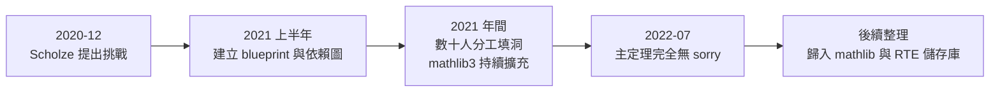

# 5.3 Liquid Tensor Experiment：研究級數學的形式化里程碑

## 本節目標

- 了解 2020 年 Peter Scholze 提出 liquid tensor experiment 的背景與動機
- 認識 condensed mathematics 與「liquid」猜想的數學定位
- 回顧 2022 年 7 月專案完成的過程與社群協作模式
- 掌握幾個技術亮點：analytic 類型、漸進完備性（asymptotic completion）
- 體會這個實驗對「研究級數學可以形式化」信心的確立，以及相關工具的演進

## 起點：菲爾茲獎得主的一個挑戰

2020 年 12 月，波昂大學的 Peter Scholze（2018 年菲爾茲獎得主，perfectoid spaces 的發明者）在他的部落格上提出了一個公開挑戰：**liquid tensor experiment**。

他要求形式化團隊驗證他與 Clausen 合著論文《Analytic ∞-local compact Spaces》及《Bayesian condensed mathematics》中的**核心定理**——一個關於「liquid 張量積」的關鍵引理（論文中稱為 Theorem 9.1 / 9.4 的組合）。Scholze 誠實地說：這是他自己也不完全確信的證明之一，如果形式化發現漏洞，那將是驚天動地的大事。

他在部落格中寫下條件：不要形式化整篇論文，只針對**他夜裡會睡不著覺的那一段推理**。這份挑戰附有他手寫的詳細證明草圖，共約五十頁的數學內容濃縮成幾個關鍵引理鏈。

## 數學背景：condensed mathematics 與 liquid

用一段話定位這組工作的野心：

- **Condensed mathematics** 主張：傳統拓撲空間這個範疇「太瘦」，應該換成 **condensed sets**（凝聚集合，pro-étale 意義下的緊生成層）作為基礎，讓代數與拓撲更好地交換
- **Liquid 張量積**是這個框架中的一個新張量結構，用來取代拓撲向量空間中表現不良的經典張量積
- 應用層面涉及實幾何、表示論、甚至解析數論中的基礎問題

換句話說，這不是「把教科書習題形式化」，而是**把 2020 年前沿研究論文中最細節、最容易被懷疑的部分交給機器檢查**。

## 2022 年 7 月：挑戰完成

專案由 Johan Commelin（數學家、Lean 社群核心成員）領銜，動員了社群中數十位貢獻者。歷程大致如下：



幾個關鍵的運作細節：

- **Blueprint + dependency graph**：團隊先用 LaTeX 寫下「證明藍圖」，每個引理標註其依賴，自動生成網頁版的依賴圖。任何人都能從圖上看到「哪些洞還沒填」
- **Community 分工**：引理被拆成可獨立認領的區塊，貢獻者各自填洞；由於 Mathlib 的單庫策略（見 5.1 節），大家的定義天然相容
- **2022 年 7 月 14 日**，最後一個 `sorry` 被消除，整個證明在 Lean 的核心邏輯之下通過編譯

Scholze 事後的評語大意是：經過這個實驗，他對這個證明**從「大概是對的」升級為「確定是對的」**，而且形式化過程也讓他更清楚證明中哪些步驟是真正的難點。

## 技術亮點之一：analytic 類型

實驗中形式化的一個新概念是 **analytic 類型**（`AnalyticSphere` 及其周邊），這是 Clausen–Scholze 理論中處理「解析結構」的範疇論工具。Lean 依值型別的能力在這裡展現：`∞-`（infinity）範疇論的片段、pro-對象、層（sheaf）等高階抽象都能直接編碼。

這對 Lean 本身也是壓力測試：Lean 3 的型別類解析在深層範疇論推理下常常變慢，實驗過程中累積的效能問題，後來成為 Lean 4 改進的重要輸入。

## 技術亮點之二：漸進完備性（asymptotic completion）

證明的核心技巧之一被 Scholze 稱為 **asymptotic completion**：把一個關於無限對象的命題，化約成一系列有限/離散對象的漸進命題。形式化時，這轉化為對極限與濾過（filtration）結構的大量操作——正是 Mathlib 中濾子（filter）、極限理論的實戰檢驗。

一個代表性片段（概念示意，非逐字引用專案程式碼）：

```lean
-- 概念示意：漸進地逼近一個極限命題
example (P : ℕ → Prop) (hmono : ∀ n m, n ≤ m → P m → P n)
    (hlim : ∀ n : ℕ, ∃ m ≥ n, P m) : ∀ n : ℕ, P n := by
  intro n
  obtain ⟨m, hm, hPm⟩ := hlim n
  exact hmono n m (le_of_lt (lt_of_lt_of_le (Nat.lt_succ_self n) hm)) hPm
```

真正的專案程式碼涉及凝聚集合上的張量積、`SemiNormedGroup` 範疇的反極限等，遠比這複雜，但「把無限命題切有限片段、逐段建立、再黏合」的模式貫穿全場。

## 對「研究級數學可以形式化」的信心確立

在 liquid tensor experiment 之前，形式化數學社群的代表作多半是「已經被充分理解的經典結果」：四色定理、奇數哥德巴赫猜想（Helfgott 證明）、Kepler 猜想。這些當然了不起，但 skeptics 總可以說：**「新的、還沒沉澱下來的研究數學，沒人能形式化。」**

這個實驗打破了那個質疑：

1. **時效**：論文發表後一年多即完成形式化，形式化不再落後數學進展幾十年
2. **難度**：牽涉的是當代最抽象的範疇論與同調代數，不是計算密集型的舊結果
3. **協作規模**：證明了社群分工 + blueprint + Mathlib 這套工作流可以承接大型研究專案
4. **對數學家本人的價值**：連作者本人都因此對自己的證明更有信心——形式化開始扮演「終極審稿人」的角色

此後的指數定理（exponential sums）、FLT 相關的續作、以及 AI 輔助證明專案（如 AlphaProof 時代的訓練資料討論），都在不同程度上踩在這個實驗打下的地基上。

## 相關工具與 lean4 之前的迭代

實驗主體是在 **Lean 3 + mathlib3** 上完成的，這是 Lean 4 尚未成熟時的最後一場大型戰役。過程中催生與磨利的工具包括：

- **Blueprint 工具鏈**（Patrick Massot 開發的 leanblueprint）：LaTeX 藍圖自動生成依賴網頁，之後成為大型形式化專案的標配
- **`Mathlib.Tactic` 的擴充**：為了應付範疇論推理，社群大幅強化了相關 tactic 與 API 設計
- **lean4 的倒逼**：Lean 3 的效能瓶頸（instance 搜尋慢、編譯器本身慢）在實驗中暴露無遺，Lean 4 的重寫把這些當成一級目標——後來整個 Mathlib 成功遷移到 Lean 4，正是這個迭代的果實

## 小結與練習

Liquid tensor experiment 是形式化數學的轉捩點：它證明了「藍圖 + 分工 + 單庫 + 證明助理」的工作流可以在一年多內機器驗證一篇前沿論文的核心定理，並且讓數學家本人成為受益者。它也是 Lean 3 時代的巔峰與絕唱——所有暴露的問題，都在 Lean 4 中得到了回應。

**練習：**

1. 前往 [RTE 儲存庫](https://github.com/leanprover-community/lean-liquid)，找到 blueprint 生成的依賴圖頁面，觀察主定理如何被拆解成引理樹。
2. 閱讀 Scholze 2020 年 12 月的部落格文章，摘錄他對「哪一段證明他最不放心」的描述，思考為什麼形式化能針對性地解決這種不安。
3. 比較 liquid tensor experiment 與四色定理（Coq, 2005）的形式化：兩者在「協作模式」與「對函式庫的依賴程度」上有何不同？
4. 討論題：如果 2026 年要形式化一篇新論文，你會在專案一開始做哪三件事？從 blueprint 的經驗出發說明理由。
