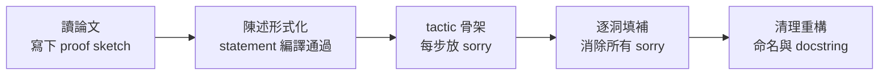

# 5.4 把論文翻譯成 Lean：從陳述到證明的工程流程

## 本節目標

- 建立「定義即型別、陳述即定理」的核心心法
- 學會三段式工作流：proof sketch → tactic 骨架 → 填洞（`sorry`）
- 以 AM-GM 不等式為例，完整示範從論文語句到 Lean 程式碼的翻譯過程
- 掌握 Mathlib 的命名慣例（snake_case、縮寫表）
- 認識常見陷阱：classical vs constructive 推理、choice 函數

## 核心心法：定義即型別，陳述即定理

把一篇數學論文翻譯成 Lean，本質上是一場**語意壓縮**：論文的自然語言裡，「設 G 是一個群」、「令 ε > 0」、「存在唯一的 x」這些句子，在 Lean 中全都有精確的型別表示：

| 論文語句 | Lean 表示 |
|----------|-----------|
| 「設 M 是一個 monoid」 | `{M : Type} [Monoid M]` |
| 「存在唯一的 x 使得 P x」 | `∃! x, P x` |
| 「定義 f 為……」 | `def f : α → β := ...` |
| 「定理 T：P 蘊含 Q」 | `theorem T : P → Q := by ...` |

兩條鐵律：

1. **定義即型別**：一個數學定義翻成 Lean 時，優先考慮「它是一個什麼型別的東西」，而不是「它是怎麼算出來的」
2. **陳述即定理**：先把定理的**陳述（statement）**一字不差地形式化並通過編譯，再開始寫證明。陳述錯了，證明再漂亮也是白工

## 三段式工作流：sketch → 骨架 → 填洞

實務上把一個證明翻進 Lean 的標準流程：



第一原則：**先讓整個檔案的骨架通過編譯，再逐一消滅 `sorry`**。`sorry` 是 Lean 的佔位證明——編譯器知道你在偷懶，會發出警告，但不阻擋你繼續工作。這讓你可以先確認全局推理路徑，再深入各個細節。

## 實戰示範：AM-GM 不等式

**論文語句**（常見的初等敘述）：

> 定理（算術幾何平均不等式）：對任意實數 $a_1, a_2, \dots, a_n \geq 0$，有
> $\dfrac{a_1 + a_2 + \cdots + a_n}{n} \leq \sqrt[n]{a_1 a_2 \cdots a_n}$。

### 第一步：翻譯陳述

先選擇最簡的 $n = 2$ 版本，把句子逐詞映射成 Lean：

```lean
theorem amgm_two (a b : ℝ) (ha : 0 ≤ a) (hb : 0 ≤ b) :
    (a + b) / 2 ≤ Real.sqrt (a * b) := by
  sorry
```

陳述寫好了，**先編譯**。若 `Real.sqrt` 的名字不對，此時就會發現——這正是「陳述先過編譯」的價值。

### 第二步：寫 proof sketch 與 tactic 骨架

論文裡的證明可能是：「移項後兩邊平方，化為 $(a-b)^2 \geq 0$」。把這個意圖翻成骨架——先假設「兩邊非負可平方比較」這個引理存在，細節留成 `sorry`：

```lean

再細化第一個洞：「不等式兩邊非負，故可平方比較」：```lean
theorem amgm_two (a b : ℝ) (ha : 0 ≤ a) (hb : 0 ≤ b) :
    (a + b) / 2 ≤ Real.sqrt (a * b) := by
  have hsq : ((a + b) / 2) ^ 2 ≤ (Real.sqrt (a * b)) ^ 2 := by
    sorry  -- 兩邊展開：左 = (a+b)²/4，右 = a*b
  have hnonneg : 0 ≤ (a + b) / 2 := by linarith
  have hsqrtnonneg : 0 ≤ Real.sqrt (a * b) := Real.sqrt_nonneg _
  have h := sq_le_sq' hsq hsqrtnonneg  -- 骨架期先假設 Mathlib 有這個引理
  linarith
```

### 第三步：填洞

`((a + b) / 2) ^ 2 ≤ (Real.sqrt (a * b)) ^ 2` 這個洞化為代數恆等式：```lean
    have expand : ((a + b) / 2) ^ 2 = a * b + (a - b) ^ 2 / 4 := by
      field_simp
      ring
    have rsq : (Real.sqrt (a * b)) ^ 2 = a * b := by
      rw [Real.sq_sqrt (mul_nonneg ha hb)]
    linarith [expand, rsq]
```

最後得到無 `sorry` 的完整證明。實務中，這些現成的引理（如 `geom_mean_le_arith_mean2_weighted`）在 Mathlib 中早有部署——**先查 Mathlib 再自己證**，是貢獻者的第一美德。

## 命名慣例：snake_case 與縮寫表

Mathlib 的命名有一套近乎形式語法的規則，核心原則是「**讀陳述，猜名字**」：

- **snake_case**：`mul_assoc`、`add_comm`、`exists_eq_left`
- **依賴關係進名字**：定理 `a ≤ b → f a ≤ f b` 對單調 `f` 命名為 `f mono`，如 `Nat.add_le_add`
- **常用縮寫表**：

| 縮寫 | 全名 | 範例 |
|------|------|------|
| `assoc` | associative | `mul_assoc` |
| `comm` | commutative | `add_comm` |
| `le` / `lt` | ≤ / < | `le_of_lt` |
| `iff` | 若且唯若 | `mem_iff` |
| `nonneg` | nonnegative | `abs_nonneg` |
| `homo` / `anti` | 同調 / 反調 | `antitone_map` |
| `simpa` | simplify + assumption | （tactic） |

一致命名的回報是巨大的：`exact?`、`apply?` 這些自動搜尋工具，正因為命名有規律，才能「從陳述猜出引理」。

## 常見陷阱一：classical vs constructive

Lean 的底層是構造主義友善的，但**經典邏輯需要顯式開啟**，而多數數學論文默認排中律與選擇公理。Lean 用 `Classical` namespace 的引理與 `by_cases`、`push_neg` 等 tactic 提供它們：

```lean
-- 「不是假」在經典邏輯下就能得到真——構造邏輯下不成立
example (p : Prop) : ¬¬p → p := by
  intro h
  exact Classical.byContradiction h
```

陷阱在於：過度使用 classical 推理會讓定義「不可計算」（無法 `#eval`）。若目標包含可執行的演算法，應盡量在構造層面工作。

## 常見陷阱二：choice 函數

選擇公理在 Lean 中透過 `Classical.choice` 實現，它讓你能寫出這種定義：

```lean
-- 「取一個滿足 P 的元素」——若 P 不決定唯一元素，這是 choice
noncomputable def some_big_element {α : Type} [Inhabited α]
    (P : α → Prop) (h : ∃ x, P x) : α :=
  Classical.choose h
```

陷阱：

- 用了 choice 的定義必須標記 `noncomputable`，且**無法展開檢視其值**——你只知道它滿足性質，不知道它是誰；每出現一次都值得自問一次
- 若論文說「取一個極大元素」，想想：真的需要 Zorn 嗎？很多時候有構造性的替代（如良序遞迴）

- 出現 `noncomputable` 是正常訊號，每出現一次都值得自問一次
- 陷阱三：定義的「形狀」選錯。翻譯「序列收斂到 L」時，新手常自創 `Prop`，而 Mathlib 的標準形狀是 `Filter.Tendsto`——**先查庫裡的標準形狀，再決定自己的定義**，自創定義是翻譯工作中最大的沉沒成本

## 小結與練習

翻譯論文到 Lean 是一套可學習的工程流程：定義即型別、陳述先過編譯、sketch 對應 tactic 骨架、`sorry` 支援增量填洞、命名遵循「讀陳述猜名字」、對 classical 與 choice 保持警覺。這套流程正是大型專案（如 5.3 節的 liquid tensor experiment）能夠分工的基礎。

**練習：**

1. 把 Lagrange 四平方定理的**陳述**翻成 Lean：對任意自然數 $n$，存在 $a, b, c, d$ 使 $n = a^2 + b^2 + c^2 + d^2$。（提示：Mathlib 有 `Nat.sum_four_squares`，先試自己寫陳述，再比對）
2. 完成上面 AM-GM 證明的骨架版本，練習 `sq_le_sq'` 與 `linarith` 的配合；再查 Mathlib 找官方版本引理名。
3. 選一篇你熟悉論文的某個引理，寫出：論文原文語句 → Lean 陳述 → proof sketch 三段，不需要完成證明。
