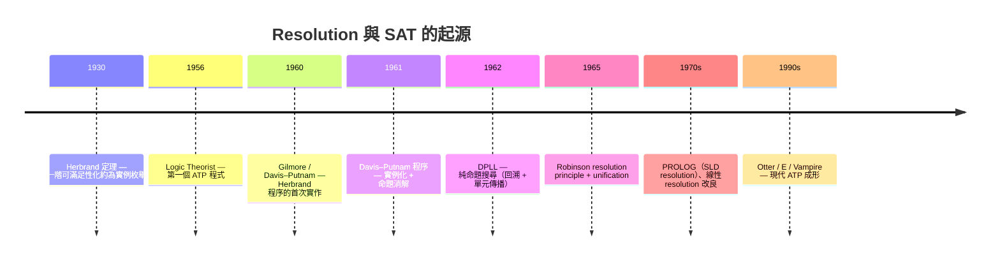
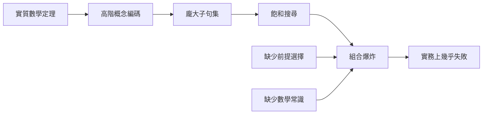

# 6.1 Resolution 與自動定理證明的起點

## 本節目標

- 回顧 1950–60 年代「讓機器自己想出證明」的第一波浪潮：1956 年的 Logic Theorist、1960 年 Gilmore 的工作，以及 1965 年 Robinson 的 **resolution principle** 與 **unification**。
- 理解 **clause normal form**、Davis–Putnam 程序（1960/1961）到 **DPLL**（1962）的演算法脈絡，以及它們如何成為現代 SAT/SMT 的祖先。
- 認識一階邏輯的 **semi-decidability**，以及 ATP 系統（Otter、Vampire、E）與 CASC 競賽的生態。
- 說清一個關鍵的歷史教訓：為什麼這些強大的搜尋引擎，對「實質數學」效果有限——而這個挫折正是本書後半「AI 介入」故事的伏筆。

## 歷史背景：樂觀的 1950 年代

1956 年夏天，Newell、Shaw 與 Simon 在達特茅斯會議的同一時期展示了 **Logic Theorist**——史上第一個自動定理證明程式。它成功重證了《Principia Mathematica》中的 38 條定理，其中一條甚至比羅素與懷海德的原始證明更優雅，兩位作者收到了 Simon 的得意來信。

然而 Logic Theorist 用的是「啟發式往前推」的策略，碰到一階邏輯以上的問題很快就力不從心。真正的轉折點來自兩條不同的研究線：

1. **證明論方向**：Gentzen 的 sequent calculus 與 tableau 方法。
2. **模型論方向**：Herbrand 定理（1930）——一階邏輯的（不）可滿足性可以化約為無限多個「命題邏輯實例」的可滿足性。

1959–60 年，Paul Gilmore 與 Martin Davis 分別把 Herbrand 定理變成可執行的程式，這是「機器證明一階邏輯定理」的第一次真正實作。

## Gilmore（1960）：Herbrand 定理的第一個實作

Gilmore 在 1960 年發表的程式直接實作 Herbrand 程序：

1. 將目標（欲證矛盾）轉為 **Skolem 化的子句集**。
2. 逐一產生 Herbrand 域中的地面（ground）實例。
3. 用命題邏輯方法檢查該有限實例集是否不可滿足。

問題很明顯：Herbrand 域是無限的，盲目枚舉實例會在極淺的問題上爆炸。Gilmore 的程式只能處理非常平凡的例子，但**它證明了這條路在原理上可行**。

**因果驅動**：盲目枚舉實例的爆炸 → 催生了「聰明地只在需要時實例化變數」的 resolution。

## Robinson 1965：Resolution Principle 與 Unification

1965 年 J. A. Robinson 在《Journal of the ACM》發表〈A Machine-Oriented Logic Based on the Resolution Principle〉，這是自動定理證明史上最重要的單篇論文。核心只有兩個概念：

### 1. Clause Normal Form（子句範式）

任何一階邏輯公式都可轉換為邏輯等價（就可滿足性而言）的子句集：

$$\text{前束範式} \to \text{Skolem 化} \to \text{CNF} \to \{\, C_1, C_2, \dots, C_n \,\}$$

每個子句 $C_i$ 是文字（literal）的析取，如 $\lnot P(x) \vee Q(f(x))$。整個問題變成「證明這組子句不可滿足」，即空子句 $\square$ 可以被推導出來。

### 2. Unification（合一）

Resolution 的推導規則是：從 $\lnot P(t_1) \vee C$ 與 $P(t_2) \vee D$ 推出 $C\sigma \vee D\sigma$，其中 $\sigma$ 是讓 $t_1$ 與 $t_2$ 相同的**最一般合一子（most general unifier, MGU）**。Robinson 給了求 MGU 的線性時間（後來改良）演算法，這是「聰明實例化」的關鍵：

```text
子句 1: ¬P(x) ∨ Q(x)        -- 量詞皆視為全稱
子句 2:  P(f(y)) ∨ R(y)     -- 合一：x := f(y)
resolvent:            Q(f(y)) ∨ R(y)
```

有了 unification，機器不再枚舉所有實例，而是**只在兩個子句「即將對撞」的瞬間，才產生恰好需要的實例**。這是組合學上的巨大節約。



## Davis–Putnam 與 DPLL：SAT 的直系祖先

1960 年 Davis 與 Putnam 發表的方法仍需 Herbrand 實例化；1961 年 Davis、Logemann、Loveland 把「命題層」的搜尋獨立出來，成為著名的 **DPLL** 演算法：

```text
DPLL(子句集 Δ):
  1. 若 Δ 含空子句     → 不可滿足（回溯）
  2. 若 Δ 無子句       → 可滿足
  3. 單元傳播 (unit propagation)：遇單文字子句則強制賦值
  4. 純文字消去 (pure literal elimination)
  5. 選一個變數分支出 true / false，遞迴
```

這個 1962 年的演算法，加上 1990 年代的「學習子句（conflict-driven clause learning, CDCL）」與 VSIDS 決策啟發式，就是今天所有工業級 SAT 求解器的骨幹。我們在下一節會看到，**SAT 之上疊加理論推理，就誕生了 SMT**——而 SMT 中的 Z3 直接催生了 Lean。

## 現代 ATP：Otter、E、Vampire 與 CASC

Resolution 在 1970–80 年代經歷大量改良（set-of-support、參數調變 paramodulation 處理等式、項重寫序、完備性標準 superposition calculus），到 1990 年代成為成熟的工程系統：

| 系統 | 起源 | 特色 |
|------|------|------|
| **Otter**（Argonne 實驗室，1988 起） | McCune 等人 | 證明了 Robbins 代數猜想（1996），經典碑石；後繼者為 Prover9 |
| **E**（Stephan Schulz，1998 起） | 自動選項 + 啟發式 | 輕量、穩定，常駐 CASC 前列 |
| **Vampire**（Voronkov 團隊，1994 起） | superposition + 飽和 | CASC 常勝軍，速度業界標竿 |

自 1996 年起，**CASC**（Conference on Automated Deduction 系統競賽）每年讓這些系統同台比賽：給定數千道一階邏輯問題（多來自 TPTP 問題庫），限時數十秒，看誰證明得多。Vampire 長期霸榜。

在「狹窄形式化」的問題上，這些系統確實驚人：Robbins 代數的證明、Feynman 問題集裡的邏輯難題、Mizar 問題庫中不少引理，Vampire 幾秒內即可解出。

## 理論極限：一階邏輯是 semi-decidable

Church（1936）與 Turing 的不可判定性結果適用於一階邏輯的有效性問題。但一階邏輯有個重要中間性質：

> **Church–Turing 定理的精細版**：一階邏輯的定理集合是 **半可判定的（semi-decidable / recursively enumerable）**——完備的證明搜尋程序（如 resolution）若定理為真終將找到證明；但若定理為假，搜尋可能永遠不終止。

$$\text{一階邏輯} \neq \text{可判定} \quad\text{但}\quad \text{存在完備搜尋程序}$$

這解釋了 ATP 的日常工作樣貌：給它 60 秒，它要嘛交出證明、要嘛回報「不知道」。純命題邏輯（SAT）反而是可判定的——這正是 DPLL/CDCL 工業成功的前提，也解釋了為什麼下一節的 SMT 要拼命把問題「下推」到可判定的理論片段。

## 為什麼 ATP 對「實質數學」效果有限？

儘管 CASC 成績亮眼，把 Vampire 直接拿去證現代數學定理卻慘不忍睹。原因有三層：

### 1. 表達能力不足

實質數學大量使用**高階概念**：拓撲的緊緻性、測度論的幾乎處處、泛函的範數收斂。Resolution 針對的是一階邏輯；把高階概念編碼成一階（axiomatize）會產生龐大且對搜尋極不友善的子句集。

### 2. 缺少前置知識（premise selection）

人類證明一段分析，背後是數千條已建立的引理。ATP 面對的子句集若包含整個數學知識庫，飽和程序會被無關引理淹沒。TPTP 競賽裡每題只附上「相關公理」，但真實數學沒有人幫你挑好前提——**「該用哪些已有結果」本身就是難題**，這在 6.4 節會成為搜尋空間分析的核心變數。

### 3. 缺乏中層推理策略

Resolution 是「盲目地完備搜尋」。人類數學家依賴大量非邏輯的常識：先固定 $\epsilon$、再取 $\delta$；對偶性暗示該考察哪個測度。這些啟發式無法塞進飽和引擎。



歷史的結論很清楚：**完備但盲目**的符號搜尋在玩具問題上強大，在實質數學上需要「外掛智慧」。這個缺口有三種補法：

1. 把 ATP 當「後端引擎」，由另一個系統幫它選前提、切小問題 → Isabelle 的 sledgehammer（6.3 節）。
2. 把推理限定在可判定理論 → SMT（6.2 節）。
3. 用統計學習提供啟發 → 早期 ML 嘗試（6.4 節）與 LLM（第 7 章）。

## 小結與練習

本節回顧了自動定理證明的第一個黃金年代：Gilmore 將 Herbrand 定理付諸程式、Robinson 的 resolution 與 unification 提供了「聰明實例化」、DPLL 開闢了命題搜尋的工業道路、Otter/Vampire/E 把 superposition 推向工程高峰。但 Church–Turing 的陰影與實質數學的高階性、知識規模，使純 ATP 停留在「狹窄但快速」的角色。這個瓶頸定義了後續三節的主題。

### 練習

1. 把 $\exists x. \forall y. (P(y) \to P(x))$ 轉為子句範式（記得否定目標後 Skolem 化）。
2. 手工計算子句 $\lnot P(f(x), y)$ 與 $P(z, g(z))$ 的最一般合一子。
3. 對 $n$ 個變數、$d$ 深度的 DPLL 搜尋，最壞情況分支數是多少？單元傳播在什麼情況下能大幅剪枝？
4. 查閱 TPTP 網站，找一道群論問題，用線上 Vampire（或 SystemOnTPTP 介面）嘗試求解；觀察它需要多少秒。
5. 說明「semi-decidable」與「decidable」的差別，並解釋為何 DPLL 能成為可判定 SAT 的完備演算法，而 resolution 對一階邏輯做不到「總會停止」。
