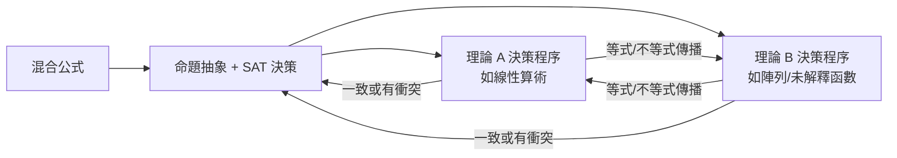
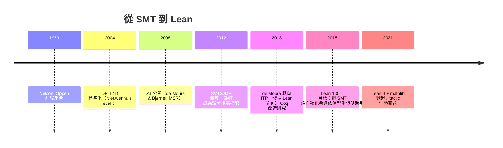

# 6.2 SMT 求解器與 Z3

## 本節目標

- 理解 SMT（Satisfiability Modulo Theories）的本質：**SAT 之上疊加理論推理**（線性算術、陣列、未解釋函數等）。
- 掌握兩大演算法支柱：**Nelson–Oppen 理論組合**與 **DPLL(T)**。
- 認識 2008 年 Microsoft 的 Z3（de Moura 與 Bjørner）及其在軟體驗證（SV-COMP）、Windows 驅動檢查的實務影響。
- 追溯一條關鍵的因果鏈：**Z3 的成功 → Leonardo de Moura 想把 SMT 技術帶進交互式定理證明 → Lean 誕生**；並解析 `linarith`、`omega`、`ring`、`polyrith` 等 Lean tactic 背後的演算法。

## 前因：SAT 的工業成功與「太低階」的抱怨

1990 年代後期，CDCL SAT 求解器（GRASP、Chaff、MiniSat）把可滿足性檢查推到百萬變數規模，硬體驗證業界全面採用。但使用者很快發現痛點：

> 「我只想知道 $x + 2y \le 3 \wedge y - x \le 1$ 有沒有解，為什麼要把它編碼成一萬個布林變數與一萬條子句？」

SAT 求解器只懂布林世界。把整數算術「扁平化」成位元層次的編碼，會摧毀人類一眼可見的理論結構。**SMT 的動機**就在這裡：

$$\text{SMT} = \text{SAT 的搜尋框架} + \text{理論專用決策程序}$$

常見的理論（theories）包括：

| 理論 | 符號 | 典型用途 |
|------|------|----------|
| 未解釋函數（EUF） | $f(x) = f(y) \Rightarrow x = y$ | 記憶體模型、抽象代數 |
| 線性實數/整數算術（LRA/LIA） | $ax + by \le c$ | 排程、資源約束 |
| 陣列理論 | $\text{read}(\text{write}(a, i, v), j)$ | 記憶體陣列、堆驗證 |
| 位元向量 | $x \oplus y$、循環移位 | 硬體/密碼學程式碼 |
| 資料結構 | seq、string | 程式驗證 |

## Nelson–Oppen：把不同理論「接」起來

1979 年 Nelson 與 Oppen 提出經典結果：若兩個**可判定、可凸（convex）、且共享變數被stably-infinite**的理論各自有決策程序，則可以互相傳遞等式資訊組合成整體決策程序。



例子：$f(x - 1) = f(0) \wedge y + 1 = x$。算術部分推出 $x - 1 = 0$，把等式 $x - 1 = 0$ 傳給 EUF 部分，EUF 立即由函數自反性確認一致（或發現矛盾）。**單一理論各自簡單，組合起來能力倍增**——這是 SMT 表達力的祕密。

## DPLL(T)：現代 SMT 的標準架構

2000 年代初，Nieuwenhuis、Oliveras、Tinelli 將 DPLL 推廣為 **DPLL(T)**：

1. SAT 引擎照常做布林搜尋，把原子（如 $x - y \le 2$）當作抽象變數。
2. 每當 SAT 得到一個「候選模型」，呼叫理論求解器（如 Simplex 求線性算術）檢查該原子組合在理論上是否一致。
3. 不一致時，理論求解器回報一組**衝突原子**，SAT 引擎將其學為衝突子句（theory lemma），繼續搜尋。

```text
SAT 引擎：決策 x1=T, x3=F → 得到原子集 { p≤0, q>1, r≠s }
   ↓
理論求解器（Simplex / congruence closure）：發現 p≤0 ∧ q>1 蘊含矛盾
   ↓
回傳衝突集 { p≤0, q>1 } → SAT 學習子句 ¬p ∨ q≤1 → 回溯續搜
```

這個架構讓 SAT 的強大學習能力與理論推理**共生**：理論矛盾轉化為新的布林學習素材。

## 2008 年的 Z3 與它的兩位作者

Nikolaj Bjørner 與 Leonardo de Moura 在 Microsoft Research Redmond 開發了 **Z3**（2008 年公開，2015 年 MIT 授權開源）。Z3 的成功關鍵：

- **統一框架**：所有理論掛在同一個 DPLL(T) 核心，理論間共享衝突學習。
- **高效 Simplex**：de Moura 與 Bjørner 給了處理整數/實數混合算術的強化 Simplex 實作。
- **工程紀律**：增量求解（incremental solving, push/pop）、 UNSAT core、超時掌控——讓它能嵌進大型工具鏈。
- **SMT-LIB 標準**：Z3 是 SMT-LIB 語言事實上的參考實作，形成社群生態。

Z3 至今仍是軟體驗證領域被引用最多的元件之一，Bjørner 與 de Moura 因其獲得多項獎項。

### 實務應用一：Windows 驅動檢查（Static Driver Verifier）

Microsoft 內部最有名的戰績是 **Static Driver Verifier（SDV）**：把 Windows 核心驅動程式碼轉成路徑公式（路徑可行性 = SMT 查詢），用 Z3 檢查每條路徑是否違反 API 使用規則。SDV 成為 Windows Driver Kit 的一部分，**在驅動發佈前抓住整類蓝屏死機（BSOD）錯誤**。工業規模的程式驗證第一次真正「每天都跑」，SMT 是幕後引擎。

### 實務應用二：SV-COMP 與軟體驗證競賽

自 2012 年起的 **SV-COMP**（軟體驗證競賽）中，几乎所有頂尖驗證器（CBMC、Ultimate、CPAchecker 等）都以 SMT 求解器作為後端。驗證器負責把 C 程式轉為公式，Z3（或相近求解器）負責裁決。這是「符號方法 + 強力後端」的標準分工。

## 因果鏈：從 Z3 到 Lean



故事的主角是同一個人：**Leonardo de Moura**。他在打造 Z3 時見證了 DPLL(T) 與理論決策程序的威力，也清楚 ITP（如 Coq）的使用者仍要手寫大量平凡證明。他的野心是：**把 SMT 的自動化水準搬進依值型別系統**。於是他離開 Z3 團隊，自 2012–13 年起在 Microsoft Research 啟動 Lean 專案——Lean 4 的編譯器架構、`omega`、`linarith` 等 tactic，處處可見 SMT 思想的影子。這是「同一作者、同一技術血統」的直接證據，也是本書把 6.2 放在 Lean 章節之前的理由。

## Lean 中 tactic 背後的演算法

Lean 並不直接呼叫 Z3（依值型別與 SMT 的邏輯基礎不同，且可信核心哲學要求 tactic 產出**可被核心檢查的證明項**），但以下 tactic 各自繼承了 SMT 的核心演算法：

### `linarith`：線性算術

把假設中的線性（不）等式配成一組線性組合以導出矛盾。核心思想與 Simplex/Fourier–Motzkin 消去同源：

$$\text{由 } a \le b \text{ 與 } c < d \text{ 消去共同變數，迭代直到導出 } 0 < 0$$

### `omega`：整數/自然數線性算術的前處理器

`omega` 專攻 $\mathbb{Z}$ 與 $\mathbb{N}$ 上的線性約束（含 div、mod、`↑` 提升與 min/max）。它的祕訣是**強力 preprocessor**：先把 `- x`、`x - y ≥ 0`、`n / 2 = k` 等語法糖與類型轉換正規化成標準原子，再交給簡化版 Simplex + 分支限界。6.3 節會再回來看它的 preprocessor 工程。

### `ring`：多項式恆等式

`ring` 證明交換環上的恆等式（如 $(a+b)^2 = a^2 + 2ab + b^2$）。演算法是**多項式正規化**：把兩邊都展開成係數有序的 Horner 形式，比較是否逐項相等。這是可判定的——交換環的恆等式理論是 decidable（等價於檢查多項式恆零）。

### `polyrith`：多項式的代數推理

`polyrith` 是「SMT 思想」最直接的後代：它線上呼叫外部求解器（預設為 Z3 或 Mathematica）**找出**多項式恆等式 $h_1 q_1 + \dots + h_k q_k = \text{goal}$ 的證明線索，再把線索翻譯回 Lean 的 `ring_nf` 與 `linear_combination` 證明項，交給 Lean 核心檢查。**外部求解器只出主意，可信核心負責驗收**——這個「hammer」模式我們在 6.3 節正式命名。


## 小結與練習

SMT 把 SAT 的搜尋力與理論決策程序的精確性結合：Nelson–Oppen 負責「接」，DPLL(T) 負責「搜」，Z3 把兩者工程化到工業規模（SDV、SV-COMP）。而 de Moura 從 Z3 走向 Lean，把「自動化後端 + 可信核心」的分工哲學內建到 Lean 的 tactic 設計中——`linarith`、`omega`、`ring`、`polyrith` 各自是 SMT 演算法在依值型別世界的變形。

### 練習

1. 用 Nelson–Oppen 的精神手推：$f(x - 1) = f(0) \wedge y + 1 = x$ 在 EUF + LIA 下是否可滿足。
2. 說明 DPLL(T) 中「theory lemma」與 CDCL 的「learned clause」的關係。
3. 在 Lean 中嘗試：`example : (a + b) ^ 2 = a ^ 2 + 2 * a * b + b ^ 2 := by ring`，然後把目標故意改錯一個係數，觀察 `ring` 的錯誤訊息。
4. 用 `polyrith` 證明 $a \mid b$ 與 $b \mid c$ 時 $a \mid c$ 的算術版本（提示：設 $b = a k$、$c = b m$）。
5. 比較 `linarith` 與 `omega` 的適用範圍：哪些目標 `omega` 能證而 `linarith` 不能（或反之）？
6. 查閱 SMT-LIB 官網，寫一個 Z3 的 SMT-LIB 檔案，驗證 $x + 2y \le 3 \wedge y - x \le 1$ 在整數上有解。
