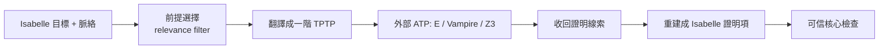

# 6.3 Aesop 與 Tactic 自動化工程

## 本節目標

- 理解 Lean 的 **simp set 生態**：簡化器如何成為整個 tactic 自動化基礎建設。
- 深入 `aesop`（2022）的**最佳優先證明搜尋**設計，以及 `auto`、`slim_check`、decidable instances 等配套機制。
- 剖析 `omega` 的 **preprocessor** 工程，理解「語法正規化」在自動化中的地位。
- 對照 Coq 的 `lia`/`ring`、Isabelle 的 `sledgehammer`（2007），理解 **hammer** 概念：把外部強力引擎接進 ITP 的標準模式。

## 前情提要：自動化的兩難

第 6.1、6.2 節的結論是：resolution/SMT 引擎威力強大，但要嘛表達力不夠（一階邏輯裝不下實質數學）、要嘛與 ITP 的依值型別核心不同源。ITP 使用者每天面對的其實不是深奧定理，而是**成千上萬條平凡步驟**：代數整理、分情況討論、套用已知引理、拆解 if-then-else。自動化工程的核心問題因此變成：

> 如何把「平凡但繁瑣」的推理交給機器，同時**產出的每一步都通過可信核心的檢查**？

## simp set 生態：Lean 自動化的地基

Lean 的 `simp` 不只是個簡化指令，而是一個**開放的知識庫生態**：

```lean
example (n : ℕ) : n + 0 = n := by simp
-- simp 使用者可自訂引理：
@[simp] lemma neg_neg (x : ℤ) : - -x = x := by simp
-- mathlib 中有成千上萬條 @[simp] 引理，依命名空間自動分組
```

關鍵設計：

1. **重寫規則即引理**：任何形如 $lhs = rhs$（或 $lhs \leftrightarrow rhs$）的引理都可標記為 `@[simp]`，由社群維護。
2. **項重寫序保證終止**：`simp` 內部使用項的字典序（類似 Knuth–Bendix order 的精神）確保重寫不會循環。
3. **結構化搜尋**：`simp` 對目標的每個子項反覆套用規則直到不動點，形成「自動化預處理器」，幾乎所有其他 tactic（包括 `aesop`、`omega`）都以它為地基。

mathlib 的 `@[simp]` 引理超過數萬條，維護它們（防止規則互相衝突、把過於強的規則移出 simp set）本身就是一門工程學——這是 ITP 獨有的「知識庫軟體工程」。

## aesop：最佳優先證明搜尋（2022）

`aesop`（**A**utomated **E**xtensible **S**earch for **O**bvious **P**roofs）由 Anne Baanen 開發，2022 年成為 mathlib 標配。它的設計目標是：

> 「像人一樣地搜尋證明：同時嘗試多條路，隨時把資源投給最有希望的那條。」

### 演算法骨架

```text
aesop(目標):
  規則集 = simp 規則 + 結構規則(拆連詞/量詞) + 使用者註冊規則(@[aesop])
  優先佇列 = [(目標, 選定規則, 優先度)]
  loop:
    取出優先度最高的節點
    套用規則 → 產生多個子目標 → 各自帶繼承/新算的優先度入佇列
    直到所有分支關閉（成功）或資源耗盡（失敗）
```

與深度優先或廣度優先不同，**best-first search** 依「子目標看起來多好解」動態排序：子目標越接近假設形式、越像 simp 可關閉的形狀，優先度越高。這讓 aesop 在數學結構明顯的證明上表現遠勝盲目搜尋。

```mermaid
flowchart TD
    G[目標] --> R1{選最高優先規則}
    R1 -->|拆 ∃ / ∧ / 分情況| S1[子目標 1]
    R1 --> S2[子目標 2]
    S1 --> K1[simp 關閉 ✓]
    S2 --> S3[套用 @[aesop] 引理]
    S3 --> K2[剩餘目標 → 繼續]
    K2 --> DONE[全部關閉 → 成功]
```

### 與 `auto`、`slim_check`、decidable instances 的分工

| 工具 | 角色 | 背後機制 |
|------|------|----------|
| `aesop` | 通用結構性證明搜尋 | best-first + simp + 使用者規則 |
| `auto` | 經典「回溯 + 前提鏈」自動化 | 深度優先嘗試 `apply` 一堆引理 |
| `slim_check` | 隨機測試（QuickCheck 移植） | 產生隨機實例找反例，非證明 |
| `decide` | 可判定命題直接計算 | **decidable instances**（類型類驅動的決策程序） |
| `omega` | 線性整數算術 | 見下節 |

**decidable instances** 是 Lean 獨有的巧思：把「這個命題可判定」本身做成類型類，證明搜尋可以信賴它——`if P then ... else ...` 的定義、`decide` tactic、甚至 `simp` 的部分分支，全都依賴類型類系統自動找到對應的決策程序。這是 **Curry–Howard 對應下的「演算法即證明」**：決策程序本身就是 $P \to \text{Bool}$ 的程式，正確性由型別檢查保證。

## omega 的 preprocessor：語法正規化的藝術

`omega`（Lean 4 中由 Robert Y. Lewis 等人打造）專攻線性整數/自然數算術。它的高效能不只來自 Simplex 求解，更來自一個精巧的 **preprocessor**：

1. **分解目標**：把 `x - y ≤ 3`、`n / 2 = k`、`n % 3 < 2`、`min a b`、`Nat` 與 `Int` 之間的 `↑` 等全部轉為標準線性原子的**合取範式**。
2. **產生輔助引理**：對 `div`/`mod` 這類非線性原語，omega 內建「已知事實」（如 `n % d + d * (n / d) = n`）作為附加假設注入問題。
3. **求解 + 回譯**：用線性算術決策程序找反例/證明，再把每步翻譯成 Lean 核心可檢查的證明項。

```text
原始目標: (n + 1) / 2 + (m - n) ≥ m
   ↓ preprocessor: 消 sugar、提升型別、拆 div/mod 為原子+輔助事實
標準形式: 一組線性不等式 ∧  div/mod 輔助引理
   ↓ 決策程序（Simplex + branch and bound）
UNSAT 證明 → 翻譯為 lean 證明項 → 核心驗收
```

**教訓**：自動化的大部分程式碼不在「求解」，而在「把混亂的輸入正規化」。這也是所有 SMT 系統的共同經驗（Z3 的前端程式碼量不亞於引擎本身）。

## 對照：Coq 的 `lia` / `ring` 與 Isabelle 的 `sledgehammer`

### Coq

- `ring`（José Grimm、Loïc Pottier 等，1990s–）證交換環恆等式：與 Lean 的 `ring` 同源，都是多項式正規化。
- `lia`（Linear Integer Arithmetic，2016 起的 Coq elementary tactics 家族）：線性整數算術的反射式決策程序。特色是**反射（reflection）**——把命題轉為 Coq 內部的語法樹資料結構，用 Coq 程式本身驗證求解結果，不依賴外部程式碼。

### Isabelle 的 sledgehammer（2007）

2007 年 Jia Meng、Lawrence Paulson 與後續的 Jasmin Blanchette 等人打造 **sledgehammer**：把 Isabelle 的目標（含整個目標脈絡）轉成一階邏輯（TPTP/SMT-LIB 格式），丟給外部 ATP（E、Vampire、Z3、SPASS），收回證明後**重建為 Isabelle 的內部證明**。



sledgehammer 的三個關鍵工程發明，後來成為所有 hammer 的模板：

1. **Relevance filter**：用統計（詞頻、TF-IDF 式打分）從數萬條引理中挑出最相關的數十條——直接回應 6.1 節的「premise selection 難題」。
2. **多引擎並行**：同時問 E、Vampire、Z3，誰先回來用誰。
3. **證明重建（reconstruction）**：外部 ATP 的證明只當「草稿」，最終證明由 Isabelle 的 `metis` 等 tactic 在系統內重演，保證通過可信核心。

## 「Hammer」概念：模式總結

hammer 的本質是一個**翻譯—求解—重建**的橋接協議：

$$\text{ITP 目標} \xrightarrow{\text{翻譯}} \text{自動引擎的世界} \xrightarrow{\text{求解}} \text{證明線索} \xrightarrow{\text{重建}} \text{可信核心可驗證的證明}$$

Lean 中的對應物：`polyrith`（線上呼叫外部引擎出多項式線索）、歷史上的 `mathlib` 頂層 tactic 組合、以及近年研究性的 SMT 整合方案。共同哲學是：

> **外部引擎可以不完美、可以超時、甚至可以出錯——只要最終證明項通過 Lean 核心檢查，正確性就沒有妥協。**

這是 ITP 自動化與純 ATP 的根本差異，也是 de Moura 從 Z3 到 Lean 一路堅持的設計原則（6.2 節）。

## 小結與練習

Lean 的自動化不是單一演算法，而是**分層工程**：simp set 是知識地基，aesop 是通用搜尋（best-first），`decide`/decidable instances 是型別類驅動的計算，`omega` 展示 preprocessor 的正規化藝術；Coq 的反射式 `lia`/`ring` 與 Isabelle 的 sledgehammer 則從兩側框出「自動化 + 可信核心」的兩條典範。當符號方法仍然不夠時，hammer 的「外部引擎出主意、內部核心驗收」為 AI 介入預留了完美的插槽——這正是第 7 章 LLM 的入口。

### 練習

1. 在 mathlib 中搜尋五條 `@[simp]` 引理，說明各自的 lhs/rhs 與為何適合放進 simp set。
2. 用 `aesop` 證明：`(∃ x, P x ∧ Q x) → ∃ y, Q y ∧ P y`；再故意抽掉 `Q` 的對稱性，觀察 aesop 失敗的模式。
3. 寫一個自訂 `@[aesop]` 規則（提示：`attribute [aesop safe] my_lemma`），讓 aesop 能自動證一個你自選的小引理。
4. 用 `decide` 證 `10 < 100`，並解釋：decidable instance 在這裡扮演什麼角色？
5. 對照 sledgehammer 與 `polyrith` 的流程圖，列出兩者共通的階段與不同之處。
6. 說明「反射（reflection）」與「外部求解器 + 重建」兩種自動化典範在信任模型上的差別。
