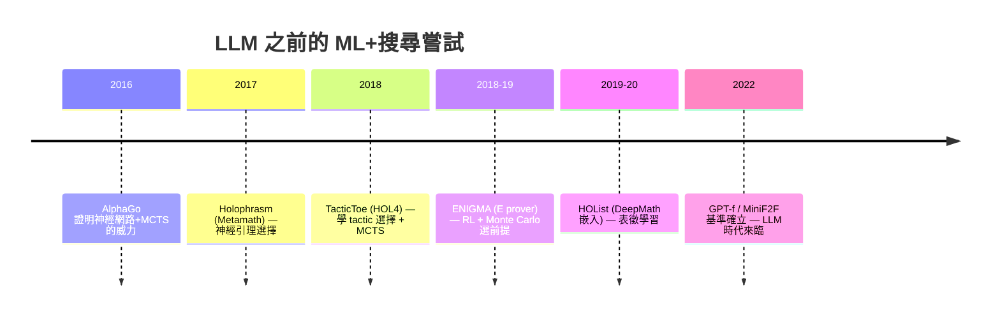
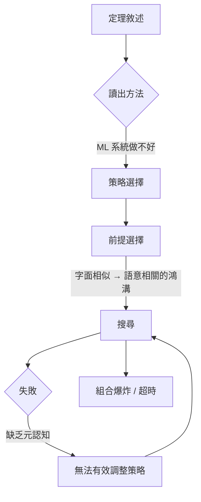

# 6.4 符號搜尋的極限

## 本節目標

- 以定量分析呈現**組合爆炸**：即使 mathlib 有 $10^5$ 條引理，證明深度 $d$ 的搜尋空間仍是天文數字。
- 回顧 2017–2019 年「機器學習 + 符號搜尋」的前 LLM 嘗試：Holophrasm、TacticToe、ENIGMA（reinforcement learning + Monte Carlo）。
- 定位真正的瓶頸：符號系統缺少「數學常識與前後文理解」。
- 論證這個瓶頸正是 LLM 介入的動機——為第 7 章鋪路。

## 組合爆炸：一個簡單但殘酷的算術

設想 Lean 中有 $n \approx 10^5$ 條 mathlib 引理可供 `apply`，且大部分引理會在套用後**產生 $k$ 個新的子目標**（例如 `apply MulLeMul` 之類的引理常留下兩個側目標）。若證明深度為 $d$，粗估的搜尋樹節點數為：

$$\underbrace{(n \cdot k)}_{b}\,\text{為分支因子}， \quad \text{搜尋空間} \approx b^d = (nk)^d$$

帶入樂觀數字（$n = 10^5$、$k = 2$、$d = 5$）：

$$(10^5 \times 2)^5 = (2 \times 10^5)^5 = 3.2 \times 10^{26}$$

這已經遠超人類歷史上所有運算的總和（大約 $10^{22}$ 次基本運算的量級）。深度 $d$ 每增加 1，空間**再乘上 $2 \times 10^5$**。就算把分支因子壓到 $k=1$（很多引理只留一個子目標）、把前提篩選掉 99%（$n = 10^3$），深度 10 的空間仍有：

$$(10^3)^{10} = 10^{30}$$

| 深度 $d$ | 分支因子 $b$ | 節點數 $b^d$ | 對照 |
|----------|--------------|--------------|------|
| 3 | $2 \times 10^5$ | $8 \times 10^{15}$ | 全世界電腦一小時 |
| 5 | $2 \times 10^5$ | $3.2 \times 10^{26}$ | 宇宙年齡×千倍運算量 |
| 10 | $10^3$ | $10^{30}$ | 毫無希望 |

這解釋了 6.3 節所有 tactic 的共同限制：`aesop`、`auto` 都設定**深度與節點上限**，超出即放棄。它們不是「不夠聰明」那麼簡單——**指數空間是資訊理論層面的硬牆**，任何窮舉式符號搜尋都撞同一堵牆。

## 前因：ML + 搜尋的早期嘗試（2017–2019）

既然盲目搜尋不行，2017 年前後的研究者想到：AlphaGo（2016）的成功證明「神經網路給啟發 + 樹搜尋保正確性」的組合可行。能不能照搬？

### Holophrasm（2017，Daniel Whalen）

- 目標：Metamath 資料庫的自動證明。
- 方法：神經網路評估「要套哪條引理」與「要不要展開定義」，配合束搜尋（beam search）。
- 成果：能在 Metamath 上證出一些基礎引理，但離人類水準很遠。
- **教訓**：訓練資料太少（Metamath 的證明僅數千條），神經網路學不到足夠的數學模式。

### TacticToe（2018，Thibault Gauthier 等）

- 目標：HOL4 的 tactic 級自動證明。
- 方法：**學習「何時用哪個 tactic」**，而非逐條引理；結合 Monte Carlo 樹搜尋（MCTS）。
- 成果：在 Sledgehammer 的基準上勝過 sledgehammer 本身，是 tactic 級學習的里程碑。
- **教訓**：以 tactic 為粒度的搜尋比以引理為粒度更省分支，但依賴 HOL4 特定的 tactic 生態，難以移植。

### ENIGMA（2018–2019，Josef Urban 等）

- 目標：E prover 的 premise selection 與引理選擇。
- 方法：用強化學習（梯度提升樹、後來加入神經網路）從大量 ATP 嘗試中學習「哪些引理該選」，配合 Monte Carlo 模擬。
- 成果：在 Mizar 與 E prover 的基準上顯著提升命中率；Urban 的 **Mizar40 / HOList** 系列延續此路線。
- **教訓**：**ML 作為「啟發式」效果顯著，但它提供的只是「比較像的引理」排名**——不足以理解證明的語意。

共同模式：**神經網路當「嚮導」，符號引擎當「保鏢」**。搜尋仍由完備的證明檢查器守門，ML 只負責在指數空間中「指路」。這個模式在原理上正確，卻被一個更深層的問題卡住。

## 真正的瓶頸：缺少數學常識與前後文理解

回顧 6.1 節 ATP 的困境與本節 ML 嘗試的受限，可以歸結為三個「理解」層次的缺失：

### 1. 無法從題目讀出「該用什麼方法」

人類看到「證明 $\epsilon$-$\delta$ 極限」，瞬間知道要用不等式放縮；看到「證明兩個群同構」，瞬間想到要構造映射。這種**從敘述結構到方法策略的映射**，是數十年數學訓練累積的常識。Holophrasm 和 TacticToe 的網路只見過幾千條證明，根本學不到這種映射。

### 2. 無法判斷「哪條引理相關」的語意

前述 premise selection 的統計方法（TF-IDF、詞頻）只看**字面相似**。但數學中「相關」往往是**語意相關**：證明緊緻性時，你可能需要一条名字裡一個字都不重疊的引理（如 Lebesgue 數引理）。當時的嵌入模型（word2vec 級別）無法捕捉這種抽象關聯。

### 3. 無法在「失敗」後調整策略

MCTS 提供了某種「學習型回溯」，但缺乏**中層推理**：人類證明失敗時會反思「我選錯了放縮方向」，而非單純退回上一個節點。這種元認知（meta-cognition）需要對證明目標的語意理解。

## 這個瓶頸就是 LLM 的入口

把上面三個缺失合起來，你會發現它們**恰好是大型語言模型的強項**：

| 符號系統的缺失 | LLM 的對應能力 |
|----------------|----------------|
| 讀不出方法 | 從大量數學文本學會「什麼題型用什麼招」 |
| 語意相關判斷 | 深度嵌入捕捉抽象語意（即使字面不重疊） |
| 缺乏元認知 | Chain-of-thought 式反思、修正 |

而且 LLM 的訓練語料是**人類寫的數百萬頁數學文獻**——Holophrasm 只有幾千條證明，GPT 級模型有 $10^{12}$ 級 token 的數學上下文。「數學常識」第一次變成**可從資料中習得的統計物件**。

這就是第 7 章的主題：

> **AlphaProof、DeepMind、OpenAI 的 o 系列、以及基於 Lean 的 LLM 自動證明系統，本質上都是「LLM 的語意嚮導 + Lean 的符號保鏢」**——把 2017–2019 年 ML+搜尋的模式，升級到擁有真正數學常識的模型。

符號方法的極限，恰好為神經方法劃定了「該補哪塊拼圖」。

## 小結與練習

符號搜尋的極限是資訊理論級的：分支因子 $b = nk \approx 10^5 \sim 10^6$、深度 $d$ 動輒數十的證明，空間 $b^d$ 在 $10^{30}$ 以上，任何窮舉都撞牆。2017–2019 年的 Holophrasm、TacticToe、ENIGMA 證明了「ML 當嚮導、符號當保鏢」的原理正確，但受制於訓練資料與表徵能力，只能處理狹窄基準。真正的瓶頸——數學常識、語意相關、元認知——正是 LLM 的長項，於是自動定理證明的故事在 2020 年代迎來主角更換。

### 練習

1. 若 mathlib 有 $10^5$ 條引理、平均每條留下 $k = 1.5$ 個子目標、證明深度 $d = 8$，估算搜尋空間節點數，並換算成「以每秒 $10^9$ 節點的機器要跑多久」。
2. 說明為何把 $n$ 從 $10^5$ 降到 $10^3$（前提選擇）與把 $d$ 從 10 降到 5（證明切割）對空間的影響**相差幾個數量級**——哪個更重要？
3. 查閱 TacticToe 的原始論文（Gauthier et al., 2018），列出它評估「tactic 選擇」時用了哪些特徵；哪些是字面特徵、哪些已帶語意？
4. ENIGMA 的 premise selection 與 sledgehammer 的 relevance filter（6.3 節）有何異同？哪個是統計式、哪個是學習式？
5. 舉一個「字面不相似但數學上相關」的引理配對例子，並說明為何 word2vec 級的嵌入難以捕捉、而 LLM 級的模型可能捕捉得到。
6. 閱讀 AlphaProof 或類似系統的介紹文章，指出它在 Holophrasm/TacticToe 模式上**保留了什麼、升級了什麼**——作為第 7 章的預習。
