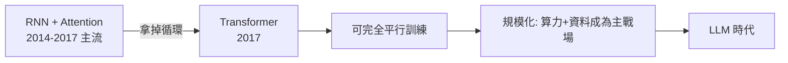
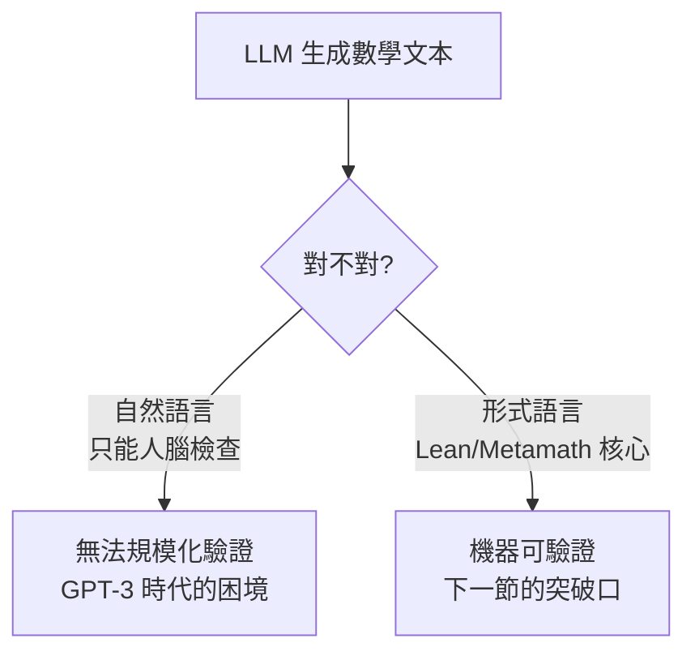

# 7.1 Transformer 與數學語感

## 本節目標

- 回顧 2017 年 "Attention Is All You Need" 如何徹底改變自然語言處理的技術路線
- 理解 2018 年 BERT 與 GPT-1 兩種預訓練範式的分岔，以及為何「下一詞預測」最終勝出
- 探討一個深層問題：單純的語言建模為什麼能學到「推理痕跡」？
- 檢視 2019–2020 年 GPT-2/GPT-3 在數學文本上的 zero-shot 與 few-shot 表現
- 建立直覺：從「預測下一個詞」外推到「預測下一個證明步驟」

## 2017：注意力就是你所需要的一切

2017 年 6 月，Google 的八人團隊（Vaswani、Shazeer、Parmar 等）發表了題為 *"Attention Is All You Need"* 的論文。這篇論文原本的目標很務實：把機器翻譯做得更快更好。當時的主流是 RNN/LSTM 加上注意力機制的混合架構——注意力只是輔助品，序列的處理仍依賴循環結構，而循環意味著**無法平行化**：第 $`t`$ 個詞的計算必須等第 $`t-1`$ 個詞完成。

Transformer 的革命性主張就寫在標題裡：**把循環整個拿掉，只留注意力**。Self-attention 讓序列中每個位置直接「看向」其他所有位置，計算複雜度從 $`O(n)`$ 的序列依賴變成可以完全平行的矩陣運算：

$$
\mathrm{Attention}(Q, K, V) = \mathrm{softmax}\left(\frac{QK^\top}{\sqrt{d_k}}\right)V
$$

這個設定的深遠後果在當時未必被論文作者 fully 預見：**訓練速度不再受限於序列長度的依賴，而是受限於 GPU 算力**。而 GPU 算力，恰恰是可以用鈔票解決的。 Transformer 於是把 NLP 的競賽從「誰的架構設計巧妙」變成「誰的算力與資料多」。

## 2018：兩條路——BERT 與 GPT-1

2018 年，Transformer 開枝散葉，分成兩條預訓練路線：

| | BERT（Google, 2018.10） | GPT-1（OpenAI, 2018.06） |
|---|---|---|
| 訓練目標 | 遮罩語言建模（完形填空） | 自迴歸下一詞預測 |
| 看得到右邊嗎 | 是（雙向） | 否（單向） |
| 擅長 | 分類、抽取式問答等理解任務 | 生成任務 |
| 後續命運 | 2020 年後逐漸式微 | 成為 GPT 系列的起點 |

BERT 的完形填空在 NLP 榜單上曾經大殺四方，但歷史的選擇是 GPT 路線。理由值得細想：**生成式模型必須「把話說完」**。填空題可以靠局部線索蒙混過關；下一詞預測則在語法、語意、事實、乃至邏輯連貫性上**沒有任何投機的餘地**——要預測「因此 $`x = 3`$ 」的下一個詞，模型必須在某種意義上「知道」 $`x`$ 為什麼等於 3。

## 下一詞預測為何能學到推理痕跡

這是本章最核心的理論直覺。表面上，語言模型只是在最小化交叉熵損失：

$$
\mathcal{L} = -\sum_t \log P(w_t \mid w_1, \dots, w_{t-1})
$$

但數學文本的「下一個詞」不是隨機的。考慮一段證明文字：「因為 $`f`$ 在 $`[0,1]`$ 上連續且 $`f(0) < 0 < f(1)`$ ，根據中間值定理，存在 $`c \in (0,1)`$ 使得 ______」。要正確填出「 $`f(c) = 0`$ 」，模型不需要理解什麼是連續——但**在訓練分布上，只有記住了前文所有邏輯依賴的模型才能把這個詞的機率推高**。Ilya Sutskever 有句常被引用的話：預測下一個詞的極限形式，就是預測「產生這段文字的那個過程」。對數學文本而言，那個過程就是數學推理本身。

三個機制使得推理能力在規模化後浮現：

1. **壓縮即智慧**：要壓縮大量人類推理文本，最有效率的內部表徵就是某種推理電路。這與 Kolmogorov 複雜度、Minimum Description Length 的古典洞見一脈相承。
2. **推理痕跡外顯化**：人類寫數學時本來就把思考過程寫在紙上（ lemma、逐步推導、 hence-therefore 結構）。模型見過百萬篇這種文本，自然學會「用文字延展計算」——這正是後來 chain-of-thought 的前身。
3. **上下文學習**：Transformer 的注意力機制允許在推理時於 context window 內「臨時學習」模式，這使 few-shot prompting 成為可能。

## 數學文本作為預訓練語料

GPT-2（2019.02）與 GPT-3（2020.05）的訓練語料都大量包含數學內容：

- **arXiv**：數十萬篇 LaTeX 格式的論文，包含完整的定理—證明結構
- **Stack Exchange 家族**（MathOverflow、Mathematics SE）：問答格式天然是「問題 → 解答」的推理對
- **教科書與講義**：系統性的定義、定理、證明三段式文本

GPT-3 的論文明確列出這些語料來源，並觀察到模型會**自發地**寫出類 LaTeX 的數學段落。這是一個重要訊號：模型不只在模仿格式，它學到了數學寫作的「文法」——儘管這個文法距離「數學的邏輯」還很遠。

## 2019–2020：GPT-2 與 GPT-3 的數學表現

誠實地說，這個時期的表現是**錯誤百出但令人驚訝**。兩個面向同時為真：

**令人驚訝的部分**：GPT-3 論文的附錄展示了不少 zero-shot 的算術與代數樣本——模型偶爾能做三位數加法、解簡單方程式、甚至寫出結構大致正確的證明段落。考慮到它從未針對數學訓練過，這打破了「語言模型只是統計鸚鵡」的簡單預期。

**錯誤百出的部分**：GPT-3 的算術準確率隨位數增加而崩壞（一位數加法近乎全對，多位數則慘不忍睹）；它會自信地寫出「證明」了偽命題的段落；它沒有任何**可驗證性**——你無法機器檢查它說的對不對。

這個困境直接指向本章的主軸：**把 LLM 的生成能力接到一個形式驗證器上**。語言可以錯，但 proof term 經過 kernel 檢查就不會錯。

## 外推：從「下一個詞」到「下一個證明步驟」

把視角拉高，證明助理中的 tactic 證明恰好提供了一種**理想化的數學文本**：

- tactic 腳本就是逐步推理的痕跡（`intro`、`apply`、`rw`……）
- 每一步的正確性由型別檢查器即時裁決
- 人類寫下的幾十萬行 Lean/Metamath/Coq 程式碼，就是現成的「下一個證明步驟」訓練語料

於是自然的外推是：如果「預測下一個詞」能學到數學語感，那麼「預測下一個 tactic」應該能學到證明語感。2020 年的 GPT-f 正是這個外推的第一次嚴肅實作——這是下一節的主題。

## 小結與練習

本節回顧了 Transformer（2017）的架構革命如何使規模化成為可能，比較了 BERT 與 GPT 兩條預訓練路線，並論證了「下一詞預測」在數學文本上訓練後能學到推理痕跡的三個機制：壓縮即智慧、推理外顯化、上下文學習。GPT-2/GPT-3 的數學表現錯誤百出但方向正確，其根本困境是缺乏可驗證性——這正是形式化證明助理要補上的那塊拼圖。

**練習**

1. 說明 RNN 無法平行訓練的原因，以及 self-attention 如何解決這個問題。
2. BERT 的完形填空目標為什麼不利於生成推理痕跡？舉一個具體例子。
3. 給定文本「因為 $`p \Rightarrow q`$ 且 $`p`$ 成立，______」，討論模型在什麼意義上「必須」理解 modus ponens 才能降低損失。
4. 上網找出 GPT-3 論文（Brown et al., 2020）中關於算術任務的表格，畫出準確率隨位數衰減的曲線。
5. 思考題：如果數學預訓練語料中充斥錯誤證明（網路品質參差不齊），下一詞預測會學到什麼？這如何論證「機器可驗證語料」的價值？
