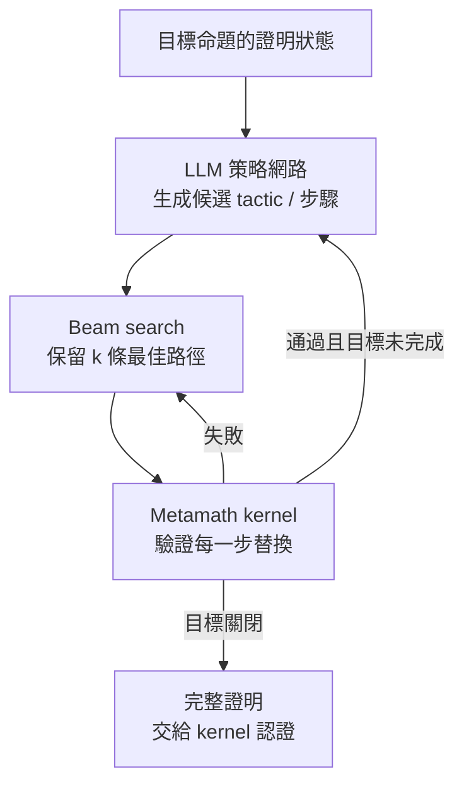

# 7.2 GPT-f 與首批 LLM 證明

## 本節目標

- 認識 2020 年 9 月 OpenAI 的 GPT-f（Polu & Sutskever）：第一個以 LLM 為核心的定理證明系統
- 理解為什麼選擇 Metamath 作為訓練與評測環境
- 掌握「beam search over tactics」的證明搜尋架構
- 回顧 2016 年先驅 Holophrasm，理解 GPT-f 的歷史座標
- 檢視 miniF2F（2021）基準的誕生，以及早期成功率數字的意義

## 2020 年 9 月：GPT-f 登場

2020 年 6 月 GPT-3 論文發表才三個月，OpenAI 的 **Stanislas Polu** 與 **Ilya Sutskever** 就在 arXiv 貼出了 *"Generative Language Modeling for Automated Theorem Proving"*。這篇論文的野心可以用一句話概括：**把自動化定理證明（ATP）問題，轉化為語言模型的最佳化問題**。

Polu 的背景值得一提：他曾是 DeepMind 的早期成員，參與過 AlphaGo 時代的專案，後來到 OpenAI。他對「搜尋 + 學習」範式有切身理解，而 GPT-f 正是把這個範式套到數學證明上——語言模型提供策略直覺（哪個 tactic 值得一試），搜尋演算法提供系統性的探索。

## 為什麼是 Metamath？

GPT-f 沒有選 Lean 或 Coq，而是選了 **Metamath**——一個誕生於 1990 年代、由 Norman Megill 開發的老牌系統。選擇理由有三：

1. **語料純淨且龐大**：Metamath 的 `set.mm` 資料庫經過近三十年累積，有數萬個經人類反覆審查的證明，且全部通過極小的 kernel 驗證。對訓練而言，這是高品質、低噪音的資產。
2. **證明結構簡單**：Metamath 的證明本質是「替換」（substitution）序列，token 數少、結構規整，非常適合塞進當年有限的 context window。
3. **kernel 極小**：驗證核心小到可以輕鬆整合進搜尋迴圈，每個候選步驟都能即時檢查。

代價是 Metamath 的社群與工具鏈遠小於 Lean/Coq，這個選擇後來在歷史上有得有失——GPT-f 的方法論被繼承，但戰場轉移到了 Lean。

## 架構：beam search over tactics

GPT-f 的運作方式是把定理證明看成**在證明狀態空間上的樹搜尋**：

具體而言：

- **策略模型**是一個在 Metamath 證明文本上預訓練、再微調的 Transformer。它接收「當前證明狀態（所有待證子目標）」，輸出下一步的機率分布。
- **價值/目標評估**：GPT-f 也訓練了輔助模型來判斷「這個狀態離證明完成還有多遠」，用於 beam search 的剪枝。
- **關鍵性質**：模型輸出的每一步都經過 kernel 驗證，**錯誤的步驟在物理上不可能進入最終證明**。這與 GPT-3 直接生成自然語言證明有本質區別——幻覺被型別檢查器擋在門外。

## 先驅：Holophrasm（2016）

嚴格說 GPT-f 不是第一個「用神經網路搜尋形式證明」的嘗試。2016 年，Daniel Whalen 的 **Holophrasm** 就已在 Metamath 上用神經網路做證明搜尋（當年還獲得 Metamath 100 資料庫上的成績）。但 Holophrasm 的網路是小規模的、針對任務手工設計的架構，且預訓練語料僅限 Metamath 本身。

GPT-f 的意義在於**範式的成熟**：

| | Holophrasm (2016) | GPT-f (2020) |
|---|---|---|
| 模型 | 小型特製神經網路 | 大規模預訓練語言模型 |
| 語感來源 | 僅 Metamath 資料庫 | 通用文本預訓練 + 微調 |
| 搜尋 | 蒙地卡羅式 | Beam search + 學習式評估 |
| 訊號 | 證明任務專屬 | 語言建模的通用表徵遷移 |

GPT-f 在 Metamath 上創下當時最佳成績：在 Metamath 資料庫的驗證集上，對未見過的命題達到約 **56% 的證明成功率**（含 tactic 級與 statement 級測試），並且**為 set.mm 補上了數十個新證明**（經社群審核後合併）——這是 LLM 生成的證明**第一次以正式身份進入人類的數學資料庫**。這一刻的歷史意義，類比於 AlphaGo 的第 37 手：機器不僅解題，還開始回饋人類的知識體系。

## miniF2F：把比較變得公平

單一系統的亮眼數字難以橫向比較——每個系統測的題目、環境、預算都不同。2021 年，OpenAI 團隊（Mert Unal 等人，與 DeepMind、Stanford 合作）推出 **miniF2F**：一組固定的 244 道競賽級數學題（AMC、AIME、IMO 版本），每題在 Lean、Metamath、Isabelle、HOL Light 等多個系統中都有形式化版本。

miniF2F 的設計哲學：

- **跨系統對齊**：同一道數學題在不同 proof assistant 中語意等價，使不同團隊的系統可以直接比較
- **難度梯度**：從 AMC（高中）到 IMO（奧林匹亞頂端），形成清晰的難度光譜
- **test/valid 分離**：避免 overfitting 到測試集

GPT-f 在 miniF2F v1 上拿到約 **15.4%**（test set）的成績——數字不高，但作為純 LLM + 搜尋的第一代系統，它樹立了基準線。後續所有系統（HyperTree Proof Search、Draft-Sketch-Prove、AlphaProof）都必須在這條基準線上證明自己。

## 這批工作的意義與侷限

GPT-f 時代確立了三件事：

1. **LLM 可以是被核心驗證的證明的來源**——幻覺問題在形式化環境中有結構性解法。
2. **搜尋是必要的**——單次生成（pass@1）遠低於搜尋後的成功率，證明是搜尋問題，正如圍棋是搜尋問題。
3. **資料環境是瓶頸**——Metamath 語料純淨但太小，方法論需要更大的生態系。

侷限同樣明顯：成功率在競賽數學上仍是個位數百分比；環境（Metamath）偏離主流數學社群；訓練資料沒有利用「證明過程中的中間反饋」做迭代改善。這些缺口，正是 2023 年 LeanDojo 與 ReProver 要填補的——見下一節。

## 小結與練習

GPT-f（2020）首次展示大規模語言模型結合 beam search 可以產出經 kernel 驗證的數學證明，甚至在 Metamath 資料庫留下數十個人類採納的新證明。其先驅是 2016 年的 Holophrasm；其遺產是「LLM 策略 + 搜尋 + 驗證」的範式與 miniF2F 基準。侷限在於環境偏小、搜尋反饋未被用於訓練迭代。

**練習**

1. 畫出 GPT-f 的證明搜尋流程圖，標註哪些元件是「學習的」、哪些是「硬邏輯的」。
2. 解釋為什麼「每步都過 kernel」使得 GPT-f 的證明不會有幻覺，而 GPT-3 的自然語言證明會。
3. 比較 Holophrasm 與 GPT-f，說明「大規模預訓練」帶來了什麼本質差異。
4. miniF2F 為什麼要為同一道題準備多個系統的版本？如果沒有跨系統對齊，會產生什麼混淆？
5. 思考題：56%（資料庫）與 15.4%（競賽題）兩個數字差距懸殊，原因何在？這透露了 LLM 證明能力的什麼特性？
