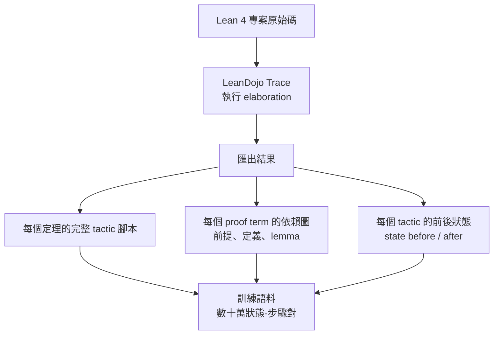
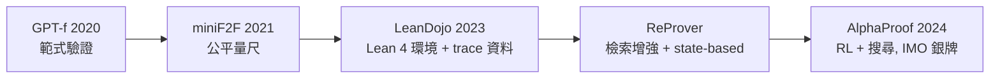

# 7.3 LeanDojo、miniF2F 與 ReProver

## 本節目標

- 梳理 miniF2F（2021）作為跨系統基準的誕生與組織方式
- 認識 2023 年 LeanDojo（Yang et al., Caltech）：Lean 4 上的互動式證明環境
- 理解 trace 機制如何匯出 proof term 的依賴圖，成為訓練資料的引擎
- 掌握 ReProver 的 retrieval-augmented tactic generation 設計
- 說明 state-based 與 statement-based 訓練的差異，以及這些基礎設施如何鋪出 AlphaProof 之路

## 從 GPT-f 到生態系缺口

第 7.2 節結尾留下三個缺口：環境偏小（Metamath）、反饋未被用於訓練、社群不在主流數學圈。2021 到 2023 年之間，學術界用三個計畫逐一填補，最終匯流成 AlphaProof 的地基。

## miniF2F（2021）：競賽數學的共同戰場

miniF2F 由 OpenAI 的 Mert Unal 等人發起，聯合 DeepMind 與 Stanford 共同建置，2021 年首版收錄 **244 道題**（valid/test 各半），全部來自真實競賽：AMC 10/12、AIME，以及多屆 IMO 的選擇題與非選擇題。

它的關鍵工程決策是**跨系統對齊**：

| 系統 | 形式化語言 | miniF2F 中的角色 |
|------|-----------|-----------------|
| Metamath | set.mm | GPT-f 的主戰場 |
| Lean 3 | mathlib | 後續大部分系統的主戰場 |
| Isabelle/HOL | HOL | 欧洲學術圈主力 |
| HOL Light | HOL | DeepMind 早期使用 |

同一道 AMC 題在四個系統中有語意等價的形式化，使得「哪家系統解出多少題」第一次有了公平的量尺。這件事看似平淡，實則關鍵：**沒有共同基準，領域就無法累積**。AlphaGo 時代的經驗告訴我們，可重複測量的評分板（leaderboard）是研究範式成熟的標誌。

值得注意的是 miniF2F 後來遷移到 **Lean 4** 版本（miniF2F-lean4），與本書前章的 Lean 4 生態接軌。

## LeanDojo（2023）：互動式證明環境的工業化

2023 年，Caltech 的 **Kaiyu Yang**（與 Sida Li、Anima Anandkumar 等合作）發表 *LeanDojo: Theorem Proving with Retrieval-Augmented Language Models*（NeurIPS 2023）。LeanDojo 回答的問題是：**如何在 Lean 4 上建造一個可供 LLM 代理互動的程式化環境？**

其核心是一個稱為 **trace** 的機制：

Trace 的價值在於它不只是「跑一次編譯」。LeanDojo 用程式方式深入 Lean 的內部結構，抽出了三層資訊：

1. **腳本層**： tactic 序列（人類寫的推理痕跡）
2. **項層**： 完整的 proof term 與其依賴的 lemma/定義——這是檢索式學習的關鍵素材
3. **狀態層**： 每個 tactic 執行前後的 goal state，構成 `(state, action, next_state)` 三元組

在這個環境之上，LLM 代理可以用標準程式介面（Python）與 Lean 互動：送出 tactic、收到新狀態或錯誤、即時驗證。這就是「互動式環境」的含義——**Lean 從一個編譯器變成了一個 gym**。

## ReProver：檢索增強的 tactic 生成

LeanDojo 論文的另一半是 **ReProver**（Retrieval-Augmented Proof runner），它展示了 trace 資料的最直接用法。設計動機來自一個觀察：人類數學家證明時不會憑空想 tactic——他們會回想「這個引理在文獻裡見過」「這種結構通常用歸納法」。

ReProver 的架構：

1. **檢索器（retriever）**：以當前 goal state 為查詢，從整個 mathlib 的定理/引理庫中找出最相關的 $`k`$ 個 lemma。訓練訊號來自 trace 資料——「證明這個狀態實際用到的 lemma」就是正例。
2. **生成器（generator）**：輸入「當前狀態 + 檢索到的 lemma」，輸出下一個 tactic。
3. **搜尋外殼**：beam search 結合 Lean 的即時驗證，失敗的路徑即時剪枝。

在 mathlib 的真實定理上，ReProver 的 tactic 級成功率明顯超過無檢索的對照組；在 miniF2F 上也達到當時具有競爭力的成績。更重要的是，LeanDojo 的環境與 trace 資料**開源**了，成為 2023 年後所有 Lean 系 AI 證明研究的標準基礎設施。

## State-based vs Statement-based

這裡有一個值得慢下來的理論分岔。訓練/評估 LLM 證明器有兩種資料單位：

- **Statement-based**：模型只看到命題本身，一氣呵成產出完整證明（或完整 tactic 腳本）。優點是簡單、可直接用 pass@k 評估；缺點是沒有中間反饋，錯了就整體失敗。
- **State-based**：模型看到當前證明狀態（可能有多個子目標），只產出下一個 tactic。優點是每步可驗證、可搜尋、可回饋；缺點是環境工程複雜。

GPT-f 與 ReProver 都是 state-based。這條路線的重要性在於：**state-based 環境使得 RL 成為可能**——只要有了 `(state, action, reward)` 的迴路，就能做 policy 改善，而不只依賴模仿學習。AlphaProof 正是走上這一步。

## 通往 AlphaProof 的最後一哩

2024 年，DeepMind 的 **AlphaProof** 在 IMO 2024 拿到銀牌水準的成績（28 分/42 分，6 題中解出 4 題）。它的技術報告與公開資訊顯示幾個要件：

- 主戰場是 **Lean 4**（與部分自動化求解器協作）
- 預訓練語料大量來自 mathlib 及類似 LeanDojo 的 trace 化資料
- 核心方法是 **RL + 搜尋**：在 Lean 環境中對 tactic policy 做強化學習，用驗證結果當獎勵
- 搭配 Gemini 家族的語言模型

而 DeepMind 早期在 HOL Light 時代（2020 前後的 HOList 系統）就與 LeanDojo 路線交會；業界普遍認為 AlphaProof 的環境層直接受益於 LeanDojo 一系的開源基礎（DeepMind 亦曾與 LeanDojo 團隊合作數學資料集，如 putnam-bench 相關生態）。歷史脈絡於是清晰：

每一環都解決一個瓶頸：範式 → 量尺 → 環境 → 資料利用 → 規模化學習。

## 小結與練習

miniF2F（2021）以跨系統對齊的 244 道競賽題建立了公平基準；LeanDojo（2023）以 trace 機制把 Lean 4 變成 LLM 可互動的 gym，並匯出腳本、依賴圖、狀態三層資料；ReProver 展示檢索增強的 tactic 生成；state-based 範式為 RL 打開大門。這條基礎設施鏈直接催生了 AlphaProof。

**練習**

1. miniF2F 的「跨系統對齊」在工程上要解決哪些問題（提示：不同系統的數值型別、自然數定義、集合論基礎都不同）？
2. 說明 LeanDojo trace 匯出的三層資訊各適合什麼用途。
3. ReProver 的檢索器訓練正負例如何構造？為什麼依賴圖是天然的監督訊號？
4. 比較 statement-based 與 state-based：一個強 LLM 若只做 statement-based 生成，會損失哪些能力？
5. 思考題：如果沒有 miniF2F，研究社群會付出什麼代價？請以 AlphaGo 時代的圍棋評分板類比。
