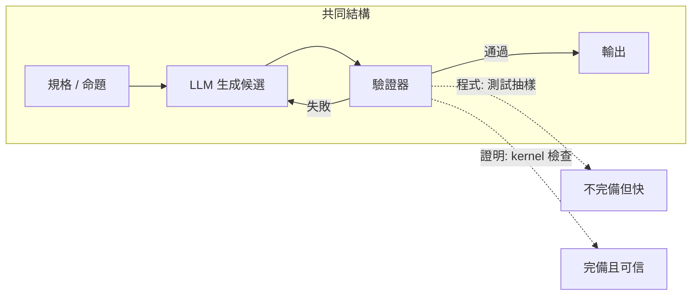
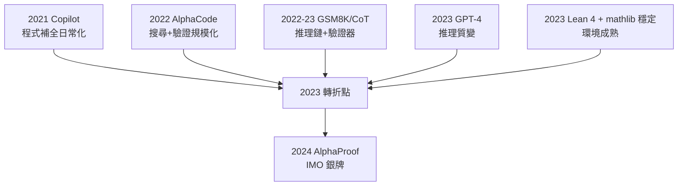

# 7.4 從寫程式到寫證明

## 本節目標

- 回顧 2021–2022 年程式生成技術的爆發：Codex/Copilot 與 AlphaCode
- 檢視 2022–2023 年以 Codex 系模型做數學的成果（GSM8K，Cobbe et al.）
- 分析程式合成與定理證明的異同：兩者都是「搜尋 + 驗證」
- 論證 Lean 作為「可執行的數學 Python」的定位
- 解釋為什麼 2023 年是轉折點：GPT-4 出現 + Lean 4 穩定

## 2021：程式碼成為 LLM 的新戰場

Transformer 與 GPT 路線確立後，下一個自然的語料礦脈是**程式碼**。GitHub 上數千萬個開源儲存庫，是人類寫過的、規模最大、且**語意高度結構化**的文字集合——程式碼不能亂寫，寫錯了跑不起來。

2021 年夏天，兩個事件接連發生：

- **OpenAI Codex**（2021.08 論文）：在 GitHub 程式碼上微調 GPT-3，成為 GitHub **Copilot** 的引擎。Copilot 於 2021 年 6 月預覽上線，把「補全下一行程式」變成了 IDE 裡的日常。
- **人類評估（HumanEval）**：Codex 論文同時發布了 164 道手寫 Python 題的基準，確立「pass@k」作為程式生成的標準指標。

程式碼訓練帶來一個關鍵紅利：**它大幅提升了模型的符號推理能力**。程式本質上是「中間值的鏈條」——變數賦值、條件分支、逐步計算——這與數學的逐步推導同構。2022 年的研究很快證實了這一點。

## 2022：AlphaCode 與競賽程式

2022 年 12 月，DeepMind 發表 **AlphaCode**（Li et al., *Competition-Level Code Generation*），在 Codeforces 平台的競賽題上達到約**前 54%** 參賽者的水準。它的方法論預示了 AlphaProof 的形狀：

1. 大規模**生成候選**（每題生成數十萬個候選程式）
2. 用**範例測試過濾**（sampled examples 剪掉大量錯誤）
3. **聚類**（clustering）保留多樣的代表性解法，只提交少數

搜尋、過濾、驗證——這三件套與 GPT-f 的 beam search、AlphaGo 的 MCTS 在結構上是同一個家族。

## 2022–2023：Codex 做數學——GSM8K 與思維鏈

2021 年 OpenAI 發布 **GSM8K**（Grade School Math 8K）：8.5 千道小學數學應用題。2022 年 3 月，Cobbe et al. 的 *"Training Verifiers to Solve Math Word Problems"* 用 Codex 系模型展示了兩個重要結果：

- **微調 + 驗證器（verifier）**：訓練一個模型判斷「這個解法對不對」，對候選解做重排序，可顯著提升最終正確率——正確答案從約 35%（基準微調）提升到 50% 以上（verifier + best-of-n）。
- 同期，Wei et al. 的 **chain-of-thought**（2022.01）發現：在 prompt 中加入「逐步推導」範例，能讓大型模型在 GSM8K 上跳躍式提升。**把推理寫出來，就是給模型延展計算的空間。**

這兩條線合流的訊息非常清楚：**數學解題 = 生成候選推理鏈 + 用某種驗證機制過濾**。唯一的問題是：那個「驗證器」還是學出來的（神經網路），會犯錯、會被欺騙。什麼驗證器**絕對不會**錯？——形式化系統的 kernel。

## 程式合成 vs 定理證明：同構與差異

把兩個領域並排，會發現驚人的結構同構：

| | 程式合成 | 定理證明 |
|---|---|---|
| 輸入 | 規格（函數簽名 + 範例） | 命題（型別 `Prop`） |
| 輸出 | 程式碼 | 證明（proof term / tactic 腳本） |
| 驗證 | 跑測試 / 型別檢查 | kernel 型別檢查 |
| 搜尋 | 生成候選 + 過濾 | 生成 tactic + 搜尋樹 |
| 獎勵 | 測試通過 | 目標關閉（`Proof finished`） |

依值型別論甚至指出更深的聯繫：**Curry–Howard 對應**下，程式就是證明、證明就是程式。定理 $`P`$ 的證明是型別 $`P`$ 的一個 inhabitant；寫一個型別為 `A → B` 的函數，與證明蘊含式 $`A \Rightarrow B`$ ，在 Lean 裡是同一件事。

差異則在於**語意環境**：

- 程式的「對」由執行結果定義——測試是抽樣的，可能漏掉邊界情況
- 證明的「對」由邏輯定義——kernel 檢查是**全稱的、完備的**（對證明本身而言）

## Lean 作為「可執行的數學 Python」

這個同構指向一個定位：**Lean 之於數學，就像 Python 之於資料科學**。

- Python 把統計/機器學習的想法變成可執行的程式；Lean 把數學論證變成可執行的證明（「執行」= kernel 檢查）。
- Python 有 pip、有社群套件；Lean 有 Lake、有 mathlib（超過一百萬行程式碼的數學函式庫）。
- LLM 學 Python 很有效，因為它可以跑、可以看錯誤、可以自我修正；**LLM 學 Lean 也可以用完全一樣的迴路**——寫 tactic、看編譯錯誤、修正、重試。

這個類比讓「把程式生成的成功公式搬到數學」從口號變成了工程路線圖：Copilot 的補全 → tactic 補全；HumanEval 的 pass@k → miniF2F 的成功率；測試過濾 → kernel 過濾；程式的 RL → 證明的 RL。

## 外卡：DeepMind「用電腦教數學」（2021）

在主線之外，DeepMind 於 2021 年發表 *"Teaching mathematics with computers: A vision for the future"*（Davis et al.），呼籲把形式化數學軟體（包括證明助理與電腦代數系統）變成數學教育的核心工具。這份立場文件常被忽略，但它在時間軸上是一個訊號：**DeepMind 內部已經把「電腦可驗證的數學」列為戰略方向**。同年 DeepMind 的 HOList/Isabelle 工作也在累積「LLM + 互動定理證明」的內部經驗。兩年後的 AlphaProof，正是這條伏筆的兌現。

## 2023：為什麼是轉折點

回顧 2023 年，三件事同時到位：

1. **GPT-4（2023.03）**：通用推理能力跨過門檻。它在專業考試（含數學）上首次展現接近人類專家的水準，chain-of-thought 的品質產生質變。模型夠強，才有資格當證明搜尋的策略網路。
2. **Lean 4 穩定**：2023 年 Lean 4 移植 mathlib 完成（mathlib4），生態從 Lean 3 過渡到效能更好、metaprogramming 更強、可用 Python 橋接的 Lean 4。基礎設施從「研究原型」變成「可用平台」——LeanDojo 正是基於 Lean 4。
3. **範式匯流**：程式生成的「生成 + 驗證 + 過濾 + RL」全套方法論，被明確移植到證明領域（LeanDojo、ReProver、以及後續的 Draft-Sketch-Prove 等）。

此後的故事——AlphaProof 的 IMO 銀牌、DeepSeek-Prover、整數論式的自動化證明大量出現——都建立在這個 2023 年的匯流之上。程式與證明，兩條平行了七十年的河流（從 AUTOMATH 與 ALGOL 的年代算起），在依值型別論與大規模語言模型的交界處正式合流。

## 小結與練習

Codex/Copilot（2021）與 AlphaCode（2022）證明了「生成 + 驗證」在程式領域的威力；GSM8K 與 chain-of-thought（2022）把這套方法套到自然語言數學，但驗證器仍是會犯錯的神經網路。程式合成與定理證明在 Curry–Howard 對應下深度同構，Lean 因此成為「可執行的數學 Python」。2023 年 GPT-4 的推理質變與 Lean 4 生態的穩定同時到位，構成 AI 數學證明的轉折點。

**練習**

1. 畫表比較 Codex、AlphaCode、GPT-f 三者的「搜尋 + 驗證」結構差異。
2. Curry–Howard 對應下，型別 `A → B` 的項與蘊含式證明是什麼關係？用 Lean 的 `Example : 1 = 1 := rfl` 說明「程式即證明」。
3. 為什麼神經網路驗證器（verifier）會被欺騙，而 Lean kernel 不會？這對「best-of-n 選擇」策略有何影響？
4. 討論「測試通過 ≠ 程式正確」與「kernel 通過 = 證明正確」的不對稱，以及它為什麼使定理證明成為更乾淨的 RL 環境。
5. 思考題：如果 GPT-4 提前兩年出現但 Lean 仍是 Lean 3，AI 數學證明的發展會如何不同？基礎設施與模型能力哪個是更強的約束？
