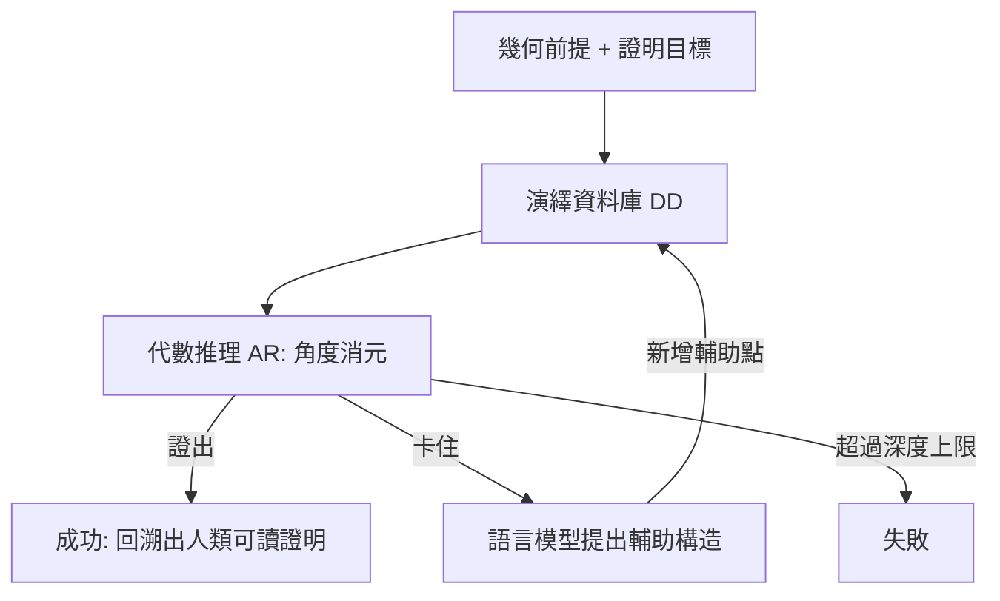
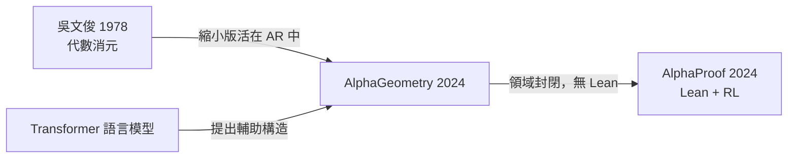

# 8.1 AlphaGeometry 雙腦架構

## 本節目標

- 了解 2024 年 1 月 17 日 Nature 論文《Solving olympiad geometry without human demonstrations》的背景與問題設定
- 理解 AlphaGeometry 的「雙腦」架構：語言模型提出構造、符號引擎完成推導
- 認識合成資料（十億級幾何圖形）如何繞過「人類示範資料不足」的瓶頸
- 掌握 25/30 的結果與吳文俊 WU's method 的對比意義
- 思考 AlphaGeometry 1 的歷史定位：LLM 不用 Lean 也能做數學，但只在特定領域

## 問題設定：IMO 平面幾何

國際數學奧林匹亞（IMO）的平面幾何題，長期被視為「機器推理的試金石」。它具備幾個奇怪的性質：

1. **形式上可完全符號化**：題目就是點、線、圓與角度的關係，天生適合符號引擎
2. **卻極需「靈光一現」**：許多題目的關鍵是畫出一條**輔助線（auxiliary construction）**——這是人類高手的直覺，符號引擎最弱的一環
3. **訓練資料極度稀缺**：人類奧林匹克幾何的證明很少以機器可讀的形式存在，網路上偶爾有解答，但格式混亂、步驟跳躍

DeepMind 在 2024 年 1 月的 Nature 論文選定的評測集，是從 IMO 2000–2022 與預選題中挑出的 **30 道平面幾何題**（剔除需要不等式或非幾何技巧的題目）。這個基準後來成為幾何 AI 系統的標準戰場。

## 前因：符號方法的黃金年代與瓶頸

機器做幾何證明並非新事。早在 1970 年代，張景中、吳文俊等人就發展了幾何定理機器證明的代數方法：

- **吳文俊的 WU's method（1978）**：把幾何命題翻譯成多項式方程組，用特徵列（characteristic set）消元判定。它在「等式型」幾何定理上近乎無敵，能在秒級證出數百條非平凡定理
- **Grobner 基底方法**：同樣走代數路線，把幾何化成理想成員判定

但代數方法有兩個致命限制：

1. **無法處理輔助點**：題目若需要「過 $`P`$ 作圓 $`\omega`$ 的切線交 $`AB`$ 於 $`Q`$ 」這種**新增物件**，多項式系統的變數集都定不下來
2. **可讀性為零**：輸出是多項式消元的痕跡，不是人類能閱讀的幾何推理

於是問題被切成兩半：**代數引擎擅長「驗證既有物件間的關係」，但「該添加什麼物件」無人能答**。在神經網路興起前，添加輔助點只能靠人類寫死的啟發式規則。

## 雙腦架構：語言模型 + 符號引擎

AlphaGeometry 的核心想法極為優雅：**讓兩種互補的系統輪流工作**。

- **語言模型（LM）**：受過幾何語言訓練的 transformer，負責「提出構造」——當符號引擎卡住時，LM 輸出一個輔助點的建構（如 `perpendicular foot A B C` 之類的構造指令）
- **符號引擎（DD + AR）**：
  - **DD（Deductive Database，演繹資料庫）**：由既有事實不斷推出新事實，直到閉包。例如從「 $`AB \perp CD`$ 」與「 $`C`$ 在圓上」推出角度關係
  - **AR（Algebraic Reasoning，代數推理）**：對角度與線性關係做線性代數消元（用一組基底表示所有角度，類似 Grobner 思想但只作用在線性角度空間上，犧牲完備性換取速度）

整個系統是一個**交替搜索**：符號引擎做窮舉式的演繹，窮盡了就請 LM 「畫一筆」再繼續。最終證明可以完全回溯成人類可讀的幾何步驟——這點與代數方法形成鮮明對比。

## 關鍵突破：十億級合成資料

神經方法的天敵是資料。奧林匹克幾何的人類可讀證明太少，直接訓練必死。DeepMind 的解法是**反著生成資料**：

1. 從隨機的幾何圖形出發（隨機撒點、連線、作圓）——不需要題目，只需要「場景」
2. 讓符號引擎（DD+AR）在這個場景上**窮舉演繹出所有可推出的結論**
3. 每條結論都是一道題：圖形中的既有物件是前提，推出的結論是目標
4. 但符號引擎證明時可能依賴大量中間步驟——把證明中的**輔助構造**抽掉之後，剩下的就是「需要輔助點才能解」的難題，而完整證明就是標準答案

這樣一來，**符號引擎本身充當了老師**：它既是出題者也是解答者。DeepMind 用這個方法生成了**三億個定理—證明對**（涉及上十億等級的幾何圖形），覆蓋遠超人類文獻的題型多樣性。這正是第 2 章以來反覆出現的主題的變奏：**形式化系統不只能驗證，還能批量製造訓練訊號**。

## 結果：25/30 與金牌水準

在 30 題基準上：

| 系統 | 解出題數 | 備註 |
|------|---------|------|
| 吳文俊 WU's method | 15 | 加上後處理也只能到 15/30 |
| GPT-4 + 直接提示 | 0 | 幾乎全軍覆沒 |
| 傳統搜尋 + DD/AR（無 LM） | 3 | 輔助點是硬傷 |
| **AlphaGeometry** | **25** | 僅次於 IMO 金牌選手平均 25.9 |

25/30 意味著 AlphaGeometry 平均水準**接近 IMO 金牌選手**（歷年金牌得主在這 30 題上的平均成績為 25.9）。它甚至解出了 2005 年 P6 的幾何題——那道題在當年只有少數選手做出。而且它的證明大多比人類官方解答更「標準化」，因為符號引擎的演繹風格是機械而完整的。

## 與吳文俊方法的對比：兩個時代的對話

WU's method 15/30、AlphaGeometry 25/30，表面是神經方法的勝利，細看卻不然：

- WU's method **不需要訓練、不需要輔助點就能處理它 cover 的等式定理**，速度極快且代數上完備
- AlphaGeometry 的 AR 模組其實就是**縮小版的代數消元**——吳文俊 1978 年的思想以另一種形式活在 2024 年的系統裡
- AlphaGeometry 真正超越的是**構造層**：把「加什麼點」這個组合爆炸的問題交給 LM 的模式識別

吳文俊本人曾期望機器證明「先從幾何做起」。四十五年後，這個願望以神經符號混合的形式實現，可謂歷史的迴響。

## AlphaGeometry 1 的意義與局限

AlphaGeometry 1 的歷史定位需要放在本書的主軸上理解：

**意義：** 它證明 LLM 不依賴 Lean 這類證明助理也能做出金牌級數學——前提是問題被限制在**符號引擎能完全 cover 的封閉領域**。幾何的物件（點線圓）與推理規則（角度、相似、共圓）是有限可枚舉的，這讓「LM 提議、引擎驗證」的分工成為可能。

**局限：** 這個前提恰恰在一般數學中不成立。數論、分析、組合沒有一個「DD+AR」可以窮盡演繹閉包；Lean 本身也不做窮舉。所以 AlphaGeometry 1 是一個**領域特化的解答**，它回答了「LLM 能否做數學」，但把更難的問題——開放領域中 reward 從哪裡來——留給了下一節的 AlphaProof。

## 小結與練習

本節看到 AlphaGeometry 1 如何用「語言模型提構造 + 符號引擎做推導」的雙腦架構、配合合成資料自舉，在 IMO 幾何上達到金牌邊緣（25/30）；也看到它與吳文俊方法的傳承與分野。其關鍵洞見——**形式引擎可以同時當出題者與閱卷者**——將貫穿本章後續所有系統。

**練習：**

1. 解釋為什麼 WU's method 無法處理需要輔助點的題目，而 AlphaGeometry 可以。
2. 合成資料生成中，為什麼要「抽掉輔助構造」再當作訓練題？若直接用符號引擎輕易推出的結論當題目會如何？
3. 嘗試把一道你熟悉的平面幾何題（如三角形中線交於一點）寫成「前提 + 目標」的形式，想想哪一步是 DD 能推的、哪一步需要 AR。
4. 討論：AlphaGeometry 的成功有多少可歸功於神經網路，多少可歸功於符號引擎？若把 LM 換成隨機構造生成器，你估計成績會掉到哪裡？（論文附錄有此消融實驗，數字僅個位數。）
