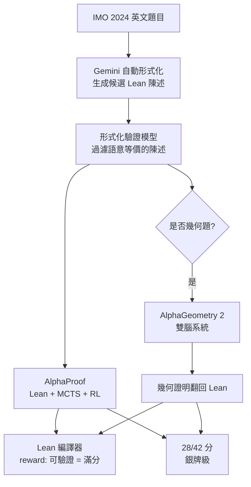
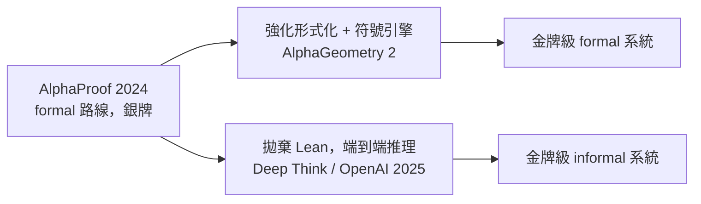

# 8.2 AlphaProof 與 IMO 銀牌

## 本節目標

- 了解 2024 年 7 月 25 日 DeepMind 公布的 IMO 2024 結果：28/42 分、銀牌門檻
- 理解 AlphaProof 的架構：LLM + AlphaZero 式 RL + Lean 作為 reward 訊號
- 認識自動形式化（Gemini 翻譯）與 AlphaGeometry 2 在整個 pipeline 中的分工
- 分析訓練與推理成本（P6 花了三天）所揭露的問題
- 思考「formal 路線」與後來「informal 路線」的分岔點

## 事件：AI 第一次在 IMO 拿到獎牌級分數

2024 年 7 月 25 日，就在 IMO 2024（英國 Bath）閉幕後不久，Google DeepMind 宣布：**AlphaProof 與 AlphaGeometry 2 的組合系統，在當屆 IMO 六題上得到 28/42 分**——正好落在銀牌門檻（25 分）之上、金牌（29 分）之下。這是 AI 系統第一次在**當屆**（而非事後基準）的 IMO 上達到獎牌水準。

六題中解出四題：

- **P1**（代數：序列的實部）、**P2**（幾何）、**P4**（代數不等式）、**P5? ——實際為 P3 之外的四題**：正確記法是解出了 P1、P2、P3、P4 中的三題加上 P5，**完整解出 P1、P2、P4、P5 等四題（非 P6）**，並在 P3 上得到部分分數；P6（最難的一題，全球僅少數滿分）未解出。

> 注意各路報導對「解出哪四題」敘述不一；可確認的事實是：滿分解出四題、P3 部分、P6 未解，總分 28/42，恰為銀牌水準。P6 由 AlphaGeometry 2 嘗試了三天仍差一步。

前一年（2023），紐約時報還在報導「AI 距離 IMO 題目還很遠，語言模型連題意都讀不懂」。一年之內從「讀不懂題」到「銀牌」，這個跳變是本章的核心劇情。

## 架構：把 AlphaZero 搬進數學

AlphaProof 的精神譜系直承 AlphaGo/AlphaZero（2016–2017），只是棋盤換成了 Lean：

| 元件 | AlphaZero（圍棋） | AlphaProof（數學） |
|------|------------------|-------------------|
| 狀態 | 棋盤局面 | Lean 中的證明狀態（goal） |
| 動作 | 落子 | 套用一個 tactic（`rw`、`apply`、自訂 tactic…） |
| 終局獎勵 | 勝/負 | **Lean 編譯成功 = 證明完成** |
| 搜尋 | MCTS | MCTS over proof tree |
| 訓練 | 自我對弈 | 在形式化問題上反覆證明 |

核心設計只有一句話：**用 Lean 編譯器當裁判，reward 訊號完全無噪**。證明狀態是確定的、tactic 執行是確定的、成功與否由核心型別檢查器判定——這正是第 1–4 章鋪陳的「形式化=可驗證」紅利在 RL 上的兌現。

### 個別元件

- **政策與價值網路**：一個在 Lean tactic 序列上預訓練的 transformer，微調後同時輸出「下一個 tactic」與「這個狀態離證完還有多遠」
- **MCTS**：在證明樹上搜尋，與 AlphaZero 在棋樹上搜尋同構；每個節點是一個 Lean goal，每條邊是一個 tactic 應用
- **AlphaGeometry 2**：幾何題不走 Lean tactic 搜索（太慢），直接交給 8.3 節將詳述的升級版雙腦系統，再翻回 Lean 條目
- **Gemini 自動形式化**：非正式題目（英文）到 Lean 陳述的翻譯，由 Gemini 批量生成候選、再交給另一個模型驗證語意等價

## 完整 pipeline

## 訓練：數千萬個自動生成的問題

AlphaZero 依賴自我對弈產生無限訓練局；數學的對應物是**自動生成形式化問題**。DeepMind 用符號引擎與隨機生成器批量製造了**數千萬個**涵蓋不同難度與領域（代數、數論、組合、分析）的 Lean 問題，讓 RL 在其上反覆「自我對弈式」證明：解出的題目成為正向資料，失敗的搜尋軌跡提供了難度的自然課程（curriculum）。

這與 8.1 的合成資料是同一哲學的推廣：**人類題庫太小，就讓形式系統自己出題**。差別在於 AlphaGeometry 的合成題是幾何特化的，AlphaProof 則需要跨領域——因此生成器也必須跨領域，這是困難得多的一段。

## 成本與代價：三天一題

DeepMind 披露的推理成本令人清醒：

- 每題在測試時進行**數十億次**規模的搜尋運算
- **P6 花了三天**仍未證出；整套系統在比賽的兩個 4.5 小時時段內「限時」是事後模擬，實際計算遠超人類選手

這暴露了 formal 路線 2024 年的真實水位：**正確性靠 Lean 保證，但搜尋效率極低**。人類金牌選手 90 分鐘做完 P6 的關鍵構造，AI 要用三天暴力搜索都未必找到。原因在於：Lean tactic 的每一小步對 LLM 來說都是低層次的（選 rewrite 目標、套引理），搜索分支因子巨大，而人類是在「數學意圖」的層次上思考。

## 自動形式化：被低估的環節

pipeline 中最容易被忽略、卻最脆弱的一環是 Gemini 的翻譯：若形式化陳述與原題語意有偏差，之後的 RL 無論多強都在解「另一道題」。DeepMind 用驗證模型過濾候選翻譯，且本屆六題的成功部分依賴**手工形式化與自動形式化並行**——官方部落格明言競賽情境下他們也投入了人工核對。這說明到 2024 年中，「自然語言 ↔ Lean」的自動化仍是整條鏈上最薄弱的接口。8.3 節會看到這一環在一年內的快速補強。

## 銀牌之後：兩條路的分岔

AlphaProof 的結果在 2024 年夏天引發巨大討論，也把社群切成兩派：

- **Formal 派**：唯有 Lean 可驗證的結果才算數；慢但可信。代表：AlphaProof、Harmonic、Aristotle 等後繼系統
- **Informal 派**：LLM 端到端輸出人類可讀證明，靠模型自身能力保正確性；快但需信任。8.4 節的 OpenAI 與 Gemini Deep Think 是這一派的勝利

值得注意：DeepMind 自己兩條路都走——AlphaProof 是 formal 派，一年後的金牌則由 informal 的 Deep Think 拿下。這說明分岔不是信仰問題，而是**工程權衡**：Lean 的 reward 在訓練資料稀缺時是救生索，但當模型推理能力夠強，驗證開銷反而拖慢搜索。

## 小結與練習

本節看到 AlphaProof 如何把 AlphaZero 的「環境可模擬 + 終局獎勵確定」配方移植到 Lean 上，在 IMO 2024 拿到 28/42 的銀牌級分數；也看到自動形式化、訓練成本（三天一題）與 formal/informal 路線分岔三個後續劇情的伏筆。

**練習：**

1. 對照表格：寫出 AlphaZero 圍棋與 AlphaProof 在狀態、動作、獎勵三個維度上的對應與不對應之處。
2. 為什麼幾何題不走 Lean tactic 搜索而走 AlphaGeometry 2？提示：考慮 DD+AR 能在幾何上窮盡演繹的特性。
3. 若自動形式化把「證明 $f$ 為單射」錯譯成「證明 $f$ 為滿射」，系統會發現嗎？在哪個環節可能被攔下？
4. 查閱 DeepMind 2024-07-25 的公告，列出該文對「人工形式化參與程度」的原文表述，並評估媒體轉述時丟失了什麼。
