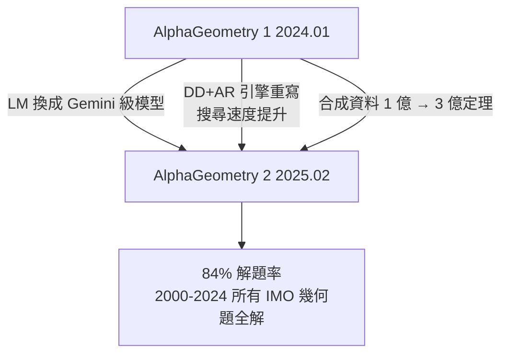
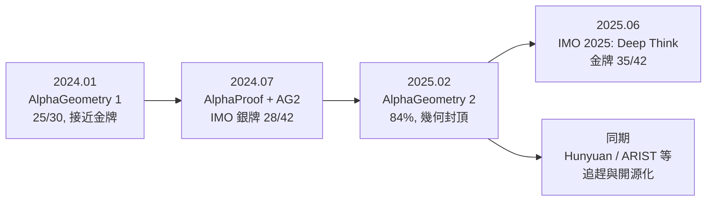

# 8.3 AlphaGeometry 2 與金牌之路

## 本節目標

- 了解 2025 年 2 月 Nature 論文發表的 AlphaGeometry 2 及其 84% IMO 幾何解題率
- 理解升級點：Gemini 驅動的語言模型、Symbolic Engine 的速度提升、合成資料規模
- 認識自動形式化（Formalization Pipeline）在系統中的角色
- 概觀同期其他系統（騰訊 Hunyuan、ARIST 等）的競爭格局
- 把 AlphaGeometry 2 放回「金牌之路」的時間線上

## 從 25/30 到 84%：2025 年 2 月的 Nature 論文

2025 年 2 月 5 日，DeepMind 在 Nature 發表 AlphaGeometry 2 的完整論文。此時距 AlphaGeometry 1 的論文剛好一年，系統在幾何上的表現從「金牌邊緣」躍升到**近乎全解**：在包含 IMO 幾何題的擴充基準上，AlphaGeometry 2 解出 **84%** 的題目，大幅超越金牌選手的水準，且能解出 **2000–2024 年間所有 IMO 幾何題**（此前唯一未解的 2005 年 P6 在 2024 年 6 月即被 AlphaGeometry 2 攻克）。

這個數字意味著：**在平面幾何這個封閉領域，機器已經達到、甚至超越人類頂尖水準**。剩下的問題只剩「領域之外的推廣」。

## 三大升級

### 1. 語言模型升級：Gemini 級規模

AlphaGeometry 1 的 LM 是一個相對小的自訓 transformer；AlphaGeometry 2 改用**基於 Gemini 架構的大規模語言模型**做構造提議。更大規模帶來的不只是「猜得更準」：

- 構造建議更少冗餘，減少搜索樹的分支因子
- 對罕見構造（如反演、特定比例點）的模式泛化更強
- 與後續的自動形式化共用同一模型家族，工程上更順

### 2. 符號引擎（DD+AR）重寫與加速

Symbolic Engine 完全重寫，論文強調**搜尋速度大幅提升**（超過兩倍以上的有效推理速度），具體手段包括：

- 演繹資料庫（DD）的資料結構與批次推論優化，更快到達事實閉包
- 代數推理（AR，角度空間的線性消元）的算法改進
- 與搜尋的更緊密整合：LM 提議的構造能更早被評估、剪枝

在「雙腦架構」中，符號引擎每快一分，同樣算力預算下能探索的構造序列就多一個數量級——這是組合搜索的乘法效應。

### 3. 合成資料規模：3 億定理

合成資料從 1 代的約 1 億（ $`10^8`$ ）定理—證明對成長到 **3 億（300M）定理**，且生成管線更難、更多樣：隨機場景更複雜、演繹閉包更深，因而抽出的「需要輔助構造」的難題比例更高。訓練資料的難度分佈直接決定 LM 在真實 IMO 題上的構造命中率。

## 自動形式化的進步

1 代只用於幾何的內部語言；2 代加入了**形式化管線**：把自然語言題目自動翻譯成系統的幾何語言（如 `perpendicular foot`、`circle with diameter` 等構造語法），並用翻譯出的陳述直接驅動證明搜索。這一步的意義超過幾何本身——它是 DeepMind 在「自然語言 → 形式語言」這條路上交的第一份大規模學費，直接餵養了 AlphaProof 的翻譯模組與後續系統的 end-to-end 形式化能力。

換句話說，AlphaGeometry 2 不只是一個幾何 solver，也是**自動形式化技術的練兵場**。

## 同期競爭者：Hunyuan、ARIST 與其他

AlphaGeometry 的成功在 2024–2025 催生了一批跟進系統，說明「神經 + 符號」配方在幾何上的可複製性：

- **騰訊 Hunyuan（HunyuanGeometry 等）**：2024 年底至 2025 年，騰訊混元團隊發表了結合大型語言模型與幾何符號工具的系統，報告在 IMO 幾何基準上接近 AlphaGeometry 2 水準，並探索把構造能力整合進通用 LLM
- **ARIST / ARISToBATE**：學術圈（如希臘雅典團隊）發展的幾何自動求解器系列，走符引引擎 + 學習式構造選擇的路線，在多個幾何資料集上與 AlphaGeometry 系統直接比較
- **開源復現**：AlphaGeometry 1 的程式碼與模型已開源，衍生出多個社群復現與改良版，使「LM + DD/AR」成為幾何 AI 的事實標準架構

這個格局與第 5 章 Mathlib 的社群動態形成對照：Mathlib 靠社會契約統一基礎，幾何 AI 則靠**開源權重與公開基準**統一戰場——兩者都是「公共基礎設施加速領域整體進步」的例子。

## 金牌之路的時間線

注意一個微妙的轉折：AlphaGeometry 2 把幾何做到 84% 之後，幾何反而**不再是瓶頸**——2024 年 P6 卡住的部分，和 2025 年系統的短板，都轉移到了**代數、數論、組合**這些沒有專用符號引擎的領域。這直接解釋了 8.4 節的路線選擇：與其為每個領域造一個 DD+AR，不如讓通用推理模型端到端地學會所有領域。

## 意義：領域特化的天花板

AlphaGeometry 2 是「領域特化符號系統」的巔峰之作，也標記了這條路線的天花板：

1. **它能 cover 的領域，機器已近滿分**——幾何宣告被攻克
2. **它的配方無法直接外推**——沒有第二個數學領域擁有幾何那樣「演繹閉包可計算」的性質
3. **它提供的技術（大模型構造、形式化管線、合成資料）全部被通用系統吸收**——AlphaGeometry 2 作為獨立系統的歷史使命在 2025 年年中即告完成，其組件活在 Deep Think 時代的系統裡

## 小結與練習

本節看到 AlphaGeometry 2 用 Gemini 級 LM、重寫的符號引擎與 3 億合成定理把 IMO 幾何推到 84% 的近滿分水準，以及自動形式化管線與同期競爭者的格局；也看到領域特化路線在封頂之後，如何把接力棒交給端到端的通用推理系統。

**練習：**

1. 搜尋分支因子的角度解釋：為什麼符號引擎「速度提升兩倍」能換來解題率的跳躍，而不只是時間省一半？
2. 比較 AlphaGeometry 2 與 Hunyuan 幾何系統的公開資料（論文或技術報告），各列出兩個技術差異點。
3. 為什麼數論不存在「演繹閉包可計算」的性質？舉一個具體例子：給定命題「 $`2^{82,589,933}-1`$ 是質數」，什麼是它的「閉包」？
4. 討論：如果你是 2025 年初的 DeepMind 研究者，面前有「繼續為代數/數論造專用符號引擎」與「押注端到端推理」兩條路，你會如何評估？8.4 節將揭曉實際選擇。
