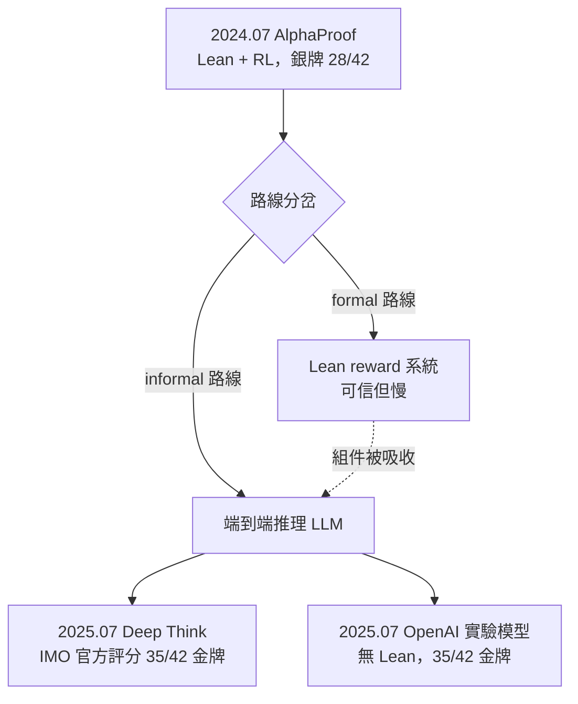
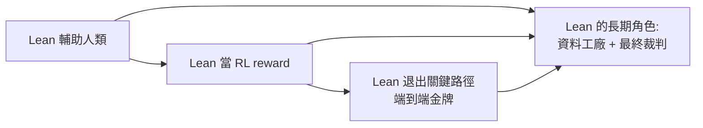

# 8.4 IMO 金牌級 AI 系統

## 本節目標

- 記錄 2025 年 6–7 月的標誌性事件：Gemini Deep Think 與 OpenAI 實驗模型雙雙達到 IMO 金牌級（35/42）
- 對比兩家系統的關鍵差異：DeepMind 接受 IMO 官方評分，OpenAI 用自然語言不經形式驗證
- 分析 formal 與 informal 路線的分歧與合流
- 梳理 AI 數學證明從「Lean 輔助」到「端到端推理」的完整演進
- 為第 9–10 章（研究級數學）拋出問題：研究數學何時被攻克？

## 事件：2025 年 7 月，金牌級的「同時」宣布

2025 年 7 月 19–20 日，兩則重磅消息在 48 小時內接連發布：

- **Google DeepMind**：宣布 Gemini Deep Think 在 **IMO 2025（澳洲 Sunshine Coast）**上以 35/42 分達到**金牌級**。關鍵在於這次是**正式協作**：IMO 授權 DeepMind 在比賽結束後、成績公布前讓系統在正式賽題上作答，並由 **IMO 官方（兩位資深前屆獎牌得主/協調者）按奧林匹亞評分規則閱卷**。這是第一次由 IMO 官方背書的評分
- **OpenAI**：宣布其實驗推理模型（尚未公開、後演化為 GPT-5 系的推理能力）同樣解出 **35/42，五題全解六題中五題**，達到金牌級。但評分由**三位前 IMO 金牌得主**按官方評分標準評閱，屬 OpenAI 委託的評估，且模型輸出是**純自然語言證明，未經任何形式系統（Lean）驗證**

兩則消息在數學與 AI 社群引發的震撼，不亞於 2016 年 AlphaGo 對李世乭。從 8.2 節的銀牌（2024.07）到金牌（2025.07），只用了整整一年。

## 兩條路線的正面交鋒

| | Gemini Deep Think（DeepMind） | OpenAI 實驗模型 |
|---|---|---|
| 分數 | 35/42，金牌級 | 35/42，金牌級 |
| 輸出形式 | 自然語言證明 | 自然語言證明 |
| 驗證 | IMO 官方授權、按奧林匹亞規則評分 | OpenAI 委託三位前金牌得主評分 |
| 是否用 Lean | **否** | **否** |
| 計算模式 | 端到端推理（Deep Think 多步思考） | 端到端推理（大算力測試時推理） |
| 資訊公開 | 官方部落格 + IMO 協作聲明 | 未發論文，僅公告，引發社群爭議 |

值得強調：**兩個金牌系統都沒有用 Lean**。2024 年 AlphaProof 的核心支柱——形式驗證作為 reward——在 2025 年的金牌系統中消失了。原因在 8.3 節末尾已埋下：當模型的推理能力足夠強、訓練資料足夠豐富，Lean 的搜索開銷反而是拖累；且 IMO 解答的正確性可以由人類專家評審（這正是 IMO 本身的制度），形式化不再是必要條件。

## OpenAI 公告的爭議

OpenAI 的宣布伴隨爭議：評分非 IMO 官方、結果未附論文、且時機選在 IMO 官方宣布前搶先發布。數學界與 AI 界對「金牌級」一詞的使用是否嚴謹辯論激烈。對照之下，DeepMind 與 IMO 的正式協作樹立了後續年份的評估範式。這段插曲本身有歷史價值：它顯示在**正確性的制度化標準**缺位時，AI 結果的可信度要靠評估程序的公信力支撐——而 Lean 一類形式驗證恰恰是另一種（更強的）公信力來源。兩種公信力制度的競合，是第 9 章討論研究數學時的核心主題。

## 從 Lean 輔助到端到端：四年演進總覽

把本書第 6–8 章的時間線合起來看：

| 年份 | 里程碑 | Lean 的角色 |
|------|--------|------------|
| 2021–2023 | LLM 生成 tactic（如 ReProver 類系統） | 輔助人類寫 Lean |
| 2024.01 | AlphaGeometry 1：幾何金牌邊緣 | 不用 Lean（領域符號引擎） |
| 2024.07 | AlphaProof：IMO 銀牌 28/42 | Lean 為核心 reward |
| 2025.02 | AlphaGeometry 2：幾何 84%，封頂 | 內部形式語言 + 自動形式化 |
| 2025.07 | Deep Think 與 OpenAI 模型：IMO 金牌 35/42 | **不用 Lean** |

演進的邏輯是：**驗證從「外部硬約束」內化為「模型能力」**。早期 LLM 需要 Lean 告訴它對錯；端到端推理模型在足夠大的算力與資料下，把「什麼樣的證明會被接受」學進了模型本身。這不代表 Lean 沒用了——它仍是訓練資料的製造機、可靠性的最終裁判——而是說在 IMO 這個「人類評審即時可判」的封閉任務上，形式驗證不再位於關鍵路徑。

## 金牌之後：研究數學何時被攻克？

IMO 是中學數學的封閉競技場：題目有標準答案、長度可控、方法在教科書範圍內的延伸。金牌達成後，問題自然升級為**研究級數學**：

1. **沒有標準答案**：研究問題可能開放數十年，無法即時驗證
2. **沒有長度界**：證明可能長達百頁（或如 liquid tensor experiment 般需要大量 Lean 工程）
3. **形式化缺口**：自然語言研究的最新結果，與 Mathlib 的形式基礎之間仍隔著鴻溝
4. **評審制度**：誰來評 AI 的研究級證明？IMO 的「官方評分」模式在研究前沿沒有對應物

2025 年年中，Google DeepMind 同時發布 **AlphaEvolve** 與對研究的探索（如協助形式化 Fermat 大定理的專案、與 Terence Tao 等數學家的合作實驗），OpenAI 與 Harmonic 等公司也在推進研究生級的 benchmark（如 FrontierMath、及後續的 open problems）。第 9 章將以「人機協作的形式化研究」為主軸，第 10 章則討論這條路的終點形態——研究數學被 AI 系統性攻克的條件與時間表。

一個可以帶進下章的判斷：**IMO 金牌證明的是「廣而淺」的能力已就位；研究數學考驗的是「深而長」的能力，兩者的瓶頸不同**。形式化（Lean/Mathlib）在後者中反而可能重新變得關鍵——因為研究級證明的可信度問題，正是形式驗證的用武之地。

## 小結與練習

本節記錄了 2025 年 7 月 Deep Think 與 OpenAI 模型同時達到 IMO 金牌級（35/42）的歷史事件：DeepMind 走 IMO 官方授權評分的正式路線，OpenAI 走自然語言、無 Lean 驗證的爭議路線；兩者共同標誌 AI 數學證明從 Lean 輔助、Lean 當 reward，走到端到端推理的三階段演進。Lean 退出了 IMO 關鍵路徑，卻在研究級數學的可信度問題上獲得新生命。

**練習：**

1. 列出 DeepMind 與 OpenAI 2025 年 IMO 結果在評估程序上的四項差異，並說明各項如何影響結果的可信度。
2. 辯論題：「沒有 Lean 驗證的金牌證明」與「有 Lean 驗證但花了三天」哪個對數學更有價值？從可讀性、可信度、可複用性三個維度分析。
3. IMO 評分靠人類協調者的制度與 Lean 編譯器的制度，各自假設了什麼？哪一種在研究數學中更難複製？
4. 查閱 DeepMind 2025-07 的公告原文，找出「IMO 官方協作」的具體描述（時間、閱卷人、流程），並與 OpenAI 公告對照。
5. 預習性思考：如果一個系統證明了一個開放問題（如黎曼猜想級別），你認為在數學界被接受前，形式化到 Lean 是必要條件嗎？寫下你的立場，第 10 章後回頭檢驗。
