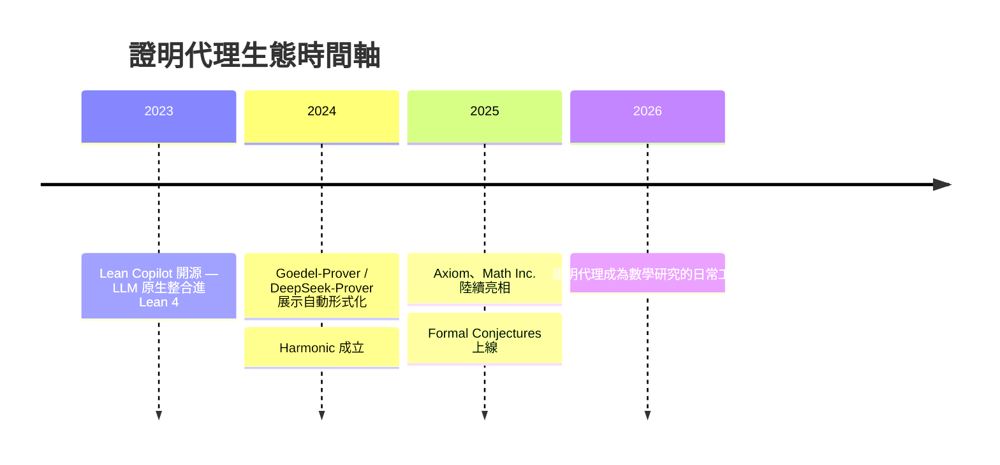
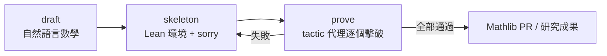

# 9.1 證明代理與新創生態

## 本節目標

- 回顧 Lean Copilot（2023）如何開啟「LLM 補 tactic」的先河
- 認識 2024–2025 年涌入的證明 AI 新創：Harmonic、Axiom、Math Inc.
- 了解開源陣營的代表：Numina、Goedel-Prover、DeepSeek-Prover
- 掌握 draft–skeleton–prove 工作流：AI 輔助形式化的標準模式

## 從輔助到代理：生態的爆發點

第五、六章我們看到 Lean 本體與 Mathlib 的成熟；第七、八章看到 LLM 開始學會寫證明。到了 2023–2025 年，這條線演化成一個完整的產業生態：**以 Lean 為驗證核心的證明代理（proving agent）**。

爆發的因果鏈很清楚：

1. **Mathlib 規模夠大**：超過百萬行，涵蓋大學數學主體，證明代理「有料可查」
2. **編譯器即裁判**：Lean 給出免費、絕對可靠的訓練訊號（第 9.3 節詳述）
3. **LLM 程式碼能力躍進**：2022 年後 code model 爆發，tactic 腳本對 LLM 來說就是另一種程式碼

## Lean Copilot（2023）：免費的第一哩

2023 年，Paula Petride 與 Kaiyu Yang 等人發布 **Lean Copilot**，這是第一個在 Lean 4 內原生整合 LLM 的開源框架。它不做任何行銷、不需訂閱，直接跑在本地或免費推論服務上，提供三個功能：

- **tactic 補全**：像 GitHub Copilot 補程式碼一樣補證明步驟
- **證明搜尋**：自動嘗試 `aesop`、`ring`、`linarith` 等組合
- **引理推薦**：從 Mathlib 中找出你該引用的定理

Lean Copilot 的價值不在模型多強，而在**證明了整合路徑**：LLM 可以作為 Lean 的外掛，編譯結果可以回饋給模型。後來所有新創與開源代理的架構，都是這條路的延伸。

## 新創陣營：資本進場

### Harmonic：Vlad Tenev 與 Aristotle

2024 年，Robinhood 共同創辦人 **Vlad Tenev** 與前 DeepMind/Google 研究員 Sunny Zhou 成立 **Harmonic AI**，目標是打造「數學超級智慧」。其核心系統名為 **Aristotle**，以 Lean 作為驗證層。

Harmonic 的賣點是「**防幻覺數學**」：任何 Aristotle 產出的結論都經過形式驗證，絕不會「編造定理」。2025 年，Harmonic 宣布 Aristotle 在形式化數學基準上達到超越人類金牌水準的競賽表現，並把攻堅目標指向重大開放問題（包括黎曼猜想相關特例的探索）。Tenev 的論述很有代表性：數學是 AI 的「完美體育場」——答案可驗證、報酬明確，而且數學能力會外溢到軟體工程與科學。

### Axiom：John Schulman 與「為數學家打造的 agent」

2025 年成立的 **Axiom** 由前 OpenAI 共同創辦人 **John Schulman**（ChatGPT 強化學習關鍵人物）主導。它明確定位為「給數學家的 AI 代理」：不是取代數學家，而是替他們完成形式化、查文獻、驗算、填補引理這些枯燥環節。Axiom 的存在本身說明了一件事——**RL 領域的頂級人才認定形式化數學是下一個「AlphaGo 時刻」的賽場**。

### Math Inc.：Gauss 與 strong prime conjecture

2025 年成立的 **Math Inc.** 走另一條路：不做消費者產品，直接展示研究級成果。其系統 **Gauss** 在「strong prime conjecture」（強質數猜想的一個變體）上完成 AI 輔助的形式化證明，成為第一個由專業證明代理攻下未解問題（變體）的公開案例之一。這標誌著證明代理從「競賽題」邁向「研究題」的轉折。

## 開源陣營：模型為王

與新創並行的是開源自動證明模型的快速迭代：

- **Numina**：以大量合成 Lean 問題訓練，強調開放資料與多階段訓練流程
- **Goedel-Prover**（2024）：史丹佛團隊，用 statement 自動形式化 + 證明搜尋的兩段式管線，在 miniF2F 上刷新紀錄
- **DeepSeek-Prover**（2024–2025）：DeepSeek 系列，以大規模合成資料與 RL 訓練，證明通過率快速攀升

這些模型共同的使用模式，就是所謂的 **draft–skeleton–prove 工作流**。

## draft–skeleton–prove 工作流

無論模型來自哪家，實務上都收敛到同一個三段式管線：

1. **Draft**：把自然語言證明（論文草稿、習題解答）交給 LLM 理解
2. **Skeleton**：產出 Lean 骨架——所有 `theorem` 敘述與 `sorry` 佔位。此步檢查「敘述是否形式化正確」
3. **Prove**：證明代理對每個 `sorry` 迴圈攻堅：產生 tactic → 編譯 → 讀錯誤 → 修正

這個工作流把「形式化」與「證明」拆開，各自配對最適合的模型，也是第 9.4 節動手實戰的藍圖。

## 資本與開源的分工

2025 年後的生態呈現有趣的分工：

| 陣營 | 代表 | 策略 |
|------|------|------|
| 新創 | Harmonic、Axiom、Math Inc. | 閉源模型、高算力、攻研究級問題 |
| 開源 | Numina、Goedel-Prover、DeepSeek-Prover | 開放權重、合成資料、競賽基準 |

兩者共享同一個驗證層（Lean）與同一批基準（第 9.2 節），形成「閉源衝頂、開源鋪路」的雙引擎。這與當年 AlphaGo（閉源）與 Leela Zero（開源）的格局驚人地相似。

## 小結與練習

**小結**：Lean Copilot（2023）打通了 LLM 與 Lean 的整合路徑；2024–2025 年 Harmonic、Axiom、Math Inc. 帶著資本進場，開源陣營以合成資料快速迭代；draft–skeleton–prove 成為標準工作流。Lean 從證明助理變成了 AI 時代的「驗證作業系統」。

**練習**：

1. 安裝 Lean Copilot，用它的補全功能完成一個你在第 4 章寫過的證明，比較手寫與補全的差異。
2. 上網查閱 Harmonic Aristotle 與 Math Inc. Gauss 的公開展示，各寫下兩個你認為「真正可信」的證據與兩個需要保留的疑點。
3. 畫出你自己的 draft–skeleton–prove 流程圖，標註每一步你會用什麼工具（人腦也算工具）。
4. 思考題：新創與開源的「驗證層共用」是否意味著 Lean 本身成為了基礎設施壟斷點？這對 Mathlib 社群治理有何影響？
