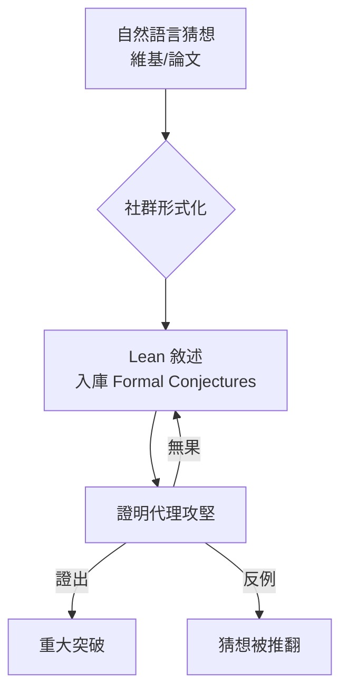

# 9.2 競賽基準與 Formal Conjectures

## 本節目標

- 理解 miniF2F 為何飽和，以及「基準老化」的必然規律
- 認識新一代基準：PutnamBench（2024）、miniCTX、Formal Conjectures（2025）
- 掌握基準污染（contamination）問題的成因與對策
- 分析基準如何驅動下一波證明模型的演化

## miniF2F：第一代基準的興與衰

2021 年提出的 **miniF2F** 把奧林匹克競賽題（AMC、AIME、IMO）形式化成 Lean/Isabelle/Metamath 三種格式，成為此後四年的標準測場。AlphaProof（2024）與 DeepSeek-Prover（2024）的戰報都以此為準。

但到了 2024 年底，最強模型在 miniF2F 上的通過率已逼近 99%。一個基準一旦飽和，就失去區分能力——就像滿分所有人都拿得到時，考試就不再是考試。

**因果驅動**：飽和 → 新基準需求 → 2024–2025 年一波更難、更「乾淨」的基準誕生。

## PutnamBench（2024）：大學競賽的升維打擊

2024 年，加州柏克萊團隊發布 **PutnamBench**：把 **William Lowell Putnam 競賽**（北美最高難度的大學數學競賽）的題目形式化成 Lean 與 Isabelle。

Putnam 題與奧林匹克題的差別是本質的：

- 涉及大學數學內容：實分析、線性代數、抽象代數
- 需要定義層層堆疊，正好考驗模型對 **Mathlib 引理的檢索能力**
- 平均證明長度遠超奧林匹克題

PutnamBench 的首批結果讓業界清醒：頂級模型只解出約 1–2% 的題目。這提醒我們，miniF2F 的 99% 不代表「數學被解決了」，只代表「那個測場被解決了」。

## miniCTX：長 context 的考驗

**miniCTX**（2024，同為柏克萊系）提出另一個維度的難度：給模型的不再是獨立題目，而是**數萬 token 的 Lean 專案 context**——自訂定義、自訂引理、自訂記號，模型必須在這片「陌生地景」中證明目標定理。

這模擬的是真實數學工作：沒有人面對的是無上下文的孤立命題，你永遠在某個定理群、某份論文、某個 codebase 裡工作。miniCTX 的指標設計也頗有啟發：它允許模型先「導出新引理」再使用，更像人類做研究的節奏。

## Formal Conjectures（2025）：未解之謎的資料庫

2025 年最重量級的基準來自 **Google DeepMind 與 Lean/mathlib 社群的合作**：**Formal Conjectures**。它把數百條**真正未解的開放問題**——從 Collatz 猜想、雙質數猜想，到各種 Erdős 問題——形式化成 Lean 敘述。

它的設計哲學與競賽基準完全不同：

- **沒有標準答案**：沒有人知道證明，所以它衡量的是「探索」而非「重現」
- **敘述本身就是貢獻**：把模糊的自然語言猜想精確化，是形式化數學最稀缺的技能
- **雙向使用**：模型可以嘗試證明，也可以嘗試找反例（證偽）

任何人都可以向這個儲存庫提交新猜想或改進敘述，它同時是基準、資料集與研究基礎設施。

## 其他開放問題形式化專案

Formal Conjectures 並非孤軍：

- **Databäck 1000 / Euler 等問題集**：民間把經典問題集中形式化
- **LeanSTS 與各種 statement 資料集**：用於訓練 statement 生成與篩選
- **Erdős Problems 網站**：每條問題附形式化狀態追蹤

「open problems in Lean」正在從零星個人專案，變成有組織的集體工程——這是第九章前後生態最深的變化之一。

## 污染問題（Contamination）

基準驅動訓練有一個系統性風險：**污染**。

1. **直接污染**：miniF2F 的題目來自歷年競賽，題目與解答早已在網路上，訓練語料裡幾乎必然包含。模型的「通過」可能只是背答案。
2. **敘述污染**：即使證明被刪，題目敘述本身出現在訓練資料中，模型仍能從記憶還原解法思路。
3. **練習題污染**：訓練用的合成題若與測試題高度相似，成績同樣虛高。

對策也隨之演化：

- **私有測場**：新創公司用內部新造題目評測，不入公開語料
- **改寫與重命名**：把經典題改寫成新敘述（但改不乾淨）
- **時間切分**：只用基準發布後產生的訓練資料
- **結構性新基準**：如 Formal Conjectures——未解問題不可能被「背下來」

| 基準 | 年份 | 難度來源 | 污染風險 |
|------|------|----------|----------|
| miniF2F | 2021 | 奧林匹克 | 高（已飽和） |
| PutnamBench | 2024 | Putnam 競賽 | 中 |
| miniCTX | 2024 | 自訂專案 context | 低 |
| Formal Conjectures | 2025 | 未解問題 | 幾乎為零 |

## 基準如何驅動下一波模型

基準不只是「考試」，它們是訓練目標的設計圖：

- miniF2F 時代 → 模型學會**孤題硬解**（龐大搜索樹 + 基礎 tactic）
- miniCTX 時代 → 模型學會**閱讀 context、檢索引理**
- PutnamBench 時代 → 模型學會**多步構造與 Mathlib 深度利用**
- Formal Conjectures 時代 → 模型必須學會**原創性**——這是未來五年真正的戰場

每一次基準換代，都重新定義了「什麼叫會做數學」，也重新分配了研究資源。

## 小結與練習

**小結**：miniF2F 的飽和暴露了「基準老化」規律；PutnamBench 升維難度、miniCTX 考驗長 context、Formal Conjectures 把未解問題變成測場；污染問題迫使基準結構性升級。基準與模型是共同演化的螺旋。

**練習**：

1. 到 Formal Conjectures 的 GitHub 儲存庫找一條你聽過的猜想（如 Collatz），閱讀其 Lean 敘述，比較與你直觀理解的差異。
2. 上 PutnamBench 網站查看最新排行榜，找出通過率最高的模型，思考它與通用聊天模型的差距。
3. 設計你自己的「防污染」小型基準：出三道你自己發明的數學題並形式化成 Lean，拿它測試一個 AI 助手。
4. 思考題：如果 Formal Conjectures 中某一條被 AI 證出，社群應如何驗證「證明過程」而非只看編譯通過？
