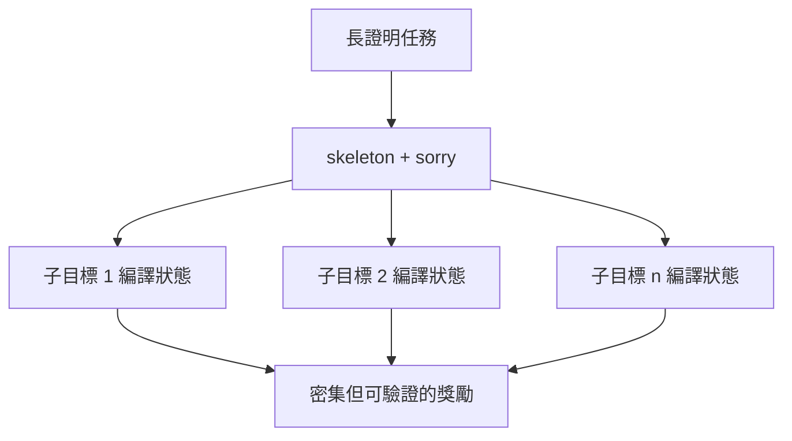
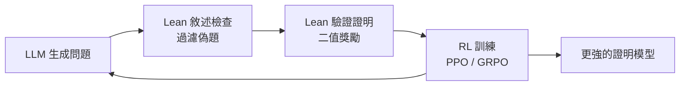

# 9.3 RLVR 與獎勵函數

## 本節目標

- 理解 RLVR（Reinforcement Learning with Verifiable Rewards）為何成為 2024–2025 的訓練主流
- 說明為什麼 Lean 被稱為「最完美的 verifier」
- 對比 process reward model 與 outcome reward 的取捨
- 掌握合成資料策略與「數據閉環」的完整架構

## 從 RLHF 到 RLVR

GPT-3 時代（2020–2022）對齊模型的主流是 **RLHF**（Reinforcement Learning from Human Feedback）：人類標註員給回應打分，訓練出一個**獎勵模型（reward model）**，再用 PPO 优化语言模型。RLHF 的致命弱點是：獎勵模型本身是學出來的近似，可以被「鑽漏洞」——模型學會寫出人類標註員喜歡但實際錯誤的答案，這就是 **reward hacking**。

2024 年，**RLVR**（Reinforcement Learning with Verifiable Rewards）成為新主流，DeepSeek-R1 是最著名的展示。核心想法簡單到近乎樸素：

> 不要學一個獎勵模型。找到**可以直接機器驗證**的任務，用驗證器當獎勵函數。

可驗證任務包括：數學題答案比對、程式碼單元測試、以及——最徹底的形式——**形式化證明編譯**。

## Lean：最完美的 verifier

為什麼說 Lean 是「最完美的 verifier」？比較各種獎勵訊號：

| 訊號來源 | 獎勵性質 | 可駭性 |
|----------|----------|--------|
| 人類標註 | 連續、主觀 | 高（reward hacking） |
| 學習式獎勵模型 | 連續、近似 | 高 |
| 答案比對 | 二值 | 中（可猜答案） |
| 單元測試 | 近二值 | 中（可過擬合測試） |
| **Lean 編譯** | **嚴格二值、可證偽** | **幾乎為零** |

Lean 編譯結果的關鍵性質：

1. **二值性**：`sorry` 之外，編譯通過就是證明，不通過就不是，沒有中間地帶
2. **可證偽性**：任何作弊（如公理走私）會顯式記錄在 `#print axioms` 中
3. **免費且可無限重複**：一個 CPU 核心就能當裁判，不需要人類、不需要 GPU
4. **無 overfitting 到測試**：Lean 的核心是數千行的可信核心（第 2.2 節的 LCF 方案），不是一組可以鑽的測試案例

第 7 章提過 AlphaZero 的自我對弈奇蹟，其前提是有完美規則模擬器。**Lean 之於數學，就是 Go 棋盤之於圍棋。**

## PRM vs ORM：過程與結果

獎勵設計有兩條路線：

- **ORM（Outcome Reward Model / outcome-based reward）**：只看最終結果。證明通過 = 1，失敗 = 0。訊號稀疏但絕對乾淨（Lean 給的就是這種）
- **PRM（Process Reward Model）**：對每一步推理打分。訊號密集，但每步評分器又是學出來的，重新引入 hacking 風險

Lean 的巧妙之處在於提供了一個**折衷**：`sorry` 骨架把長證明切成子目標，每個子目標的編譯狀態是**可機器驗證的中間訊號**——密集，卻不造假。這讓「過程獎勵」不必依賴學習出來的評分器。

## 合成資料策略

RLVR 需要大量「題目 + 驗證」對，Lean 生態發展出三層合成管線：

### 1. Problem generation（題目生成）

用 LLM 從 Mathlib 敘述、競賽題、論文中變造新題：改數字、換條件、組合兩個定理。Numina 與 DeepSeek-Prover 都大量使用。

### 2. Statement checking（敘述檢查）

生成的題目可能有問題：敘述為假、敘述平庸（`True`）、或與既有定理重複。過濾策略：

- 編譯檢查敘述本身合法
- 用 `aesop`/暴力搜索先試解——**太容易的丟掉**（無訓練價值），並檢查不是已知定理的複製品
- 檢查敘述與目標難度分佈匹配

### 3. AutoFormalization（自動形式化）

把自然語言數學（教科書、維基百科、論文）轉成 Lean 敘述。這是資料閉環的入口，也是目前最難的一環：形式化錯了，後面證得再好也無意義。

## 數據閉環：自我改進的飛輪

把以上組件組裝起來，得到證明 AI 的完整訓練迴路：

每一輪迴圈：

1. 更強的模型生成更多、更難的候選題
2. Lean 過濾掉壞題、壞證明（零成本、零誤差）
3. 通過的證明成為新的訓練訊號
4. RL 更新模型，回到 1

這就是 AlphaZero 式自我對弈在數學上的重現，而 Lean 是讓這個飛輪能轉起來的**唯一低摩擦潤滑劑**——沒有它，每一輪都需要人類數學家把關，飛輪立刻卡死。

## 限制與開放問題

RLVR + Lean 的飛輪並非萬能：

- **難題獎勵稀疏**：頂尖開放問題上，模型幾乎拿不到任何正獎勵，RL 無處發力
- **形式化瓶頸**：自然語言研究數學的 AutoFormalization 正確率仍低
- **範式偏狹**：飛輪偏愛「可形式化、可驗證」的數學，抽象與概念創新類的工作較難納入

這些正是第 10 章要討論的「AI 數學的哲學邊界」的技術背景。

## 小結與練習

**小結**：RLVR 用機器可驗證的獎勵取代學習式獎勵模型，杜絕 reward hacking；Lean 編譯是二值、可證偽、免費的完美 verifier；`sorry` 骨架提供可驗證的密集過程訊號；合成資料三層管線（生成→檢查→形式化）餵養出自我改進的數據閉環。

**練習**：

1. 用 `#print axioms` 檢查你第 4 章的定理，確認沒有走私 `sorryAx` 或 `Classical.choice` 以外的公理。
2. 寫一個 Lean 敘述，故意讓它為假，再寫一段看似合理的證明，觀察編譯器如何拒絕——體會「無法 hacking」的含義。
3. 畫圖比較 ORM、PRM、Lean `sorry` 骨架三種獎勵訊號的密度與可信度。
4. 思考題：如果一個證明代理用 10 萬次編譯嘗試才證出一條定理，這個證明在數學上「等價」於人類三行證明嗎？
