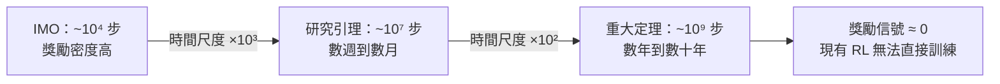
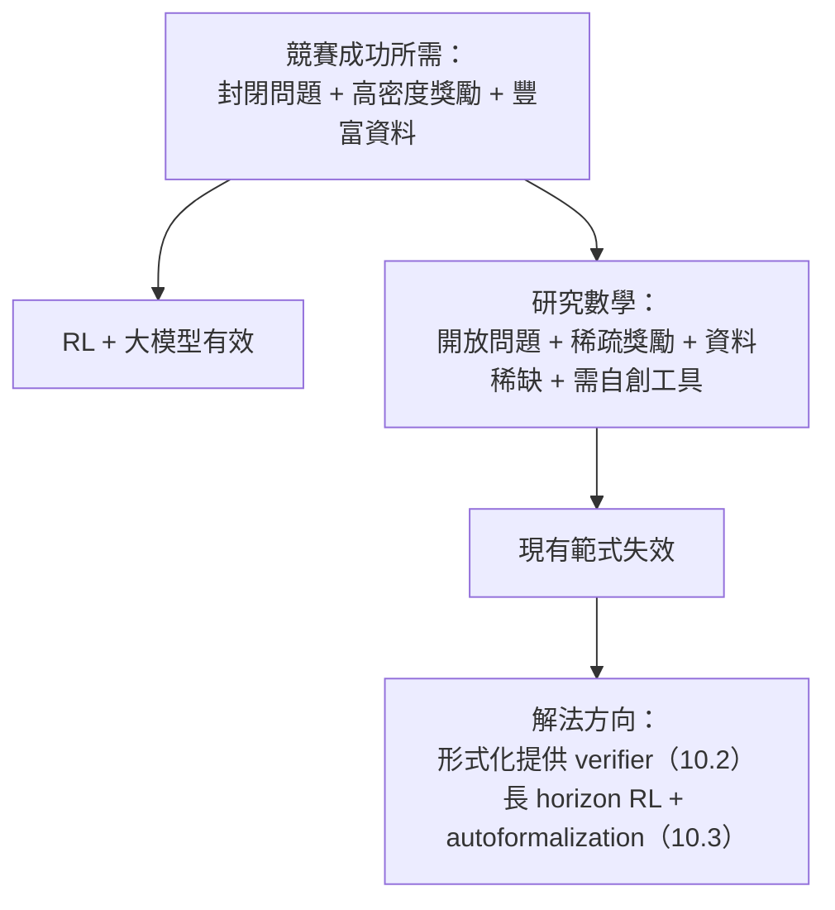

# 10.1 從競賽到研究數學的鴻溝

## 本節目標

- 對比 IMO 競賽數學與研究數學在**問題來源、時間尺度、評判標準**上的本質差異。
- 理解為什麼「AI 解出 IMO 金牌題」不等於「AI 能證明 Riemann 猜想」。
- 認識 **problem formulation**（問題的提出）本身就是研究數學的核心工作。
- 建立「經驗比例」的量感：小時 vs 人年，這個數量級差異如何決定 AI 路線圖。

## 兩個世界的對照

2024 年 7 月，Google DeepMind 的 AlphaProof 與 AlphaGeometry 2 在 IMO 中拿到銀牌水準的分數；2025 年，多家實驗室的系統達到金牌水準。媒體標題寫著「AI 達到數學奧林匹亞巔峰」。但數學家們的反應相當克制：**這是一個里程碑，但離研究數學還有一道鴻溝**。這道鴻溝值得我們仔細剖析。

| 維度 | IMO 競賽數學 | 研究數學 |
|------|-------------|----------|
| 問題來源 | 人為設計、已知範疇 | 未知是否存在解、邊界不明 |
| 時間限制 | 每題 4.5 小時（兩天各 3 題） | 數月到數年，甚至數十年 |
| 已知保證 | 一定有初等解法 | 可能無解、可能獨立於公理系統 |
| 解法範圍 | 單一或多個巧妙技巧 | 需要跨領域、自創工具 |
| 評判標準 | 滿分 7 分，有標準答案 | 同行審查 + taste + 影響力 |
| 知識前置 | 高中數學 + 技巧 | 數年博士訓練 + 領域文獻 |
| 敘事結構 | 封閉：題目→解答 | 開放：問題本身就是故事 |

## 鴻溝的五個面向

### 1. 已知範疇 vs 無人知曉的地形

IMO 題目由委員會設計，**命題者自己先解出來**，並確認可用中學數學工具解決。這意味著：

$$\text{IMO 問題} \subset \{\text{已知可解且解法初等}\}$$

研究數學沒有這層保證。Riemann 猜想提出至今（1859）超過 165 年，沒有人知道它是否在 ZFC 內可證。Twin prime conjecture、Collatz 猜想都可能是「這個時代的工具無法觸及」的問題——甚至像連續統假設那樣，被證明**獨立於公理系統**（見 1.1 節）。

AI 在競賽中的成功，本質上是在一個**封閉、有獎勵信號、有大量歷史例題**的環境中進行強化學習。研究數學的環境是開放且稀疏的：你可能在錯誤的方向上花三年，而沒有任何梯度告訴你回頭。

### 2. 時間尺度：獎勵信號的稀疏化

RL 的核心困難是 credit assignment：當獎勵在 $10^8$ 步之後才出現，學習信號幾乎消失。

用一個量化的「經驗比例」來看：

- IMO 一道題：頂尖選手**數小時**內解決；全部歷史題庫約數千題，是完美的訓練集。
- 一篇研究論文的證明：累計**人年（person-year）**——往往是多位數學家多年工作 + 前人數十年的鋪墊。
- 例如 Wiles 證明 Fermat 最後定理：**七年閉關**，加上 Taylor 補完證明，背後是數學界數十年對橢圓曲線與模形式的積累。

比例差異大約是 $10^3 \sim 10^5$ 倍。這不是「模型再大一點」能彌補的差距，而是**訓練範式本身**的問題（10.3 節將討論長 horizon RL 作為可能的解法）。

### 3. Problem formulation：提出問題本身就是研究

競賽中，問題是**給定的**。研究中，最有價值的工作之一是**問對問題**：

- Hilbert 1900 年的 23 個問題設定了一整個世紀的議程（1.2 節）。
- Grothendieck 不以解題聞名，而是**重新定義問題空間**——把 Weil 猜想轉化為 scheme 與 étale cohomology 語言下的自然問題。
- Terence Tao 將 PFR 猜想重新表述為更易攻擊的熵不等式形式，直接導致 2023 年的突破（10.2 節）。

好的 formulation 會把「不可解」變成「可解」。這需要 taste——對什麼問題重要、什麼方法有希望的判斷力——而 taste 極難轉化為可優化的 reward function。

### 4. 資料稀缺：研究級證明沒有題庫

IMO 有五十多年的歷史題庫、數百本教材、無數論壇討論（AoPS）。研究數學呢？

- 一篇 Annals 級論文的完整證明，**散落在數十篇文獻**中，依賴大量未寫下的「民間知識」（folklore）。
- 研究級證明**幾乎沒有形式化版本**——直到近年（10.2 節），形式化的研究數學屈指可數。
- 數學家之間的口傳知識：「這個 lemma 用 trace method 應該能出來」——這類 heuristic 不存在於任何語料中。

對語言模型而言，這意味著訓練資料分佈的尾部（研究前沿）幾乎是空的；對 RL 而言，連 verifier 都難以取得——除非先投入巨大成本形式化（這正是 Buzzard 的 Fermat 專案在做的事）。

### 5. 跨領域與 taste

Wiles 的證明用了：橢圓曲線、模形式、Galois 表示、群表示論、代數幾何……IMO 題目的「技巧組合」至多涉及三四個中學主題；研究證明則要求在**多個深層理論之間建立橋樑**，而這些橋樑往往在證明之前並不存在——需要證明者**發明新數學**（Grothendieck 為 Weil 猜想發明了整個上同調框架）。

## 為什麼「IMO 金牌 ≠ 能證 Riemann」

把上述面向收攏成一個因果鏈：

換句話說，IMO 金牌證明了 AI 具備了「數學技巧層」的能力；但研究數學需要的是「方向感層」（提出對的問題、判斷對的攻擊路徑）與「基建層」（把數十年文獻變成機器可用的形式）。後兩層正是本書第 10 章剩餘三節的主題。

值得注意的是，這道鴻溝正在縮窄：AlphaProof 對 RL 的使用、Lean 形式化社群的擴張、以及 2024 年 PFR 形式化中 AI 的實際參與，都顯示「資料稀缺」與「verifier 缺失」這兩個瓶頸是可以被工程手段攻擊的。

## 小結與練習

### 重點回顧

1. IMO 與研究數學在問題來源、時間尺度（小時 vs 人年，約 $10^3\sim10^5$ 倍）、資料可得性上有本質差異。
2. Problem formulation 是研究的一部分，也是 AI 最難習得的能力。
3. RL 在競賽的成功依赖封閉環境與高密度獎勵；研究數學兩者皆缺。
4. 鴻溝可以被工程手段縮窄：形式化（提供 verifier）與 autoformalization（提供資料）是兩條主要路徑。

### 練習

1. 選一個你熟悉的 IMO 經典題（例如 1988 年 Problem 6），分析它具備哪些「競賽特性」：已知有解、初等工具、封閉敘事。
2. 查閱 Wiles 證明 Fermat 最後定理的歷史，列出證明依賴的至少三個前代理論成果，估算「累計人年」的數量級。
3. 辯論題：「若 AI 能解所有 IMO 題，它距離證明 Riemann 猜想還差什麼？」請分別從資料、獎勵、taste 三個角度寫一段 200 字論證。
4. 思考題：Taste（品味）能否被形式化為可優化的目標函數？如果可以，reward model 需要什麼樣的訊號？
