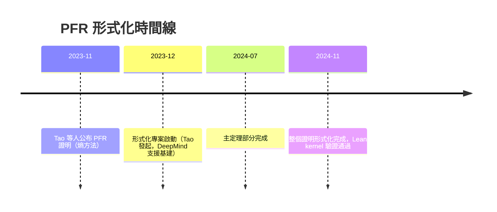
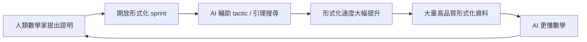

# 10.2 形式化研究數學的先行者

## 本節目標

- 了解 Kevin Buzzard 對「Lean 形式化研究數學」的倡議，以及 Imperial College Lean group 的角色。
- 掌握 2024 年 PFR（Polynomial Freiman-Ruzsa）猜想形式化的來龍去脈：Tao 的突破、社群協作、AI 輔助、兩個月完成。
- 回顧研究級形式化的其他里程碑：liquid tensor experiment、sphere packing、Fermat 最後定理 Lean 專案（目標 2028–2029）。
- 理解這些專案共同的模式：**人類突破 → 社群形式化 → AI 從中學習**。

## Kevin Buzzard 的倡議：數學需要新的基礎設施

Kevin Buzzard 是 Imperial College London 的數論學家。2017 年前後，他做了一個在當時頗為激進的宣言：**數學研究需要自己的軟體基礎設施，就像實驗物理需要加速器一樣**。

他的論證核心：

1. 同行審查無法保證正確性：歷史上多個重大證明（四色定理的電腦部分、分類有限單群）的缺口花費數年甚至數十年才補上。
2. 現代證明越來越長、越來越跨領域，人類審查的容量已到極限。
3. Lean + Mathlib 提供了一條路：把數學一層層建在 kernel 檢查過的地基上（見第 5 章 Mathlib 社群）。

他創立了 Imperial Lean group，系統性地訓練博士生用 Lean，並推動「重寫代數幾何與數論的數位基礎」。2019 年他獲得 XRDialog 計畫的資助（部分由 Ethereum 創辦人 Vitalik Buterin 捐贈），專門用於形式化 perfectoid spaces 與相關數論基礎——這些是 Scholze（Fields Medal 2018）理論的核心。

Buzzard 的口號值得記住：

> 「We need to teach Lean all of mathematics, so that Lean can then help us go further.」

## Liquid Tensor Experiment：一次壓力測試

2020 年 12 月，Peter Scholze 在 MathOverflow 上提出挑戰：他與 Clausen 證明的定理（關於凝聚態數學 analytic geometry 的關鍵 hand-off 定理）中，有一段他自認**沒有完全理解的複雜論證**。他想知道 Lean 能否形式化它。

這就是 **Liquid Tensor Experiment (LTE)**，由 Community Lean 團隊（Johan Commelin 領導）執行。2022 年 7 月完成。其意義：

- 證明了 Lean/Mathlib 能承載**當代最前沿**的數學，而不只是教科書內容。
- 過程中 Scholze 與形式化者反覆對話，**形式化本身就是一次極深的數學審查**——確實發現了原始論文中若干需要澄清的點。
- 催生了大量數論/幾何所需的 Mathlib 基礎設施。

## 主案例：PFR 猜想的形式化（2024）

### 背景與人類突破

Polynomial Freiman-Ruzsa conjecture 是加法組合學的中心問題之一，關於：若整數集合 $A$ 的和集 $A+A$ 不大，$A$ 在結構上離一個子群有多近。這個問題懸置數十年，因為它聯結了結構（subgroup）與隨機性（coset 逼近）。

2023 年 11 月，**Terence Tao** 發起 Polymath 類型的線上協作（實際是 Tao 與 Ben Green 等人在 blog 上公開推進），僅用約**三週**就證明了函數版本 PFR。證明的關鍵是 Tao 先前提出的**熵（entropy）方法**——把組合問題轉寫成資訊論不等式。

### 形式化衝刺

2023 年 12 月，Tao 宣布發起 **PFR formalization project**，目標是將整個證明在 Lean 中形式化，採用開放協作（類似 Polymath 的模式但用 Git 管理，存放於 Google DeepMind 支援的倉庫）。結果驚人：

幾個關鍵事實：

1. **速度**：人類證明用了三週，形式化用了約一年（相較之下，LTE 花了 18 個月、四色定理形式化花了 6 年、奇偶遊戲等更長）——這個比率正在快速改善。
2. **AI 輔助**：專案大量使用了 AI 工具（包括 DeepMind 的 AlphaProof 相關模型、GitHub Copilot 類補全）來寫 tactic 與尋找 Mathlib 引理，是**第一個大規模 AI 輔助的研究級形式化**。
3. **過程即驗證**：形式化期間發現並澄清了熵方法論證中的若干技術細節。
4. **模式確立**：「人類證明 → 開放形式化 sprint → AI 輔助加速」成為可複製的流程，而非一次性的壯舉。

### PFR 的技術啟示

PFR 專案展示了一個正回饋環：

這個環正是第 10.3 節路線圖的現實版。

## 其他研究級形式化里程碑

| 專案 | 定理/理論 | 時間 | 形式化耗時 | 特點 |
|------|-----------|------|-----------|------|
| 奇偶遊戲定理 | 啟發式搜尋演算法正確性 | 2015–2017 | ~2 年 | Coq，早期測試 |
| Sphere Packing（高維） | Hales 的 Kepler 猜想相關工作 | 2014–2017 | ~5 年 | Isabelle/HOL + Kaiser，超大協作 |
| 四色定理 | 修正並形式化 2004（Gonthier, Coq）、2017 前後檢驗（Isabelle, AFP） | 多年 | 6 年（Coq 版） | 首個重度依賴電腦計算的證明形式化（2.1 節曾提） |
| Liquid Tensor Experiment | Clausen–Scholze 定理 | 2020–2022 | ~1.5 年 | 前沿數學首次壓力測試 |
| PFR 猜想 | Tao–Green 等的證明 | 2023–2024 | ~1 年 | 開放協作 + AI 輔助的模式確立 |
| Fermat 最後定理專案 | Wiles–Taylor 證明 | 2024–（進行中） | 目標 2028–2029 | 史上最大單一形式化工程 |

## Fermat's Last Theorem in Lean：終極目標

2024 年，Buzzard 宣布啟動 **FLT in Lean** 專案，目標是在 2028–2029 年前後完成 Wiles 證明的完整形式化。這是數學形式化史上最龐大的單體工程，需要：

- **模形式（modular forms）**的完整理論：包括 $q$-展開、Hecke 算子、新形式（newforms）理論——Mathlib 中許多仍在建設。
- **Galois 表示（Galois representations）**：橢圓曲線的 $\ell$-進表示、deformation theory（Mazur 的理論）。
- **模性提升（modularity lifting）**：R = T 定理，這是 Wiles 論證的心臟。
- Langlands 綱領的諸多片段、類域論、Iwasawa 理論的基礎。

專案的策略是「分層招募」：把證明拆成數十個獨立模組，由全球的形式化小組（Imperial、Bonn、Cambridge、以及其他大學與業餘貢獻者）認領。Buzzard 明確說過：這個專案的一部分動機正是**為 AI 準備訓練資料與 verifier**——一旦 FLT 有了形式化版本，它就成為研究級證明的最高品質標本。

專案過程中也有務實的教訓：預估所需的 Mathlib 基礎遠超預期，團隊多次需要先「修路再行車」——先形式化定理依賴的底層理論。這再次印證了 5.1 節的觀察：Mathlib 的成長是整個事業的瓶頸與槓桿。

## 模式的共同規律

把上述專案排在一起，可以看到清晰的趨勢：

| 指標 | 早期（2010s） | 近期（2020s） |
|------|--------------|--------------|
| 人類證明到形式化的延遲 | 5–10 年以上 | 1 年（PFR）→ 目標同步 |
| 主要人力 | 少數專家 | 開放社群 + AI |
| 數學年代 | 經典定理 | 當代前沿 |
| 主要產出 | 單一形式化 | Mathlib 基建 + 資料集 |

**延遲趨近於零、AI 比重趨近於一**——這兩條曲線的外推，就是 10.3 節的路線圖。

## 小結與練習

### 重點回顧

1. Buzzard 的倡議把形式化從「驗證工具」提升為「數學基礎設施」，Imperial Lean group 是人才的孵化器。
2. LTE（2022）證明 Lean 能承載前沿數學；PFR（2024）確立「開放協作 + AI 輔助、一年內完成」的新模式。
3. FLT in Lean 專案（目標 2028–2029）是規模與雄心之最，其副產品——形式化的模形式與 Galois 表示理論——將是 AI 數學的重要資產。
4. 趨勢：形式化延遲縮短、AI 參與度上升、專案產出從單點走向基建。

### 練習

1. 查閱 PFR formalization 專案的 GitHub 倉庫與 Tao 的部落格文章，記錄專案中的三個技術挑戰與解法。
2. 解釋為什麼 R = T 定理是 Wiles 證明的「心臟」，以及形式化它需要哪些前置理論。
3. 比較 LTE 與 PFR 專案：在人力、工具、AI 使用上有哪些具體差異？
4. 思考題：如果形式化延遲趨近於零，數學論文的發表流程會變成什麼樣子？peer review 的角色會如何改變？
