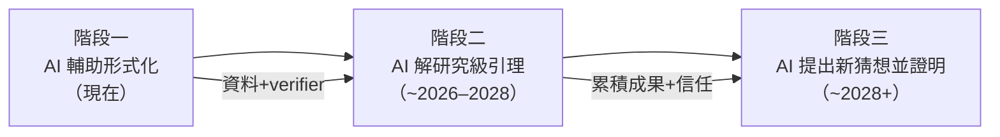
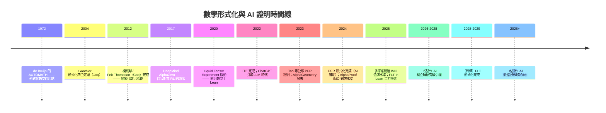
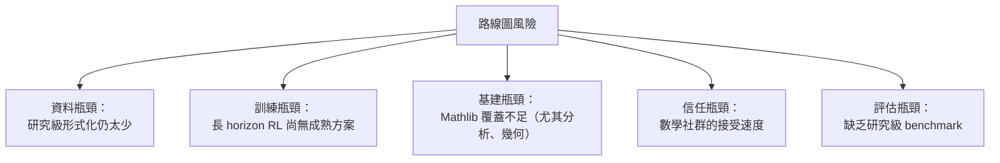

# 10.3 通往 AI 數學家的路線圖

## 本節目標

- 掌握 DeepMind 與 Tao 等人描繪的階段論：AI 輔助形式化 → AI 獨立解研究級引理 → AI 提出並證明新猜想。
- 盤點路線圖所需的「技術拼圖」：autoformalization、長 horizon RL、神經符號混合、算力與成本。
- 建立合理的時間線預期（學界估計 2026–2030），並用 mermaid 時間線回顧從 AUTOMATH 到未來的全程。

## 階段論：三級火箭

2024–2025 年，DeepMind（AlphaProof 團隊）與 Terence Tao 在多次公開對談中，把「AI 數學家」的到來拆成三個階段。這個框架已成為社群的共識語言。

### 階段一（現在）：AI 輔助人類形式化

- 人類提出證明，AI 負責加速形式化：tactic 補全、Mathlib 引理搜尋、草稿到 Lean 的翻譯。
- 實例：PFR 形式化專案（10.2 節）已大規模使用 AI 輔助；Lean 的 AI widget（如 Lean Copilot、各種 LLM tactic 建議器）逐漸成為標配。
- 關鍵指標：**形式化延遲**（證明公布到形式化完成的時間）從數年縮到一年，再向「同步」逼近。

### 階段二（2026–2028 估計）：AI 獨立解研究級引理

- AI 在人類給定的定理陳述下，自主完成某個**研究級引理**的形式化證明——不是 IMO 題，而是論文中真實的中間步驟。
- AlphaProof 的後續版本與 PFR 專案的互動是先聲：在 2024 年的形式化 sprint 中，AI 系統已能完成部分 sub-lemma 的證明（事前「預告」了這個階段的能力）。
- 關鍵條件：形式化文獻夠多（資料）、Mathlib 夠完整（工具）、RL 能處理長 horizon（訓練）。

### 階段三（2028–2030 之後估計）：AI 提出並證明新猜想

- AI 不只解題，還**問對問題**：在形式化語料中找出模式、提出新猜想、並嘗試證明。
- 這要求超越階段二的能力：taste、跨領域類比、以及「知道什麼值得證」的判斷（10.1 節指出這是最難的部分）。
- 更現實的近景是人機協作：AI 提出大量候選猜想，人類篩選；或人類提出方向，AI 探索證明樹。

## 技術拼圖：四塊缺一不可

### 1. 更強的 Autoformalization

把人類數學文字（LaTeX 論文）自動翻成 Lean。這是資料槓桿：一旦成熟，Mathlib 與整個 arXiv 之間的鴻溝就能跨越。目前的困難：

- 數學語言高度依賴上下文與省略：「顯然」「同樣的論證」對機器是深淵。
- 定理陳述的**等價形式選擇**：同一猜想有許多表述，選錯形式會讓證明樹爆炸。
- 進展：DeepMind 的 AlphaProof 管線包含將 IMO 題翻譯為 Lean 的元件；學界（如 Anthropic、OpenAI 與各大學的合作）持續改進 formality 的基準（miniF2F、PutnamBench 之後是更難的基準）。

### 2. 長 Horizon RL

10.1 節指出：研究證明的獎勵信號在 $10^7\sim10^9$ 步之外。可行的工程路線：

- **課程分解**：把長證明拆成引理樹，逐層訓練（AlphaProof 在 IMO 層級已這樣做）。
- **過程獎勵（process reward）**：不只獎勵「證完」，還對每步 tactic 給中間評分——需要高品質的過程標註，形式化社群正在供應。
- **樹搜尋 + 學習值函數**：MCTS 風格的搜尋搭配 value model，把長證明變成搜尋問題。

### 3. 符號 + 神經混合

純 LLM 會幻覺；純符號系統（如 6.1 節的 resolution 證明器）在組合爆炸前無力。混合架構的分工：

| 元件 | 角色 | 例子 |
|------|------|------|
| 神經網路 | 提議、類比、剪枝 | LLM 選 tactic、猜引理 |
| 符號系統 | 精確執行與驗證 | Lean kernel、SMT、自動化 tactic |
| 形式環境 | 提供獎勵與可重置狀態 | Lean 互動式證明環境作為 RL gym |

Lean 在此扮演雙重角色：**訓練環境**（可程式化的數學 gym）與**最終裁判**（kernel 驗證），這是它相對純 LLM 路線的結構性優勢。

### 4. 算力與成本

- 訓練一個前沿 LLM 的成本在 $10^8$ 美元量級，需要數萬顆 GPU/TPU；AlphaProof 在 IMO 期間對每題用了**數天的大量平行取樣**。
- 但數學 RL 有個特點：**inference-time scaling 很有效**——推理時多搜尋就多收穫，這使「少量訓練 + 大量搜尋算力」的路線可行。TPU 叢集可以在賽前集中對特定題材做取樣與微調。
- 開源端（如以 Mathlib 為基礎的學術專案）無法比拼訓練算力，但可以專注於資料與環境建設，等前沿模型的能力外溢。

## 時間線：從 AUTOMATH 到未來

幾點對時間線的冷靜提醒：

1. 學界估計（包括 Tao 本人的保守說法）落在 **2026–2030** 之間出現「AI 對研究數學有實質獨立貢獻」；但「研究級引理」與「核心突破」之間仍有巨大間隔。
2. 歷史教訓：1960 年代的自動定理證明者也曾被預言「十年內取代數學家」，結果沉寂數十年。指數外推需要警惕。
3. 另一面的教訓：2017 年 AlphaZero 到 2024 年 AlphaProof 只用了七年——現代基礎設施（算力、RL 演算法、形式環境齊備）使曲線比上一世代陡峭得多。

## 瓶頸與風險

其中**評估瓶頸**常被低估：IMO 有標準答案，研究前沿沒有。如何測量「AI 的數學品味」？一個候選答案是讓 AI 在形式化的開放問題列表（如 Mathlib 中仍未解的引理、dblp 上的 conjecture 資料）上工作，以實際成果計分——這也是階段二到階段三的過渡測試場。

## 小結與練習

### 重點回顧

1. 三階段路線圖：輔助形式化（現在）→ 獨立解研究級引理（~2026–2028）→ 提出並證明新猜想（~2028+）。
2. 四塊技術拼圖：autoformalization、長 horizon RL、神經符號混合、算力。Lean 同時是訓練環境與最終裁判。
3. 時間線估計應保持區間思維：學界共識約在 2026–2030 有實質研究貢獻，且需記住 1960 年代的失敗預言。
4. 五大瓶頸：資料、訓練、基建、信任、評估——每個都是具體的工程問題，而非單純的「模型變大」。

### 練習

1. 選擇階段二的一個可能測試場：從 Mathlib 找一個「證明冗長但方向明確」的已知引理，思考 AI 要獨立證明它需要哪些能力。
2. 比較 inference-time scaling 與 training-time scaling 在數學 RL 中的相對重要性，寫 200 字分析。
3. 查閱 AlphaProof 的技術報告，畫出其管線圖（問題翻譯、取樣、RL 訓練、形式驗證各環節）。
4. 思考題：如果 2028 年 AI 能獨立解研究級引理，數學系的博士訓練應該如何調整？
