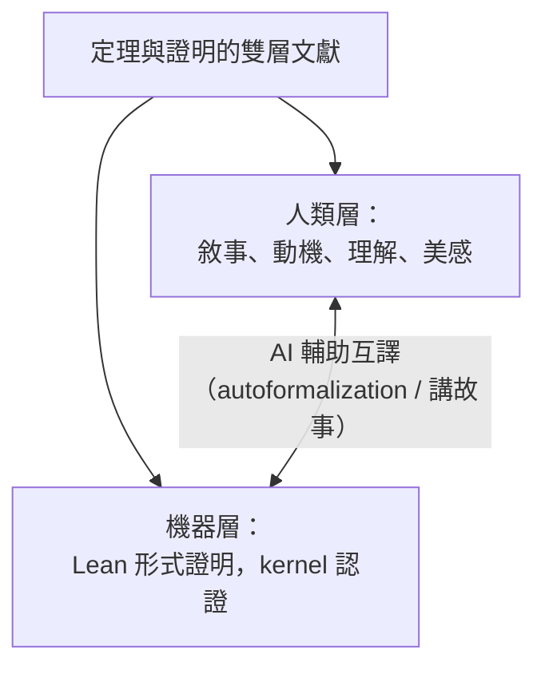

# 10.4 當證明不再由人寫下

## 本節目標

- 回顧「數學是發現還是發明」的經典哲學爭論，並置於機器證明的新脈絡下。
- 理解機器證明的認識論：可信度如何從「人類審查」轉移到「kernel 驗證」。
- 探討人類數學家角色的轉變：猜想的提出者、意義的賦予者。
- 完成全書總結：回到第 1 章 Hilbert 的夢想，盤點已實現與正在路上的部分。

## 發現還是發明？一場兩千年的辯論

數學哲學最古老的問題之一：數學對象是被**發現**的（Plato：數學理念獨立存在於理念世界）還是被**發明**的（形式主義：數學是人為符號遊戲）？

| 立場 | 代表 | 主張 | 弱點 |
|------|------|------|------|
| 柏拉圖主義 | Gödel、Hardy | 數學真理客觀存在，證明是發現 | 無窮抽象對象如何被「感知」？ |
| 形式主義 | Hilbert | 數學是符號系統的操作 | 為何符號遊戲「意外地」有效於物理？ |
| 建構主義 | Brouwer | 數學是心智的構造活動 | 排中律的普遍失效代價太大 |
| 經驗主義/自然主義 | Lakatos、Quine | 數學如科學，經證偽與修正演進 | 淡化了證明的確定性 |

有趣的是，本書主角們恰好站在光譜兩端：**Gödel 是柏拉圖主義者**（他相信自己證明的不完備性揭示了數學實在），**Hilbert 是形式主義者**（1.2 節），而 **de Bruijn 的 AUTOMATH**（2.1 節）則把形式主義推向工程極致——證明就是可機械檢查的符號物件。

機器證明的出現，給這場辯論提供了新的實驗場：如果 AI 能提出並證明人類想不到的定理，這些定理是它「發現」的客觀真理，還是它「發明」的符號構造？大多數工作數學家的直覺是前者——這也是為什麼他們對 AI 數學既興奮又警惕。

## 機器證明的認識論：可信度的轉移

傳統數學知識的確定性鏈條：

$$\text{數學家的直覺} \to \text{證明草稿} \to \text{同行審查} \to \text{社群共識}$$

每一環都可能出錯——同行審查漏掉過大洞（Mochizuki 的 ABC 證明爭議持續至今）、已發表的證明被發現有誤（每年數百起）。形式化的承諾是**把確定性收斂到一個小而可信的核心**：

$$\text{任何證明} \to \text{Lean kernel 檢查} \to \text{信任 kernel} \to \text{確定性}$$

kernel 是幾千行的核心（見 2.2、3.2 節的依值型別論），其正確性可以被少數專家徹底審查，甚至多個 kernel 互相驗證。這是 2.2 節 LCF 方案（可信核心 + tactic）哲學的勝利：**無論證明由人寫、由 AI 寫、還是由隨機搜尋產生，只要 kernel 說通過，它就是對的。**

這帶來一個深刻的認識論後果：**證明的「作者」與證明的「可信度」徹底脫鉤**。一個我們完全無法理解的、由 AI 產生的兩百萬行證明，與 Wiles 的論文，在「是否為真」上具有同等的保證。但——它們在「是否被理解」上截然不同。

## 證明的美感與理解性

### Formal proof ≠ human understanding

數學共同體重視證明的原因從來不只是「為真」，還包括：

1. **解釋力**：告訴我們定理為什麼為真，揭示現象背後的機制。
2. **連結性**：把看似無關的領域接起來（如模形式與橢圓曲線）。
3. **可複用性**：證明技術成為下一代問題的工具。
4. **美感**：數學家常說 elegant、deep、beautiful——這不是裝飾，而是對上述品質的直覺壓縮。

一個極端的例子：四色定理的證明（Appel–Haken 1976，形式化於 2005）本質上是「1200 小時的電腦計算 + 可檢查的歸約框架」。它為真，但**幾乎沒有帶來理解**——我們仍然不知道「為什麼」四種顏色就夠了。對比之下， 有些證明（如 Euclid 的素數無窮性）一行就傳達了機制。

歷史上早有先例：**Bourbaki** 學派以徹底形式化、公理化的風格重寫數學，追求最大嚴格性。但連 Bourbaki 成員也承認：他們的書是可靠的參考，卻不是好的啟蒙教材——嚴格性與理解性是兩個軸。Lean 的形式證明把 Bourbaki 式嚴格性推到極限：machine-checkable，但對人類讀者而言，它往往是不可讀的符號海洋。

因此未來的數學文獻可能呈現**雙層結構**：

AI 恰好在兩層之間架橋：把形式證明「翻譯回」人類可讀的解釋（explainable proof），或把人類草稿翻成形式證明。

## 人類數學家的角色轉變

如果 AI 能證明定理，數學家做什麼？社群中最有影響力的兩種回答：

### Tao 的「協作 2.0」

Terence Tao 把 AI 定位為**極其能幹的協作者**，如同電腦代數系統之於上一代數學家，但能力強得多。他實際的工作方式已經改變：在 PFR 形式化中，他把繁瑣的證明步驟外包給 AI 與協作網路，自己專注於問題的提出與方向判斷。他設想的數學工作流：人類提出猜想與策略 → AI 填補引理與細節 → 人類檢查整體圖像並賦予意義。數學從「個人的深度思考」走向「人機編排的協作網路」。

### Buzzard 的宣言

Kevin Buzzard 的立場更為激進：數學界應該**系統性地把全部數學形式化**，因為這既是品質保證，也是為 AI 時代鋪路。他把形式化視為這一代數學家欠下一代的基礎設施——如同當年建立 arXiv 與 MathSciNet。

兩人共同指向的新角色分工：

| 傳統角色 | 未來角色 |
|----------|----------|
| 證明者 | 猜想的提出者、方向的選擇者 |
| 審查者 | 意義的賦予者、重要性的評判者 |
| 計算與推導執行者 | 與 AI 對話的指揮者 |
| 文獻的閱讀者 | AI 成果的解釋者與整合者 |

## 全書總結：回到 Hilbert 的夢想

讓我們回到第 1 章。Hilbert 計畫夢想的是什麼？把全部數學形式化，用機械程序檢查一切證明——甚至（可判定性）機械地判定一切數學命題的真假。

Gödel 與 Turing 擊碎了這個夢想的後半：不存在完備一致的算術系統，不存在判定一切命題的演算法。但這個夢想的**前半——「機器檢查所有證明」——已經被實現了**：

- 1972 AUTOMATH 證明形式化數學在原則上可行（第 2 章）。
- LCF 確立可信核心架構（第 2 章）；Lean 的 kernel 正是這條血脈（第 3 章）。
- Mathlib 把形式化從單點壯舉變成社群工程（第 5 章）。
- 2022 LTE、2024 PFR、2028–2029 FLT：研究數學正被一層層形式化（第 10 章）。

而「機器創造數學」正在路上：AlphaGeometry、AlphaProof 證明了技巧層的自動化（第 6、7 章的理論在此匯流）；階段二與階段三（10.3 節）是明確的工程目標，而非科幻。Hilbert 若看到今天，大概會說：夢想以我未預料的方式倖存了——Gödel 的牆仍在，但我們在牆內蓋起了一座機器與人類共構的數學城市。

最後留給讀者的問題，也是本書真正想問的問題：

> 當證明不再由人寫下，數學還是我們所理解的那門學問嗎？

我們的回答是：數學的核心從來不是證明的書寫，而是**理解、猜想與意義**——這些恰好是機器最晚到達的地方。人類數學家不會消失，但將以一種兩千年前 Euclid 無法想像、卻又與他一脈相承的方式，繼續這場關於無窮的對話。

## 小結與練習

### 重點回顧

1. 發現 vs 發明之辯獲得新實驗場：Gödel 的柏拉圖主義與 Hilbert 的形式主義在機器證明中各自復活。
2. 機器證明使可信度從同行審查轉移到 kernel；證明的「作者」與「可信度」脫鉤。
3. Formal proof ≠ understanding；未來文獻將是人類敘事層與機器形式層的雙層結構，AI 負責互譯。
4. 數學家的新角色：提出猜想、判斷方向、賦予意義（Tao 的協作 2.0、Buzzard 的形式化宣言）。
5. Hilbert 夢想的前半（機器檢查證明）已實現，後半（機械判定真理）被 Gödel 永久封存，而「機器創造數學」正在路上。

### 練習

1. 就「AI 證明的定理是被發現還是被發明」，分別站在柏拉圖主義與形式主義立場各寫 150 字論證。
2. 比較四色定理證明與 Euclid 素數無窮性證明在「解釋力」上的差異，討論「為真的證明」與「好的證明」的區別。
3. 查閱 Tao 關於 AI 與數學的公開演講或訪談，摘錄他對「協作 2.0」的具體設想，並與本節對照。
4. 終章寫作：回顧全書，你認為「機器創造數學」到來時，最先被改變的會是數學教育、數學研究，還是數學哲學？寫 300 字短文。
