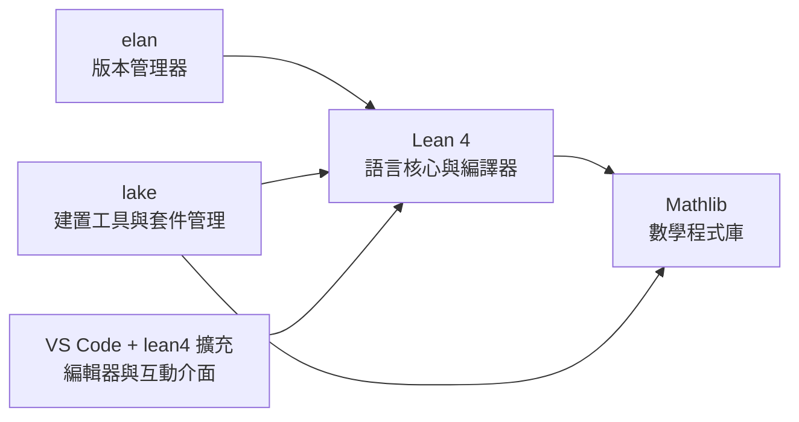

# 1.2 Lean 是什麼

## 本節目標

- 了解 Lean 同時是一門程式語言與一個證明助理
- 認識 proof assistant 與傳統程式語言的差異
- 認識 Lean 4 與 Mathlib 生態
- 建立「定理也是程式」的直覺

## 一門語言，兩種用法

**Lean** 是微軟研究院的 Leonardo de Moura（也是著名的自動化定理證明器 Lean/Z3 系列的作者之一）從 2013 年開始開發的程式語言。它有兩個身分：

1. **通用程式語言**：你可以用它寫出真正能執行的程式。Lean 自己的編譯器就是用 Lean 寫的（這叫 self-hosting），編譯速度在函數式語言中名列前茅。
2. **證明助理（proof assistant）**：你可以用它寫出**數學證明**，並由機器逐行檢查每一步是否無懈可擊。

本書主要用第二個身分，但兩者共享同一套語法與同一套邏輯基礎——這正是 Lean 最迷人之處，稍後會解釋。

## Proof Assistant 與傳統程式語言的差異

| 面向 | 傳統程式語言（Python、C、Java） | 證明助理（Lean、Coq、Isabelle） |
| --- | --- | --- |
| 核心產出 | 執行後產生副作用的程式 | 通過型別檢查的「證明項」 |
| 「對」的定義 | 執行結果符合預期（靠測試） | 型別檢查通過（數學上的嚴格證明） |
| 測試 | 只能測有限個輸入 | 一旦證完，**對所有輸入都成立** |
| 數學命題 | 只能寫註解，機器不檢查 | 是程式的一部分，機會完全檢查 |
| 除錯 | 看 runtime 錯誤、log | 看「目標狀態」（goal state） |
| 錯誤的代價 | 線上服務當機、資料錯誤 | 幾乎沒有——編譯器直接拒絕 |
| 典型使用者 | 業務開發、資料科學 | 數學家、資訊科學研究者、本書讀者 |

關鍵差異用一句話說：**測試只能證明 bug 存在，不能證明 bug 不存在；但型別檢查通過的證明，機器保證它在邏輯上無懈可擊。**

## 「定理也是程式」：初步直覺

Lean 建立在 **Curry–Howard 對應**之上。這個對應把兩件事畫上等號：

- **命題** 就是 **型別**（type）
- **證明** 就是 **該型別的一個值**（一個項、一個程式）

聽起來抽象，看例子就懂：

```lean
-- 「1 + 1 = 2」是一個命題，也是一個型別
-- `rfl` 是這個型別的一個值，也就是這個命題的「證明」
example : 1 + 1 = 2 := rfl
```

用 Python 的心態來讀這行：宣告一個函數（這裡是常數）時，我們宣告它的**回傳型別**。只是這次回傳型別不是 `int` 或 `str`，而是「命題 $1 + 1 = 2$」；而「回傳的值」`rfl` 不是資料，而是**證明本身**。

換個角度：要提供一個型別為 $P$ 的值，就等於提供 $P$ 的證明。要「住」進 $1+1=2$ 這個型別，你需要一個合法的證明項；隨便亂寫，型別檢查器（同一個檢查普通程式型別的機制）就會拒絕。

再看一個更有程式感的例子：

```lean
-- 「若 a ≤ b 且 b ≤ c，則 a ≤ c」這個定理，本質上是一個函數
theorem le_trans' {a b c : ℕ} (hab : a ≤ b) (hbc : b ≤ c) : a ≤ c :=
  le_trans hab hbc
```

讀法：`le_trans'` 是一個函數，吃兩個「證明」當參數（`hab` 是 $a \leq b$ 的證明，`hbc` 是 $b \leq c$ 的證明），回傳「$a \leq c$ 的證明」。**定理就是函數，引理就是可以被呼叫的 API**——數學知識在 Lean 裡像程式庫一樣被模組化、被版本控制、被覆用。

## Lean 4 與 Mathlib 生態

Lean 有幾個主要版本。**Lean 4**（2021 年發布）是目前的正式版本，相較於 Lean 3 的重大改進是：Lean 4 本身就是一門快速、可編譯、可寫通用程式的語言，證明與程式在同一個系統裡無縫切換。

本書使用 **Lean 4 + Mathlib**：

- **Mathlib** 是 Lean 社群維護的超大型數學程式庫，截至 2025 年已有超過 150 萬行程式碼，涵蓋：分析、代數、拓撲、測度論、表示論、範疇論等大學到研究所程度的數學。
- Mathlib 由全世界數百位貢獻者共同維護，每天有數十個 pull request，是當今最活躍的數學形式化計畫。
- 本書的定位：**從高中數學出發，沿著 Mathlib 的地基往上爬**。你會用到的每一個引理，幾乎都能在 Mathlib 中找到「正牌」版本。

工具鏈一覽：



- **elan**：管理多個 Lean 版本（類似 `rustup`、`nvm`）。
- **lake**：專案建置與依賴管理（類似 `cargo`、`npm`）。
- **lean4 擴充（VS Code）**：即時顯示證明狀態的互動環境。

## 與其他證明助理的比較

Lean 不是唯一的證明助理。一句話帶過另外兩個最有名的：

- **Coq**（現名 Rocq）：歷史悠久，學術界使用廣泛，證明了四色定理的形式化；語法與生態較學院派。
- **Isabelle/HOL**：德國學界主力，自動化能力強；但社群與數學庫的活躍度不如 Lean。

一句話總結 Lean 的定位：**現代化的語言設計 + 最活躍的數學形式化社群（Mathlib）+ 對初學者相對友善的互動介面**，使它成為 2020 年代學「形式化數學」的首選。國際數學家大會（ICM 2022）邀請演講者 Terence Tao 等人也公開投入 Lean 生態，是它影響力的註腳。

## 第一眼看 Lean 程式碼

先混個眼熟，不用完全懂。這是一個完整的 Lean 4 + Mathlib 檔案：

```lean
import Mathlib.Tactic

-- 定義一個數學物件：二次方程的判別式
def disc (a b c : ℝ) : ℝ := b ^ 2 - 4 * a * c

-- 證一個定理：判別式為零時，重根存在
theorem has_double_root (a b c : ℝ) (ha : a ≠ 0) (h : disc a b c = 0) :
    ∃ x : ℝ, a * x ^ 2 + b * x + c = 0 := by
  use -b / (2 * a)
  field_simp
  rw [disc, h]
  ring

-- 檢查一個物件或敘述的型別（命題）
#check disc
#check has_double_root
```

幾個觀察：

- `--` 開頭是註解，跟大部分語言一樣。
- `def` 定義數學物件（這裡是函數 $\mathrm{disc}(a,b,c) = b^2 - 4ac$），`theorem` 陳述並證明定理。
- `∃ x : ℝ, ...` 是「存在實數 $x$ 使得……」的數學記號，Lean 直接支援。
- `field_simp`、`ring` 這些是**戰術（tactic）**，可以理解為「自動化小助手」，幫你處理繁瑣的代數變形。
- `#check` 是查詢指令，會告訴你某個物件的型別（命題）。

## 小結與練習

### 本節重點

1. Lean 同時是程式語言與證明助理，兩者共享同一套邏輯基礎。
2. Proof assistant 的「對」由型別檢查保證，不像傳統程式靠測試。
3. Curry–Howard 對應：命題即型別、證明即程式。定理就是函數。
4. Lean 4 + Mathlib 是當前最活躍的數學形式化生態。

### 練習

1. 用你自己的話解釋：「測試 100 萬組輸入都通過」與「機器驗證的證明」有什麼本質差異？
2. 把下列敘述寫成 Lean 的命題形式（先不用寫證明，不確定的語法可以先猜）：
   - 對所有實數 $x$，$x \cdot 0 = 0$。
   - 存在實數 $x$ 使得 $x ^ 2 = 2$。
   - 若 $n$ 是偶數，則 $n ^ 2$ 是偶數。
3. 以下哪一個是「證明即程式」的例子？為什麼？
   - (a) 用 Python 寫一個函數檢查 1000 以內所有偶數都符合哥德巴赫猜想。
   - (b) 在 Lean 中寫出「所有質數大於 1」的證明。
4. （探索題）拜訪 Mathlib 的 GitHub 頁面（github.com/leanprover-community/mathlib），找一個你認得名字的數學主題（例如「Prime」質數相關檔案），看看它的目錄結構。

下一節，我們動手把環境建起來。
