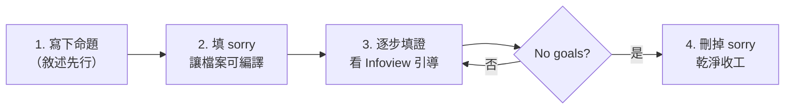

# 1.4 第一個證明

## 本節目標

- 寫出並理解你的第一個 Lean 證明 `1 + 1 = 2`
- 認識 `rfl`、`#check`、`theorem` 等基本元素
- 學會故意寫錯並閱讀錯誤訊息
- 了解 `sorry` 的意義，建立「先敘述後填證」的工作流
- 學會用 `exact?` 尋找現成引理

## 一行證明：`1 + 1 = 2`

在你的專案裡（例如 `Myproj/Basic.lean`）輸入：

```lean
example : 1 + 1 = 2 := rfl
```

按下儲存，VS Code 右側 Infoview 顯示 **"No goals"**，沒有紅色底線——**Lean 承認你證明了 $1 + 1 = 2$**。

逐段拆解這一行：

- `example`：Lean 的關鍵字，意思是「這裡有一個匿名命題與它的證明」。
- `:` 之後、`:=` 之前，是**命題**（也是型別）：`1 + 1 = 2`。
- `:=` 之後是**證明**（也是程式）：`rfl`。

**`rfl` 是 reflexivity（自反性）的縮寫**：$t = t$ 對任何 $t$ 都成立。Lean 會把 `rfl` 丟給型別檢查器，後者把 `1 + 1` 和 `2` 各自計算/化簡到同一個值（都是自然數 $2$），兩邊一致，`rfl` 就成功。換句話說：**只要等號兩邊「定義上」就是同一個東西，`rfl` 就能證**。這類證明叫「由定義即得」（proof by definition）。

用 Python 的心態再讀一次：這行的意思是「提供一個型別為 `1 + 1 = 2` 的值，這個值叫 `rfl`」。型別檢查器檢查 `rfl` 是否真的符合該型別，通過就代表命題得證。

## `#check`：查詢命題與型別

`#check` 是互動式查詢指令，告訴你某個東西的型別：

```lean
#check 1 + 1        -- ℕ（或取決於型別推斷，這裡是自然數）
#check (1 + 1 = 2)  -- Prop：這是一個「命題」
#check rfl          -- 對任何 a : α，rfl : a = a
```

你會看到 `1 + 1 = 2` 的型別是 `Prop`——Lean 中所有「命題」的型別。這正是上一節 Curry–Howard 對應的具體呈現：**命題是型別（其型別為 `Prop`），證明是值**。

## `theorem`：幫定理取名字

`example` 是匿名的。要重複使用，就用 `theorem` 取名：

```lean
theorem one_plus_one : 1 + 1 = 2 := rfl

-- 現在可以引用它
#check one_plus_one
```

輸出是 `one_plus_one : 1 + 1 = 2`。這個定理從此成為你個人數學庫的一員，可以 `exact one_plus_one`、可以 `rw [one_plus_one]`，像呼叫函數一樣使用。

帶前提的定理長這樣（先感受，細節後面章節講）：

```lean
theorem add_comm' (a b : ℕ) : a + b = b + a := Nat.add_comm a b
-- 「對所有自然數 a b，a + b = b + a」
-- 證明方式：引用 Mathlib 既有的 Nat.add_comm
```

## 故意寫錯：看懂錯誤訊息

學習看錯誤訊息，跟學習寫對一樣重要。試試：

```lean
example : 1 + 1 = 3 := rfl
```

Lean 立刻報錯（紅色底線 + Problems 面板）：

```
type mismatch
  rfl
has type
  ?m = ?m : Prop
but is expected to have type
  1 + 1 = 3 : Prop
```

解讀：`rfl` 需要「兩邊是同一個東西」，但 `1 + 1` 化簡後是 `2`，不是 `3`。**Lean 不是說「你的數學不好」，而是說「你宣告的型別與你提供的值對不上」**——這就是型別檢查器在當裁判。

再試一個語法錯誤：

```lean
example : 1 + 1 = 2 := rf1   -- 最後一個是數字 1，不是字母 l
```

錯誤訊息：`unknown identifier 'rf1'`（不認得這個名字）。常見錯誤訊息速查：

| 錯誤訊息 | 意思 | 常見原因 |
| --- | --- | --- |
| `unknown identifier` | 找不到這個名字 | 打錯字、忘記 import |
| `type mismatch` | 型別（命題）對不上 | 證明與敘述不符 |
| `unsolved goals` | 還有目標沒證完 | 漏寫步驟、或少處理一種情況 |
| `tactic failed` | 該戰術幫不上忙 | 目標形狀不符該戰術的適用條件 |

## `sorry`：誠實的佔位符

```lean
theorem hard : ∀ n : ℕ, n + 0 = n := by
  sorry
```

`sorry` 的意思是：「我知道這裡還沒證完，先放著」。Lean 會**接受**這個檔案（讓你能繼續往下工作），但：

- Infoview 與訊息列會出現 **`declaration uses 'sorry'`** 的警告；
- 使用到它的任何定理也會連帶被標記；
- 它**不是**證明，是「承認未完成」的官方標記。

一個重要的心態：**絕不把 `sorry` 留在最終版本**。它就像程式裡的 `TODO`——可以有，但要看得見、要清掉。

## 「先敘述後填證」的工作流

`sorry` 的真正價值，是讓你把寫證明變成**漸進式施工**：



具體操作示範。先宣告一個你想證的定理，暫時用 `sorry`：

```lean
theorem two_plus_two : 2 + 2 = 4 := by
  sorry
```

把游標放到 `sorry` 那行，Infoview 顯示目標 `⊢ 2 + 2 = 4`。先試 `rfl`：

```lean
theorem two_plus_two : 2 + 2 = 4 := by
  rfl
```

成功（Lean 把 `2 + 2` 計算成 `4`，自反性成立）。但如果遇到 `rfl` 不夠用的，就得用**戰術（tactic）模式**（`by` 開頭、逐行作戰），這是後面章節的主題。

## `exact?`：向 Mathlib 求助

當你不知道用哪個引理時，把游標放在目標處，寫：

```lean
example (a b : ℝ) : a + b = b + a := by
  exact?
```

Infoview 會列出 Mathlib 中所有能直接證出當前目標的引理，例如建議 `exact add_comm a b`。點選建議、替換掉 `exact?`，證明就完成了。

其他好用工具：

- `#check @引理名`：查某個引理的精確型別（`@` 會顯示所有隱含參數）。
- `rw?`：建議可以嘗試的改寫。
- Mathlib 官方文件（leanprover-community.github.io/mathlib4_docs）：全文搜尋引理名。命名慣例大致是「主詞_性質」，如 `add_comm`、`mul_assoc`、`Nat.le_refl`。

> 提醒：`exact?` 是**輔助**不是**代替**。第一個目標是自己先想「這一步數學上該怎麼走」，再用 `exact?` 找對應的引理名。直接全程靠 `exact?` 猜，學不到數學。

## 完整迷你練習檔

把以下內容貼進你的 `Basic.lean`，全部應該編譯通過（綠燈）：

```lean
import Mathlib.Tactic

-- 1. 最簡單的自反性證明
example : 1 + 1 = 2 := rfl

-- 2. 帶名字的定理
theorem one_plus_one : 1 + 1 = 2 := rfl

-- 3. 先敘述後填證：用 sorry 起頭，再換成證明
theorem two_plus_two : 2 + 2 = 4 := by
  rfl

-- 4. 用 exact? 找到的引理
example (a b : ℝ) : a + b = b + a := by
  exact add_comm a b

-- 5. 查詢指令（不出現在編譯結果中）
#check one_plus_one
#check (1 + 1 = 2)
```

## 小結與練習

### 本節重點

1. `example : 命題 := 證明` 是 Lean 證明的最小單位；`rfl` 處理「定義上即相等」的目標。
2. `#check` 查型別（命題）；`theorem` 給證明命名、使其可覆用。
3. 錯誤訊息是型別檢查器的裁判報告，看懂它們是基本功。
4. `sorry` 是誠實的佔位符，支撐「先敘述後填證」的工作流，但最終必須清除。
5. `exact?` 能從 Mathlib 中搜出可用的引理。

### 練習

1. 用 `rfl` 證明：`2 * 3 = 6`、`10 - 4 = 6`、`(1 : ℕ) + 0 = 1`。哪一個讓你意外？為什麼？
2. 故意寫出三個不同種類的錯誤（打錯字、型別不符、語法錯），記下 Lean 的錯誤訊息並解讀。
3. 用 `theorem` 與 `rfl` 證明 `three_times_three : 3 * 3 = 9`，然後用 `#check` 確認它的型別。
4. 用 `exact?` 證明：對所有實數 $a b c$，$(a + b) + c = a + (b + c)$。把 `exact?` 的建議寫成正式證明。
5. （思考題）`sorry` 讓命題「編譯通過」。如果一個數學論文用 Lean 寫作但留了一個 `sorry`，這篇論文的價值是什麼？和「整篇用自然語言、無法機器檢查」相比呢？

恭喜完成第一章！下一章我們正式學習戰術（tactics），開始寫真正的結構化證明。
