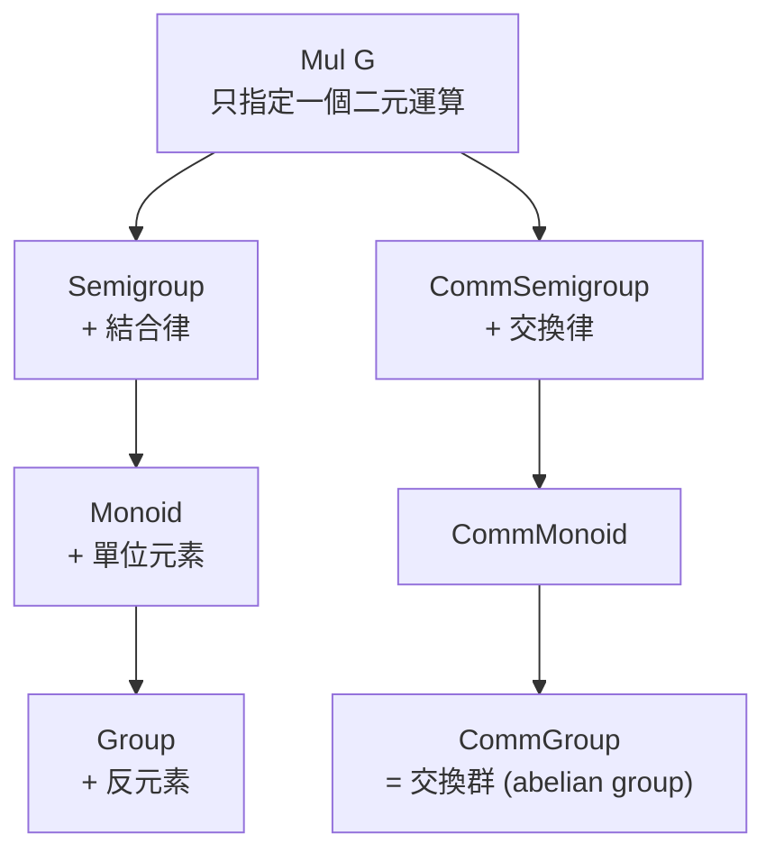

# 6.1 群：axioms 即 typeclass

## 本節目標

- 理解群的定義：結合律、單位元素、反元素三條公理（四公理的常見寫法）
- 認識 Mathlib 中 `class Group (G : Type*)` 的實際定義
- 建立 typeclass 與 instance 的直覺：**「這個型別配上了這套代數結構」**
- 看懂 `Semigroup → Monoid → Group` 的繼承層級
- 使用 `abel`、`ring`、`field_simp` 處理代數等式
- 親手宣告一個具體群的 instance：整數模 $`n`$ 群 $`\mathbb{Z}/n`$

---

## 6.1.1 群的數學定義

一個 **群（group）** 是一個集合 $`G`$ 配上一個二元運算 $`\cdot : G \times G \to G`$ ，滿足：

1. **結合律**： $`(a \cdot b) \cdot c = a \cdot (b \cdot c)`$ ，對所有 $`a, b, c \in G`$ 。
2. **單位元素**：存在 $`e \in G`$ 使得 $`e \cdot a = a \cdot e = a`$ 。
3. **反元素**：對每個 $`a \in G`$ ，存在 $`a^{-1} \in G`$ 使得 $`a \cdot a^{-1} = a^{-1} \cdot a = e`$ 。

教科書常把 1 拆成「封閉性」與「結合律」兩條，合稱四公理。但在 Lean 裡，二元運算的型別 $`G \to G \to G`$ **天生就封閉**——你根本寫不出一個「運算結果落在集合外」的項。這是型別論的第一個紅利：公理變少，因為型別系統幫你免費檢查了一條。

例子： $`(\mathbb{Z}, +)`$ 是群而 $`(\mathbb{N}, +)`$ 不是（沒有反元素）；非零有理數 $`(\mathbb{Q}^\times, \times)`$ 是群而 $`(\mathbb{Q}, \times)`$ 不是（ $`0`$ 沒有反元素）； $`n`$ 階對稱群 $`S_n`$ ：所有 $`\{1, \dots, n\}`$ 的排列在合成運算下成群。

## 6.1.2 Mathlib 的 `Group` class

打開 Mathlib，你會看到（簡化後）：

```lean
class Group (G : Type*) extends DivInvMonoid G where
  div_eq_mul_inv : ∀ a b : G, a / b = a * b⁻¹
  -- 以及由 DivInvMonoid 繼承而來的：
  mul_assoc : ∀ a b c : G, a * b * c = a * (b * c)
  one_mul : ∀ a : G, 1 * a = a
  mul_one : ∀ a : G, a * 1 = a
  inv_mul_cancel_left : ∀ a : G, a⁻¹ * a = 1
```

看起來比教科書定義囉嗦，那是因為 Mathlib 為了 API 完整性多列了幾條 **可推導的性質**（它們能由另外幾條證出，但聲明出來方便取用）。核心只有一件事：

> **`Group G` 是一個「證明攜帶的包裹」：型別 $`G`$ 、一個乘法 `Mul G`、一個單位元 `One G`、一個反元素 `Inv G`，以及它們滿足公理的證明。**

在 Lean 裡，`Group` 是 `class`，所以這個包裹可以靠 **typeclass inference** 自動被找到——這就是下一節的主題。

## 6.1.3 typeclass 的直覺：instance 是「結構的註冊」

初學者最常卡住的地方：`a * b⁻¹` 這種寫法裡，`*` 和 `⁻¹` 到底是什麼？

答案是：`*` 是 `HMul` 型別類的投影函數，`⁻¹` 是 `Inv` 型別類的投影函數。當你寫 `a * b` 且 `a b : G` 時，Lean 會搜尋 `instance : Mul G`，找到就展開，找不到就報錯 `failed to synthesize Mul G`。所以：

| 數學語言 | Lean 語言 |
|---|---|
| 「 $`G`$ 是一個群」 | `Group G` 的 instance 存在 |
| 「設 $`a \in G`$ 」 | `variable {G : Type*} [Group G] (a : G)` |
| 「因為 $`G`$ 是群，故結合律成立」 | `mul_assoc`（Lean 自動從 instance 取出證明） |

關鍵心智模型：**`[Group G]` 這個方括號參數，就是「假設 G 是群」的形式化**。你的定理不再需要寫「設 $`(G, \cdot)`$ 為一群」——型別簽名本身就說完了。

## 6.1.4 代數結構層級

Mathlib 把代數結構排成一座塔，每往上一層多一條公理：



教科書的「阿貝爾群」在 Mathlib 叫 `CommGroup`。塔的設計有一個實際好處：**一個關於 Monoid 的定理，自動對群、對交換群、對 $`\mathbb{N}`$ 都適用**，不用重寫三次。

## 6.1.5 常用 API：`inv_mul_cancel_left` 與朋友們

群論第一章的等式證明，在 Lean 裡幾乎都是重寫 (rewriting)：

```lean
example {G : Type*} [Group G] (a b : G) : a⁻¹ * (a * b) = b := by
  rw [← mul_assoc, inv_mul_cancel_left]
```

常用引理（值得背下來）：`mul_assoc`、`one_mul`、`mul_one`、`inv_mul_cancel_left : a⁻¹ * (a * b) = b`、`mul_inv_cancel_left : a * (a⁻¹ * b) = b`、`inv_inv : a⁻¹⁻¹ = a`、`mul_left_inv : a⁻¹ * a = 1`（即公理本身）。

而當運算是交換的（`CommGroup` 或之後的 `Field`），直接交給 **`abel`** tactic（如 `abel` 一行證 `a * b⁻¹ * c = c * b⁻¹ * a`）；環上的多項式恆等式交給 **`ring`**；分式等式交給 **`field_simp`**（6.3 節實戰）。

## 6.1.6 實例一：整數模 $`n`$ 的加法群

現在親手註冊一個群。取 $`G = \mathbb{Z}/n`$ ，即「餘數的世界」，運算是加法後取餘數。Mathlib 已經提供 `ZMod n`，並且它就是群——但我們把 instance 驗證的過程攤開來看：

```lean
import Mathlib.Tactic

-- ZMod n 上的加法已是交換群，Mathlib 內建 instance。驗證公理可用：
example (n : ℕ) (a : ZMod n) : a + 0 = a := by simp
-- 反元素就是「負的」：在 ZMod 5 中 2 的反元素是 3
example : (2 : ZMod 5) + 3 = 0 := by decide
```

注意最後一個例子：`decide` 對有限型別直接暴力檢查——這是 Lean 獨有的玩法：**有限群可以窮舉證明**。

## 6.1.7 實例二：自訂對稱群 $`S_3`$ 的一小塊

我們自訂一個 3 元素的型別，讓它攜帶一個自己寫的群結構（用乘法表定義的循環群 $`\mathbb{Z}/3`$ ，它正是 $`S_3`$ 的子群）：

```lean
import Mathlib.Tactic

inductive T3 | z | o | t   -- 三元素型別
open T3

def mul3 : T3 → T3 → T3    -- 循環群 Z/3 的乘法表
  | z, x => x | x, z => x
  | o, o => t | o, t => z | t, o => z | t, t => o

instance : One T3 := ⟨z⟩
instance : Mul T3 := ⟨mul3⟩

@[simp] lemma mul3_z_left (x : T3) : mul3 z x = x := by cases x <;> rfl
@[simp] lemma mul3_z_right (x : T3) : mul3 x z = x := by cases x <;> rfl

@[simp] lemma o_mul_t : mul3 o t = z := rfl
@[simp] lemma t_mul_o : mul3 t o = z := rfl
@[simp] lemma o_mul_o : mul3 o o = t := rfl
@[simp] lemma t_mul_t : mul3 t t = o := rfl

-- 結合律與反元素公理：對三元素型別窮舉即可
instance : Group T3 := by
  constructor
  case mul_assoc =>
    intro a b c
    cases a <;> cases b <;> cases c <;> simp [mul3] <;> rfl
  case inv_mul_cancel_left =>
    intro a
    cases a <;> simp [mul3] <;> rfl
  all_goals exact inferInstance
```

`cases a <;> cases b <;> cases c` 一口氣展開 $`3^3 = 27`$ 個子目標，每個都是 `rfl` 級別的計算。**有限結構的公理驗證 = 窮舉**，這在紙上數學反而做不到（太繁瑣），Lean 卻一行搞定。

## 6.1.8 對照表：本章術語

| 數學 | Lean / Mathlib |
|---|---|
| 群 $`G`$ / 交換群 / 幺半群 | `[Group G]` / `[CommGroup G]` / `[Monoid G]` |
| 單位元 $`e`$ 、反元素 $`a^{-1}`$ | `1`、`a⁻¹` |
| 結合重排、交換群線性等式 | `mul_assoc`、`abel` tactic |

## 小結與練習

**小結**：群 = 型別 + 運算 + 公理證明的包裹；typeclass 讓「 $`G`$ 是群」成為編譯器自動查得到的假設；`Semigroup → Monoid → Group` 層級讓定理沿塔向上繼承；有限群的公理可以窮舉驗證。

**練習**（★ 越多越難）

1. ★☆☆☆☆ 證明：`{G : Type*} [Group G] (a b : G) : a * (b * a⁻¹)⁻¹ = a * a * b⁻¹`（提示：`group` tactic 一行可解，但請先手動 `rw` 練習）。
2. ★★☆☆☆ 證明群的單位元素唯一：若 `h : e * a = a` 對所有 `a` 成立，則 `e = 1`。
3. ★★★☆☆ 在 6.1.7 的 `T3` 上，補齊 `Group` instance 中被 `all_goals exact inferInstance` 跳過的每個欄位，確認哪些是繼承來的、哪些要自己證。
4. ★★★★☆ 定義 $`\mathbb{Z}/2 \times \mathbb{Z}/2`$ （`ZMod 2 × ZMod 2`）並證明它是交換群；再用 `decide` 驗證每個非單位元素的階都是 2。
