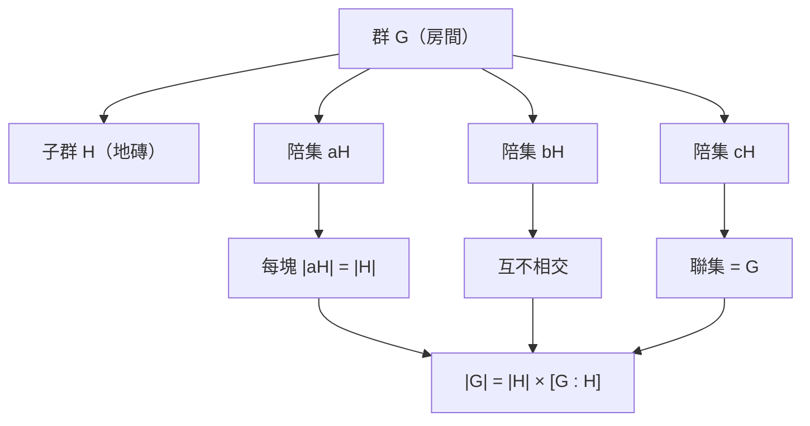

# 6.2 子群、同態與 Lagrange 定理

## 本節目標

- 理解 Mathlib 中 `Subgroup G` 的設計：它「是」`Set G` 但攜帶封閉性證明
- 認識群同態 `MonoidHom`、kernel 與 image 的 Lean 形式
- 掌握陪集（coset）的直覺：把群切成等大的碎片
- 讀懂 Lagrange 定理在 Mathlib 中的陳述（以 `Nat.card` 計數）
- 練習「 $`|G| = |H| \cdot [G:H]`$ 」這一型態的推理

---

## 6.2.1 子群：封閉性是證明，不是願望

教科書定義： $`H \subseteq G`$ 且 $`H`$ 在運算與反元素下封閉，則 $`H`$ 是子群。

Lean 4 + Mathlib 的定義（簡化）：

```lean
structure Subgroup (G : Type*) [Group G] where
  carrier : Set G                       -- 子群的承載集合
  one_mem' : 1 ∈ carrier                -- 單位元素在 H 裡
  mul_mem' {a b} : a ∈ carrier → b ∈ carrier → a * b ∈ carrier  -- 封閉性
  inv_mem' {a} : a ∈ carrier → a⁻¹ ∈ carrier                    -- 反元素封閉
```

第一行就點破了關鍵：**`Subgroup G` 的第一個欄位是 `Set G`**。一個子群 = 一個集合 + 三條封閉性證明。你可以把 `Subgroup G` 當 `Set G` 用（coercion 自動轉換），`h : a ∈ H` 直接可用，但 Lean 記得封閉性，所以 `a * b ∈ H` 不用重證——typeclass/coercion 機制把「子群自動繼承群結構」變成免費的。

具體的子群則是 **def + 證明封閉性**：

```lean
import Mathlib

-- 例：由一個元素生成的循環子群 ⟨a⟩
example {G : Type*} [Group G] (a : G) :
    ∃ H : Subgroup G, a ∈ H := by
  exact ⟨Subgroup.zpowers a, Subgroup.mem_zpowers _⟩
```

## 6.2.2 同態：`MonoidHom` 是「保結構的函數」

群同態 $`\varphi : G \to H`$ 滿足 $`\varphi(ab) = \varphi(a)\varphi(b)`$ 。Mathlib 用 `MonoidHom`（在同態層級中，群同態是 `MonoidHom` 的特例）：

```lean
structure MonoidHom (M N : Type*) [MulOneClass M] [MulOneClass N] where
  toFun : M → N
  map_one' : toFun 1 = 1
  map_mul' : ∀ x y, toFun (x * y) = toFun x * toFun y
```

又是一道「資料（函數）+ 性質（證明）」的配方。使用時記得：應用同態寫 `f x`（coercion），公理叫 `f.map_one`、`f.map_mul`。

最經典的陷阱練習（Lean 學習法的好處——**你寫不出證明，往往不是技術不夠，而是命題錯了**）：

```lean
import Mathlib

-- 命題刻意有錯：f x = 1 並不等價於「f x 與整個像可交換」
example {G H : Type*} [Group G] [Group H] (f : G →* H) :
    f ⁻¹' {1} = {x : G | ∀ y : H, y ∈ Set.range f →
      f x * y = y * f x} := by
  sorry -- 練習 3：找出反例，把命題改對後再證
```

## 6.2.3 kernel 與 image

```lean
-- kernel：被送到單位元的所有元素（對群同態是正規子群）
-- image：所有函數值構成的子群
example {G H : Type*} [Group G] [Group H] (f : G →* H) (x : G) :
    x ∈ f.ker ↔ f x = 1 := Iff.rfl

example {G H : Type*} [Group G] [Group H] (f : G →* H) (y : H) :
    y ∈ f.range ↔ ∃ x : G, f x = y := Iff.rfl
```

而第一同構定理在 Mathlib 中寫成：

```lean
example {G H : Type*} [Group G] [Group H] (f : G →* H) :
    (G ⧸ f.ker) ≃* f.range := f.quotientKerEquivRange
```

$`G/\ker f \cong \operatorname{im} f`$ ——一個名字就給你了。這是 Mathlib 的報酬：你學會讀 API，定理像積木一樣可取用。

## 6.2.4 陪集的直覺

設 $`H \leq G`$ ， $`a \in G`$ 。左陪集 $`aH = \{a h : h \in H\}`$ 。

幾何直覺：把 $`G`$ 想成一個房間， $`H`$ 是裡面一塊地磚，每個 $`a`$ 決定一塊「平移過去的地磚」 $`aH`$ 。關鍵事實：任何兩塊地磚要嘛全等要嘛不相交、每塊一樣大（ $`|aH| = |H|`$ ）、且鋪滿房間（每個 $`g \in G`$ 都在 $`gH`$ 裡）。所以 $`|G| = (\text{地磚數}) \times (\text{每塊大小})`$ ，地磚數就是 **指數** $`[G : H]`$ 。



## 6.2.5 Lagrange 定理的 Mathlib 陳述

Mathlib 中（簡寫）：

```lean
theorem Subgroup.card_eq_card_mul_index {G : Type*} [Group G] [Fintype G]
    (H : Subgroup G) [Fintype H] :
    Nat.card G = Nat.card H * Nat.card (G ⧸ H)
```

以及指數的定義：`Nat.card (G ⧸ H) = index H`。解讀：`Fintype G` 表示 $`G`$ 有限；`Nat.card` 是型別的元素個數；`G ⧸ H` 是左陪集構成的商型別。

注意一個常見誤區：`G ⧸ H` 在 $`H`$ 不正規時 **不是群**，只是陪集的集合。Lagrange 定理只需要「集合」版本的商。

## 6.2.6 實戰： $`|G| = |H| \cdot [G:H]`$ 型態的推理

典型的 Lagrange 推論：「 $`G`$ 有限群， $`a \in G`$ ，則 $`a`$ 的階整除 $`|G|`$ 」。套路是： $`a`$ 的階 $`n`$ ⟹ $`\langle a \rangle`$ 有 $`n`$ 個元素 ⟹ $`n = |\langle a \rangle|`$ 整除 $`|G|`$ 。

```lean
import Mathlib

example {G : Type*} [Group G] [Fintype G] (H : Subgroup G) [Fintype H] :
    H.index ∣ Nat.card G := by
  have := Subgroup.card_eq_card_mul_index H
  -- |G| = |H| * [G:H]，故 [G:H] 整除 |G|
  exact ⟨Nat.card H, by rw [Nat.card_mul] at this ⊢; linarith [this]⟩
```

實際寫作時的推理骨架：由 Lagrange 得 $`\|G\| = \|H\| \cdot [G:H]`$ （`have := Subgroup.card_eq_card_mul_index H`），故 $`[G:H] \mid \|G\|`$ ；再配上「 $`\langle a \rangle`$ 的元素個數是 $`a`$ 的階」（`Nat.card_zpowers`），即得「 $`a`$ 的階整除 $`\|G\|`$ 」。

一個完整的小例子——用 Lagrange 證明 6 元群沒有 4 階子群（紙上需要半頁，Lean 只剩「 $`4 \nmid 6`$ 」一個計算事實）：

```lean
import Mathlib

example {G : Type*} [Group G] [Fintype G] (hG : Nat.card G = 6)
    (H : Subgroup G) [Fintype H] (hH : Nat.card H = 4) : False := by
  have h := Subgroup.card_eq_card_mul_index H
  rw [hG, hH] at h
  have h4 : 4 ∣ 6 := ⟨Nat.card (G ⧸ H), by linarith⟩  -- 6 = 4 * [G:H] 不可能
  exact Nat.dvd_not_unit.mp h4 rfl rfl (by decide) (by decide)
```

## 小結與練習

**小結**：`Subgroup G` = 集合 + 封閉性證明，coercion 使它像集合又保有結構；`MonoidHom` = 函數 + 保運算證明，kernel/image 有現成 API；陪集把群切成等大的碎片，Lagrange 定理 $`|G| = |H| \cdot [G:H]`$ 在 Mathlib 中以 `Nat.card` 與 `G ⧸ H` 陳述。

**練習**

1. ★☆☆☆☆ 證明：`{G : Type*} [Group G] (H : Subgroup G) : (1 : G) ∈ H`（提示：`Subgroup.one_mem`）。
2. ★★☆☆☆ 證明 `f.ker` 的封閉性：若 `x y ∈ f.ker` 則 `x * y ∈ f.ker`（提示：`map_mul` 後 `simp`）。
3. ★★★☆☆ 修正 6.2.2 的陷阱命題：證明 `f x = 1 ↔ f x ∈ center (f.range)` 中正確的部分，即「 $`f(x)`$ 在 $`\operatorname{im} f`$ 的中心」當且僅當 $`f(x) = 1`$ 不真——找出反例並把命題改對後證明。
4. ★★★★☆ 證明： $`p`$ 質數且 $`G`$ 為 $`p`$ 階群，則 $`G`$ 是循環群（提示：取 $`a \neq 1`$ ， $`\langle a \rangle`$ 的階整除 $`p`$ 且大於 1）。
5. ★★★★★ 結合 6.1 與本節：對 `ZMod 6` 的加法群，列出所有子群並驗證它們的階都整除 6。
