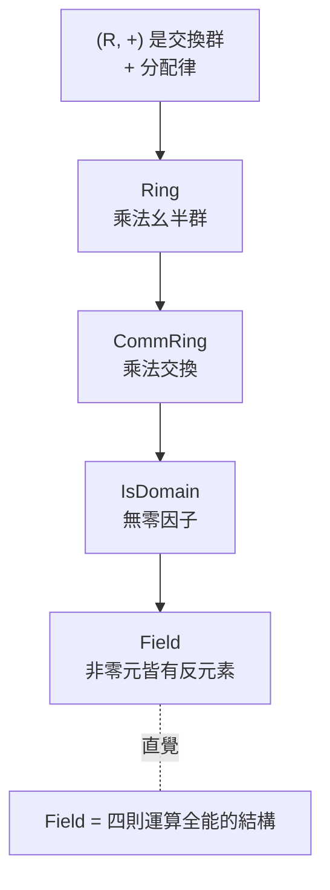

# 6.3 環與體：從整數到有限體

## 本節目標

- 掌握 Ring / CommRing / Field 的公理，與 Mathlib 對應的 class
- 驗證 $`\mathbb{Z}`$ 是交換環：看一個「具體結構如何註冊成 instance」
- 理解 `ZMod p` 在 $`p`$ 質數時是體（Field）的意義
- 認識理想（Ideal）的初步定義與直覺
- `field_simp` 實戰：分式等式的自動化
- 對有限體的存在性建立直覺

---

## 6.3.1 環的公理

一個 **環（ring）** $`R`$ 是一個集合配兩個運算 $`+, \times`$ ：

- $`(R, +)`$ 是 **交換群**：結合、交換、有 $`0`$ 、有負元素
- $`(R, \times)`$ 是 **幺半群**：結合、有 $`1`$
- 分配律： $`a(b + c) = ab + ac`$ 與 $`(a+b)c = ac + bc`$
- Mathlib 額外要求 $`0 \neq 1`$ （排除零環，叫 `Nontrivial`）

再往上加公理就得到塔的更高層：



Mathlib 中 `Field` 的核心（簡化）：

```lean
class Field (K : Type*) extends CommRing K, DivInvMonoid K where
  div_eq_mul_inv : ∀ a b : K, a / b = a * b⁻¹
  exists_pair_ne : ∃ x y : K, x ≠ y
  mul_inv_cancel : ∀ a : K, a ≠ 0 → a * a⁻¹ = 1
  inv_mul_cancel : ∀ a : K, a ≠ 0 → a⁻¹ * a = 1
```

與群不同的是：反元素公理帶著條件 `a ≠ 0`。**零沒有反元素**，這使得 `Field` 的定理到處都是 `≠ 0` 假設，也使得 `field_simp` tactic 成為必需品（見 6.3.4）。

## 6.3.2 驗證 $`\mathbb{Z}`$ 的 instance

$`\mathbb{Z}`$ 是交換環但不是體（ $`2`$ 沒有整數反元素）。在 Lean 裡：

```lean
import Mathlib

open scoped Int

example : CommRing ℤ := inferInstance
example : IsDomain ℤ := inferInstance

-- 注意：Mathlib 給 ℤ 的 / 是「歐幾里得整除」，不滿足 a * a⁻¹ = 1！
example : (2 : ℤ) / 2 = 1 := by norm_num
example : ((2 : ℤ) / 3) * 3 ≠ 2 := by norm_num
```

這段的重點是一個深刻的教訓：**同一個符號 `/` 在不同型別上意義不同**。`ℚ`、`ℝ` 的 `/` 是真除法（來自 `Field` instance），`ℤ` 的 `/` 是歐幾里得除法（來自 `EuclideanDomain` 附近的结构）。typeclass 讓符號重載，但也要求你時時意識到 **當下的 instance 是哪一套**。

Mathlib 中 $`\mathbb{Z}`$ 的 `CommRing ℤ` instance 沒有任何魔法：**每一條環公理，都對應一條關於整數的具體引理**（如 `left_distrib := Int.left_distrib`、`mul_assoc := Int.mul_assoc`），這些引理在整數章節由 Peano 歸納（第 4 章的工具）證出。

## 6.3.3 `ZMod p` 是體

第 5 章學過 $`\mathbb{Z}/m`$ 。現在問：什麼時候 $`\mathbb{Z}/m`$ 是體？

答案： $`m`$ 質數時。直覺：在 $`\mathbb{Z}/p`$ 中，若 $`a \neq 0 \pmod p`$ ，則 $`\gcd(a, p) = 1`$ ，由 Bézout（第 5 章）存在 $`u, v`$ 使 $`au + pv = 1`$ ，故 $`a u \equiv 1 \pmod p`$ ， $`u`$ 就是 $`a`$ 的反元素。 $`m`$ 合成時（如 $`\mathbb{Z}/6`$ 中 $`2 \cdot 3 = 0`$ ）出現零因子，破壞反元素。

Mathlib 的陳述：

```lean
import Mathlib

example (p : ℕ) [Fact (Nat.Prime p)] : Field (ZMod p) := inferInstance
example : Field (ZMod 5) := inferInstance
```

`[Fact (Nat.Prime p)]` 是「把命題打包成參數」的 Mathlib 慣用法： $`p`$ 是質數這個 **命題** 變成一份可傳遞的證據。有了 `Field (ZMod p)`，6.2 節的 Lagrange 立即給出 **費馬小定理**：

$$
a^{p-1} = 1 \quad \text{在 } \mathbb{Z}/p \text{ 中，對 } a \neq 0
$$

因為 $`\mathbb{Z}/p`$ 的非零元在乘法下成群，階為 $`p - 1`$ ，Lagrange 說 $`a`$ 的階整除 $`p-1`$ 。看，第 6 章的三大塊（群、子群計數、體）在這裡接上了。

## 6.3.4 理想（Ideal）初步

**理想** 是環裡的「子群」概念——但更挑剔：它要被環的元素從兩側「吸收」。

$$
I \subseteq R \text{ 是理想} \iff I \text{ 對加法成群，且 } r \in R,\ i \in I \Rightarrow ri \in I
$$

```lean
structure Ideal (R : Type*) [CommRing R] extends AddSubmonoid R where
  smul_mem' : ∀ (c : R) {x}, x ∈ carrier → c • x ∈ carrier
```

直覺對照：

| 群論 | 環論 |
|---|---|
| 子群 $`H \leq G`$ | 子環 / 加法子群 |
| 正規子群 $`N \trianglelefteq G`$ | **理想** $`I \trianglelefteq R`$ |
| 商群 $`G / N`$ | 商環 $`R / I`$ |
| kernel 是正規子群 | kernel 是理想 |

為什麼要「吸收性」？因為商環 $`R/I`$ 的乘法定義 $`(a+I)(b+I) = ab+I`$ 要 **well-defined**，就必須保證拿 $`I`$ 裡的元素亂乘不會跑出去。例子：偶數集合 $`2\mathbb{Z}`$ 是 $`\mathbb{Z}`$ 的理想； $`3\mathbb{Z}`$ 、 $`p\mathbb{Z}`$ 都是。 $`\mathbb{Z}`$ 的每個理想都形如 $`n\mathbb{Z}`$ （主理想）——這正是「 $`\mathbb{Z}/m`$ 覆蓋了 $`\mathbb{Z}`$ 的所有商環」的原因。

```lean
import Mathlib

-- pℤ 是 Z 的理想：Ideal.span {p}
example (p : ℤ) : Ideal ℤ := Ideal.span {p}
-- 成員判定：與整除性無縫接軌
example (x : ℤ) : x ∈ Ideal.span {6} ↔ 6 ∣ x := Ideal.mem_span_singleton
```

`Ideal.span {6}` = 「由 6 生成的理想」= $`6\mathbb{Z}`$ ，而成員判定 `x ∈ Ideal.span {6} ↔ 6 ∣ x` 正是 `Ideal.mem_span_singleton`。理想的理論在 Lean 裡與整除性理論無縫接軌。

## 6.3.5 `field_simp` 實戰

體上的等式一旦有分母，`ring` 就罷工（因為 `a / b` 要先乘開、要處理 `≠ 0`）。`field_simp` 的工作是：**把分母全部乘掉，化成多項式等式，再交給 `ring`**。

```lean
import Mathlib

example (a b c : ℚ) (ha : a ≠ 0) (hb : b ≠ 0) :
    (a / b) * (b / c) = a / c := by field_simp

example (x y : ℚ) (hx : x ≠ 0) (hy : y ≠ 0) :
    1 / x + 1 / y = (x + y) / (x * y) := by field_simp

-- 複雜一點：x + 1/x = y + 1/y 且 x,y ≠ 0 則 x = y
example (x y : ℚ) (hx : x ≠ 0) (hy : y ≠ 0)
    (h : x + 1 / x = y + 1 / y) : x = y := by
  field_simp at h ⊢
  nlinarith [sq_nonneg (x - y), sq_nonneg (x + y), h]
```

使用守則：`field_simp` 只負責「清路障」，清完常要接 `ring`、`nlinarith`；它需要知道「誰不等於零」（假說中要有 `≠ 0`）；對 `Nat`、`ℤ` 別用（它們的 `/` 不是體除法）。

## 6.3.6 有限體的存在直覺

經典定理（本書只給直覺）：

> **有限體的分類**：每個有限體的大小都是質數冪 $`p^n`$ ，且每個 $`p^n`$ 恰有一個（在同構意義下）有限體 $`\mathbb{F}_{p^n}`$ 。

直覺路線：有限體 $`K`$ 的特徵（加法單位元重複相加歸零的最小次數）必是質數 $`p`$ （若是合成數 $`m = ab`$ ，則 $`a \cdot 1`$ 與 $`b \cdot 1`$ 是零因子），於是 $`K`$ 含一份 $`\mathbb{F}_p = \mathbb{Z}/p`$ 的拷貝；而 $`K`$ 是 $`\mathbb{F}_p`$ 上的向量空間（6.4 節正式化！），維度為 $`n`$ 時 $`|K| = p^n`$ 。

Lean 中已形式化為 `FiniteField.card_eq_p_pow` 一類的定理。**你現在已經擁有讀懂其陳述所需的全部語言**：Field、Nat.card、子群（ $`K^\times`$ 的乘法群）、以及將在下一節登場的向量空間維度。

## 小結與練習

**小結**：Ring/CommRing/Field 是逐層加公理的 typeclass 塔上段；`CommRing ℤ` 的 instance 是一覽表的公理↔引理對照；`Field (ZMod p)` 靠 Bézout 與 `Fact (Nat.Prime p)` 成立，並由 Lagrange 免費生出費馬小定理；Ideal 之於環，正如正規子群之於群；`field_simp` 是分式等式的開路機，`ring` 是終結者。

**練習**

1. ★☆☆☆☆ 用 `field_simp` + `ring` 證明：`(a / b) / c = a / (b * c)`（`a b c : ℚ`，適當的 `≠ 0` 假設）。
2. ★★☆☆☆ 證明 `x ∈ Ideal.span {n} ↔ n ∣ x` 對 `x n : ℤ` 成立，並用它證明 `4 ∈ Ideal.span {2}`。
3. ★★★☆☆ 證明：`(ZMod 6) 中 2 * 3 = 0 且 2 ≠ 0 且 3 ≠ 0`——即 $`\mathbb{Z}/6`$ 有零因子，故不是 `IsDomain`（提示：`decide` 或 `norm_num`）。
4. ★★★★☆ 由 `Field (ZMod 5)` 出發，用 Lagrange（6.2）證明：對所有 `a : ZMod 5`，`a ≠ 0 → a ^ 4 = 1`（這是費馬小定理的 $`p = 5`$ 特例；可用 `decide` 對照你的推理）。
5. ★★★★★ 證明：若 $`K`$ 是體且 $`x : K`$ 滿足 $`x^2 = x`$ ，則 $`x = 0`$ 或 $`x = 1`$ （提示：`field_simp` 分解 $`x(x-1) = 0`$ ；需要 `mul_eq_zero`）。
