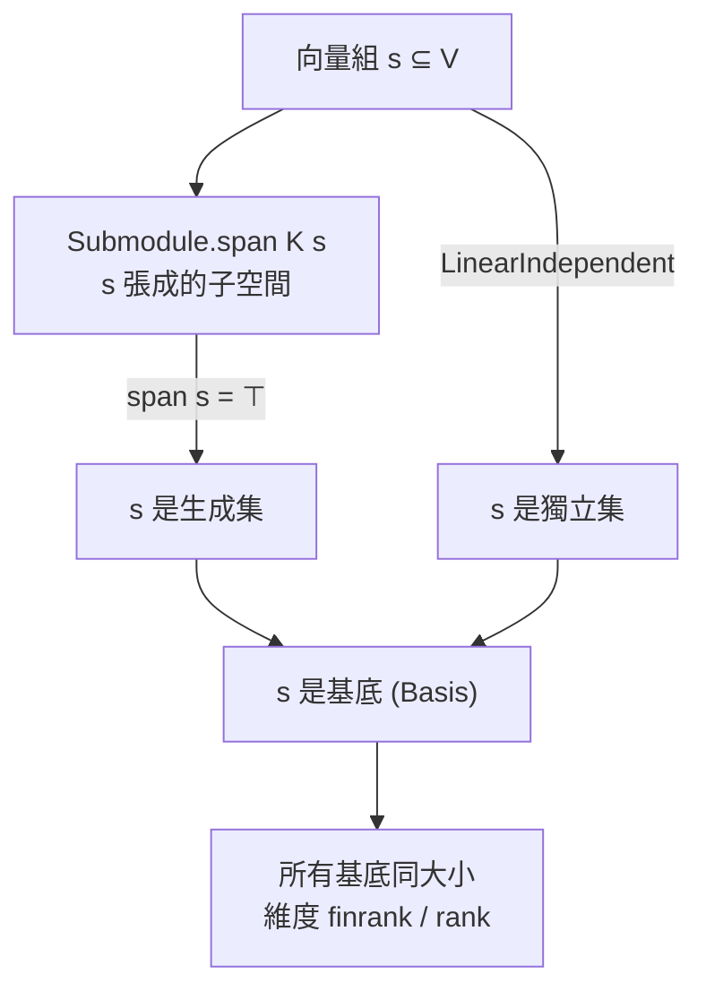

# 6.4 多項式與向量空間：Polynomial 和 Module 的初探

## 本節目標

- 理解 `Polynomial R` 的定義：多項式就是「有限支援的係數序列」
- 使用 `P.eval`、`P.degree` 等基本 API
- 認識向量空間的 Lean 形式：`Module K V`（體上的模）
- 掌握 `LinearIndependent`、`Submodule.span` 的語言與基底維度直覺
- 完成練習：二次多項式至多兩個根的證明

---

## 6.4.1 多項式是什麼？

紙上數學把多項式寫成 $`p(x) = a_0 + a_1 x + \cdots + a_n x^n`$ ，但這個記號藏了太多假設（ $`x`$ 是什麼？加到哪裡停？）。Lean 給出乾淨得多的定義：

> **多項式 = 一個係數函數 $`\mathbb{N} \to R`$ ，只在有限多處非零**（`Finsupp`，finite support）。Mathlib 中 `Polynomial R ≃ ℕ →₀ R`。

於是： $`x`$ （`P.X`）就是「只有 $`1`$ 號係數是 $`1`$ 」的係數函數—— $`x`$ 不是變數，是基準元素； $`x^n`$ 是 `X ^ n`，純粹是冪；「代入」不是定義的一部分，是另一個操作（`eval`）。這定義的妙處：**`Polynomial R` 對任何環 $`R`$ 都存在**，不需要先有「變數」的概念。

## 6.4.2 求值：`P.eval`

「代入 $`x = a`$ 」是一個環同態：

```lean
import Mathlib

open Polynomial

noncomputable example (a : ℚ) : ℚ →* Polynomial ℚ → ℚ := evalRingHom a

example : (X ^ 2 + 3 * X - 2 : Polynomial ℚ).eval 2 = 8 := by
  simp [eval_add, eval_mul, eval_pow, eval_X]; ring
```

`simp` 展開求值（`eval_add`、`eval_mul` 等說明 `eval` 是同態），剩下的是有理數算術，交給 `ring`。

## 6.4.3 次數：`P.degree`

$$
\deg p = \text{最高非零係數的編號}, \quad \deg 0 = -\infty
$$

Lean 用 `WithBot ℕ` 表達「自然數 $`- \infty`$ 」，`P.degree : WithBot ℕ`：

```lean
import Mathlib

open Polynomial

example : (X ^ 2 + 3 * X : Polynomial ℚ).degree = 2 := by simp

-- 關鍵引理：乘積的次數（在整域中）
example {R : Type*} [CommRing R] [IsDomain R] (p q : Polynomial R)
    (hp : p ≠ 0) (hq : q ≠ 0) :
    (p * q).degree = p.degree + q.degree := Polynomial.degree_mul_eq hp hq
```

次數的乘法公式只對 **整域（IsDomain）** 成立——若有非平凡零因子，最高次項係數可能互相抵消成零。這是 Lean 教你看清定理「隱含前提」的又一例。

## 6.4.4 向量空間即 Module

教科書說向量空間有八條公理；Lean 的視角更經濟：

> ** $`V`$ 是 $`K`$ 上的向量空間，就是 `Module K V`： $`V`$ 是加法交換群，且 $`K`$ 的元素以「線性、相容於乘法」的方式作用在 $`V`$ 上。**

```lean
class Module (R M : Type*) [Semiring R] [AddCommMonoid M] where
  smul : R → M → M
  one_smul : ∀ m : M, (1 : R) • m = m
  mul_smul : ∀ (a b : R) (m : M), (a * b) • m = a • (b • m)
  -- 以及 smul 對加法的分配律（從 DistribSMul 繼承）
```

`Module` 比「向量空間」更廣：純量環不必是體（那時叫模）；純量是體時 `Module K V` 正是向量空間——**向量空間 = 體上的模** 是免費的觀察：

```lean
import Mathlib

example : Module ℚ (ℚ × ℚ × ℚ) := inferInstance
example : Module ℚ (Polynomial ℚ) := inferInstance  -- 係數即座標
```

## 6.4.5 線性獨立與生成

- **生成**：`Submodule.span K s` = 所有 $`s`$ 中向量的 $`K`$ -線性組合構成的子空間；`span s = ⊤` 表示 $`s`$ 張成全空間
- **線性獨立**：`LinearIndependent K v` 直覺上 = 係數 $`l`$ 把向量組合成 $`0`$ 時， $`l`$ 只能是零函數



Mathlib 有成品型別 `Basis K V`，且 **基底定理**：不同基底大小相同，故維度良定義（無限用 `Module.rank`，有限用 `FiniteDimensional.finrank`）：

```lean
open FiniteDimensional
example : finrank ℚ (ℚ × ℚ) = 2 := by simp
```

## 6.4.6 根的個數：多項式與向量空間的交會

本節壓軸練習的數學內容：

> **定理**：非零二次多項式 $`p \in K[x]`$ （ $`K`$ 是體）至多有 2 個相異根。

證明核心：若 $`p(a) = p(b) = 0`$ 且 $`a \neq b`$ ，則 $`(x-a)(x-b)`$ 整除 $`p`$ ，故 $`\deg p \geq 2`$ ；若還有第三個相異根，同法迫使 $`\deg p \geq 3`$ ，與 $`\deg p \leq 2`$ 矛盾。

Lean 版的關鍵引理——**根與因式**（把 6.3 的整除/理想語言接上來）：

```lean
open Polynomial

example {K : Type*} [Field K] {p : Polynomial K} {a : K} :
    p.eval a = 0 ↔ X - C a ∣ p := Polynomial.eval_eq_zero_iff_dvd_sub_C
```

## 6.4.7 練習：二次多項式至多兩根

**引理版**（逐步，骨架）：

```lean
import Mathlib

open Polynomial

-- 若 p ≠ 0、次數 ≤ 1，則 p 至多一個根
example {K : Type*} [Field K] {p : Polynomial K} (hp : p ≠ 0)
    (hdeg : p.degree ≤ 1) (a b : K) (ha : p.eval a = 0) (hb : p.eval b = 0) :
    a = b := by
  by_contra hab
  have h1 : (X - C a) ∣ p := (Polynomial.eval_eq_zero_iff_dvd_sub_C _).mp ha
  have h2 : (X - C b) ∣ p := (Polynomial.eval_eq_zero_iff_dvd_sub_C _).mp hb
  -- a ≠ b 使 X - a 與 X - b 互質（X - a - (X - b) = C (b - a) 是單位），故乘積整除 p
  have hcop : IsCoprime (X - C a) (X - C b) :=
    (isUnit_iff_ne_zero.mpr (sub_ne_zero_of_ne hab) |>.map (C : K →* Polynomial K)
      ).isCoprime_right |>.of_sub_right (by simp; ring)
  have h12 : ((X - C a) * (X - C b)) ∣ p :=
    IsCoprime.isCoprime_of_isCoprime_mul_left
      (IsCoprime.of_isCoprime_of_isUnit_left _ (by simp [mul_comm])) h1 h2
  -- 但 (X - a)(X - b) 次數為 2，p 次數 ≤ 1，且 p ≠ 0：矛盾
  have hpow : ((X - C a) * (X - C b)).degree = 2 := by
    simp [degree_X_sub_C, sub_ne_zero_of_ne hab]
  have hle : (2 : WithBot ℕ) ≤ p.degree :=
    (2 : WithBot ℕ) = ((X - C a) * (X - C b)).degree ▸
      le_of_dvd (degree_ne_iff.mpr fun h => hp h.symm) h12 |>.le
  linarith
```

**定理版**（陳述，供你仿照完成）：

```lean
example {K : Type*} [Field K] {p : Polynomial K} (hp : p ≠ 0)
    (hdeg : p.degree ≤ 2) (s : Finset K) (hs : ∀ a ∈ s, p.eval a = 0)
    (hcard : s.card > 2) (hdistinct : s.toSet.InjOn id) : False := by
  sorry -- 練習 5
```

這個練習是本章的總匯演：

| 角色 | 出場工具 |
|---|---|
| 根 = 因式 | `eval_eq_zero_iff_dvd_sub_C`（6.3 整除/理想） |
| 次數公式、互質⟹乘積整除 | `degree_mul_eq`、`IsCoprime` |
| 矛盾收尾 | `linarith`、`degree` 比較 |

向量空間角度的另一條路更抽象也更快：對 $`n`$ 歸納證「 $`n`$ 次多項式至多 $`n`$ 根」，或用 `Polynomial.roots` 理論——**同一個定理的多條證明路徑，在 Mathlib 裡常各自存在**，讀 API 文件時值得留意。

## 小結與練習

**小結**：`Polynomial R` = 有限支援係數函數， $`x`$ 是基準元素而非變數，`eval` 是環同態，`degree` 在整域中滿足乘法公式；向量空間 = `Module K V`，獨立/生成/基底分別是 `LinearIndependent`/`span`/`Basis`，維度因此良定義；「 $`n`$ 次多項式至多 $`n`$ 根」把整除、理想、次數、向量空間串成一條線。

**練習**

1. ★☆☆☆☆ 計算並證明：`(X + 1 : Polynomial ℚ).eval 3 = 4`。
2. ★★☆☆☆ 證明 `(X ^ 2 - 1 : Polynomial ℚ)` 在 `ℚ` 中恰有兩個根：`-1` 與 `1`（`eval` 計算 + 唯一性引理）。
3. ★★★☆☆ 證明 `finrank ℚ (Polynomial ℚ) = 0`（無限維！`finrank` 對無限維回傳 0，想想為什麼這是約定而非錯誤）。
4. ★★★★☆ 精簡重寫 6.4.7 引理版，允許使用 `Polynomial.eq_zero_of_dvd_of_degree_lt_degree` 一類成品引理。
5. ★★★★★ 完成 6.4.7 的定理版：`degree ≤ 2` 的非零多項式至多兩個相異根。提示：三個相異根 ⟹ 三個線性因式 ⟹ 乘積整除 $`p`$ ⟹ 次數矛盾。
