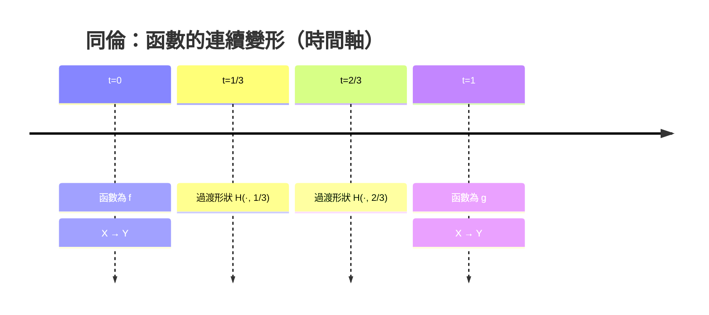

# 9.3 連通性與同倫

## 本節目標

- 建立連通性的直覺：一個空間「不能切成兩塊開的」。
- 認識 Mathlib 的 `IsPreconnected` 與 `IsConnected`。
- 證明 $`\mathbb{R}`$ 是連通的，以及連通集在連續映射下像仍連通。
- 初步認識同倫（homotopy）的概念與 mermaid 圖解。
- 了解 `ContinuousMap` 型別與其為何是代數拓樸的入門磚。

---

## 連通的直覺：不能切成兩塊開的

看兩個集合：

- $`[0, 1]`$ ：連成一片，你找不到一條縫把它分成兩個「自己內部也開」的部分。
- $`[0, 1] \cup [2, 3]`$ ：明顯是兩塊，縫就在 $`(1, 2)`$ 這個缺口。

如何把「連成一片」說得精確？用**開集**來說：

**定義（連通）**。 $`s \subseteq X`$ 稱為**連通的**，若**不存在**開集 $`U, V`$ 使得：

1. $`s \subseteq U \cup V`$ （ $`U, V`$ 合起來罩住 $`s`$ ）；
2. $`U \cap s \neq \varnothing`$ 、 $`V \cap s \neq \varnothing`$ （兩塊都真的抓到 $`s`$ ）；
3. $`U \cap V \cap s = \varnothing`$ （兩塊在 $`s`$ 內不相交）。

直覺：如果能找到兩個開集，把 $`s`$ 「乾淨地」切成兩塊不重疊的碎片，那 $`s`$ 就不是連通的。注意三個條件都要相對於 $`s`$ 來看—— $`U, V`$ 可以在 $`s`$ 外面重疊，無所謂。

與前面各章的否定式定義（如完備性的柯西否定式）一樣，「連通 = 切不開」是一個**不存在性**命題，證明連通往往用反證法：假設切得開，推出矛盾。

---

## Mathlib：`IsPreconnected` 與 `IsConnected`

Mathlib 的表述：

```lean
def IsPreconnected (s : Set α) : Prop :=
  ∀ u v : Set α, IsOpen u → IsOpen v → (s ∩ u).Nonempty → (s ∩ v).Nonempty →
    s ⊆ u ∪ v → (s ∩ (u ∩ v)).Nonempty

def IsConnected (s : Set α) : Prop :=
  IsPreconnected s ∧ s.Nonempty
```

讀法對照：`IsPreconnected s` 說「若 $`s`$ 被兩個開集 $`u, v`$ 罩住、且兩者都在 $`s`$ 內抓到點，則兩者必在 $`s`$ 內也重疊」。這正是「切不乾淨」的正面化寫法——不是說切不開，而是說**任何看似切開的兩塊必相交**，邏輯等價但適合直接證明。

`IsConnected` 額外要求非空：空集切不開（ vacuously preconnected ），但通常我們不想讓空集參與「連通成分」的討論，所以要求至少有一個點。單點集是連通的；兩個不交開區間的並不是。

---

## $`\mathbb{R}`$ 是連通的

**定理**。 $`\mathbb{R}`$ 是連通的；更一般地， $`s \subseteq \mathbb{R}`$ 連通 $`\iff`$ $`s`$ 是一個區間。

直覺證明（反證法 + 完備性）：假設 $`\mathbb{R} = U \cup V`$ ， $`U, V`$ 開、不交、皆非空。取 $`a \in U`$ 、 $`b \in V`$ （不妨 $`a < b`$ ）。令

$$
c = \sup \{ x : [a, x] \subseteq U \}.
$$

由 $`U`$ 開， $`c \notin U`$ 時附近可縮短上確界、 $`c \in U`$ 時附近可擴張——兩種情況都逼 $`c \in V`$ （因 $`U \cup V = \mathbb{R}`$ ）；再由 $`V`$ 開， $`c`$ 附近屬於 $`V`$ ，那麼 $`\sup`$ 可以再往上推，與 $`c`$ 是上確界矛盾。

完備性（sup 存在）再次擔任引擎：** $`\mathbb{R}`$ 連通 $`\iff`$ $`\mathbb{R}`$ 完備**，有理數 $`\mathbb{Q}`$ 就因不完備而可以在 $`\sqrt{2}`$ 處切開（ $`(-\infty, \sqrt{2}) \cap \mathbb{Q}`$ 與 $`(\sqrt{2}, \infty) \cap \mathbb{Q}`$ 是 $`\mathbb{Q}`$ 中不交的非空開集，合起來罩住 $`\mathbb{Q}`$ ）。

Mathlib 提供現成引理：

```lean
-- 區間是預連通的（從而 ℝ 連通）
theorem Real.preconnected_univ : (Set.univ : Set ℝ).IsPreconnected
```

以及一般區間版本 `Set.preconnected_Icc`、`Set.preconnected_Ioo` 等。有了它，配上非空，就得到 `Real.isConnected_univ` 風格的結論。

---

## 連通性的遺傳：連續像仍連通

**定理**。若 $`s`$ 連通、 $`f`$ 在 $`s`$ 上連續，則 $`f(s)`$ 連通。

證明是典型的「抽象化後一行搞定」：假設 $`f(s)`$ 被開集 $`U, V`$ 乾淨切開，那麼 $`f^{-1}(U)`$ 、 $`f^{-1}(V)`$ 是 $`s`$ 上（相對）開的、不交的、非空的，合起來罩住 $`s`$ ——這就切開了 $`s`$ ，矛盾。

$$
\text{連通 } s \xrightarrow{\ f \text{ 連續}\ } \text{連通 } f(s)
$$

這個引理的威力：配上 $`\mathbb{R}`$ 連通，立即得到**中間值定理的連通版**—— $`[a,b]`$ 連通，故 $`f([a,b])`$ 連通，而 $`\mathbb{R}`$ 的連通子集是區間，區間包含端點之間的一切值。9.4 節的專案將正式開發這條路。

---

## 同倫：把一個函數連續地變形成另一個

現在跳一層樓，問一個更宏觀的問題：**兩個連續函數之間有什麼結構？**

設 $`f, g : X \to Y`$ 連續。直覺上，「 $`f`$ 可以連續地變形成 $`g`$ 」是什麼意思？想象 $`f`$ 是一根鐵絲的形狀， $`g`$ 是另一根；同倫就是讓鐵絲**在 $`Y`$ 裡連續地彎動**、過程中不斷線，最後變成 $`g`$ 的形狀。

形式化：**同倫**是一族連續函數 $`H : X \times [0, 1] \to Y`$ ，滿足

$$
H(x, 0) = f(x), \qquad H(x, 1) = g(x).
$$

參數 $`t \in [0,1]`$ 是「時間」： $`t=0`$ 時是 $`f`$ ， $`t=1`$ 時是 $`g`$ ，中間是連續過渡。記作 $`f \simeq g`$ 。



**例子**： $`X = Y = \mathbb{R}`$ ， $`f(x) = 0`$ 、 $`g(x) = x`$ 。直線同倫 $`H(x, t) = t\,x`$ 就把它們連起來—— $`\mathbb{R}`$ 上的函數意外地好變形。但在 $`Y = S^1`$ （圓）上，恆等映射與一個把圓「翻轉」的映射之間就**沒有**同倫：圓是有洞的，鐵絲繞洞的方向變不掉。

**同倫的威力在於分類**：「 $`f \simeq g`$ 」是一個等價關係（自反、對稱、傳遞都可證，靠拼接時間參數），等價類叫**同倫類**。不同的同倫類反映目標空間的**洞**的數量——這正是代數拓樸的基本哲學：

> **把幾何問題（空間的形狀）翻譯成代數問題（某個代數結構的分類）。**

同倫是這個翻譯的第一顆螺絲：往後的**基本群** $`\pi_1`$ 、**同倫群** $`\pi_n`$ ，全部建立在「映射的同倫類」之上。所以說同倫是代數拓樸的入門磚。

---

## Mathlib 的 `ContinuousMap`

在同倫的敘述裡， $`H`$ 是「一個從 $`X \times [0,1]`$ 出發的連續函數」。Mathlib 把「連續函數」本身做成一個型別：

```lean
/-- 連續函數的型別 -/
def ContinuousMap (X Y : Type*) [TopologicalSpace X] [TopologicalSpace Y] :=
  { f : X → Y // Continuous f }

notation:50 C(X, Y) => ContinuousMap X Y
```

這是一個 subtype：資料是底層函數 $`f`$ ，附帶證明 `Continuous f`。把連續性「打包進型別」的好處：

- 可以對 `C(X, Y)` 賦予拓樸（緊緻開拓樸、在緊緻域上一致收斂拓樸等），於是**函數空間自己變成拓樸空間**——9.1 節「丟掉距離」的動機在這裡回收：函數空間往往只有拓樸、沒有好的度量。
- 同倫可以定義為 `C(X, Y)` 中的**路徑**：一個連續映射 `C([0,1], C(X, Y))`。這個「把拓樸現象再拓樸化」的迴圈，正是現代拓樸學的玩法。

---

## 小結與練習

**本節重點**：

| 概念 | 一句話 | Lean |
|---|---|---|
| 連通 | 切不開（開集分離不存在） | `IsConnected` / `IsPreconnected` |
| $`\mathbb{R}`$ 連通 | 完備性 $`\Rightarrow`$ 不可切 | `Real.preconnected_univ` |
| 連續像 | 連通集的連續像連通 | `IsConnected.image` |
| 同倫 | 連續變形 $`H(x,t)`$ | `ContinuousMap` 上的路徑 |

**練習**：

1. 證明 $`\mathbb{Q}`$ 不連通（在 $`\sqrt{2}`$ 處切開）。
2. 證明連通集的閉包仍連通。（提示：若 $`\bar{s}`$ 被切開，限制回 $`s`$ 也被切開。）
3. 用「連續像連通 + $`\mathbb{R}`$ 連通子集是區間」推導：若 $`f : [0,1] \to \mathbb{R}`$ 連續且 $`f(0) < 0 < f(1)`$ ，則存在 $`c`$ 使 $`f(c) = 0`$ 。
4. 證明同倫關係 $`\simeq`$ 是等價關係（數學證明即可，拼接時間參數 $`t \mapsto 2t`$ 、 $`t \mapsto 2t - 1`$ ）。
5. 在 Lean 中 `#check @IsPreconnected` 與 `#check @ContinuousMap`，確認定義形式與本節一致。
