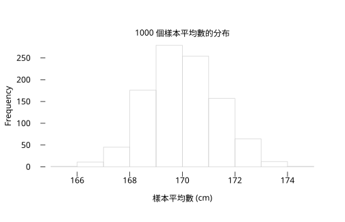

# 1.1 從母體到樣本

## 本節目標

- 說清楚**母體**（population）與**樣本**（sample）的區別，以及參數與統計量的對應
- 理解為什麼人類史上一再放棄普查、改用抽樣：從 1936 年《Literary Digest》的慘敗，到 1948 年美國總統選舉民調的「杜魯門錯誤」
- 建立**統計推論的基本迴路**：樣本 → 統計量 → 推論母體
- 用 `r.set_seed` + `g.rnorm` 模擬「從一個母體抽很多樣本」，親眼看到樣本平均數的波動，並認識**抽樣變異**

---

## 一個開學第一天的問題

假設你是老師，想知道「全國高中二年級學生的平均身高」。全國有幾十萬人——你不可能一個一個量。你能做的，只是量**自己班上 30 個學生**，然後用這 30 個數字去**猜**全國的平均。

這就是統計學的核心處境：

- **母體**：你想研究的那整群對象（全國高二學生的身高）。
- **樣本**：你實際拿到的資料（班上 30 人）。
- 母體的特徵值叫**參數**（parameter），例如母體平均 $`\mu`$ 、母體標準差 $`\sigma`$ ——它們是固定的數，但**通常永遠不知道**。
- 樣本的特徵值叫**統計量**（statistic），例如樣本平均 $`\bar{x}`$ 、樣本標準差 $`s`$ ——它們可以算出來，但**每抽一次就變一次**。

| 母體（未知、固定） | 樣本（已知、隨機） |
| --- | --- |
| 平均 $`\mu`$ | 平均 $`\bar{x}`$ |
| 標準差 $`\sigma`$ | 標準差 $`s`$ |
| 比例 $`p`$ | 比例 $`\hat{p}`$ |

**統計推論**就是箭頭右邊猜左邊的學問：


---

## 為什麼不乾脆普查？

直覺上「問所有人」最準，但歷史一再證明：**問所有人不但貴，還常常更不準**。

### 1940 年：美國放棄詳細普查

美國憲法要求每十年普查一次人口，起初普查員會逐項詢問大量個人資訊。到了 1940 年，人口已超過一億三千萬，逐項詳細訪查的成本與誤差都失控了。美國普查局從 1940 年起改用**抽樣長表**（long form）：大多數家庭只答基本題，隨機抽樣的部分家庭回答詳細題。這是「大國官方統計必然走向抽樣」的轉捩點——不是抽樣比較便宜所以妥協，而是**控制得好的抽樣比失控的普查更準**。

### 1936 年：《Literary Digest》的兩百四十萬人大翻車

美國雜誌《Literary Digest》在 1920–1932 年連續五屆總統選舉民調全中，聲譽如日中天。1936 年它信心滿滿地寄出約一千萬份問卷，收回約 240 萬份——樣本之大前所未有——預測藍登（Alf Landon）以 57% 大勝。結果羅斯福（FDR）拿下 61% 的選票連任，**預測錯了 19 個百分點**，雜誌幾個月後就倒閉了。

錯在哪？不在樣本小，而在**樣本偏**：

- 名單來自雜誌訂戶、電話簿與汽車登記——1936 年大蕭條年代，有電話、有汽車的人明顯偏富裕，而富裕者多支持藍登。
- 收回的 240 萬份是**自願回覆**，不滿現任者更踴躍回覆（自我選擇偏差）。

樣本量 $`n = 2{,}400{,}000`$ 再大，也救不了**有系統的偏差**。抽樣誤差隨 $`\sqrt{n}`$ 縮小，但偏差不會——它在那裡就是那裡。

### 1948 年：杜魯門舉起那張報紙

1948 年總統選舉，蓋洛普（Gallup）等主要民調機構一致預測杜威（Thomas Dewey）大勝杜魯門（Harry Truman）。當選的卻是杜魯門——《芝加哥論壇報》提前付印的頭版「DEWEY DEFEATS TRUMAN」成了他著名的舉報照片。

1948 年民調失誤的技術原因是**配額抽樣**（quota sampling）：訪員按性別、年齡、地區的固定比例湊人數，但在配額內「挑誰」由訪員自行決定，而訪員傾向挑共和黨支持者（較好約、較友善）。這之後，蓋洛普改用**隨機抽樣**，並修正了訪談時點與未決選民的處理，往後數十年準確度大增。

> **這三段歷史的共同教訓**：抽樣的成敗關鍵不在「量」，而在「怎麼抽」。隨機性不是讓結果不可控，反而是讓偏差可被數學**量化**的前提。

---

## 統計推論的基本迴路

把上述整理成一個會不斷重複的迴路：

1. 從母體抽出一個隨機樣本；
2. 對樣本計算統計量（本書先學 $`\bar{x}`$ 、 $`\`s``$ ，後面還有 $`t`$ 統計量等）；
3. 用機率模型描述「如果母體是這樣，統計量會怎麼波動」；
4. 反過來：由統計量的波動，推斷母體大概是什麼樣。

步驟 3 是整本書的引擎：**「一個母體抽很多樣本，統計量會怎麼分布」**。這在真實世界做不到（你只有一個樣本），但在電腦裡可以模擬——這正是本章接下來要做的事。

---

## 動手：一個母體，一千個樣本

我們先用 `r.set_seed(42)` 建一個「已知答案」的母體：10,000 人的身高，平均 170 cm、標準差 7 cm。母體的 $`\mu`$ 、 $`\`\sigma``$ 在這裡是上帝視角、全能看見——現實中你看不見，先看見它是為了待會驗證。

```python
import rstatistics as r

g = r.set_seed(42)
pop = g.rnorm(10000, mean=170.0, sd=7.0)   # 上帝視角：整個母體

print(r.mean(pop), r.sd(pop))
```

輸出：

```
169.92083385516628 7.042943773660772
```

母體平均 169.92、標準差 7.04，跟我們設定的 170、7 很接近（模擬母體本身的隨機起伏）。

現在**假裝我們不知道母體**，每次只抽 $`n = 30`$ 人，算出樣本平均 $`\bar{x}`$ 。重複 1,000 次，觀察 $`\bar{x}`$ 的波動：

```python
g = r.set_seed(42)
means = [r.mean(g.rnorm(30, mean=170.0, sd=7.0)) for _ in range(1000)]

print(r.mean(means))                  # 1000 個 x̄ 的平均
print(r.sd(means))                    # x̄ 的波動幅度
print(7.0 / (30 ** 0.5))              # 理論值：σ/√n
print(min(means), max(means))         # 最倒霉與最幸運的樣本
```

輸出：

```
169.9944017666233
1.3296983751060767
1.2780193008453875
165.9495203632563 174.62151806842664
```

畫出這 1,000 個 $`\bar{x}`$ 的直方圖：

```python
g2 = r.Graphics(width=7.0, height=4.5)
g2.hist(means, main="1000 個樣本平均數的分布", xlab="樣本平均數 (cm)")
g2.save("img/sampling_dist.svg")
```

輸出（SVG 已存檔，可在瀏覽器開啟）：

```
（無文字輸出；sampling_dist.svg 內含直方圖）
```

圖：抽樣分布：樣本平均的散布。


這張圖就是**抽樣分布**（sampling distribution）的模擬版。三個關鍵觀察：

1. **中心對**：1,000 個 $`\bar{x}`$ 的平均是 169.99，幾乎等於母體的 170——樣本平均**平均而言**沒有偏。這種性質叫**不偏**（unbiased），第 1.3 節談變異數時會再遇到同樣的問題。
2. **波動可預測**： $`\`\bar{x}``$ 的標準差約 1.33，跟理論值 $`\sigma/\sqrt{n} = 7/\sqrt{30} \approx 1.278`$ 一致。這個量有個名字：**標準誤**（standard error）。
3. **單一樣本可能很離譜**：最倒霉的樣本平均只有 165.9——如果你只抽一次又剛好抽到它，你會嚴重低估全班身高。**抽樣變異是真實存在的**，統計學的一半篇幅都在教我們怎麼為它計帳。

### 樣本越大，波動越小

把 $`n`$ 從 5 加到 300，同樣跑 1,000 次：

```python
for n in (5, 30, 300):
    g3 = r.RNG(1)                       # 每種 n 用同一顆種子，公平比較
    ms = [r.mean(g3.rnorm(n, mean=170.0, sd=7.0)) for _ in range(1000)]
    print(n, r.mean(ms), r.sd(ms), 7.0 / (n ** 0.5))
```

輸出：

```
5 169.97768078857965 3.242154721179385 3.1304951684997055
30 169.9925976127022 1.2181599600392787 1.2780193008453875
300 169.9970511857067 0.40464777516401756 0.404145188432738
```

波動大致按 $`1/\sqrt{n}`$ 縮小： $`\`n``$ 變 100 倍，誤差只縮 10 倍。這也解釋了民調界的老經驗： $`\`n = 1000``$ 上下的選舉民調，誤差約 $`\sqrt{0.25/1000} \approx 1.6\%`$ ，再往上砸錢，報酬遞減。

```python
g4 = r.set_seed(5)
p_hat = [x / 1000 for x in g4.rbinom(1000, 1000, 0.5)]   # n=1000 的民調，真支持度 50%
print(r.mean(p_hat), r.sd(p_hat), (0.25 / 1000) ** 0.5)
```

輸出：

```
0.499952 0.01609685698528768 0.015811388300841896
```

1,000 次「民調」的支持度落在 0.5 附近、標準差約 1.6 個百分點——這就是「±3% 抽樣誤差」的由來（95% 的樣本會落在 $`2 \times 1.6\%`$ 內，詳見第 8 章）。

### 種子的意義

`r.set_seed(42)` 回傳一個與 R 的 `set.seed(42)` **位元等價**的亂數產生器。設定種子後，你每次執行程式都得到同一組「隨機」數——這正是教科書能貼出可重現輸出的原因。寫作業與研究程式時，**永遠先設種子**。

```python
g5 = r.set_seed(42)
print(g5.runif(2))
```

輸出：

```
[0.9148060434963554, 0.9370754132978618]
```

這兩個數與 R 裡 `set.seed(42); runif(2)` 的輸出（0.9148060、0.9370754）完全相同。

---

## 與 R 對照

```r
set.seed(42)
pop <- rnorm(10000, 170, 7)
cat(mean(pop), sd(pop), "\n")
means <- replicate(1000, mean(rnorm(30, 170, 7)))
cat(mean(means), sd(means), "\n")
```

輸出：

```
169.9208 7.042944 
169.9944 1.329698 
```

與 `rstatistics` 的輸出（169.9208…、7.0429…、169.9944…、1.3297…）完全一致——因為兩邊的亂數流就是同一串。

---

## 小結

- 母體的 $`\mu`$ 、 $`\`\sigma``$ 是未知常數；樣本的 $`\bar{x}`$ 、 $`\`s``$ 是可計算、但每次抽樣都不同的隨機量。
- 普查在大型母體上既貴又容易因**覆蓋不全**與**自願回覆**而偏差（1936、1948 两次大翻車都是偏差，不是樣本不足）。
- 統計推論的迴路：**樣本 → 統計量 → 透過抽樣分布推論母體**。
- 樣本平均數的波動尺度是 $`\sigma/\sqrt{n}`$ （標準誤），隨樣本數按 $`1/\sqrt{n}`$ 縮小。
- `r.set_seed` + `g.rnorm` 讓抽象的「抽樣分布」變成可以畫出來的直方圖。

---

## 練習

1. 把 1.1 節的模擬改成 $`n = 10`$ ，重跑 1,000 次。樣本平均數的標準差大約是多少？與 $`7/\sqrt{10}`$ 比較。
   （提示：只改 `g.rnorm` 的第一個參數。）
2. 母體改成均勻分布：`g.runif(10000, 150, 190)`，重做「1,000 個 $`n=30`$ 樣本平均」的實驗。直方圖的形狀跟常態母體時有何不同？（提示：想想第 6 章的中央極限定理會怎麼說。）
3. 用 `g.rbinom` 模擬 $`n=400`$ 的民調（真支持度 0.5）1,000 次。有幾次 $`\hat{p}`$ 落在 0.45 到 0.55 之外？跟 95% 這個數字接得上嗎？
4. **歷史思考題**：1936 年《Literary Digest》的樣本有 240 萬，1948 年蓋洛普的樣本只有約 5 萬，為什麼後者反而可靠？用「偏差 vs. 抽樣變異」各寫兩句話。
5. 寫一個小函數 `sample_se(n, reps)`，回傳 1,000 個樣本平均數的標準差；對 $`n = 1, 4, 16, 64`$ 各呼叫一次，檢查結果是否約為 $`7/\sqrt{n}`$ 。
