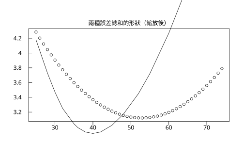

# 1.2 集中趨勢

## 本節目標

- 會算並會選：平均數（mean）、中位數（median）、加權平均（weighted mean）
- 理解平均數對**離群值**敏感、中位數**穩健**的具體含義
- 用程式掃描驗證一個漂亮的幾何事實：**平均數最小化平方誤差總和，中位數最小化絕對誤差總和**

---

## 「代表值」是什麼意思？

給你一組數，要你挑一個數 $`c`$ 來代表整組，這句話其實沒講完——**用什麼標準評估挑得好不好**？不同的標準會給出不同的答案，這正是本節三種「平均」的差別來源。

先備妥一組資料。這是某小公司 15 位員工的月薪（萬元），大部分人在 30–60 之間，但老闆月薪 220：

```python
import rstatistics as r

w = [28, 30, 32, 32, 35, 36, 38, 40, 42, 45, 48, 52, 55, 60, 220]
print(r.mean(w), r.median(w))
```

輸出：

```
52.86666666666666 40
```

平均 52.9 萬，中位數 40 萬——差了 13 萬。**哪個才是「 typical 」的薪資？**

### 平均數：加總除以個數

$`\bar{x} = \dfrac{1}{n}\sum_{i=1}^{n} x_i`$

```python
print(r.mean(w))
```

輸出：

```
52.86666666666666
```

### 中位數：排序後的中間

把資料排序， $`\`n``$ 為奇數取正中間那個，偶數取中間兩個的平均。

```python
print(r.median(w))
print(r.median([1, 2, 3, 100]))   # 偶數個：取 2 與 3 的平均
```

輸出：

```
40
2.5
```

15 個人裡有 7 人月薪高於 40、7 人低於 40——中位數描述的是**排在隊伍中間的人**，與老闆賺多少無關。

### 加權平均：有些數字「票比較重」

若資料是「分數 × 權重」的形式（例如學期成績：期中 20%、期末 50%、報告 30%），用**加權平均**：

```python
scores = [60, 80, 90]
weights = [0.2, 0.3, 0.5]
print(r.weighted_mean(scores, weights))
```

輸出：

```
81.0
```

手算驗證： $`\`60(0.2) + 80(0.3) + 90(0.5) = 12 + 24 + 45 = 81``$ 。

---

## 離群值：平均數的致命傷

回到薪資例子。老闆的 220 萬在平均數裡佔了整整一票的話語權——它把總和拉高了 180 萬，除以 15 就是每人平均被拉高 12 萬。

**平均數對每個數字一視同仁，因此一個極端值就能牽著它走；中位數只在乎排名，極端值再大也只影響「它是第幾名」。**

這種性質叫**穩健性**（robustness）：把最大值從 220 改成 2200，中位數完全不動，平均數暴增到 170.9。房價、所得、網站回應時間這類**右偏**（少數極大值）的資料，新聞報導「平均房價」時往往正是被少數豪宅拉高的。

> **選擇法則**：資料大致對稱 → 平均數（用到每個數字，效率高）；資料偏斜或有離群值 → 中位數（穩健）。兩者都算、互相比對，是資料分析的第一道防偽檢查——兩者差很多時，一定有故事。

---

## 為什麼是「平方」與「絕對值」？（Gauss 與最小平方法，1805 前後）

現在回答開頭的問題：平均數和中位數不只是兩個約定俗成的算法，它們各自是**某種誤差標準下的最優解**。

設想我們要挑一個數 $`c`$ 代表資料，並用「每個點離 $`c`$ 的距離總和」衡量 $`c`$ 的好壞。常見兩種衡量：

- **平方誤差總和**： $`\`S(c) = \sum_{i} (x_i - c)^2``$
- **絕對誤差總和**： $`\`A(c) = \sum_{i} |x_i - c|``$

用微積分（或幾何直覺）可以證明：

- 使 $`S(c)`$ 最小的 $`c`$ 恰為**平均數**：對 $`c`$ 微分得 $`-2\sum(x_i - c) = 0`$ ，解出 $`c = \bar{x}`$ 。
- 使 $`A(c)`$ 最小的 $`c`$ 恰為**中位數**： $`\`A(c)``$ 的斜率是「左邊點數 − 右邊點數」，斜率由負轉正的位置正是中位數。

這兩條線索的歷史重量極不相同。**最小平方法**在 1805 年由 Legendre 首度公開發表（Gauss 主張自己 1790 年代就在用，兩人還為此有過著名的優先權爭議），它後來長成整座線性迴歸大廈的地基（本書第 10 章）；**絕對誤差**準則則一直要到 20 世紀計算機普及後，才以「分位數迴歸」等面貌被廣泛使用——因為 $`|x_i - c|`$ 在 $`c = x_i`$ 處有尖角、不易微分，當年處理起來太麻煩。

我們不背這個結論，直接**用程式掃描驗證**：對一堆候選值 $`c`$ ，算出兩種誤差總和，找出各自的贏家。

```python
import rstatistics as r

w = [28, 30, 32, 32, 35, 36, 38, 40, 42, 45, 48, 52, 55, 60, 220]

# 候選值：以 0.5 為步距掃過資料範圍
cands = [x + 0.5 * k for x in range(20, 61) for k in range(4)]

best_sq  = min(cands, key=lambda c: sum((xi - c) ** 2 for xi in w))
best_abs = min(cands, key=lambda c: sum(abs(xi - c) for xi in w))

print(best_sq, best_abs)
print(r.mean(w), r.median(w))
```

輸出：

```
53.0 40.0
52.86666666666666 40
```

平方誤差的贏家 53.0（掃描步距 0.5，逼近平均數 52.87）、絕對誤差的贏家 40.0（正是中位數）。**兩種「平均」背後各站著一種誤差哲學**：平方懲罰大誤差特別重（所以離群值能拉動平均數），絕對值一視同仁（所以中位數穩健）。

再畫出兩條誤差曲線的形狀（平方是光滑拋物線，絕對值是折線）：

```python
g = r.Graphics(width=7.0, height=4.5)
cs = [x * 1.0 for x in range(25, 75)]
g.plot(cs, [sum((xi - c) ** 2 for xi in w) / 10000 for c in cs])
g.lines(cs, [sum(abs(xi - c) for xi in w) / 100 for c in cs])
g.title("兩種誤差總和的形狀（縮放後）", )
g.save("img/err_curves.svg")
```

輸出：

```
（無文字輸出；err_curves.svg 內含兩條曲線）
```

圖：兩條誤差曲線。


可以看到「平均數」落在光滑碗底，「中位數」落在 V 形折谷底。

---

## 動手：薪資資料的三種代表值

```python
import rstatistics as r

w = [28, 30, 32, 32, 35, 36, 38, 40, 42, 45, 48, 52, 55, 60, 220]

print("mean   =", r.mean(w))
print("median =", r.median(w))
print("wmean  =", r.weighted_mean(w, [1] * 15))    # 等權重 → 退化成普通平均
```

輸出：

```
mean   = 52.86666666666666
median = 40
wmean  = 52.86666666666667
```

等權重的加權平均就是普通平均（末位差來自浮點加總順序）。做一個更真實的加權場景：公司整體「平均薪資」若要反映**職級人數結構**（基層 12 人、中層 2 人、高層 1 人），就得用職級平均乘人數加權——直接把三個職級的平均薪資加起來除以 3 是錯的。

---

## 與 R 對照

```r
w <- c(28,30,32,32,35,36,38,40,42,45,48,52,55,60,220)
cat(mean(w), median(w), "\n")
scores <- c(60, 80, 90); weights <- c(0.2, 0.3, 0.5)
sum(scores * weights)      # R 沒有內建 weighted.mean 以外的加權時可用
weighted.mean(scores, weights)
```

輸出：

```
52.86667 40 
[1] 81
```

`mean`、`median`、`weighted.mean` 與 `r.mean`、`r.median`、`r.weighted_mean` 一一對應。

---

## 小結

- 平均數、中位數、加權平均都是「代表值」，差別在**誤差標準**：平方 vs. 排名 vs. 帶權票數。
- **平均數最小化平方誤差總和，中位數最小化絕對誤差總和**——本節用掃描驗證過。這解釋了平均數為何對離群值敏感（平方懲罰大誤差）、中位數為何穩健。
- 資料偏斜或含離群值時，先看中位數；mean 與 median 相差懸殊是資料有故事的警訊。
- 最小平方法（1805 年 Legendre 發表）是這套「平方」哲學的歷史起點，往後貫穿變異數（1.3 節）與迴歸（第 10 章）。

---

## 練習

1. 對薪資資料 `w`，把 220 依序改成 300、1000、10000，記錄 mean 與 median 的變化。median 動了嗎？
2. 掃描驗證程式中，把候選步距從 0.5 縮到 0.01，看看 best_sq 是否更接近 `r.mean(w)`。
3. 自己造一組**左偏**資料（多數值靠近上限、少數極小值），畫直方圖（`r.Graphics().hist`），比較 mean 與 median 誰在左邊。
4. 某班成績：小考 70 分佔 20%、期中 85 分佔 30%、期末 90 分佔 50%，用 `r.weighted_mean` 算學期總分。若改成「期末佔 100%」呢？
5. **證明題（提示版）**：對 $`S(c) = \sum (x_i - c)^2`$ 微分並令其為 0，導出 $`c = \bar{x}`$ ；再論證 $`A(c) = \sum |x_i - c|`$ 在 $`c`$ 越過中位數時斜率由負轉正。
