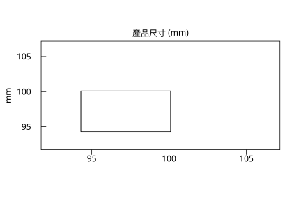

# 1.4 五數摘要與箱型圖

## 本節目標

- 會算五數摘要：min / Q1 / median / Q3 / max，理解 `fivenum`（hinge）與 `quantile` type 7（插值）的差別
- 掌握箱型圖的鬚與離群值規則（ $\`1.5 \times \mathrm{IQR}`$ ）
- 會用 `r.fivenum` / `r.summary` / `r.boxplot_stats`，並用 `Graphics` 畫箱型圖存成 SVG

---

## 用五個數字看一組資料

平均與標準差是兩個數；**五數摘要**給五個：最小值、下四分位 $`Q_1`$ 、中位數、上四分位 $`Q_3`$ 、最大值。它把資料切成四塊各佔 25%，一口氣透露**位置、離散、對稱性**：若 $`Q_3`$ 離中位數比 $`Q_1`$ 遠得多，資料右偏。

延續 1.4 節的產品尺寸資料（15 件常規品，加上兩件異常：一件 140 mm、一件 62 mm）：

```python
import rstatistics as r

x = [97.0, 100.1, 92.4, 93.2, 105.9, 95.3, 106.6, 103.1, 99.8, 95.0,
     95.9, 98.3, 92.3, 98.7, 94.3, 140.0, 62.0]

print(r.fivenum(x))
print(r.quantile(x, [0.25, 0.5, 0.75]))
print(r.summary(x))
```

輸出：

```
[62.0, 94.3, 97.0, 100.1, 140.0]
  25%   50%   75% 
 94.3  97.0 100.1 
   Min. 1st Qu.  Median    Mean 3rd Qu.    Max. 
  62.00   94.30   97.00   98.23  100.10  140.00 
```

`r.summary` 在五數之外多給一個平均數——注意平均 98.23 被右邊的 140 拉高了（比中位數 97.0 大），這正是 1.2 節「mean 與 median 相差懸殊＝資料有故事」的小號版本。

## hinge 與插值：兩種四分位數

算 $`Q_1`$ 、 $\`Q_3`$ 其實**沒有全球統一的公式**，本書會遇到兩種：

- **Tukey hinges**（`r.fivenum` 用的）：把資料（含中位數本身）對半劈成兩半，各取**中位數**。結果一定是資料裡真實出現的數。
- **type 7 插值**（`r.quantile` 的內定 type，也是 R 的內定）：把 $`n-1`$ 等分的位置之間做線性插值，結果可以落在兩個資料點之間。R 的 `quantile(x, .25)` 預設就是它。

當 $`n`$ 是奇數時兩法可能不同。看 $`n = 8`$ 的例子：

```python
y = [97.0, 100.1, 92.4, 93.2, 105.9, 95.3, 106.6, 103.1]

print(r.fivenum(y))
print(r.quantile(y, [0.25, 0.5, 0.75], type=7))
```

輸出：

```
[92.4, 94.25, 98.55, 104.5, 106.6]
    25%     50%     75% 
 94.775  98.550 103.800 
```

中位數一致（98.55），但 $`Q_1`$ ：hinge 給 94.25（下半 4 個數的中位數），type 7 給 94.775（位置 $`0.25 \times 7 + 1 = 2.75`$ 的插值）。**兩者都對**——四分位數本來就是約定。讀別人的輸出時，先問「用的是哪一種」。

## 箱型圖：鬚與 1.5×IQR 離群值規則

箱型圖（boxplot，Tukey 1970 年代推廣）把五數摘要畫成一個箱子加兩根鬚：

- 箱體從 $`Q_1`$ 到 $`Q_3`$ ，箱內橫線是中位數；
- **鬚**最長伸到箱緣外 $`1.5 \times \mathrm{IQR}`$ 為止（且不超過資料範圍內最遠的非離群點）；
- 落在鬚之外的點被**單獨畫成點**，即離群值。

規則的算式：

$`\text{下界} = Q_1 - 1.5\,\mathrm{IQR}, \qquad \text{上界} = Q_3 + 1.5\,\mathrm{IQR}`$

手工複算一次這組產品資料：

```python
q1, q3 = r.quantile(x, [0.25])[0], r.quantile(x, [0.75])[0]
iqr = q3 - q1
lo, hi = q1 - 1.5 * iqr, q3 + 1.5 * iqr
print(q1, q3, iqr, lo, hi)
print(sorted(v for v in x if v < lo or v > hi))
inl = sorted(v for v in x if lo <= v <= hi)
print(inl[0], inl[-1])
```

輸出：

```
94.3 100.1 5.799999999999997 85.6 108.79999999999998
[62.0, 140.0]
92.3 106.6
```

$`1.5 \times \mathrm{IQR} = 8.7`$ ，上下界 85.6 / 108.8；62 與 140 落在界外——**62 與 140 被判為離群值**，鬚則停在界內最遠的資料點 92.3 與 106.6。這一切 `r.boxplot_stats` 一次算齊（回傳 R 風格的統計物件）：

```python
st = r.boxplot_stats(x)
print(st.stats)      # [鬚下, Q1, 中位數, Q3, 鬚上]
print(st.out)        # 離群值
```

輸出：

```
[92.3, 94.3, 97.0, 100.1, 106.6]
[140.0, 62.0]
```

與手工計算完全一致。

### 畫出來存成 SVG

```python
g = r.Graphics(width=6.0, height=4.0)
g.boxplot(x, main="產品尺寸 (mm)", ylab="mm")
g.save("img/box_product.svg")
```

輸出：

```
（無文字輸出；box_product.svg 內含箱型圖）
```

圖：箱型圖。



圖上會看到：箱子 94.3–100.1、中位線 97、鬚到 92.3 與 106.6，以及飄在鬚外的兩個離群點。

> **鬚規則的統計含義**：若資料來自常態母體， $`\pm 1.5\,\mathrm{IQR}`$ 大約對應 $`\pm 2.7\sigma`$ ，理論上只有約 0.7% 的點會被誤判為離群值——所以箱型圖點名出來的點，值得**逐個拿起來看**，而不是直接刪掉。本例的 62 與 140 就是要回工廠查的製程異常，不是要從報表上抹掉的數字。

## 兩組並排：箱型圖的真正威力

單看一組資料，箱型圖只是五數摘要的圖形版；**並排比較**才是它被發明出來的主因。工廠例子的續集：白班與夜班各抽 30 件，看夜班機器是否跑偏：

```python
import rstatistics as r

g = r.set_seed(21)
day = [round(v, 1) for v in g.rnorm(30, 100, 3)]
night = [round(v, 1) for v in g.rnorm(30, 104, 3)]
for name, d in (("白班", day), ("夜班", night)):
    st = r.boxplot_stats(d)
    print(name, st.stats, "out:", st.out)
```

輸出：

```
白班 [93.2, 97.6, 100.15, 102.0, 106.6] out: []
夜班 [98.5, 103.4, 104.4, 107.5, 110.3] out: []
```

沒有任何一點被判離群值——**但兩個箱子中位數差了約 4 mm，且箱子幾乎不重疊的部位很多**。「沒有離群值」不等於「沒有問題」：這裡的問題是**整體位置的偏移**（可能是夜班機器校正跑了），而不是個別異常件。單看每班的離群值規則會完全漏掉它。

這也預告了全書的一個主題：**「個別點怪不怪」與「兩組差多少」是兩個不同的問題**。後者要到第 7 章（ $\`t`$ 檢定）才有正式答案，但箱型圖並排已經能讓你在 EDA 階段就嗅到問題。

---

## 與 R 對照

```r
x <- c(97.0,100.1,92.4,93.2,105.9,95.3,106.6,103.1,99.8,95.0,
       95.9,98.3,92.3,98.7,94.3,140.0,62.0)
print(quantile(x))
print(fivenum(x))
print(boxplot.stats(x))
boxplot(x, main="產品尺寸 (mm)", ylab="mm")
```

輸出：

```
   0%   25%   50%   75%  100% 
 62.0  94.3  97.0 100.1 140.0 
[1]  62.0  94.3  97.0 100.1 140.0
$stats
[1]  92.3  94.3  97.0 100.1 106.6
$n
[1] 17
$conf
[1] 94.77740 99.22260
$out
[1] 140  62
```

`r.summary(x)` 的印出格式仿 R 的 `summary(x)`（六欄 Min. / 1st Qu. / Median / Mean / 3rd Qu. / Max.），`r.boxplot_stats` 對應 R 的 `boxplot.stats`（連中位數的 $`95\%`$ 凹口區間 `conf` 都有算）。

---

## 小結

- 五數摘要（min、 $\`Q_1`$ 、median、 $\`Q_3`$ 、max）一次給出位置與離散；`r.summary` 再附上 mean 供對照。
- 四分位數有兩種約定：**hinge**（`r.fivenum`，取真實資料值）與 **type 7 插值**（`r.quantile` 內定，R 同款）； $\`n`$ 為奇數時結果可能不同，兩者皆合法。
- 箱型圖的鬚止於箱緣外 $`1.5 \times \mathrm{IQR}`$ ，界外點單獨標記；在常態資料上這條線約在 $`2.7\sigma`$ ，誤報率極低，但被點名的點要**個別檢視**而非刪除。
- `r.boxplot_stats` + `Graphics.boxplot` 讓「算規則」與「畫圖」分離，方便你在文字報告中引用確切數字。

---

## 練習

1. 對 $`n = 9`$ 的資料 `[1,2,3,4,5,6,7,8,100]` 分別算 `r.fivenum` 與 `r.quantile(x, [0.25, 0.5, 0.75], type=7)`，指出哪些四分位數不同、並手驗 hinge 的取法。
2. 手工複算：對 `x = [5, 7, 10, 12, 15, 18, 21, 60]` 求 $`1.5 \times \mathrm{IQR}`$ 的上下界，判斷 60 是否離群值，再與 `r.boxplot_stats` 的 `out` 對照。
3. 用 `g = r.set_seed(3); y = g.rnorm(100, 50, 5)` 抽 100 個常態值，畫箱型圖。有幾個離群值？跟「理論上約 0.7%」接近嗎？（ $\`n=100`$ 時期望約 0.7 個，抽不到 0 個也很正常。）
4. 把第 3 題的資料換成指數分布 `g.rexp(100, rate=1/10)`，畫箱型圖。上下鬚為何不對稱？（提示：右偏。）
5. **比較題**：`r.summary(x)` 與 `r.fivenum(x)` 各適合什麼場合？各用一句話說明你會在什麼報告裡用哪一個。
