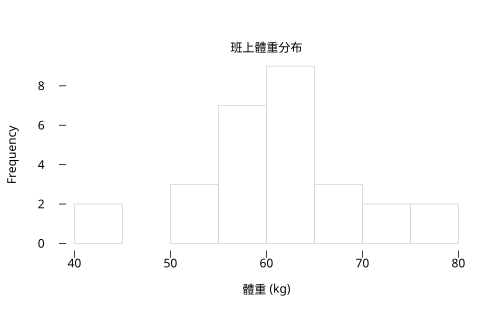
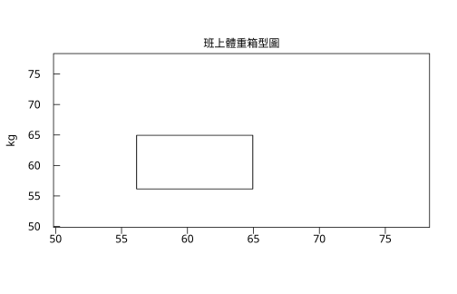

# 1.5 用 rstatistics 看資料

## 本節目標

- 把 1.1–1.4 的工具串成一條完整的 **EDA**（Exploratory Data Analysis，探索式資料分析）流程
- 實戰一組 28 筆的真實感資料：`r.summary`、`r.table` 類別統計、`r.rank` 與 `r.scale` 的用途
- 完成整章回顧練習

---

## EDA：Tukey 留下的工作方式

John Tukey 在 1977 年出版《Exploratory Data Analysis》，主張：**拿到資料先畫圖、先算摘要，別急著套模型**。本章學的每個工具都是 EDA 的一站；本節把它們走一遍。

流程如下：


## 資料：某班 28 位學生的體重

```python
import rstatistics as r

g = r.set_seed(2026)
w = [round(v, 1) for v in g.rnorm(28, mean=62, sd=8)]
print(w)
```

輸出：

```
[66.2, 53.4, 63.1, 61.3, 56.7, 41.9, 56.1, 53.8, 62.9, 58.2, 58.7, 56.2, 60.2, 60.2, 41.6, 72.8, 66.9, 63.7, 55.6, 67.5, 59.4, 60.7, 50.9, 73.7, 62.4, 77.3, 75.8, 62.5]
```

### 第一站：五數摘要

```python
print(r.summary(w))
```

輸出：

```
   Min. 1st Qu.  Median    Mean 3rd Qu.    Max. 
  41.60   56.18   60.45   60.70   64.33   77.30 
```

解讀：中位數 60.45 與平均 60.70 很接近（資料大致對稱）； $`\`Q_3 - Q_1 \approx 8.15``$ 、全距 35.7。沒有明顯偏斜，可以放心用 mean/sd 這一組（1.2、1.3 節的選擇法則）。

### 第二站：直方圖與箱型圖

```python
g1 = r.Graphics(width=7.0, height=4.5)
g1.hist(w, main="班上體重分布", xlab="體重 (kg)")
g1.save("img/w_hist.svg")

g2 = r.Graphics(width=7.0, height=4.5)
g2.boxplot(w, main="班上體重箱型圖", ylab="kg")
g2.save("img/w_box.svg")
```

輸出：

```
（無文字輸出；w_hist.svg 與 w_box.svg 已存檔）
```

圖：重量資料的直方圖、重量資料的箱型圖。



直方圖顯示資料集中在 55–65，左邊拖著兩個 41.x 的值；箱型圖用它們檢查（`r.boxplot_stats(w).out` 是空串列）確認這兩個值還在 $`1.5 \times \mathrm{IQR}`$ 界內——**是「偏輕」，不是「離群」**，差別在第 1.4 節的規則。

### 第三站：類別化與 `r.table`

連續值常切成類別看組成。把體重三等分：

```python
cat = ["偏輕" if x < 56 else ("標準" if x <= 68 else "偏重") for x in w]
print(r.table(cat))
```

輸出：

```
x
偏輕 偏重 標準 
 6  4 18 
```

28 人中「標準」18 人、「偏輕」6 人、「偏重」4 人。`r.table` 對應 R 的 `table()`，給**次數表**——描述統計裡最古老、也最常被低估的工具。

### 第四站：`r.rank` 與 `r.scale`

- **`r.rank`**：給出每個值的名次（並列值取平均名次）。它本身不玄，但它是第 9 章**無母數檢定**（Wilcoxon、Spearman）的原料——那些檢定只看名次不看數值，因此對離群值免疫。
- **`r.scale`**：z 分數，讓「我的體重在這班算幾個標準差之外」變成一個可比較的數。

```python
print(r.rank(w)[:8])
z = r.scale(w)
print([round(v, 3) for v in z[:8]])
print(r.mean(z), r.sd(z))
```

輸出：

```
[22.0, 4.0, 20.0, 16.0, 9.0, 2.0, 7.0, 5.0]
[0.643, -0.855, 0.28, 0.07, -0.469, -2.201, -0.539, -0.808]
-2.1807952269422717e-17 1.0
```

第一筆 66.2 是全班第 22 名、z 分數 0.643；第 6 筆 41.9 的 z 分數 −2.20——低於平均兩個標準差以上，值得多看一眼（但按箱型圖規則仍非離群值）。

## 一條 EDA 流程的完整劇本

把上述整理成你以後每次拿到新資料的固定動作：

1. **`r.summary(x)`**：五數 + 平均，30 秒掌握位置與離散；
2. **mean vs. median**：差很多 → 有偏斜或離群值 → 改用 median/IQR/MAD（1.2、1.3）；
3. **畫圖**：`hist` 看形狀、`boxplot` 點名離群值（1.4）；
4. **離群值追查**：每個被 1.5×IQR 點名的值都要能回答「量測錯誤？真實極端？還是值得研究的個案？」；
5. **類別化**：`r.table` 看組成（1.5）；
6. **標準化**：`r.scale` / `r.rank` 為後續比較與檢定鋪路。

> EDA 不是檢定的前置雜務，而是**產生假說的地方**：1.1 節的抽樣迴路告訴我們統計量會波動，1.2–1.4 節的工具讓我們看清楚手上這個樣本長什麼樣，第 7 章起再教我們對波動計帳。

## 一個新手常見的陷阱：看到離群值就刪

把一個 130 kg 的資料塞進我們的體重資料（可能是磅秤壞了，也可能是一位真的特別重的學生——你不知道之前不能動手）：

```python
g = r.set_seed(2026)
w = [round(v, 1) for v in g.rnorm(28, mean=62, sd=8)]
w2 = w + [130.0]
print(r.mean(w), r.sd(w))
print(r.mean(w2), r.sd(w2))
print(r.median(w2), r.mad(w2))
st = r.boxplot_stats(w2)
print(st.out)
```

輸出：

```
60.70357142857143 8.544111341990963
63.09310344827586 15.361662183000593
60.7 6.819960000000002
[130.0]
```

一個點讓平均加了 2.4、標準差幾乎翻倍（8.5 → 15.4）；中位數與 MAD 幾乎不動，`boxplot_stats` 也正確地把它點名出來。正確的處理順序是：

1. **先追查**：磅秤錯？抄錄錯？還是真實值？
2. 查得到是錯誤 → 修正或剔除，**並在報告裡寫明**；
3. 查不到 → 保留它，改用穩健度量（median/IQR/MAD）描述，或兩組數字並陳。

「先算 boxplot、再決定要不要相信 mean/sd」正是本章所有工具的分工。

---

## 與 R 對照

```r
set.seed(2026)
w <- round(rnorm(28, 62, 8), 1)
print(summary(w))
print(table(cut(w, c(0, 56, 68, Inf), labels = c("偏輕", "標準", "偏重"))))
print(head(rank(w)))
print(round(head(scale(w)), 3))
```

輸出：

```
   Min. 1st Qu.  Median    Mean 3rd Qu.    Max. 
  41.60   56.17   60.45   60.70   64.33   77.30 

偏輕 標準 偏重 
   6   18    4 
[1] 22  4 20 16  9  2
[1]  0.643 -0.855  0.280  0.070 -0.469 -2.201
```

逐項對得上（R 的 `summary` 顯示 56.17 與 `rstatistics` 的 56.18 只是小數位取捨差異）。注意 R 用 `cut()` 做類別化，我們用 list comprehension——概念相同。

---

## 小結

- 一條 EDA 流程：summary → 圖形 → 離群值追查 → table 類別化 → scale/rank 標準化。
- `r.summary` / `r.table` / `r.rank` / `r.scale` 加上 `Graphics`，就是本章全部工具的實戰組合。
- **mean/median 接近 → 用 sd 組；差很遠 → 用 median/IQR/MAD 組**——這條法則貫穿全章。
- 本章回答「這份樣本長什麼樣」；接下來的章節回答「這個樣本對母體說了什麼」。

---

## 練習（第 1 章總回顧）

1. **全流程**：用 `g = r.set_seed(11)` 抽 `g.rnorm(25, 100, 5)`，走完上面六步 EDA，每步一行結論。
2. **離群值實驗**：在練習 1 的資料塞一個 `999`，重算 summary、sd、mad、boxplot_stats。哪些量變了、哪些沒變？對應 1.2/1.3 節的什麼性質？
3. **Bessel 再現**：不查書，用 20 字以內說明「為什麼樣本變異數除 $`n-1`$ 而非 $`n`$ 」，再用 `n = 5` 的模擬驗證你的說法（1.3 節）。
4. **hinge vs type 7**：造一組 9 個數，找出 hinge 與 type 7 給出不同 $`Q_1`$ 的情況，並各畫一次箱型圖（1.4 節）。
5. **歷史串聯**：用 100 字把以下四件事連成一個故事——1936 年 Literary Digest 的偏差、1948 年配額抽樣的失誤、Tukey 的 EDA（1977）、以及你寫程式時「先設種子」的習慣。（提示：偏差無法靠 $`n`$ 消除；隨機性讓誤差可計算；可重現性讓計算可驗證。）
