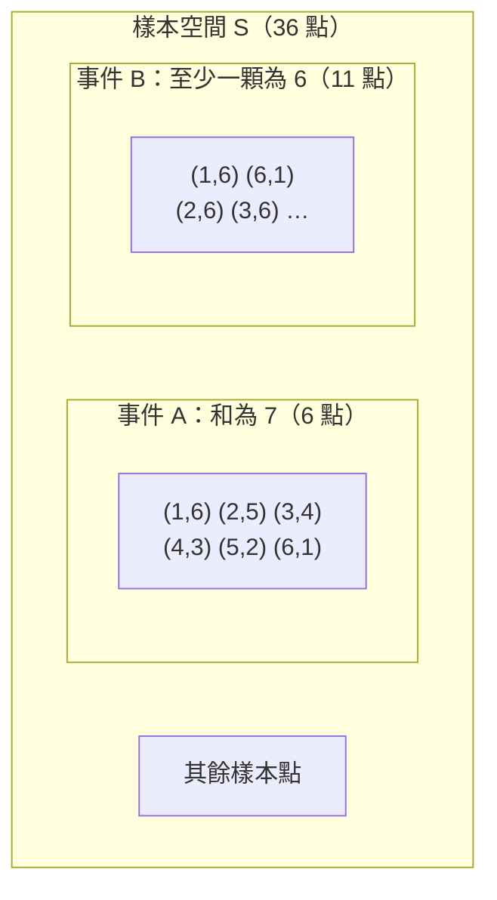

# 2.1 隨機試驗與樣本空間

## 本節目標

- 說清楚什麼是「隨機試驗」，以及為什麼機率論需要一套嚴格的語言
- 認識機率論誕生的歷史現場：1654 年 Pascal 與 Fermat 的賭金分配通信
- 學會用集合表示樣本空間與事件，掌握事件之間的關係（包含、互斥、餘事件）
- 用 Python 列舉骰子樣本空間，實際計算事件機率

---

## 問題：一場中斷的賭局

1654 年，法國賭徒 de Méré 爵士寫信給數學家 Blaise Pascal，問了一個賭桌上就會遇到的問題：

> 兩人各出 32 枚金幣下注，約定先贏 3 局的人拿走全部賭金。現在比賽因故中斷，一人已贏 2 局、另一人贏了 1 局，賭金該怎麼分？

當時流行的分法很粗糙：按已贏局數比例分（2:1）。但這明顯不對——如果比數是 2:2，按比例五五分，可再贏一局就全贏，明顯占便宜的一方虧了。正確的分法應該問：

> **如果比賽繼續，各自的獲勝「機會」有多大？按機會分。**

要回答這個問題，必須先能精確地描述「機會」。這正是機率論要解決的第一個問題。

### 歷史：1654 年 Pascal–Fermat 通信，機率論誕生

Pascal 自己解了一部分，覺得不放心，就把問題寄給了圖盧茲的律師兼業餘數學家 Pierre de Fermat。兩人在 1654 年往返了幾封信（世稱 *De Méré 問題通信*），各自用不同方法得到一致的答案：

- **Pascal 的路線**：遞迴。設 A 再贏 1 局就贏，列出接下來所有可能局面，倒推每個局面的價值。
- **Fermat 的路線**：直接枚舉。比賽最多再打 2 局就分勝負（ $`(2,1)`$ 的比數下，A 需要 1 勝、B 需要 2 勝），把這 2 局的 $`2^2 = 4`$ 種等可能結果全部列出來：

```text
第5局 第6局   勝者
A    A       A
A    B       A（A 已贏滿 3 局）
B    A       A
B    B       B
```

4 種結果裡 A 贏 3 種，所以賭金應按 $`3:1`$ 分配——而不是直覺的 $`2:1`$ 。

Fermat 的做法隱含了一個革命性的想法：**把隨機現象的所有可能結果攤在紙上，一個不漏地數**。這個「樣本空間」的原始形態，就是本章的起點。這幾封信後來被數學史家公認為機率論的誕生時刻；1657 年荷蘭的 Huygens 據此寫出第一本機率教材 *De Ratiociniis in Ludo Aleae*（論賭博中的推理）。

---

## 隨機試驗與樣本空間

### 隨機試驗

一個**隨機試驗**（random experiment）滿足三個條件：

1. 可以在相同條件下重複進行；
2. 每次的可能結果不止一個，且**事先知道全部可能結果**；
3. 單次會出現哪個結果無法預測。

丟骰子、抽牌、明天是否下雨（近似地），都是隨機試驗。

### 樣本空間

隨機試驗**所有可能結果構成的集合**稱為**樣本空間**（sample space），記作 $`S`$ 或 $`\Omega`$ ；每個元素稱為一個**樣本點**。Fermat 枚舉的那 4 行，就是一個樣本空間。

常見的樣本空間：

| 試驗 | 樣本空間 |
|---|---|
| 丟一枚銅板 | $`S = \{H, T\}`$ |
| 丟一顆骰子 | $`S = \{1, 2, 3, 4, 5, 6\}`$ |
| 丟兩顆骰子（區分先後） | $`S = \{(i, j) : 1 \le i \le 6,\ 1 \le j \le 6\}`$ ，共 36 點 |
| 等公車時間 | $`S = \{t \in \mathbb{R} : t \ge 0\}`$ |

注意丟兩顆骰子時， $`(3, 5)`$ 與 $`(5, 3)`$ 是**不同的樣本點**——只要試驗過程能區分「第一顆」與「第二顆」。這是初學者最容易犯的錯：把樣本空間建成 $`\{(i, j): i \le j\}`$ 的 21 點版本，各點卻不是等可能的（ $`(3,3)`$ 只有 $`(3,5)`$ 一半的機會），後面所有計算跟著全錯。**樣本空間要選到每個樣本點天然等可能，計算才會簡單。**

### 事件：樣本空間的子集

**事件**（event）就是樣本空間的一個子集——「我們關心的一批結果」。例如「兩顆骰子點數和為 7」這個事件

$`A = \{(1,6), (2,5), (3,4), (4,3), (5,2), (6,1)\}`$

事件 $`A`$ 發生，意思就是實際出現的樣本點落在 $`A`$ 裡。有了集合表示，事件之間的關係直接翻譯成集合運算：

| 集合語言 | 機率語言 | 記號 |
|---|---|---|
| $`A \subseteq B`$ | $`A`$ 發生則 $`B`$ 必發生 | $`A \subset B`$ |
| $`A \cup B`$ | $`A`$ 或 $`B`$ 至少一個發生 | 和事件 |
| $`A \cap B`$ | $`A`$ 與 $`B`$ 同時發生 | 積事件（常簡寫 $`AB`$ ） |
| $`A^c`$ | $`A`$ 不發生 | 餘事件 |
| $`A \cap B = \varnothing`$ | $`A`$ 、 $`B`$ 不會同時發生 | **互斥**（mutually exclusive） |

### 用 mermaid 畫事件關係

把樣本空間想成一塊矩形面積，事件是其中的區塊，很多關係一眼就能看出：



$`A`$ 與 $`B`$ 兩個區塊有共同的樣本點 $`(1,6)`$ 、 $`(6,1)`$ ——兩事件**相交**；而「奇數」與「偶數」這樣的事件畫出來會是兩塊完全不重疊的區域——**互斥**。

圖中 $`(1,6)`$ 、 $`(6,1)`$ 同時屬於 $`A`$ 和 $`B`$ ，是積事件 $`A \cap B`$ ；這提醒我們 $`A`$ 與 $`B`$ **不互斥**。

---

## 動手：用 Python 列舉樣本空間

Fermat 用筆枚舉 4 種結果，我們用 `itertools.product` 枚舉 36 種。原則一樣：**先把樣本空間完整造出來，事件就是篩選（子集），機率就是數個數再相除。**

```python
from itertools import product

# 樣本空間：兩顆骰子（區分先後，共 36 個結果）
S = list(product(range(1, 7), repeat=2))
print("樣本空間大小 |S| =", len(S))
print("前 6 個元素:", S[:6])

# 事件 A：點數和為 7
A = [(a, b) for (a, b) in S if a + b == 7]
print("A（和為7）:", A)

# 事件 B：至少一顆是 6
B = [(a, b) for (a, b) in S if a == 6 or b == 6]
print("B（含6）的元素個數:", len(B), "例:", B[:4])

def P(E):
    return len(E) / len(S)

print("P(A) =", P(A))
print("P(B) =", P(B))
print("P(A 和 B) =", P([e for e in S if e in A and e in B]))
print("P(A 或 B) =", P([e for e in S if e in A or e in B]))
```

輸出：

```text
樣本空間大小 |S| = 36
前 6 個元素: [(1, 1), (1, 2), (1, 3), (1, 4), (1, 5), (1, 6)]
A（和為7）: [(1, 6), (2, 5), (3, 4), (4, 3), (5, 2), (6, 1)]
B（含6）的元素個數: 11 例: [(1, 6), (2, 6), (3, 6), (4, 6)]
P(A) = 0.16666666666666666
P(B) = 0.3055555555555556
P(A 和 B) = 0.05555555555555555
P(A 或 B) = 0.4166666666666667
```

核對一下： $`P(A) = 6/36 = 1/6`$ ， $`P(B) = 11/36`$ ， $`P(AB) = 2/36`$ （只有 $`(1,6)`$ 、 $`(6,1)`$ 兩點），

$`P(A \cup B) = P(A) + P(B) - P(AB) = \frac{6 + 11 - 2}{36} = \frac{15}{36} = 0.4167`$

與程式輸出一致。這條「多算的扣回來」公式就是下一節的**加法法則**。

回到開頭的分賭金問題，我們也能用同一套方法驗證 Fermat 的答案：

```python
from itertools import product

# 比數 2:1，A 需再贏 1 局、B 需 2 局；每局 A 獲勝機率 1/2
wins = 0
total = 0
for games in product("AB", repeat=2):        # 最多再打 2 局的所有劇本
    a_wins = games.count("A")
    if a_wins >= 1:                          # A 先湊到 3 勝
        wins += 1
    total += 1
print(wins, "/", total, "=", wins / total)
```

輸出：

```text
3 / 4 = 0.75
```

A 的獲勝機會是 $`3/4`$ ，賭金按 $`3:1`$ 分——與 Fermat 1654 年筆算的結果完全相同。

---

## 與 R 對照

R 用 `expand.grid` 建樣本空間，用向量化條件篩選事件：

```r
S <- expand.grid(d1 = 1:6, d2 = 1:6)
nrow(S)
A <- subset(S, d1 + d2 == 7)
B <- subset(S, d1 == 6 | d2 == 6)
nrow(A)/36   # P(A)
nrow(B)/36   # P(B)
mean(S$d1 + S$d2 == 7 | S$d1 == 6 | S$d2 == 6)
```

輸出：

```text
[1] 36
[1] 0.1666667
[1] 0.3055556
[1] 0.4166667
```

---

## 小結

1. **隨機試驗**：可重複、結果可知、單次不可測；其全體可能結果構成**樣本空間** $`S`$ 。
2. **事件 = 子集**；事件的「或、且、否」就是集合的 $`\cup, \cap, ^c`$ 。
3. 樣本空間的選法決定難易：要選到**每個樣本點等可能**，機率才能用「數個數」計算（古典機率 $`P(E) = |E|/|S|`$ ）。
4. 1654 年的 Pascal–Fermat 通信教會世界一件事：把隨機問題翻譯成「枚舉樣本空間＋數數」，模糊的「機會」就變成可計算的數學。下一節我們把「數個數相除」升級成嚴格的公理體系。

---

## 練習

1. 丟三顆骰子，用 `itertools.product` 列舉樣本空間，求「點數和為 10」與「三顆全相異」的機率。（提示： $`|S| = 216`$ ；答案應為 $`27/216`$ 與 $`120/216`$ 。）
2. 丟兩顆骰子，事件 $`C = {}`$ 「點數差為 1」。求 $`P(C)`$ ，並判斷 $`C`$ 與「和為 7」是否互斥。（提示：列出所有 $`(i, j)`$ 滿足 $`|i - j| = 1`$ 。）
3. 一手 5 張撲克牌從 52 張中抽出。用 `itertools.combinations` 估「同花」的機率，並與理論值 $`\frac{4\binom{13}{5}}{\binom{52}{5}}`$ 比對。（提示：注意樣本空間要用**組合**而不是排列。）
4. de Méré 還問過另一個讓他輸錢的問題：丟一顆骰子 4 次，「至少一次出現 6」的機率是否大於 1/2？丟兩顆骰子 24 次，「至少一次出現雙 6」呢？用列舉或公式算出來，解釋為什麼他直覺認為兩者「應該一樣」卻一勝一敗。（提示： $`1 - (5/6)^4 \approx 0.5177`$ ， $`1 - (35/36)^{24} \approx 0.4914`$ 。）
