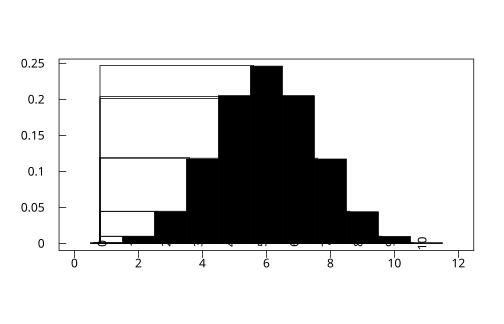

# 3.1 伯努利試驗與二項分配

## 本節目標

- 認識最簡單的隨機實驗：伯努利試驗（只有成功／失敗兩種結果）
- 推導二項分配的 pmf，理解組合數 $`\binom{n}{k}`$ 為什麼會出現
- 會用 `r.dbinom` / `r.pbinom` / `r.qbinom` 做分配查詢，用 `g.rbinom` 做模擬
- 畫「理論 pmf vs 模擬頻率」的長條圖，體會蒙特卡羅誤差的量級
- 學會「至少一個成功」= $`1-(1-p)^n`$ 這個實用公式

---

## 問題場景：重複丟一枚不公正的銅板

假設你丟一枚銅板 10 次，出現正面的機率是 $`p=0.5`$ 。問「恰好出現 3 次正面」的機率是多少？

這個問題看起來平凡，但它是整個統計推論的細胞：**任何「重複 $`n`$ 次、每次成功機率相同且互相獨立」的實驗**，都可以化約成這個模型。醫學試驗中 100 位病人痊癒的人數、品管中 500 顆晶圓的不良品數、網路封包傳輸的丟失次數——本質上都是同一個問題。

### 歷史事件（1713）：雅各布・伯努利與《推測術》

瑞士數學家 **雅各布・伯努利（Jacob Bernoulli, 1655–1705）** 花了二十多年研究「反覆觀察」中的機率法則，他的遺作 **《推測術》（Ars Conjectandi）** 於 1713 年出版。書中首次系統性地處理了「 $`n`$ 次獨立試驗中成功 $`k`$ 次」的計算，並提出著名的大數法則雛形：**重複試驗越多，成功頻率就越貼近理論機率**。這本書把機率從賭桌上的技巧，變成一門可以推論未知的科學。為了紀念他，單次成功／失敗的試驗就叫**伯努利試驗**。

二項分配的完整公式後來由棣美弗（Abraham de Moivre）等人在 18 世紀補齊，但概念骨架正是《推測術》立下的。

---

## 理論推導

### 伯努利分配：一次試驗

設 $`X`$ 表示一次試驗的結果（成功記 1、失敗記 0），成功機率 $`p`$ ：

```math
P(X = 1) = p, \qquad P(X = 0) = 1-p
```

它的期望值與變異數是後面章節的基礎：

$`E[X] = p`$ ， $`\mathrm{Var}(X) = p(1-p)`$ （3.5 節會正式推導）。

### 二項分配： $`n`$ 次試驗中成功 $`k`$ 次

設 $`Y`$ = $`n`$ 次獨立伯努利試驗中成功的次數。以「丟 10 次、恰好 3 次正面」為例，推導三步走：

1. **指定哪 3 次成功**：例如「第 1、2、3 次成功，其餘失敗」，機率是 $`p^3 (1-p)^7`$ 。
2. **這樣的序列有幾種？** 從 10 個位置中選 3 個放成功，共 $`\binom{10}{3}`$ 種。
3. **這些序列互斥**，把機率相加：

```math
P(Y = 3) = \binom{10}{3} p^3 (1-p)^7
```

一般化為**二項 pmf**：

```math
P(Y = k) = \binom{n}{k} p^k (1-p)^{n-k}, \qquad k = 0, 1, \ldots, n
```

其中組合數

$`\binom{n}{k} = \dfrac{n!}{k!\,(n-k)!}`$

因為 $`(p + q)^n`$ 展開式的係數恰好就是這些組合數（ $`q = 1-p`$ ），這個分配被稱為**二項（binomial）分配**。記作 $`Y \sim \mathrm{Bin}(n, p)`$ 。

### 「至少一個成功」： $`1-(1-p)^n`$

實務上我們常問的不是「恰好 $`k`$ 次」，而是「**至少發生一次**」：疫苗接種 100 人至少一人出現副作用？系統上線 100 天至少當機一天？

直接把 $`P(Y=1) + P(Y=2) + \cdots + P(Y=n)`$ 加起來很麻煩，但**反面**只有一種情況——全部失敗：

```math
P(Y \ge 1) = 1 - P(Y = 0) = 1 - (1-p)^n
```

這條公式是許多工程決策的基礎：單一元件故障率 $`p=0.01`$ ，就算只有 100 個獨立環節，**至少一處出錯**的機率已高達約 63%。

---

## 動手做：用 rstatistics 計算與模擬

### d / p / q 三兄弟

和 R 一致，rstatistics 對每個分配提供三個函數：

- `r.dbinom(k, size, prob)`：pmf，即 $`P(Y=k)`$ （**d**ensity）
- `r.pbinom(q, size, prob)`：CDF，即 $`P(Y \le q)`$ （**p**robability）
- `r.qbinom(p, size, prob)`：分位數，給機率 $`p`$ 回傳最小的 $`q`$ 使 $`P(Y \le q) \ge p`$ （**q**uantile）

```python
import rstatistics as r

# 丟 10 次公正銅板，各種正面次數的機率
pmf = [r.dbinom(k, size=10, prob=0.5) for k in range(11)]
print([round(x, 4) for x in pmf])
```

```
[0.001, 0.0098, 0.0439, 0.1172, 0.2051, 0.2461, 0.2051, 0.1172, 0.0439, 0.0098, 0.001]
```

機率山峰在 $`k=5`$ 處（ $`np = 10 \times 0.5 = 5`$ ），左右對稱——因為 $`p=0.5`$ 。

```python
# CDF 與分位數
print(r.pbinom(6, size=10, prob=0.5))    # P(Y <= 6)
print(r.qbinom(0.95, size=10, prob=0.5)) # 95% 分位數
```

```
0.8281249999999998
8.0
```

「最多 6 次正面」的機率約 82.8%；要涵蓋 95% 的結果，正面次數最多到 8 次。

組合數可以直接用 `r.choose` 驗證 pmf 的第一個因子：

```python
print(r.choose(10, 3))   # C(10,3) = 120
print(r.choose(10, 3) * 0.5**10)   # 應等於 dbinom(3, 10, 0.5)
```

```
120.0
0.11718750000000001
```

### 模擬：`g.rbinom` 與理論對照

用 `g = r.set_seed(42)` 取得與 R 位元等價的 RNG，丟出 100000 次「10 連丟」：

```python
import rstatistics as r

g = r.set_seed(42)
n = 100000
xs = g.rbinom(n, size=10, prob=0.5)

cnt = {}
for x in xs:
    cnt[int(x)] = cnt.get(int(x), 0) + 1

ks = list(range(11))
theo = [r.dbinom(k, size=10, prob=0.5) for k in ks]
sim = [cnt.get(k, 0) / n for k in ks]

print(f"{'k':>2} {'理論 pmf':>10} {'模擬頻率':>10} {'差':>10}")
for k, t, s in zip(ks, theo, sim):
    print(f"{k:>2} {t:>10.4f} {s:>10.4f} {s - t:>10.4f}")
```

```
 k     理論 pmf      模擬頻率         差
 0     0.0010     0.0011     0.0001
 1     0.0098     0.0097    -0.0001
 2     0.0439     0.0442     0.0003
 3     0.1172     0.1190     0.0018
 4     0.2051     0.2011    -0.0040
 5     0.2461     0.2470     0.0009
 6     0.2051     0.2039    -0.0012
 7     0.1172     0.1183     0.0011
 8     0.0439     0.0447     0.0008
 9     0.0098     0.0101     0.0003
10     0.0010     0.0009    -0.0001
```

**蒙特卡羅誤差有多大？** 每格的頻率是 $`n=100000`$ 次的估計，標準誤約 $`\sqrt{p(1-p)/n}`$ 。以 $`p \approx 0.2`$ 計算， $`\sqrt{0.2 \times 0.8 / 100000} \approx 0.0013`$ ，所以差異在 $`\pm 0.004`$ 內都屬正常波動——上表最大的偏差（ $`k=4`$ 的 $`-0.004`$ ）剛好接近 3 個標準誤，在 11 格中偶爾出現一格並不意外。**規律：模擬次數增加 100 倍，誤差縮小 10 倍。**

### 畫圖：理論 pmf（灰）疊上模擬頻率（描邊）

```python
g2 = r.Graphics(width=7.0, height=4.5)
g2.barplot(theo, [str(k) for k in ks])          # 理論值長條
for i, t in enumerate(theo):
    g2.rect(i + 0.6, 0, 0.8, sim[i])            # 模擬頻率描邊
g2.save("img/binom_pmf_sim.svg")
```

輸出 `img/binom_pmf_sim.svg`：灰色實心長條是理論 pmf，每根長條前緣的黑框是 100000 次模擬的頻率。**兩者幾乎重疊**——這是對大數法則最直接的視覺驗證，也正是伯努利在《推測術》中想證明的定律。

### 模擬的均值與變異數

```python
fx = list(map(float, xs))
print(r.mean(fx))   # 理論 np = 5
print(r.var(fx))    # 理論 np(1-p) = 2.5
```

圖：理論 pmf 與模擬頻率重疊。



```
5.003500000000006
2.521452964529575
```

模擬均值 5.0035 對理論 5、模擬變異數 2.521 對理論 2.5，誤差都在 $`1/\sqrt{n}`$ 的量級（詳見 3.5 節）。

### 「至少一個成功」驗證

```python
# 100 個環節、單一故障率 1%，至少一處故障
print(1 - (1 - 0.01) ** 100)                    # 公式
print(r.pbinom(0, 100, 0.01, lower_tail=False)) # P(Y > 0)，rstatistics 內建
```

```
0.6339676587267709
0.6339676587267584
```

兩者一致（尾端微小差異是浮點運算順序造成的，第 14 位小數才看得到）。

---

## 與 R 對照

rstatistics 的函數名稱與參數設計完全比照 R，以下 R 腳本可逐行對照：

```r
dbinom(0:10, size = 10, prob = 0.5)
#  [1] 0.0009765625 0.0097656250 0.0439453125 0.1171875000 0.2050781250
#  [6] 0.2460937500 0.2050781250 0.1171875000 0.0439453125 0.0097656250
# [11] 0.0009765625

pbinom(6, 10, 0.5)     # [1] 0.828125
qbinom(0.95, 10, 0.5)  # [1] 8

set.seed(42)
xs <- rbinom(100000, 10, 0.5)
mean(xs); var(xs)
# [1] 5.00357
# [1] 2.521522

1 - pbinom(0, 100, 0.01)  # [1] 0.6339677
```

（本節 R 輸出以 `Rscript` 實際執行驗證。）R 是**向量式**的：`dbinom(0:10, ...)` 一次吃整個向量；Python 版要自己寫 list comprehension。數值上，`r.dbinom` 的結果與 R 位元級一致。

---

## 小結

- **伯努利試驗**（1713，《推測術》）是機率模型的原子：一次試驗、成功機率 $`p`$ 。
- $`n`$ 次獨立試驗的成功次數 $`Y \sim \mathrm{Bin}(n,p)`$ ，pmf $`= \binom{n}{k} p^k (1-p)^{n-k}`$ ；組合數 $`\binom{n}{k}`$ 來自「哪 $`k`$ 次成功」的排列組合。
- d / p / q 三函數分別回答「這一格的機率」「累積到這裡的機率」「涵蓋 95% 的分界」。
- 模擬頻率圍繞理論值波動，標準誤 $`\approx \sqrt{p(1-p)/n}`$ ； $`n`$ 大 100 倍、誤差小 10 倍。
- 「至少一個成功」用反面思考： $`1-(1-p)^n`$ 。

---

## 練習

1. 某試管嬰兒技術單次植入成功率 $`p=0.3`$ 。植入 5 次，求恰好 2 次成功的機率，並用 `r.dbinom(2, 5, 0.3)` 驗證。**提示**： $`\binom{5}{2} \times 0.3^2 \times 0.7^3`$ ，搭配 `r.choose(5,2)`。
2. 承上，至少 2 次成功的機率？用 `1 - r.pbinom(1, 5, 0.3)` 與手算 $`1 - [P(0) + P(1)]`$ 對照。**提示**：`pbinom` 是累積，注意要減到 $`k \le 1`$ 。
3. 伺服器每日當機機率 $`0.002`$ 。一年 365 天中**至少當機一天**的機率是多少？先猜再算（多數人嚴重低估）。**提示**： $`1 - 0.998^{365}`$ 。
4. 用 `g.rbinom` 模擬 10000 次 $`\mathrm{Bin}(20, 0.3)`$ ，畫理論 pmf 與模擬頻率的對照長條圖，並估計每格的標準誤。**提示**：標準誤用 $`\sqrt{\hat{p}(1-\hat{p})/n}`$ 。
5. 證明：若 $`X \sim \mathrm{Bin}(n-1, p)`$ ，則 $`Y = X + 1 \sim \mathrm{Bin}(n, p)`$ 的 pmf 滿足遞迴關係 $`\dfrac{P(Y=k+1)}{P(Y=k)} = \dfrac{n-k}{k+1} \cdot \dfrac{p}{1-p}`$ ，並用這個關係解釋為什麼 pmf 的峰在 $`\lfloor (n+1)p \rfloor`$ 附近。**提示**：寫下兩個 pmf 相除，多數項會消掉。
