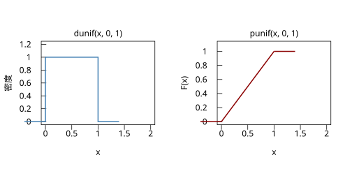
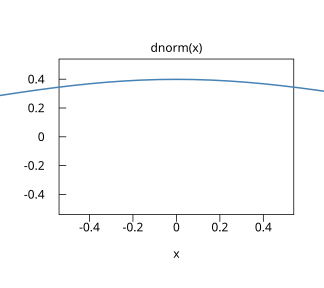

# 4.1 密度函數與累計分配

## 本節目標

- 理解為什麼連續型隨機變數滿足 $`P(X = a) = 0`$ ，以及這件事為什麼「不矛盾」
- 把密度函數 $`f(x)`$ 讀成機率的「每單位長度」，而不是機率本身
- 掌握累計分配函數（CDF）的定義與四個性質，並會用 $`P(a < X \le b) = F(b) - F(a)`$
- 會由 CDF 反解中位數與分位數
- 動手：`r.dunif` / `r.punif` / `r.qunif`，並用 Graphics 畫出密度曲線與 CDF 曲線

---

## 從丟飛鏢說起

第 3 章的分配都是**離散**的：擲骰子的點數只有 1 到 6，卜松計數只有 0、1、2、…。我們把機率一顆一顆堆在整數點上，機率質量函數 $`p(k) = P(X = k)`$ 每一顆都是正的。

但現實中很多量是**連續**的：等公車的時間、精密零件的壽命、一個人的身高。你問「這個人身高恰好是 175.000000… 公分的機率是多少」——答案是 0。因為「恰好 175」這個點沒有寬度，而落在任何有限寬度之外的機會必須是 0。

用丟飛鏢想：鏢落在靶上某一點 $`a`$ 的機率是 0，但鏢**一定**落在某點。所以

$`P(X = a) = 0`$ 並不表示 $`a`$ 不可能發生，只表示單點「不含機率質量」。對連續型變數，機率只屬於**區間**：

$`P(a < X \le b) = \int_a^b f(t)\,dt`$

### 為什麼這個概念在那個年代被發明

機率論在 17 世紀誕生時全是賭桌上的離散問題（骰子、紙牌）。到了 18 世紀，天文學家要處理**觀測誤差**——一次測量偏了 2.3 角秒，機率必須落在一段誤差區間上，而不是某個精確值上。正是「誤差分布」這個問題逼出了連續機率：Simpson（1757）與 Laplace（1774）開始為誤差找「曲線」，最後由 Gauss（1809）給出正態曲線（4.4 節）。連續機率從一開始就是**為了描述測量**而生。

---

## 密度：機率的每單位長度

密度函數 $`f(x)`$ 滿足：

1. $`f(x) \ge 0`$ （可超過 1！）
2. $`\int_{-\infty}^{\infty} f(x)\,dx = 1`$
3. $`P(a < X \le b) = \int_a^b f(x)\,dx`$

關鍵讀法： $`f(x)`$ 的單位是**機率/長度**，就像「人口密度」是人/平方公里，不是人。一段區間的機率 = 密度曲線下的面積。

一個常見的誤會：「 $`f(0.5) = 1`$ 所以 $`P(X = 0.5) = 1`$ ？」不對—— $`f(0.5)`$ 只是說，在 0.5 附近每單位長度分到 1 的機率；長度 $`\Delta x`$ 的一小段分到約 $`f(0.5)\,\Delta x`$ 。密度可以大於 1（例如 $`f(x) = 5`$ 的分配），因為它不是機率。

對均勻分配 $`U(0,1)`$ （區間內密度恆為 1）最容易看清楚：

- $`P(0.2 < X \le 0.5) = \int_{0.2}^{0.5} 1\,dx = 0.3`$ —— 恰好是「密度 × 寬度」
- 區間越縮越窄，機率就越趨近 0；寬度為 0 時機率為 0

這兩件事我們馬上用程式驗證。

---

## 累計分配函數 CDF

累計分配函數把「到目前為止累積了多少機率」寫成一個函數：

$`F(x) = P(X \le x) = \int_{-\infty}^{x} f(t)\,dt`$

它有四個性質（離散版也一樣，只是積分換加總）：

1. **單調遞增**（不必然嚴格）： $`x_1 < x_2 \Rightarrow F(x_1) \le F(x_2)`$
2. **邊界**： $`F(-\infty) = 0`$ ， $`F(\infty) = 1`$
3. **區間機率**： $`P(a < X \le b) = F(b) - F(a)`$ ← 最常用的一條
4. **密度是 CDF 的導數**： $`f(x) = F'(x)`$ （在 $`F`$ 可微處）

第 3 條是日常工作的主力：「落在這段範圍的機率」永遠是兩個 CDF 值相減。第 4 條則說明 d 與 p 兩族函數的關係——`r.d*` 是導數、`r.p*` 是積分。

### 由 CDF 反解分位數

CDF 把「值 → 機率」變成一個可逆的查表：給機率 $`p`$ ，找滿足 $`F(x) = p`$ 的 $`x`$ ，這就是 **p 分位數** $`q_p`$ ：

$`q_p = F^{-1}(p), \qquad F(q_p) = p`$

特別地 $`q_{0.5}`$ 是**中位數**， $`q_{0.25}, q_{0.75}`$ 是四分位數。這就是 `r.q*`（quantile）函數在做的事：**d 是密度、p 是累計、q 是反解**——三個字母對應同一個分配的三個方向。

以 $`U(2,5)`$ 為例， $`F(x) = (x-2)/3`$ ，解 $`F(x) = 0.5`$ 得中位數 $`x = 2 + 3 \times 0.5 = 3.5`$ ——就是區間的中點。這不是巧合：CDF 反解分位數，永遠可以這樣手算驗證。

---

## 動手：rstatistics 的 d/p/q

### 均勻分配的三個方向

```python
import rstatistics as r

# 均勻分配 U(0,1)：密度與 CDF
print(r.dunif(0.3, 0, 1))          # 密度：區間內恆為 1
print(r.dunif(3.0, 2, 5))          # U(2,5)：密度 = 1/3
print(r.punif(0.7, 0, 1))          # CDF：P(X <= 0.7)
print(r.punif(4.0, 2, 5) - r.punif(2.5, 2, 5))  # P(2.5 < X <= 4)
print(r.qunif(0.5, 2, 5))          # 中位數
print(r.qunif(0.25, 2, 5))         # 第一四分位數
```

```
1.0
0.3333333333333333
0.7
0.5
3.5
2.75
```

中位數 3.5、四分位數 2.75，都和我們手算的「區間起點 + 寬度 × p」一致。

### 密度是每單位長度：兩個驗證

```python
# 密度是「每單位長度的機率」：寬度 0.3 的區間，機率 ≈ 密度 × 寬度
print(r.punif(0.5) - r.punif(0.2))   # P(0.2 < X <= 0.5)，U(0,1)
print(r.dunif(0.35) * 0.3)           # 密度(1) x 寬度(0.3) —— 完全一致（均勻時無誤差）

# 單點的機率為 0：寬度越窄，機率越趨近 0
print(r.punif(0.5) - r.punif(0.5 - 0.001))
print(r.punif(0.5) - r.punif(0.5 - 0.000001))
```

```
0.3
0.3
0.0010000000000000009
9.999999999732445e-07
```

寬度 0.3 的區間拿到機率 0.3；區間縮到 0.001，機率就縮到 0.001。把寬度推到 0，機率就是 0——這就是 $`P(X = a) = 0`$ 的具體樣子。（輸出的 9.9999…e-07 有一點浮點誤差，正好提醒我們這些都是近似的數值計算。）

### 畫出密度與 CDF 曲線

均勻分配的密度是分段常數（矩形），`g.curve('dunif', ...)` 內建參數只有標準的 $`U(0,1)`$ 版本，所以直接用 `lines` 自畫線段最清楚；右圖的 CDF 是一條斜率 1 的直線（因為 $`F'(x) = f(x) = 1`$ ）。

```python
import rstatistics as r

# 均勻分配的密度與 CDF 曲線
g = r.Graphics(width=7.0, height=3.5, mfrow=[1, 2])

# 左圖：密度（自畫線段，因為 dunif 是分段常數）
g.plot([0, 2], [0, 1.2], type="n", main="dunif(x, 0, 1)", xlab="x", ylab="密度")
xs = [-0.4, 0.0, 0.0, 1.0, 1.0, 1.4]
ys = [0.0, 0.0, 1.0, 1.0, 0.0, 0.0]
g.lines(xs, ys, col="steelblue", lwd=2)
g.next_panel()
# 右圖：CDF
g.plot([0, 2], [0, 1.1], type="n", main="punif(x, 0, 1)", xlab="x", ylab="F(x)")
g.lines([-0.4, 0.0], [0.0, 0.0], col="darkred", lwd=2)
g.lines([0.0, 1.0], [0.0, 1.0], col="darkred", lwd=2)
g.lines([1.0, 1.4], [1.0, 1.0], col="darkred", lwd=2)
g.save("img/04.1-dunif-punif.svg")

# curve() 的用法：畫標準常態密度（之後幾節會常用）
g2 = r.Graphics(width=4.5, height=4.0)
g2.plot([0, 0], [0, 0], type="n", main="dnorm(x)", xlab="x", ylab="")
g2.curve("dnorm", -4, 4, col="steelblue", lwd=2)
g2.save("img/04.1-dnorm-curve.svg")
```





兩張圖對照著看：左圖矩形下的**面積**是 1；右圖 CDF 從 0 爬到 1，爬升的斜率就是左圖的高度。這就是 $`f = F'`$ 的圖像意義。

---

## 與 R 對照

rstatistics 的 `d/p/q` 三族設計完全沿襲 R：函數名相同、參數語意相同、數值位元級一致。下面的 R 腳本輸出與前面的 Python 輸出一一對應。

```r
dunif(0.3); dunif(3.0, 2, 5)
punif(0.7); punif(4.0, 2, 5) - punif(2.5, 2, 5)
qunif(0.5, 2, 5); qunif(0.25, 2, 5)
punif(0.5) - punif(0.2)
```

```
[1] 1
[1] 0.3333333
[1] 0.7
[1] 0.5
[1] 3.5
[1] 2.75
[1] 0.3
```

R 對應的畫圖程式：

```r
curve(dunif(x, 0, 1), from = -0.4, to = 1.4, n = 2,
      main = "dunif(x, 0, 1)", xlab = "x", ylab = "密度")
curve(punif(x, 0, 1), from = -0.4, to = 1.4,
      main = "punif(x, 0, 1)", xlab = "x", ylab = "F(x)")
```

（R 的 `curve` 對 `dunif` 直接可用；rstatistics 的 `g.curve` 因為內建參數限制，均勻分配改用 `lines` 自畫——這也是一個好練習：自己把分段常數畫出來，會更理解密度。）

---

## 小結

- 連續型變數 $`P(X = a) = 0`$ ：機率屬於區間，不屬於單點；「恰好等於」不是不可能，而是沒有寬度。
- 密度 $`f(x)`$ 是機率的**每單位長度**，可以大於 1；機率 = 密度曲線下的面積。
- CDF $`F(x) = P(X \le x)`$ ：單調遞增、兩端收斂到 0 與 1； $`P(a < X \le b) = F(b) - F(a)`$ 。
- 分位數是 CDF 的反解 $`q_p = F^{-1}(p)`$ ；中位數是 $`q_{0.5}`$ 。
- `r.d*`（密度/導數）、`r.p*`（累計/積分）、`r.q*`（反解）是同一分配的三個方向。

---

## 練習

1. 用 `r.punif` 算 $`U(2,5)`$ 的 $`P(X > 4)`$ 與 $`P(2 < X \le 3)`$ ，並與手算的幾何比例（長度比）核對。
   （提示： $`P(X > a) = 1 - F(a)`$ 。）
2. $`U(0,1)`$ 的 CDF 是 $`F(x) = x`$ （在 $`[0,1]`$ 內）。手算 $`q_{0.9}`$ ，再用 `r.qunif(0.9)` 驗證。
3. 某分配的密度為 $`f(x) = 2x`$ （ $`0 \le x \le 1`$ ）。先用積分確認 $`\int_0^1 2x\,dx = 1`$ ，再求 CDF 與中位數（解 $`F(x) = 0.5`$ ）。
4. 把「畫密度與 CDF」那一小節的程式改成畫 $`U(2,5)`$ ：密度變成高度 $`1/3`$ 的矩形、CDF 是斜率 $`1/3`$ 的直線。畫完後檢查 CDF 終點是否為 1。
5. 用迴圈把區間寬度從 0.1、0.01、0.001 一路縮小，印出 $`P(0.5 < X \le 0.5 + w)`$ ，觀察它如何趨近 0。（提示：`r.punif(0.5 + w) - r.punif(0.5)`。）
