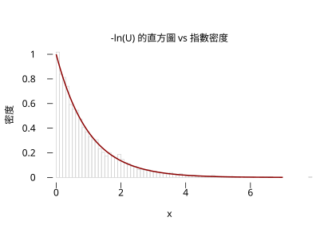

# 4.2 均勻分配

## 本節目標

- 認識最簡單的連續分配：均勻分配 $`U(a,b)`$ 的密度、平均與變異數
- 會用 `g.runif` 產生亂數，並理解它與 R 的 `set.seed`/`runif` 位元級等價
- 理解「**均勻是一切模擬的源頭**」：反變換法（inverse transform）
- 動手：只用 `runif` 造出指數亂數 $`-\ln(U)/\lambda`$ ，並驗證直方圖貼合 `r.dexp`

---

## 最簡單的連續分配

連續分配裡最「不講究」的一個：在區間 $`[a, b]`$ 上每個點地位平等。密度是矩形：

$`f(x) = \begin{cases} \dfrac{1}{b-a} & a \le x \le b \\ 0 & \text{其他} \end{cases}`$

矩形高度 $`1/(b-a)`$ 不是隨便選的——它是「總面積等於 1」的唯一解：寬 $`(b-a)`$ 乘高 $`1/(b-a)`$ 恰好為 1。這正是 4.1 節說的「密度是每單位長度的機率」：機率總量 1 攤平在長度 $`b-a`$ 上。

由對稱性，平均就是中點，CDF 是一條從 $`(a,0)`$ 爬到 $`(b,1)`$ 的直線：

$`E[X] = \frac{a+b}{2}, \qquad \mathrm{Var}(X) = \frac{(b-a)^2}{12}, \qquad F(x) = \frac{x-a}{b-a}`$

變異數的 $`(b-a)^2/12`$ 值得記：區間拉長一倍，散布變成 4 倍（變異數）或 2 倍（標準差）。分母 12 來自積分 $`\int_{0}^{1}(u-1/2)^2 du = 1/12`$ ——這我們會在練習裡手算。

### 為什麼這個概念重要

均勻分配在應用上幾乎不直接出現（現實中很少「每個值等可能」的連續量），但它是**所有模擬的起點**。電腦裡的隨機數產生器（R 的 `runif`、我們的 `g.runif`）產生的就是 $`U(0,1)`$ 樣本；其他任何分配的亂數——常態、指數、Gamma、Beta——都是從這些均勻亂數**加工**出來的。這一節要親手做一次這個加工（反變換法），之後你呼叫 `g.rexp` 時就知道裡面發生了什麼。

---

## 反變換法：從 runif 造出任何分配

**想法**：CDF $`F`$ 把值送到機率（ $`[0,1]`$ 之間）；它的反函數 $`F^{-1}`$ 就把機率送回值。所以若 $`U \sim U(0,1)`$ ，令

$`X = F^{-1}(U)`$

則 $`X`$ 的 CDF 恰好是 $`F`$ ：

$`P(X \le x) = P(F^{-1}(U) \le x) = P(U \le F(x)) = F(x)`$

最後一步用了 $`U(0,1)`$ 的 CDF 就是 $`P(U \le u) = u`$ （在 $`[0,1]`$ 上）。一句話：**把均勻機率沿著 CDF 的反函數「掰」回 x 軸，掰出來的樣本就服從那個分配。**

以指數分配為例。 $`\mathrm{Exp}(\lambda)`$ 的 CDF 是 $`F(x) = 1 - e^{-\lambda x}`$ （ $`x \ge 0`$ ）。令 $`u = 1 - e^{-\lambda x}`$ 反解：

$`x = -\frac{\ln(1-u)}{\lambda}`$

而 $`1-U`$ 與 $`U`$ 同分布，所以可以再簡化成：

$`X = -\frac{\ln U}{\lambda} \sim \mathrm{Exp}(\lambda)`$

這就是下面程式裡的那一行。同一招也造得出其他有封閉反函數的分配（例如 4.5 節的 Beta 沒有，就要用別的方法——那是後話）。

> 這一招在 1947 年由 von Neumann 在蒙地卡羅方法的奠基工作中系統化；更早，丟銅板決定數字位元的想法在 1900 年代初就有人用。今天所有統計軟體的核心亂數仍然是 $`U(0,1)`$ ，其他分配都是「變換」出來的。

---

## 動手：runif 與反變換

### runif 的基本樣子

```python
import rstatistics as r

g = r.set_seed(42)
u = g.runif(5)
print(u)
```

```
[0.9148060434963554, 0.9370754132978618, 0.2861395347863436, 0.8304476260673255, 0.6417455188930035]
```

`r.set_seed(42)` 回傳的 RNG 與 R 的 `set.seed(42)` 位元等價：這五個數字在 R 裡跑 `set.seed(42); runif(5)` 會得到一模一樣的值（見文末對照）。樣本落在 $`[0,1]`$ 上，看起來「沒有特別偏好哪一邊」——這就是均勻。

### 反變換法造指數亂數

```python
import math
import rstatistics as r

# 反變換法：若 U ~ U(0,1)，則 X = -ln(U)/lambda ~ Exp(lambda)
lam = 1.0
g = r.set_seed(42)
u = g.runif(5000)
x = [-math.log(v) / lam for v in u]

print(r.mean(x))          # 理論值 1/lambda = 1
print(r.sd(x))            # 理論值 1/lambda = 1
print(r.mean([1 if v > math.log(1000) else 0 for v in x]))  # P(X>ln1000)=0.001
```

```
0.9981724119163148
1.0090995933198068
0.0008000000000000095
```

三個檢查都對上理論：

- 樣本平均 0.998 ≈ $`1/\lambda = 1`$
- 樣本標準差 1.009 ≈ $`1/\lambda = 1`$ （指數分配的平均與標準差相等）
- 尾端機率： $`P(X > \ln 1000) = e^{-\lambda \ln 1000} = 1000^{-\lambda} = 0.001`$ ，模擬得 0.0008——5000 個樣本裡約 4 個超過，符合（這裡用到了 3.2 節卜松分配的稀少事件直覺）。

### 直方圖貼合密度曲線

最後把 5000 個「自製指數亂數」畫成直方圖（密度尺度），疊上真正的指數密度 $`f(x) = e^{-x}`$ ：

```python
import math
import rstatistics as r

g = r.set_seed(42)
u = g.runif(5000)
x = [-math.log(v) for v in u]        # 反變換法造出 Exp(1)

g2 = r.Graphics(width=5.5, height=4.2)
g2.hist(x, main="-ln(U) 的直方圖 vs 指數密度", xlab="x", ylab="密度", freq=False, breaks="FD", xlim=[0, 7])
g2.curve("dexp", 0, 7, col="darkred", lwd=2)
g2.save("img/04.2-inverse-transform.svg")
```



直方圖的輪廓與紅色密度曲線貼合：靠 0 的地方最高、往右指數下降。這 5000 個數字**只**由 `runif` 與 `math.log` 造出來，卻服從指數分配——「均勻是一切模擬的源頭」不是口號，是這一行 $`-\ln(U)`$ 。

> 註：`g.hist(..., freq=False)` 畫的是密度尺度（總面積 1），才能與密度曲線疊在同一張圖上；`breaks` 給字串 `"FD"`（Freedman–Diaconis 演算法）決定分箱數。

---

## 與 R 對照

```r
set.seed(42); runif(5)
set.seed(42); u <- runif(5000); x <- -log(u)
c(mean(x), sd(x))
mean(x > log(1000))
```

```
[1] 0.9148060 0.9370754 0.2861395 0.8304476 0.6417455
[1] 0.9981724 1.0090996
[1] 8e-04
```

R 與 rstatistics 的輸出**逐位一致**（`8e-04` 就是 0.0008）——兩邊的 `set.seed(42)` 是同一套亂數演算法。R 的畫圖版本：

```r
hist(x, freq = FALSE, breaks = "FD", xlim = c(0, 7),
     main = "-ln(U) 的直方圖 vs 指數密度", xlab = "x", ylab = "密度")
curve(dexp(x), add = TRUE, col = "darkred", lwd = 2)
```

---

## 小結

- $`U(a,b)`$ ：密度為高度 $`1/(b-a)`$ 的矩形；平均 $`(a+b)/2`$ 、變異數 $`(b-a)^2/12`$ 。
- `g.set_seed`/`g.runif` 與 R 的 `set.seed`/`runif` 位元等價，教材可完全對照。
- 反變換法： $`X = F^{-1}(U)`$ 把 $`U(0,1)`$ 樣本變成任意有封閉反 CDF 的分配的樣本。
- 對指數分配： $`-\ln(U)/\lambda \sim \mathrm{Exp}(\lambda)`$ ——模擬結果的平均、標準差、尾部機率都吻合理論。
- 之後每一節的 `g.r*` 亂數，本質上都是從 `runif` 變換出來的。

---

## 練習

1. 用反變換法從 $`U(0,1)`$ 造出 $`U(2,5)`$ 的樣本： $`X = 2 + 3U`$ 。驗證 5000 個樣本的平均接近 3.5、標準差接近 $`3/\sqrt{12} \approx 0.866`$ 。
   （提示：這是 $`F^{-1}(u) = a + (b-a)u`$ 的直接代入。）
2. 用反變換法造 $`\mathrm{Exp}(2)`$ （ $`\lambda = 2`$ ）樣本 5000 個，檢查平均 ≈ 0.5、標準差 ≈ 0.5，並用 `r.pexp(1.0, 2.0)` 對照樣本中 $`X \le 1`$ 的比例。
3. Pareto 分配的 CDF 是 $`F(x) = 1 - x^{-k}`$ （ $`x \ge 1`$ ）。推導反變換公式 $`X = U^{-1/k}`$ ，模擬 5000 個 $`k = 2`$ 的樣本，驗證 $`P(X > 2) = 1/4`$ 。
   （提示： $`P(X > x) = x^{-k}`$ 。）
4. 把本節的直方圖程式中的 `breaks="FD"` 改成 `"Sturges"` 與 `"Scott"`，觀察分箱數不同時直方圖與密度曲線的貼合程度如何變化。
5. （挑戰）用兩個獨立均勻亂數實作 von Neumann 的「捨去法」造常態亂數：在 $`[-1,1] \times [0,1]`$ 的正方形裡隨機撒點，只保留落在 $`e^{-(x^2+y^2)/2}`$ 曲面之下的點的 $`x`$ 。畫直方圖並與 `r.dnorm` 疊圖。
   （提示：需要用到 `g.runif(2)` 與條件判斷。）
