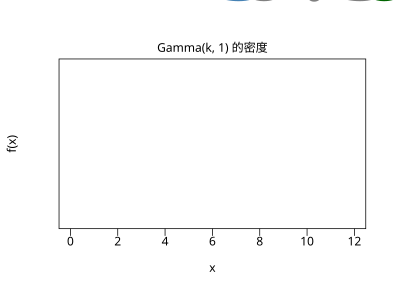

# 4.3 指數與 Gamma 分配

## 本節目標

- 理解指數分配 = 卜松過程中「等下一件事」的時間（呼應 3.2 的卜松分配）
- 驗證並理解**無記憶性**：指數分配唯一的標誌
- 認識 Gamma 分配 = 多個獨立指數相加，`shape` 參數的意義
- 掌握 `r.dexp / r.pexp / r.qexp / r.dgamma / r.pgamma / r.rgamma`，用排隊與壽命例子練習
- 用 Graphics 畫不同 shape 的 Gamma 密度曲線

---

## 等待時間：從卜松到指數

3.2 節的卜松分配數的是「單位時間內事件發生幾次」：每分鐘進站的客戶數、每頁的錯字數。卜松過程還有另一面——**等下一次事件要多久**。若單位時間內事件數 $`N \sim \mathrm{Pois}(\lambda)`$ ，那麼相鄰兩事件的間隔時間 $`T`$ 服從：

$`T \sim \mathrm{Exp}(\lambda), \qquad f(t) = \lambda e^{-\lambda t}\ (t \ge 0)`$

為什麼？「等超過 $`t`$ 都沒事件」就等於「 $`[0,t]`$ 內零事件」，用卜松的機率（ $`P(N=0) = e^{-\lambda t}`$ ，把平均事件數換成 $`\lambda t`$ ）：

$`P(T > t) = e^{-\lambda t} \quad\Rightarrow\quad F(t) = 1 - e^{-\lambda t}`$

微分得密度。**計數與等待是同一件事的兩面**：卜松管「發生幾次」，指數管「間隔多久」， $`\lambda`$ 是兩邊共用的速率參數。這也是為什麼指數密度永遠從最高點 $`\lambda`$ 出發、往右指數下降——短間隔最容易發生，越久沒事，下一刻也**不會**更急（這句話的精確意義就是無記憶性）。

### 歷史：1909 年的電話與 1910 年的排隊

這套「計數＋等待」的模型由 Erlang（1909，哥本哈根電話交換機的話務問題）開創，他先推出今日以他命名的排隊公式，隨後（1910 年代）處理「多個階段串接」的服務時間，引入了後來稱為 Gamma 分配的工具。指數分配因此從一開始就是**工程問題**的分配：電話線、維修、壽命測試——所有「等下一件事」的場景。

---

## 無記憶性：指數分配的指紋

$`\mathrm{Exp}(\lambda)`$ 最著名的性質：

$`P(X > s + t \mid X > s) = P(X > t)`$

「已經等了 $`s`$ ，還要再等至少 $`t`$ 的條件機率」等於「從零開始等至少 $`t`$ 」。等了再久也不會更接近終點——分配沒有記憶。證明一行：

$`\frac{P(X > s+t)}{P(X > s)} = \frac{e^{-\lambda(s+t)}}{e^{-\lambda s}} = e^{-\lambda t}`$

這條性質是雙面刃：

- **好用**：燈泡沒有磨合期、客戶流失率恆定，可以直接建模；馬爾可夫鏈整個理論都靠它。
- **不真實**：人會老化、機器會磨損，「用越久壞得越快」的東西不服從指數分配——那要靠 Weibull（4.5 節會見到）或 Gamma。

事實上，無記憶性**唯一**的連續解就是指數分配：任何連續分配若有此性質，必然是 $`P(X>t) = e^{-\lambda t}`$ 。

---

## Gamma 分配：多個指數相加

如果事件要**發生 n 次**才算完成（第 n 位客人服務完、第 n 個零件故障），總等待時間是 n 個獨立指數的**和**：

$`X = T_1 + T_2 + \cdots + T_n \sim \mathrm{Gamma}(n, \lambda)`$

密度的一般式（shape $`k > 0`$ 、rate $`\lambda > 0`$ ）：

$`f(x) = \frac{\lambda^k}{\Gamma(k)} x^{k-1} e^{-\lambda x}\ (x \ge 0)`$

其中 $`\Gamma(k) = \int_0^\infty t^{k-1} e^{-t}\,dt`$ 是把階乘推廣到實數的 Gamma 函數（ $`\Gamma(n) = (n-1)!`$ ）。兩個參數的直覺：

- $`k`$ （shape）＝要**累積幾件事**： $`k=1`$ 退化成指數； $`k`$ 越大曲線越往右、越對稱（中央極限定理的預告）。
- $`\lambda`$ （rate）＝**速率**：與指數共用；平均 $`k/\lambda`$ 、變異數 $`k/\lambda^2`$ 。

（R 與 rstatistics 的 `dgamma(x, shape, rate)` 用 rate；有些課本寫尺度參數 $`\theta = 1/\lambda`$ ，看到 scale 要倒過來。）

---

## 動手：dexp / pexp / qexp / dgamma / pgamma

### 指數分配三方向 + 無記憶性

```python
import rstatistics as r

# 指數分配：r.dexp / r.pexp / r.qexp
print(r.dexp(1.0))                 # lambda=1，f(1) = e^-1
print(r.dexp(1.0, 2.0))            # lambda=2
print(r.pexp(3.0))                 # P(X<=3) = 1 - e^-3
print(r.qexp(0.5, 0.5))            # 中位數 = ln(2)/0.5

# 無記憶性：P(X>5) vs P(X>3+2 | X>3)
print(r.pexp(2.0, lower_tail=False))                     # P(X>2)
print(r.pexp(5.0, lower_tail=False) / r.pexp(3.0, lower_tail=False))  # P(X>5)/P(X>3)
```

```
0.36787944117144233
0.2706705664732254
0.950212931632136
1.3862943611198906
0.1353352832366127
0.13533528323661267
```

兩個重點：

- 中位數 $`\ln 2 / \lambda`$ ：無論 $`\lambda`$ 多大，**一半**的等待時間超過 $`\ln 2/\lambda`$ （平均的 0.693 倍）——平均被少數長尾拉高，中位數比平均更能代表「典型等待」。
- $`P(X > 2) = 0.1353`$ 與 $`P(X>5)/P(X>3) = 0.1353`$ **完全相等**：已經等了 3 個單位，再等 2 個的條件機率跟重新開始等 2 個一模一樣。無記憶性在數字上現形。

### Gamma：理論值與模擬

```python
# Gamma：n 個 Exp(lambda) 之和 ~ Gamma(n, lambda)
print(r.dgamma(1.0, 1.0, 1.0))     # Gamma(1,1) = Exp(1)
print(r.dgamma(2.0, 2.0, 1.0))     # Gamma(2,1) 密度 x e^-x
print(r.pgamma(2.0, 3.0, 1.0))     # P(Gamma(3,1) <= 2)

# 模擬驗證：5 個 Exp(1) 相加 ~ Gamma(5, 1)
g = r.set_seed(42)
s = []
for _ in range(2000):
    e = g.rexp(5, 1.0)
    s.append(sum(e))
print(r.mean(s))                   # 理論 5
print(r.sd(s))                     # 理論 sqrt(5) ≈ 2.236
```

```
0.36787944117144233
0.2706705664732254
0.32332358381693604
5.032553958699541
2.233618734044846
```

`dgamma(1, 1, 1)` 與上節 `dexp(1)` 的 $`e^{-1} = 0.3679`$ 完全相同—— $`k=1`$ 時 Gamma 就是指數。模擬「5 個 Exp(1) 相加」2000 次：平均 5.033 ≈ $`k/\lambda = 5`$ 、標準差 2.234 ≈ $`\sqrt{k}/\lambda = \sqrt{5}`$ 。**Gamma 是指數的相加，平均與變異數都按倍數長**。

### 不同 shape 的密度形狀

```python
import rstatistics as r

# 不同 shape 的 Gamma 密度
g = r.Graphics(width=5.5, height=4.2)
xs = [i * 0.1 for i in range(0, 121)]        # x = 0 .. 12
for shape, col in [(0.5, "gray"), (1.0, "darkred"), (2.0, "orange"), (5.0, "steelblue"), (10.0, "darkgreen")]:
    ys = [r.dgamma(x, shape, 1.0) for x in xs]
    if shape == 0.5:
        g.plot(xs, ys, type="l", main="Gamma(k, 1) 的密度", xlab="x", ylab="f(x)", col=col, lwd=2)
    else:
        g.lines(xs, ys, col=col, lwd=2)
g.text(7.5, 0.55, "k=0.5", 0.0, "gray", 10.0)
g.text(4.2, 0.62, "k=1", 0.0, "darkred", 10.0)
g.text(2.4, 0.42, "k=2", 0.0, "orange", 10.0)
g.text(4.5, 0.18, "k=5", 0.0, "steelblue", 10.0)
g.text(9.0, 0.125, "k=10", 0.0, "darkgreen", 10.0)
g.save("img/04.3-gamma-shapes.svg")
```



把這條演化看成一個縮時錄影： $`k=1`$ 是指數（從 0 處的 $`\lambda`$ 直接下滑）； $`k=2`$ 開始離地爬升、有了一個峰； $`k`$ 越大峰越靠右、越對稱—— $`k=10`$ 時已經很像常態了。這不是巧合：Gamma( $`k`$ ) 是 $`k`$ 個 i.i.d. 變數之和，中央極限定理（第 7 章）說 $`k`$ 大時必然走向常態。

> 註：`g.curve('dgamma', ...)` 內建參數固定為 shape=1（即指數），畫多條不同 shape 的曲線要用 `plot(type="l")` + `lines` 自己疊，正好練 4.1 節的畫圖功夫。

### 排隊例子：銀行櫃台

單一櫃台的服務時間服從 $`\mathrm{Exp}(0.5)`$ （平均 2 分鐘一位）。模擬前 8 位客人：

```python
# 排隊例子：服務時間 Exp(0.5)（平均 2 分鐘），前 8 位客人
g = r.set_seed(101)
t = g.rexp(8, 0.5)
print([round(v, 2) for v in t])
print(r.mean(t))                  # 理論 1/0.5 = 2
print(r.pexp(2.0, 0.5))           # P(一位客人 2 分鐘內服務完)
```

```
[2.36, 6.35, 0.84, 0.63, 3.19, 0.98, 0.63, 1.28]
2.033063708561546
0.6321205588285577
```

8 位客人的服務時間：有一位花了 6.35 分鐘（比平均值久很多），也有 0.63 分鐘的快手——指數樣本就是這樣**長短懸殊**。樣本平均 2.03 貼合理論值 2。單人 2 分鐘內完成的機率是 0.632： $`P(T \le 1/\lambda) = 1 - e^{-1} \approx 0.632`$ 這個數字值得記住——「平均等待時間內完成」的機率不是 0.5，而是 0.632（因為右尾拖得長，中位數只有平均的 0.693 倍）。

### 壽命例子（順帶一提模型邊界）

若某電子元件壽命 $`T \sim \mathrm{Exp}(\lambda = 0.1)`$ （平均 10 年）：

- 5 年內故障： $`P(T \le 5) = 1 - e^{-0.5} \approx 0.393`$
- 但因為無記憶性，「已用 5 年的元件再活 5 年」機率同樣是 $`e^{-0.5}`$ ——建模時要自問：這個產品有沒有老化？有的話指數分配就**不對**，該用 Weibull（shape > 1 時故障率隨時間上升，見 4.5 節）。

---

## 與 R 對照

```r
dexp(1.0); dexp(1.0, 2.0); pexp(3.0); qexp(0.5, 0.5)
pexp(2.0, lower.tail=FALSE)
pexp(5.0, lower.tail=FALSE) / pexp(3.0, lower.tail=FALSE)
dgamma(1, 1, 1); dgamma(2, 2, 1); pgamma(2, 3, 1)
set.seed(42); s <- replicate(2000, sum(rexp(5))); c(mean(s), sd(s))
```

```
[1] 0.3678794
[1] 0.2706706
[1] 0.9502129
[1] 1.386294
[1] 0.1353353
[1] 0.1353353
[1] 0.3678794
[1] 0.2706706
[1] 0.3233236
[1] 5.032554 2.233619
```

與 Python 輸出逐一相同。R 的畫圖版本：

```r
x <- seq(0, 12, length.out = 200)
plot(x, dgamma(x, 0.5), type = "l", col = "gray",
     main = "Gamma(k, 1) 的密度", xlab = "x", ylab = "f(x)")
for (k in c(1, 2, 5, 10)) lines(x, dgamma(x, k), col = k + 1)
```

---

## 小結

- 指數分配 = 卜松過程的**等待時間**： $`f(t) = \lambda e^{-\lambda t}`$ ，與 3.2 的卜松計數共用 $`\lambda`$ 。
- **無記憶性** $`P(X > s+t \mid X > s) = P(X > t)`$ ：連續分配中唯一，好用（馬爾可夫）但別用在會老化的東西上。
- Gamma( $`k, \lambda`$ ) = $`k`$ 個獨立 $`\mathrm{Exp}(\lambda)`$ 之和：平均 $`k/\lambda`$ 、變異數 $`k/\lambda^2`$ ； $`k \to`$ 大時形狀趨近常態。
- 中位數 $`\ln 2/\lambda`$ 、 $`P(T \le 1/\lambda) = 0.632`$ 是常用的兩個內部檢查點。
- d/p/q 三方向 + `g.r*` 亂數，指數與 Gamma 都齊備。

---

## 練習

1. 客服電話每小時平均 4 通（ $`\lambda = 4`$ ，單位：小時）。求兩通電話間隔超過 20 分鐘的機率，以及間隔中位數。
   （提示： $`P(T > t) = e^{-\lambda t}`$ ， $`t`$ 要換成小時；中位數 $`\ln 2/\lambda`$ 。）
2. 用 `r.pexp` 驗證 $`P(T \le 1/\lambda) = 1 - e^{-1} \approx 0.632`$ 對 $`\lambda = 0.5`$ 、 $`\lambda = 2`$ 都成立；並解釋為什麼「平均時間內完成」的機率與 $`\lambda`$ 無關。
   （提示：把 $`t = 1/\lambda`$ 代入 CDF， $`\lambda`$ 被消掉了。）
3. 用模擬（每輪 `sum(g.rexp(10, 1.0))`）重做「10 個指數相加」的實驗，檢查平均 ≈ 10、標準差 ≈ $`\sqrt{10}`$ ，並對照 `r.pgamma(10, 10, 1)` 與模擬中「總和 ≤ 10」的比例。
4. 某機器由 3 個串聯零件組成，每個零件壽命 $`\mathrm{Exp}(0.2)`$ （每小時故障率 0.2）。機器壽命（第一個零件壞就停）服從什麼分配？平均多久？求機器撐過 10 小時的機率。
   （提示：串聯壽命 = 最小值 = 3 個指數的最小值，速率相加： $`\lambda = 3 \times 0.2`$ 。）
5. Gamma( $`k, \lambda`$ ) 的平均是 $`k/\lambda`$ 。用 `r.qgamma` 的精神反過來想：給定想要「平均 20、標準差 10」的等待分配， $`k`$ 與 $`\lambda`$ 各要多少？（ $`\mathrm{Var} = k/\lambda^2`$ 。）
   （提示：兩式相除得 $`k = (\text{mean}/\text{sd})^2`$ 。）
