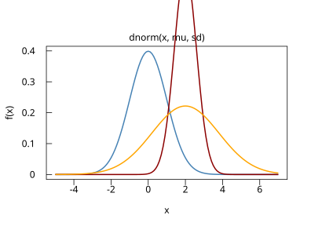
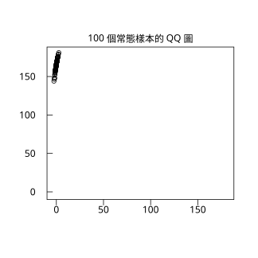

# 4.4 正態分配

## 本節目標

- 說出正態分配從哪裡來：De Moivre（1733）→ Laplace → Gauss（1809）的誤差理論
- 讀懂密度公式每一段的意義，並用程式驗證 **68-95-99.7 法則**
- 會標準化 $`z = (x-\mu)/\sigma`$ ，理解為什麼只需背一張標準常態表
- 掌握 `r.dnorm / r.pnorm / r.qnorm`
- 認識 QQ 圖（`qqnorm`）的概念，為第 10 章鋪路

---

## 歷史：一枚硬幣逼出鐘形曲線（1733–1809）

### 1733：De Moivre 與二項分配的極限

故事從賭桌開始。擲 3600 次公平硬幣，正面次數 $`X \sim \mathrm{Binom}(3600, 0.5)`$ 的機率怎麼算？直接用二項公式要算 $`\binom{3600}{1800}`$ 這種天文數字的組合數——1800 年代還沒有電腦，根本算不動。De Moivre 在 1733 年（後來收入 1738 年版《機遇論》）證明： $`n`$ 大時，二項機率的形狀趨近一條**鐘形曲線**：

$`\binom{n}{k} p^k (1-p)^{n-k} \;\approx\; \frac{1}{\sqrt{2\pi np(1-p)}} \exp\!\left(-\frac{(k-np)^2}{2np(1-p)}\right)`$

他就靠這條曲線硬算出了 $`P(X = 1800)`$ 。這是**中央極限定理的第一個特例**（第 7 章會正式講），鐘形曲線的第一次現身是為了**解決計算**。

### 1774–1810：Laplace 與誤差的第一條曲線

天文觀測需要「把多次測量合併成一個最佳值」，這逼出誤差分布問題。Laplace（1774）提出了第一條誤差曲線（後稱 Laplace 分配），但它的尖頂不夠漂亮；他也注意到 De Moivre 的曲線屢屢出現在「大量小因素相加」的場景。1809–1810 年之間，Laplace 證明了完整的中央極限定理，把「為什麼到處都是鐘形」說清楚：**很多個獨立小誤差相加，總和就是常態**。

### 1809：Gauss 與誤差理論

Gauss 在 1809 年出版《天體運動論》，從另一頭走進來：他假設誤差服從某條對稱曲線，**要求算術平均是最佳估計**，反推出這條曲線唯一只能是

$`f(x) = \frac{1}{\sqrt{2\pi}\,\sigma} \exp\!\left(-\frac{(x-\mu)^2}{2\sigma^2}\right)`$

正態分配因此得名「高斯分配」。Legendre（1805）與 Gauss 的最小平方法、後來的迴歸分析（第 12 章），整座大廈都建在這條曲線上。「**誤差是常態的**」這個假設至今仍是統計推論的預設。

### 為什麼這個概念重要

De Moivre 的出發點是「算不動」、Laplace 的是「許多小原因相加」、Gauss 的是「平均數當最優」。三個問題、一條曲線——這是統計史上最漂亮的收斂。之後你會發現：二項、卜松、Gamma、 $`t`$ 、卡方， $`n`$ 大了都長成它。

---

## 密度公式：每一項在說什麼

$`f(x) = \frac{1}{\sqrt{2\pi}\,\sigma} \exp\!\left(-\frac{(x-\mu)^2}{2\sigma^2}\right)`$

- $`\mu`$ ：**中心**——曲線的對稱軸，也是平均與中位數（三者重合，唯一常見分配之一）。
- $`\sigma`$ ：**寬度**——越小越尖。 $`1/(\sqrt{2\pi}\sigma)`$ 讓總面積等於 1（ $`\sigma`$ 越小，峰要越高才補得回面積）。
- 指數裡的 $`(x-\mu)^2/(2\sigma^2)`$ ：偏離中心的「距離平方 ÷ 兩倍變異數」——偏離越多機率衰減越快，而且是平方懲罰（正負對稱）。

整個分配只有兩個參數，記號 $`N(\mu, \sigma^2)`$ 。 $`N(0, 1)`$ 稱為**標準常態**。

### 68-95-99.7 法則

常態分配有三個好背的數字（理論值 68.27%、95.45%、99.73%）：

$`P(\mu - \sigma < X < \mu + \sigma) \approx 0.68`$

$`P(\mu - 2\sigma < X < \mu + 2\sigma) \approx 0.95`$

$`P(\mu - 3\sigma < X < \mu + 3\sigma) \approx 0.997`$

這是速算神器：身高 $`N(165, 7^2)`$ ，比 179 高（ $`\mu + 2\sigma`$ ）的人約 $`(1-0.95)/2 = 2.5\%`$ 。

---

## 動手：dnorm / pnorm / qnorm

### 驗證 68-95-99.7

```python
import rstatistics as r

# 68-95-99.7 法則（標準常態）
print(r.pnorm(1) - r.pnorm(-1))
print(r.pnorm(2) - r.pnorm(-2))
print(r.pnorm(3) - r.pnorm(-3))
```

```
0.6826894921370859
0.9544997361036411
0.9973002039367398
```

$`[{\mu}\pm\sigma]`$ 抓 68.3%、 $`\pm 2\sigma`$ 抓 95.4%、 $`\pm 3\sigma`$ 抓 99.73%。注意 99.73% 意味著**一萬個樣本裡只有 27 個**會落在 $`\pm 3\sigma`$ 之外——品管「3σ 法則」的由來。

### 標準化：一張表走天下

任何 $`N(\mu, \sigma^2)`$ 都可以搬回 $`N(0,1)`$ ：令 $`z = (x - \mu)/\sigma`$ 。減 $`\mu`$ 是「把中心搬到 0」、除 $`\sigma`$ 是「把寬度縮成 1」。之後一切機率都查標準表即可。

```python
# 標準化：身高 175cm，mu=165, sd=7  ->  z
mu, sd = 165.0, 7.0
x = 175.0
z = (x - mu) / sd
print(z)
print(r.pnorm(z))                       # 標準化後
print(r.pnorm(x, mu, sd))               # 直接算，結果相同
print(r.pnorm(x, mu, sd, lower_tail=False) * 100)  # P(X>175) 百分比

# qnorm：由機率反解分位數
print(r.qnorm(0.5))                     # 中位數
print(r.qnorm(0.975))                   # 95% 信賴區間的臨界值
print(r.qnorm(0.975) * sd + mu)         # 還原回身長尺度
```

```
1.4285714285714286
0.9234362744901652
0.9234362744901652
7.656372550983487
0.0
1.9599639845400534
178.71974789178037
```

四個重點：

- 175 公分 = $`z = 1.43`$ ，即比平均高 1.43 個標準差。
- $`P(X \le 175) = 0.9234`$ ：直接算與標準化後查表**完全相同**（兩條路同一答案，這就是標準化的意義）。
- 比 175 高的人約 7.66%。
- $`q_{0.975} = 1.959964 \approx 1.96`$ ——這個數字從第 8 章信賴區間開始會出現上百次：95% 信賴區間是「平均 ± 1.96 個標準誤」。 $`q_{0.5} = 0`$ 印證常態的對稱性：中位數就是中心。

### 模擬與不同參數的曲線

```python
import rstatistics as r

g = r.set_seed(42)
h = g.rnorm(5, mu, sd)
print([round(v, 2) for v in h])
```

```
[174.6, 161.05, 167.54, 169.43, 167.83]
```

五個樣本都落在 $`[165-2\sigma, 165+2\sigma] = [151, 179]`$ 內——樣本少時落在 68% 帶內很正常，別急著下結論（這是抽樣變異，第 5 章的主題）。

### 畫曲線與 QQ 圖

```python
import rstatistics as r

# 常態密度：不同 mu/sd 的曲線
g = r.Graphics(width=5.5, height=4.2)
xs = [i * 0.1 for i in range(-50, 71)]     # x = -5 .. 7
for mu, sd, col in [(0.0, 1.0, "steelblue"), (2.0, 0.6, "darkred"), (2.0, 1.8, "orange")]:
    ys = [r.dnorm(x, mu, sd) for x in xs]
    if mu == 0.0:
        g.plot(xs, ys, type="l", main="dnorm(x, mu, sd)", xlab="x", ylab="f(x)", col=col, lwd=2)
    else:
        g.lines(xs, ys, col=col, lwd=2)
g.save("img/04.4-dnorm-curves.svg")

# qqnorm 概念預告：常態樣本的 QQ 圖
g2 = r.set_seed(42)
x = g2.rnorm(100, 165.0, 7.0)
g3 = r.Graphics(width=4.5, height=4.5)
g3.qqnorm(x, main="100 個常態樣本的 QQ 圖")
g3.qqline(x)
g3.save("img/04.4-qqnorm.svg")
```





QQ 圖（quantile-quantile）的讀法：把資料的分位數畫在 y 軸、**理論常態**的分位數畫在 x 軸。若資料真的來自常態，點會落在一條直線上（`qqline` 畫的參考線）。上圖的點大致貼線、兩端稍有抖動（樣本數 100 的正常現象）。**直方圖會說謊（分箱方式影響形狀），QQ 圖不會**——第 10 章我們用它正式檢驗常態性。

> 註：`g.curve('dnorm', from, to, mean=..., sd=...)` 也畫得出單條常態曲線；要多條比較就必須 `plot` + `lines`（`curve` 一次只有一組參數）。

---

## 與 R 對照

```r
pnorm(1)-pnorm(-1); pnorm(2)-pnorm(-2); pnorm(3)-pnorm(-3)
(175-165)/7; pnorm(175, 165, 7); pnorm(175, 165, 7, lower.tail=FALSE)*100
qnorm(0.5); qnorm(0.975); qnorm(0.975)*7+165
set.seed(42); round(rnorm(5, 165, 7), 2)
```

```
[1] 0.6826895
[1] 0.9544997
[1] 0.9973002
[1] 1.428571
[1] 0.9234363
[1] 7.656373
[1] 0
[1] 1.959964
[1] 178.7197
[1] 174.60 161.05 167.54 169.43 167.83
```

與 Python 逐一相同（連亂數都一樣）。R 的畫圖版本：

```r
x <- seq(-5, 7, length.out = 200)
plot(x, dnorm(x), type = "l", col = "steelblue",
     main = "dnorm(x, mu, sd)", xlab = "x", ylab = "f(x)")
lines(x, dnorm(x, 2, 0.6), col = "darkred")
lines(x, dnorm(x, 2, 1.8), col = "orange")

qqnorm(x); qqline(x)   # x 為上段的 100 個常態樣本
```

---

## 小結

- 歷史三步：**De Moivre 1733**（二項極限，為了算得動）→ **Laplace 1774–1810**（誤差曲線＋中央極限定理）→ **Gauss 1809**（誤差理論，最小平方法的基礎）。
- 密度 $`\frac{1}{\sqrt{2\pi}\sigma} e^{-(x-\mu)^2/(2\sigma^2)}`$ ： $`\mu`$ 管中心、 $`\sigma`$ 管寬度；平均＝中位數＝眾數。
- **68-95-99.7**：程式驗證 0.6827 / 0.9545 / 0.9973。
- 標準化 $`z = (x-\mu)/\sigma`$ 後一切查標準常態； $`q_{0.975} = 1.96`$ 要背。
- `r.dnorm / r.pnorm / r.qnorm` 三方向；QQ 圖是目視常態性的標準工具（第 10 章）。

---

## 練習

1. 某考試成績 $`N(70, 8^2)`$ 。用 68-95-99.7 速算：分數在 62 到 86 之間的比例？超過 94 分的比例？
   （提示：62 = 70−8、86 = 70+2σ；94 = 70+3σ，尾部對半分。）
2. 用 `r.pnorm` 精確算上題，與速算值比較；再用 `r.qnorm` 找出「前 10%」的分數線。
   （提示：前 10% 是 $`q_{0.9}`$ 。）
3. 標準化練習： $`X \sim N(30, 5^2)`$ ，把 $`x = 22, 30, 37`$ 各化成 $`z`$ ，並驗證 `r.pnorm(z)` 與 `r.pnorm(x, 30, 5)` 相同。
4. 模擬 $`N(165, 7^2)`$ 樣本 10000 個，算出落在 $`\pm\sigma`$ 、 $`\pm 2\sigma`$ 、 $`\pm 3\sigma`$ 內的實際比例，與理論值 68.27/95.45/99.73% 比較。
   （提示：用列表推導數個數再除以 10000。）
5. （預習第 10 章）用 `g.rexp(100, 1.0)` 造 100 個指數樣本，畫它的 QQ 圖與直方圖。點會偏離直線（右尾翹起）——直方圖上這個「右偏」與 QQ 圖上「兩端下垂」是同一件事的兩種畫法。
