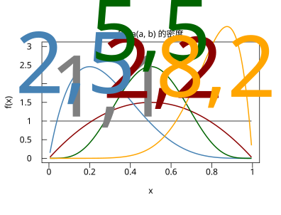
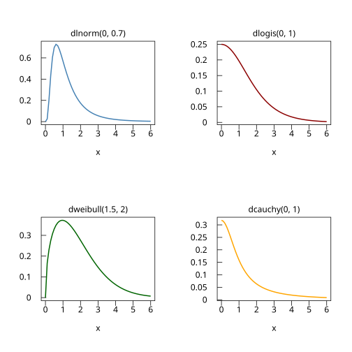

# 4.5 Beta 分配與組合的分布

## 本節目標

- 看懂 Beta 密度的形狀如何隨 $`(a, b)`$ 變化，並用程式一次畫出多條曲線
- 理解「**均勻 = Beta(1,1)**」以及 Beta 為什麼是「比例的不確定性」的自然模型
- 用 `r.beta(a, b)` 常數與自寫的**梯形法數值積分**驗證 $`\int_0^1 f = 1`$
- 快速認識 lnorm / logis / weibull / cauchy——本書的「分配圖鑑」收尾

---

## 比例的不確定性

前面三節的分配都活在 $`[0, \infty)`$ 上，但有一大類量的範圍天生是 **0 到 1**：命中率、及格率、市占率、廣告點擊率、一台機器每天正常運轉的時間比例。描述「一個比例的不確定性」最自然的家族就是 **Beta 分配**：

$`f(x) = \frac{1}{B(a,b)} x^{a-1} (1-x)^{b-1}\ (0 \le x \le 1)`$

其中 $`B(a,b) = \int_0^1 t^{a-1}(1-t)^{b-1}\,dt = \frac{\Gamma(a)\Gamma(b)}{\Gamma(a+b)}`$ 是把 $`x^{a-1}`$ 與 $`(1-x)^{b-1}`$ 的乘積「規一化」的常數。兩個參數的直覺讀法（這在貝氏統計裡是標準語言，第 9 章會用到）：

- $`a`$ ≈ 「看到過的**成功**次數 + 1」，把機率質量推向 1
- $`b`$ ≈ 「看到過的**失敗**次數 + 1」，把機率質量推向 0
- 平均 $`\dfrac{a}{a+b}`$ ——正是「成功比例」的樣子

Beta(1,1)： $`x^0(1-x)^0 = 1`$ ，密度是常數 $`1/B(1,1) = 1`$ ——**就是 $`U(0,1)`$ **。均勻分配在 Beta 家族裡的位置，就像指數在 Gamma 家族裡（shape=1）：都是「什麼資訊都還沒有」的起點。Beta(2,5) 則像「1 次成功、4 次失敗」之後你對命中率剩下的不確定性：大部分質量壓在 0.2 附近、不可能出現負值或超過 1。

### 為什麼這個概念重要

Beta 是第 3 章二項分配的「連續鏡像」：二項描述「 $`n`$ 次實驗成功 $`k`$ 次」的**次數**，Beta 描述「成功率本身」的**信念分布**。這正是它 1774 年之後（Euler 與 Laplace 時代完成積分理論）在貝氏統計中無可取代的原因——而 rstatistics 的 `r.beta(a,b)` 函數（數學的 B 函數）正是密度公式裡那個常數。

---

## 動手：dbeta / pbeta / rbeta 與數值積分

### 形狀隨 (a,b) 變化

```python
import rstatistics as r

g = r.Graphics(width=5.5, height=4.2)
xs = [i * 0.005 for i in range(1, 200)]    # x = 0.005 .. 0.995
for a, b, col in [(1.0, 1.0, "gray"), (2.0, 2.0, "darkred"), (2.0, 5.0, "steelblue"), (5.0, 5.0, "darkgreen"), (8.0, 2.0, "orange")]:
    ys = [r.dbeta(x, a, b) for x in xs]
    if a == 1.0:
        g.plot(xs, ys, type="l", main="Beta(a, b) 的密度", xlab="x", ylab="f(x)", ylim=[0, 3], col=col, lwd=2)
    else:
        g.lines(xs, ys, col=col, lwd=2)
g.text(0.30, 1.12, "1,1", 0.0, "gray", 10.0)
g.text(0.56, 1.62, "2,2", 0.0, "darkred", 10.0)
g.text(0.13, 1.75, "2,5", 0.0, "steelblue", 10.0)
g.text(0.50, 2.62, "5,5", 0.0, "darkgreen", 10.0)
g.text(0.82, 1.65, "8,2", 0.0, "orange", 10.0)
g.save("img/04.5-beta-shapes.svg")
```



五條曲線讀出五種「信念狀態」：

- **(1,1)**：水平線＝均勻 $`U(0,1)`$ ，一無所知
- **(2,2)**：中間鼓起，峰在 0.5——「大概對半，但不確定」
- **(2,5)**：質量推向左邊，峰在 $`(a-1)/(a+b-2) = 1/5 = 0.2`$ ——「成功率偏低」
- **(5,5)**：又高又窄地集中在 0.5——「資料多了 8 次，信心增加」
- **(8,2)**：推向右邊——「成功率偏高」

注意 $`a, b`$ 同時加大時曲線**變窄**：看到的次數越多，不確定性越小（變異數 $`\frac{ab}{(a+b)^2(a+b+1)}`$ ，隨 $`a+b`$ 變小）。這就是「資料累積 → 信念收斂」的具體圖像。

### 基本三方向與亂數

```python
import rstatistics as r

# Beta 密度形狀
print(r.dbeta(0.5, 1.0, 1.0))      # Beta(1,1) = 均勻 U(0,1)，密度恆 1
print(r.dbeta(0.3, 2.0, 5.0))
print(r.pbeta(0.5, 2.0, 5.0))      # CDF

g = r.set_seed(42)
print(g.rbeta(3, 2.0, 5.0))        # 亂數在 RNG 上

# r.beta(a,b)：B 函數常數；1/B(2,5) = 30 是密度前的常數
print(r.beta(2.0, 5.0))
print(1.0 / r.beta(2.0, 5.0))
```

```
1.0
2.160899999999999
0.890625
[0.1849357573500494, 0.3647603962637168, 0.43080701096923063]
0.03333333333333335
29.99999999999999
```

檢查點：

- `dbeta(0.5, 1, 1) = 1`：Beta(1,1) 就是 $`U(0,1)`$ 。
- $`P(X \le 0.5 \mid a=2, b=5) = 0.8906`$ ：質量大多在 0.5 左邊（平均 $`2/7 \approx 0.286`$ ），合理。
- $`B(2,5) = \frac{1!\,4!}{6!} = \frac{24}{720} = \frac{1}{30}`$ ，所以密度前的常數 $`1/B = 30`$ ——數值 29.9999… 在浮點誤差內吻合。

### 自寫梯形法驗證 ∫ = 1

數值積分不需要套件，梯形法 10 行搞定：把 $`[a,b]`$ 切成 $`n`$ 段，每段面積用梯形 $`\frac{f(x_i)+f(x_{i+1})}{2}h`$ 近似：

```python
import rstatistics as r

# 數值積分（梯形法）：∫ dbeta(x; 2, 5) dx 應為 1
def trap(f, a, b, n):
    h = (b - a) / n
    s = 0.5 * (f(a) + f(b))
    for i in range(1, n):
        s += f(a + i * h)
    return s * h

f = lambda x: r.dbeta(x, 2.0, 5.0)
print(trap(f, 0.0, 1.0, 1000))
print(trap(f, 0.0, 1.0, 20))
```

```
0.9999975000014996
0.9937593749999998
```

n=1000 得 0.9999975（誤差約 $`2.5 \times 10^{-6}`$ ，梯形法的誤差是 $`O(h^2)`$ 級：n 變 50 倍，誤差縮小約 2500 倍，與 n=20 時的 0.9938 相符）。任何密度積分都必須是 1——**總機率恆等於 1**——這是檢查自己手寫密度有沒有漏係數的萬用手段。

---

## 分配圖鑑：本書的最後四件收藏

連續分配家族還有幾位要角，各畫一條形狀差異圖：

```python
import rstatistics as r

# 分配圖鑑：lnorm / logis / weibull / cauchy
g2 = r.Graphics(width=7.0, height=7.0, mfrow=[2, 2])
xs = [i * 0.1 for i in range(0, 61)]       # 0..6
ys = [r.dlnorm(x, 0.0, 0.7) for x in xs]
g2.plot(xs, ys, type="l", main="dlnorm(0, 0.7)", xlab="x", ylab="", col="steelblue", lwd=2)
ys = [r.dlogis(x, 0.0, 1.0) for x in xs]
g2.next_panel()
g2.plot(xs, ys, type="l", main="dlogis(0, 1)", xlab="x", ylab="", col="darkred", lwd=2)
ys = [r.dweibull(x, 1.5, 2.0) for x in xs]
g2.next_panel()
g2.plot(xs, ys, type="l", main="dweibull(1.5, 2)", xlab="x", ylab="", col="darkgreen", lwd=2)
ys = [r.dcauchy(x, 0.0, 1.0) for x in xs]
g2.next_panel()
g2.plot(xs, ys, type="l", main="dcauchy(0, 1)", xlab="x", ylab="", col="orange", lwd=2)
g2.save("img/04.5-gallery.svg")
```



四個故事各一句：

- **lnorm（對數常態）**： $`\ln X`$ 服從常態。乘性過程（股價、細菌繁殖、礦藏品位）的結果——常態相**加**、對數常態相**乘**。右偏得厲害，永遠為正。
- **logis（logistic）**：長得非常像常態但**尾巴厚一點**；它的 CDF 是 S 形的 logistic 函數，是邏輯迴歸（預測「是/否」）的心臟。
- **weibull（韋伯）**：指數分配的推廣（shape=1 時就是指數）。shape > 1 故障率隨時間**上升**（老化）、shape < 1 **下降**（初期不良）——壽命工程的首選，正補上 4.3 節「指數不會老化」的缺口。
- **cauchy（柯西）**：著名的**壞孩子**——平均與變異數都不存在（尾巴太厚），中央極限定理**不適用**。它是 4.4 節「什麼都是常態」這條規律的邊界案例：兩個標準常態**相除**就得到它。看到 cauchy 樣本，別算平均。

cauchy 的尾巴有多厚？同樣是 $`|X| \le 1`$ ，常態抓 68.3%，cauchy 只抓 50%：

```python
print(r.pcauchy(1) - r.pcauchy(-1))
print(r.pnorm(1) - r.pnorm(-1))
```

```
0.5
0.6826894921370859
```

厚尾巴的機率都流到遠處去了。

至此本書的「分配圖鑑」收齊：**離散**（第 3 章）二項、卜松、幾何、負二項、超幾何；**連續**（第 4 章）均勻、指數、Gamma、常態、Beta，外加 lnorm / logis / weibull / cauchy 四件收藏。每一個都是一個真實世界問題的答案。

---

## 與 R 對照

```r
dbeta(0.5, 1, 1); dbeta(0.3, 2, 5); pbeta(0.5, 2, 5)
set.seed(42); rbeta(3, 2, 5)
beta(2, 5); 1/beta(2, 5)
n <- 1000; h <- 1/n; x <- (1:(n-1))*h
0.5*h*(0 + dbeta(1-h, 2, 5)) + sum(dbeta(x, 2, 5))*h
pcauchy(1)-pcauchy(-1)
```

```
[1] 1
[1] 2.1609
[1] 0.890625
[1] 0.1849358 0.3647604 0.4308070
[1] 0.03333333
[1] 30
[1] 0.9999975
[1] 0.5
```

數值全部一致。R 的畫圖版本：

```r
x <- seq(0.005, 0.995, length.out = 200)
plot(x, dbeta(x, 1, 1), type = "l", col = "gray",
     main = "Beta(a, b) 的密度", xlab = "x", ylab = "f(x)", ylim = c(0, 3))
for (ab in list(c(2,2), c(2,5), c(5,5), c(8,2)))
  lines(x, dbeta(x, ab[1], ab[2]))
```

（R 的 `beta(a, b)` 對應 rstatistics 的 `r.beta(a, b)`——都是數學的 B 函數，不是亂數。）

---

## 小結

- Beta( $`a, b`$ ) 是 **0 到 1 上的分配**，密度 $`\frac{1}{B(a,b)} x^{a-1}(1-x)^{b-1}`$ ；平均 $`a/(a+b)`$ 。
- **Beta(1,1) = U(0,1)**； $`a, b`$ 加大則質量集中——「資料累積 → 信念收斂」，貝氏統計（第 9 章）的基礎。
- `r.beta(a, b)` 是 B 函數常數（密度前的規一化因子），可用 $`B(2,5)=1/30`$ 手算驗證。
- 自寫梯形法積分是檢查「密度積分 = 1」的萬用工具，誤差 $`O(h^2)`$ 。
- 圖鑑四件：lnorm（乘性）、logis（厚尾＋S 形 CDF）、weibull（可老化的壽命）、cauchy（無平均無變異數、躲開中央極限定理）。

---

## 練習

1. Beta(2,5) 的峰在哪裡？（解析式 $`\frac{a-1}{a+b-2}`$ ，驗證與第 4 節 $`a=2,b=5`$ 時的圖一致。）再用 `r.pbeta` 求 $`P(X > 0.4)`$ 。
2. 用梯形法驗證 $`\int_0^1 \mathrm{dbeta}(x;\ 1, 1)\,dx = 1`$ 與 $`\int_0^1 \mathrm{dbeta}(x;\ 5, 5)\,dx = 1`$ ，並把 n=20、100、1000 的誤差列成表，觀察 $`O(h^2)`$ 的收縮速度。
3. 用 `g.rbeta(2000, 2, 5)` 造樣本，畫直方圖（密度尺度）並疊上 `r.dbeta` 曲線；算樣本平均並與理論值 $`2/7`$ 比較。
4. Weibull(shape=1.5, scale=2) 與 Exp(rate=0.5)（即 Weibull(1, 2)）畫在同一張圖上，說明 shape 從 1 變 1.5 時曲線的兩個變化（起點變 0、峰右移）。
   （提示：shape=1 是從 $`\lambda = 1/2 = 0.5`$ 開始下滑的指數。）
5. 用 `g.rcauchy(1000)` 算樣本平均，重複 10 次（換 10 個 seed），觀察平均值每次都「不一樣大」甚至飄到很遠——這就是「cauchy 沒有平均」在模擬裡的樣子。對照 `g.rnorm(1000)` 的 10 個平均（都很靠近 0）。
