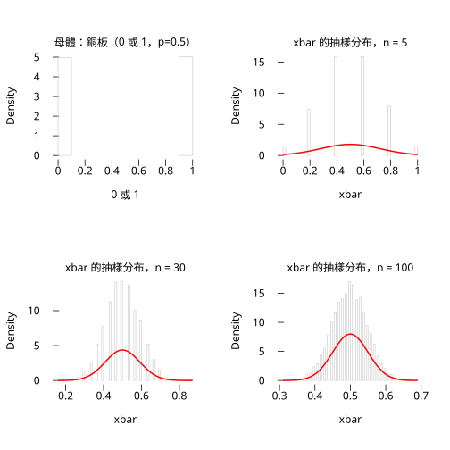
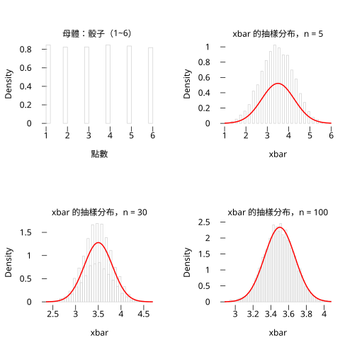
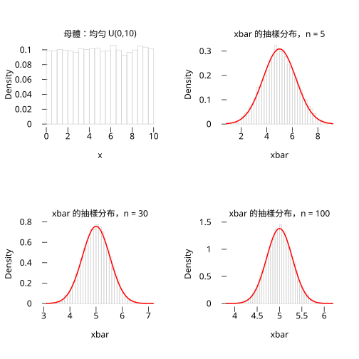
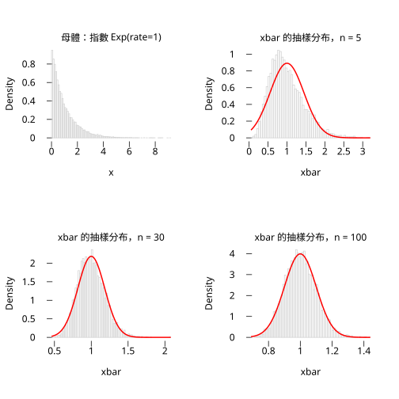
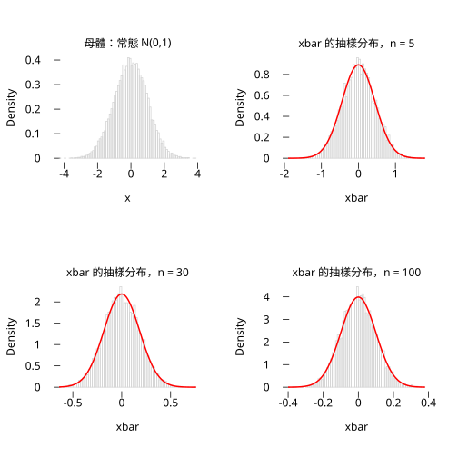
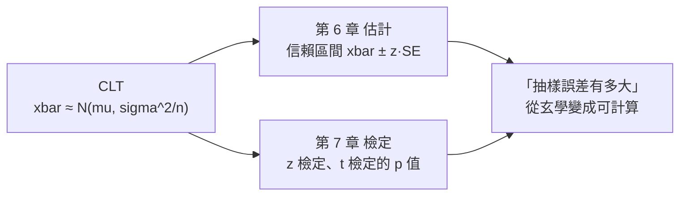

# 5.2 中央極限定理

## 本節目標

- 說出中央極限定理（CLT）的敘述，理解它「收斂到什麼」
- 用三種不同形狀的母體（均勻、指數、二項）模擬 $`\bar{X}`$ 的分布，看鐘形浮現
- 用五張 SVG 圖（銅板、骰子、均勻、指數、常態）親眼看見「平均數趨向常態」
- 討論「 $`n`$ 要多大」： $`n = 5 / 30 / 100`$ 的比較
- 用 $`\sigma/\sqrt{n}`$ 對照模擬的 sd，確認 CLT 的定量面
- 明白 CLT 為什麼是第 6、7 章一切統計推論的地基

---

## 問題：母體不是常態，第 5.1 節的常態結論還能用嗎？

5.1 節的 $`\bar{X} \sim N(\mu, \sigma^2/n)`$ 有一個前提：**母體本身是常態**。但現實資料常不是——等燈時間是指數、擲骰次數是幾何、問卷是二項。難道每種母體都要另推一套 $`\bar{X}`$ 的分布？

答案是十九世紀機率學家給的驚人禮物：

> **中央極限定理（CLT）**：設 $`X_1, \ldots, X_n`$ i.i.d.，平均 $`\mu`$ 、變異數 $`\sigma^2 < \infty`$ （**母體是什麼形狀都行**）。當 $`n \to \infty`$ ，
>
> ```math
> \frac{\bar{X} - \mu}{\sigma/\sqrt{n}} \;\xrightarrow{\ d\ }\; N(0, 1)
> ```

換句話說， $`n`$ 夠大時 $`\bar{X} \approx N(\mu, \sigma^2/n)`$ ，**不管母體長什麼樣**。這解釋了為什麼常態曲線（高斯 1809 年用於誤差論、Laplace 1810 年證出 CLT 的一般形式）會在自然與社會資料裡無所不在：很多觀測值本身就是大量獨立因素的「平均」。

### CLT vs 大數法則：收斂的兩個面向

容易混的是 5.3 節的大數法則（LLN）。兩者都是「 $`n`$ 變大時 $`\bar{X}`$ 的極限行為」，但問的問題不同：

| | 大數法則（LLN） | 中央極限定理（CLT） |
|---|---|---|
| 問什麼 | $`\bar{X}`$ 會不會**收斂到** $`\mu`$ ？ | 收斂過程中**殘餘的波動是什麼形狀**？ |
| 答案 | 會（機率收斂） | 是常態，大小 $`\sigma/\sqrt{n}`$ |
| 用途 | 「估計值可信」的依據 | 給出**誤差的大小與機率**，推論的依據 |

LLN 說針會停在靶心，CLT 說針孔繞著靶心散成常態雲、雲的半徑是 $`\sigma/\sqrt{n}`$ 。推論需要的是後者——只知道「會中靶心」還不夠，要能算「偏 2 公分以外的機率」。

---

## 動手（一）：三種母體，三張直方圖

母體形狀刻意挑差很多的：均勻（對稱、有界）、指數（嚴重右偏、無界）、二項（離散）。每種都重複抽 20,000 組 $`n=30`$ 的樣本，畫 $`\bar{X}`$ 的直方圖。

```python
import rstatistics as r

def ascii_hist(x, nb=20, width=60):
    lo, hi = min(x), max(x)
    step = (hi - lo) / nb
    counts = [0] * nb
    for v in x:
        counts[min(nb - 1, int((v - lo) / step))] += 1
    mx = max(counts)
    for i, c in enumerate(counts):
        if c == 0: continue
        m = lo + (i + 0.5) * step
        bar = "#" * max(1, round(width * c / mx))
        print(f"{m:8.2f} |{bar} {c}")

B = 20000

print("=== (1) 均勻母體 U(0,10)，n=30 ===")
g = r.set_seed(7)
xb = []
for _ in range(B):
    xb.append(r.mean(g.runif(30, 0.0, 10.0)))
print(f"平均 = {r.mean(xb):.4f} (母體平均 5)，sd = {r.sd(xb):.4f} (理論 {(10/12**0.5)/30**0.5:.4f})")
ascii_hist(xb, nb=20)

print()
print("=== (2) 指數母體 Exp(rate=1)，n=30 ===")
g = r.set_seed(7)
xe = []
for _ in range(B):
    xe.append(r.mean(g.rexp(30, 1.0)))
print(f"平均 = {r.mean(xe):.4f} (母體平均 1)，sd = {r.sd(xe):.4f} (理論 {1/30**0.5:.4f})")
ascii_hist(xe, nb=20)

print()
print("=== (3) 二項母體 Bin(10, 0.3)，n=30 ===")
g = r.set_seed(7)
xo = []
for _ in range(B):
    xo.append(r.mean([float(v) for v in g.rbinom(30, 10, 0.3)]))
print(f"平均 = {r.mean(xo):.4f} (母體平均 3)，sd = {r.sd(xo):.4f} (理論 {(10*0.3*0.7)**0.5/30**0.5:.4f})")
ascii_hist(xo, nb=20)
```

輸出（實際執行）：

```
=== (1) 均勻母體 U(0,10)，n=30 ===
平均 = 5.0018 (母體平均 5)，sd = 0.5263 (理論 0.5270)
    3.15 |# 9
    3.35 |# 28
    3.55 |# 73
    3.75 |#### 191
    3.95 |######## 394
    4.15 |################# 837
    4.35 |############################# 1458
    4.55 |########################################## 2150
    4.76 |#################################################### 2632
    4.96 |############################################################ 3038
    5.16 |########################################################## 2921
    5.36 |############################################### 2393
    5.56 |################################## 1732
    5.76 |####################### 1140
    5.96 |############ 587
    6.16 |##### 265
    6.36 |## 100
    6.56 |# 37
    6.76 |# 12
    6.97 |# 3

=== (2) 指數母體 Exp(rate=1)，n=30 ===
平均 = 1.0013 (母體平均 1)，sd = 0.1836 (理論 0.1826)
    0.46 |# 11
    0.54 |# 62
    0.62 |##### 278
    0.69 |############## 819
    0.77 |################################ 1786
    0.85 |############################################### 2686
    0.93 |########################################################### 3327
    1.01 |############################################################ 3400
    1.08 |################################################## 2808
    1.16 |#################################### 2060
    1.24 |####################### 1287
    1.32 |############## 772
    1.40 |###### 367
    1.47 |### 177
    1.55 |## 106
    1.63 |# 33
    1.71 |# 11
    1.78 |# 8
    1.94 |# 2

=== (3) 二項母體 Bin(10, 0.3)，n=30 ===
平均 = 3.0014 (母體平均 3)，sd = 0.2640 (理論 0.2646)
    2.08 |# 13
    2.19 |# 25
    2.29 |## 96
    2.39 |#### 194
    2.49 |########## 493
    2.59 |################### 972
    2.69 |################################# 1659
    2.80 |############################################# 2287
    2.90 |###################################################### 2736
    3.00 |############################################################ 3026
    3.10 |####################################################### 2784
    3.20 |############################################# 2267
    3.30 |############################### 1560
    3.41 |################### 972
    3.51 |########## 526
    3.61 |#### 224
    3.71 |## 116
    3.81 |# 36
    3.91 |# 10
    4.02 |# 4
```

三個母體天差地遠，但 $`n=30`$ 時三張 $`\bar{X}`$ 直方圖**都是鐘形**，而且模擬 sd 都對上 $`\sigma/\sqrt{n}`$ 。指數那一張還留一點右偏痕跡——這正是下一個實驗要看的。

---

## 動手（二）： $`n`$ 要多大？

CLT 是漸近結果，教科書常說「 $`n \ge 30`$ 就夠」。這句話該打折：夠不夠**取決於母體偏得多麼厲害**。用最偏的指數母體來試：

```python
print("=== n 要多大？指數母體，n = 5 / 30 / 100 ===")
for n in (5, 30, 100):
    g = r.set_seed(7)
    xs = []
    for _ in range(B):
        xs.append(r.mean(g.rexp(n, 1.0)))
    skew_note = {5: "仍看到右偏尾巴", 30: "已接近鐘形", 100: "幾乎完美鐘形"}[n]
    print(f"n={n:3d}: sd={r.sd(xs):.4f} (理論 {1/n**0.5:.4f})  {skew_note}")
    if n == 5:
        ascii_hist(xs, nb=18)

print()
print("=== n=100 指數母體的 xbar 直方圖（對照鐘形）===")
g = r.set_seed(7)
xs = []
for _ in range(B):
    xs.append(r.mean(g.rexp(100, 1.0)))
ascii_hist(xs, nb=18)
```

輸出（實際執行，接上前一段）：

```
=== n 要多大？指數母體，n = 5 / 30 / 100 ===
n=  5: sd=0.4476 (理論 0.4472)  仍看到右偏尾巴
    0.15 |### 173
    0.35 |##################### 1357
    0.55 |############################################### 3070
    0.75 |############################################################ 3881
    0.95 |####################################################### 3548
    1.15 |############################################ 2870
    1.35 |############################### 1990
    1.55 |##################### 1337
    1.75 |############# 810
    1.95 |######## 488
    2.15 |### 223
    2.35 |## 125
    2.55 |# 68
    2.75 |# 29
    2.95 |# 17
    3.15 |# 9
    3.35 |# 3
    3.55 |# 2
n= 30: sd=0.1836 (理論 0.1826)  已接近鐘形
n=100: sd=0.1008 (理論 0.1000)  幾乎完美鐘形

=== n=100 指數母體的 xbar 直方圖（對照鐘形）===
    0.68 |# 9
    0.73 |# 48
    0.77 |#### 237
    0.81 |########## 611
    0.86 |######################## 1409
    0.90 |####################################### 2300
    0.95 |####################################################### 3226
    0.99 |############################################################ 3512
    1.04 |###################################################### 3172
    1.08 |######################################### 2377
    1.13 |########################## 1550
    1.17 |############## 848
    1.21 |######## 454
    1.26 |### 156
    1.30 |# 57
    1.35 |# 26
    1.39 |# 6
    1.44 |# 2
```

三個教訓：

1. **sd 隨時都準**： $`\sigma/\sqrt{n}`$ 是精確公式， $`n=5`$ 時就對上（0.4476 vs 0.4472）——它來自 5.1 節的變異數運算，不需要 CLT。
2. **形狀才是 CLT 的內容**，而形狀收斂得慢：指數這種重偏母體， $`n=5`$ 明顯右偏， $`n=30`$ 大致鐘形但尾部仍不對稱， $`n=100`$ 才乾淨。
3. 「 $`n \ge 30`$ 」是針對不太偏的母體的經驗法則；**母體越偏、越重尾，需要的 $`n`$ 越大**。

---

## 動手（三）：五種母體，五張圖 —— 讓鐘形自己長出來

前面兩段用 ASCII 直方圖在終端機裡看形狀；終端機的字元格子只有 60 欄，看得見「鐘形」卻看不清楚 **不鐘形的時候差多少**。這裡改用本書第 10 章要介紹的 SVG 裝置，把同一個實驗畫成可以貼進論文的圖。

實驗設計對五種母體各做一次，每種畫一張 2×2 的圖：

- 左上：**母體本身**（一次抽 20,000 個觀測值）
- 右上、左下、右下： $`\bar{X}`$ 的抽樣分布， $`n = 5 / 30 / 100`$ （每格 8,000 組抽樣）
- 紅線： $`N(\mu, \sigma^2/n)`$ 的密度曲線，也就是 CLT 說「應該長成」的樣子

五種母體刻意挑得亂來：銅板（兩點、對稱但離散）、骰子（六點、離散且不對稱）、均勻（連續、對稱、有邊界）、指數（連續、嚴重右偏、無上界）、常態（本來就是鐘形）。**如果 CLT 真的成立，前四種的最後一格都會變成鐘形，而且越像常態母體越快變。**

```python
import rstatistics as r

B = 8000
NS = [5, 30, 100]


def sample_means(vals, n):
    """把 B*n 個抽樣值切成 B 組、每組 n 個，取各組平均。"""
    out = []
    for i in range(B):
        out.append(r.mean(vals[i * n:(i + 1) * n]))
    return out


def normal_overlay(g, xlo, xhi, mu, sigma, n, col="red"):
    """在目前的圖窗上疊上 N(mu, sigma^2/n) 的密度曲線。"""
    xs = []
    ys = []
    for i in range(201):
        x = xlo + (xhi - xlo) * float(i) / 200.0
        xs.append(x)
        ys.append(r.dnorm(x, mu, sigma / n ** 0.5))
    g.lines(xs, ys, col, 2.0)


def one_figure(name, title, label, mu, sigma, breaks, draw):
    g = r.Graphics(width=7.0, height=7.0, mfrow=[2, 2])
    g.hist(draw(20000), main="母體：" + title, xlab=label, ylab="Density",
           freq=False, breaks=breaks)
    for k in range(3):
        n = NS[k]
        g.next_panel()
        xs = sample_means(draw(B * n), n)
        h = g.hist(xs, main="xbar 的抽樣分布，n = " + str(n), xlab="xbar",
                   ylab="Density", freq=False, breaks="FD")
        normal_overlay(g, h.breaks[0], h.breaks[len(h.breaks) - 1], mu, sigma, n)
    g.save("05.2-clt-" + name + ".svg")
    print("寫出 05.2-clt-" + name + ".svg")


g1 = r.set_seed(11)
one_figure("coin", "銅板（0 或 1，p=0.5）", "0 或 1", 0.5, 0.5, "FD",
           lambda k: [float(v) for v in g1.rbinom(k, 1, 0.5)])

g2 = r.set_seed(12)
one_figure("dice", "骰子（1~6）", "點數", 3.5, (35.0 / 12.0) ** 0.5, "FD",
           lambda k: g2.sample_from([1.0, 2.0, 3.0, 4.0, 5.0, 6.0], k, True))

g3 = r.set_seed(13)
one_figure("uniform", "均勻 U(0,10)", "x", 5.0, (100.0 / 12.0) ** 0.5, "FD",
           lambda k: g3.runif(k, 0.0, 10.0))

g4 = r.set_seed(14)
one_figure("exponential", "指數 Exp(rate=1)", "x", 1.0, 1.0, "FD",
           lambda k: g4.rexp(k, 1.0))

g5 = r.set_seed(15)
one_figure("normal", "常態 N(0,1)", "x", 0.0, 1.0, "FD",
           lambda k: g5.rnorm(k, 0.0, 1.0))
```

輸出的五張圖（SVG，可用瀏覽器直接打開）：

**銅板**（ $`\mathrm{Bernoulli}(0.5)`$ ）——母體只有 0 和 1 兩個值， $`\bar{X}`$ 的可能值是 $`0, 0.2, 0.4, \ldots, 1`$ ：



$`n = 5`$ 時 $`\bar{X}`$ 還看得出離散的五個階梯（0.2, 0.4, 0.6, 0.8, 1.0 都有可能是平均數 ✓）， $`n = 30`$ 時階梯已經糊掉、 $`n = 100`$ 時完全鐘形。**離散母體也逃不掉 CLT** —— 只要 $`n`$ 夠大。

**骰子**（ $`\{1, \ldots, 6\}`$ 上的離散均勻）——母體偏心（ $`\mu = 3.5`$ ），所以 $`n = 5`$ 的 $`\bar{X}`$ 明顯右偏，要到 $`n = 100`$ 才漂亮：



**均勻**（ $`U(0, 10)`$ ）——母體是「一條平的長板凳」， $`n = 5`$ 的 $`\bar{X}`$ 還是長方形（均勻和的分布是梯形 ✓）， $`n = 30`$ 就已經是漂亮的鐘形：



**指數**（ $`\mathrm{Exp}(1)`$ ）——最難收斂的一個， $`n = 5`$ 的鐘形右肩明顯塌陷， $`n = 100`$ 才和紅線幾乎重合：



**常態**（ $`N(0,1)`$ ）——起點就是鐘形， $`n = 5`$ 時已經相當像， $`n = 100`$ 時紅線與直方圖幾乎無法區分。**這正是 5.1 節那句「母體是常態時 $`\bar{X}`$ 就是常態」的視覺版本**：



把五張圖排在一起看，CLT 的兩句話就同時浮現了：

1. **形狀**只跟 $`n`$ 有關，跟母體長什麼樣無關（除了收斂速度）。
2. **收斂速度**跟母體的「形狀品質」有關：常態 > 均勻 > 銅板/骰子 > 指數。 textbooks 說的「 $`n \ge 30`$ 夠了」，是對「不太偏的母體」講的。

---

## 與 R 對照

```r
set.seed(7)
B <- 20000
xe <- replicate(B, mean(rexp(30, 1)))
c(mean = mean(xe), sd = sd(xe), se = 1 / sqrt(30))
hist(xe, breaks = 20, main = "CLT: Exp(1), n=30", xlab = "xbar")
```

輸出（實際執行）：

```
     mean        sd        se 
1.0012905 0.1835723 0.1825742 
```

與 Python 版一致（同一個 seed、位元等價的亂數）。

---

## 小結：第 6、7 章的地基

把依賴關係講明白：



- CLT 把「樣本平均的誤差」變成**常態機率問題**，於是信賴區間的 1.96、檢定的 p 值才有公式可寫。
- $`\sigma/\sqrt{n}`$ 來自變異數運算（精確），鐘形**形狀**來自 CLT（漸近）——兩者別混為一談。
- 母體偏得厲害時 $`n`$ 要更大；第 7 章的 $`t`$ 檢定與穩健方法就是為了補這個洞。

## 練習

1. 把均勻母體的 $`n`$ 降到 3：直方圖還像常態嗎？和指數母體 $`n=3`$ 比，誰先變鐘形？為什麼？
   （提示：均勻本身對稱、無尾巴；偏度小的母體收斂快。）
2. 用 CLT 估 $`P(\bar{X} > 1.3)`$ （指數母體、 $`n=30`$ ），再和模擬比例比對。
   （提示：理論 `1 - r.pnorm(1.3, 1.0, 1/30**0.5)`；模擬統計超過 1.3 的比例。）
3. 重尾母體（如 Cauchy，`g.rcauchy(n)`）**沒有**有限變異數——模擬 $`n=30`$ 的 $`\bar{X}`$ 直方圖，它收斂到鐘形了嗎？
   （提示：不會；這說明 CLT 的前提「 $`\sigma^2 < \infty`$ 」不是裝飾品。）
4. 二項母體 $`p=0.05`$ 時 $`\bar{X}`$ 的分布有何特別？（提示：高度右偏、許多 0；想想「 $`n`$ 要多大」的答案會怎麼變。）
