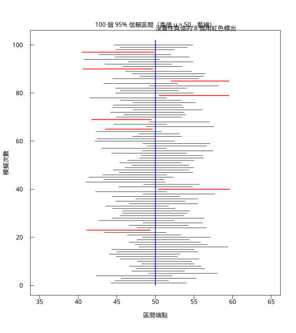

# 6.4 信賴區間怎麼讀

## 本節目標

- 徹底釐清最常見的誤讀：**「95% 是這個區間的機率」是錯的**
- 建立正確的敘述：「95% 是**這個方法**的長期覆蓋率」
- 用**區間圖**（100 條橫線疊在真值線上）把這件事一次說清
- 列出實務上最常見的十個信賴區間誤讀，並給出正確說法
- 理解「信賴區間」與「機率陳述」的差異，以及 **Bayesian 可信區間**為什麼長得像

---

## 問題：「這個區間有 95% 的機率包含真值」——這句話錯在哪？

我們幾乎每個做統計的人都聽過（或說過）這句話：

> 「我們算出的 95% 信賴區間是 $`[47.6, 57.9]`$ ，所以真值 $`\mu`$ 有 **95% 的機率**落在這個區間裡。」

**這句話是錯的。** 而且它錯得很微妙，因為聽起來非常合理。

### 為什麼它錯？

回到 6.2 節的推導。在我們**還沒抽樣之前**，母體是固定的、 $`\mu`$ 是一個未知的常數。而區間的端點

 $`\bar{X} \pm t_{\alpha/2,n-1}\frac{S}{\sqrt{n}}`$ 

是**隨機的**（因為 $`\bar{X}`$ 和 $`S`$ 是隨機的）。所以：

- **在抽樣之前**， $`\mu`$ 是一個固定的數字。「 $`\mu`$ 落在某個隨機區間裡的機率」這種說法本身就不成立——除非我們給 $`\mu`$ 一個主觀的先驗分布（那就是 6.4 節最後講的 Bayesian 做法）。
- **在抽樣之後**， $`\bar{X}`$ 和 $`S`$ 已經變成了**已知的數字**，區間 $`[47.6, 57.9]`$ 變成了一個**固定**的區間。此時真值 $`\mu`$ 要嘛在裡面、要嘛不在——沒有機率可言。

### 正確的敘述（Neyman, 1934）

> **方法** $`M`$ 是「信心水準 95% 的」，意思是：如果反覆使用 $`M`$ 抽樣並每次做出一個區間，那麼長期下來，這些區間中有 95% 會包含真值。

**主詞是「方法」，不是「這個區間」。** 這是本章的全部重點。

用一個類比：

> 就像擲硬幣。說「這枚硬幣正面朝上的機率是 50%」是對的（因為它還沒擲）。但一旦擲完了、平放在桌上，你說「這枚硬幣正面朝上的機率是 50%」就不對了——它要嘛朝上要嘛朝下，是 0 或 1。**信賴區間正是「已擲完的硬幣」**。

---

## 動手（一）：100 個區間畫成一張圖

與其講道理，不如直接看。

我們做 100 次獨立重複抽樣，每次抽 $`n=30`$ 個，算一個 95% $`t`$ 區間，然後**把 100 個區間全部畫出來**。

```python
import math
import rstatistics as r

mu, sigma, n = 50.0, 12.0, 30
B = 100
g = r.set_seed(2026)

print("=== 100 個 95% 信賴區間，看有多少個蓋住真值 μ = 50 ===")
intervals = []
cover = 0
for _ in range(B):
    s = g.rnorm(n, mean=mu, sd=sigma)
    m = r.mean(s)
    se = r.sd(s) / math.sqrt(n)
    tc = r.qt(0.975, n - 1)
    lo, hi = m - tc * se, m + tc * se
    intervals.append((lo, hi))
    if lo <= mu <= hi:
        cover += 1
print(f"蓋住真值的區間數 = {cover} / {B}（理論約 95）")
print("沒蓋住的區間：")
for i, (lo, hi) in enumerate(intervals):
    if not (lo <= mu <= hi):
        print(f"  第 {i+1:>3} 個：[{lo:.4f}, {hi:.4f}]")
print()
print("前 10 個區間：")
for i, (lo, hi) in enumerate(intervals[:10]):
    print(f"  {i+1:>3}: [{lo:.4f}, {hi:.4f}]  寬度 = {hi-lo:.4f}")
widths = [hi - lo for lo, hi in intervals]
print(f"平均寬度 = {r.mean(widths):.4f}，最小 = {min(widths):.4f}，最大 = {max(widths):.4f}")
```

輸出（實際執行）：

```
=== 100 個 95% 信賴區間，看有多少個蓋住真值 μ = 50 ===
蓋住真值的區間數 = 92 / 100（理論約 95）
沒蓋住的區間：
  第  23 個：[41.0921, 49.3673]
  第  40 個：[50.3265, 59.6702]
  第  65 個：[43.5183, 49.6617]
  第  69 個：[41.7246, 49.5023]
  第  79 個：[50.4477, 59.5776]
  第  85 個：[51.9980, 59.5510]
  第  90 個：[40.6143, 49.6802]
  第  97 個：[40.4932, 49.8720]

前 10 個區間：
    1: [44.2216, 54.0401]  寬度 = 9.8185
    2: [44.7467, 51.7041]  寬度 = 6.9574
    3: [45.5316, 55.2888]  寬度 = 9.7572
    4: [42.3115, 52.1962]  寬度 = 9.8848
    5: [49.0859, 58.0864]  寬度 = 9.0005
    6: [46.9244, 53.7976]  寬度 = 6.8733
    7: [47.4494, 56.4271]  寬度 = 8.9777
    8: [46.6175, 55.9441]  寬度 = 9.3266
    9: [48.2249, 55.0251]  寬度 = 6.8002
   10: [47.6118, 54.7618]  寬度 = 7.1500
平均寬度 = 8.7382，最小 = 5.2709，最大 = 11.9656
```

**92/100 蓋住了真值。** 剩下 8 個沒蓋住——注意它們**不是隨機散落在任何地方**，而是全都落在**同一側**：

- 第 23、65、69、90、97 個的**上限都小於 50**（真值在區間的右邊）——這些是「低估」；
- 第 40、79、85 個的**下限都大於 50**（真值在區間的左邊）——這些是「高估」。

這正是 6.2 節的直方圖在空間上的對應：**抽樣分布是單峰的**，所以失敗的區間會聚在兩端，而不會均勻散布。

### 畫成區間圖

```python
print()
print("=== 畫區間圖：100 條橫線疊在真值線上 ===")
g3 = r.set_seed(2026)
ivs = []
for _ in range(B):
    s = g3.rnorm(n, mean=mu, sd=sigma)
    m = r.mean(s)
    se = r.sd(s) / math.sqrt(n)
    tc = r.qt(0.975, n - 1)
    ivs.append((m - tc * se, m + tc * se))

gr = r.Graphics(width=8.0, height=9.0)
gr.plot([35, 65], [0, 0], type="n", xlab="區間端點", ylab="模擬次數", xlim=[35, 65], ylim=[0, B + 2])
x0, y0, x1, y1 = [], [], [], []
rx0, ry0, rx1, ry1 = [], [], [], []
for i, (lo, hi) in enumerate(ivs):
    y = i + 1
    if lo <= mu <= hi:
        x0.append(lo); y0.append(y); x1.append(hi); y1.append(y)
    else:
        rx0.append(lo); ry0.append(y); rx1.append(hi); ry1.append(y)
gr.segments(x0, y0, x1, y1, col="black", lwd=1)
if rx0:
    gr.segments(rx0, ry0, rx1, ry1, col="red", lwd=2)
gr.segments([mu], [0], [mu], [B + 2], col="blue", lwd=2)
gr.text(50, B + 6, f"沒蓋住真值的 {B - cover} 個用紅色標出", adj=0.5)
gr.title(main="100 個 95% 信賴區間（真值 μ = 50，藍線）")
gr.save("img/06.4-ci-coverage.svg")
print("已存 06.4-ci-coverage.svg")
```

輸出（實際執行）：

```
=== 畫區間圖：100 條橫線疊在真值線上 ===
已存 06.4-ci-coverage.svg
```

圖形存成 `img/06.4-ci-coverage.svg`：



**怎麼看這張圖**：

- **藍線**是真值 $`\mu = 50`$ 的位置。
- **黑線**是 92 個蓋住了真值的區間。
- **紅線**是 8 個沒蓋住的區間——可以看到它們全部偏在一側。

這張圖把「95% 是方法的性質」變成了可以一眼看見的東西：**如果你把同一套方法再跑一次（再做 100 個區間），紅線的位置會換人，但紅線的「總數」大約維持在 5 個左右。** 這正是「95%」的意思——它描述的是**長期平均的比例**，不是某一次結果。

### 換信心水準看覆蓋率

```python
print()
print("=== 換不同 confidence level 看覆蓋率（每次 200 個區間）===")
for cl in (0.80, 0.90, 0.95, 0.99):
    g2 = r.set_seed(555)
    cov = 0
    R = 200
    for _ in range(R):
        s = g2.rnorm(n, mean=mu, sd=sigma)
        m = r.mean(s)
        se = r.sd(s) / math.sqrt(n)
        tc = r.qt(1 - (1 - cl) / 2, n - 1)
        if m - tc * se <= mu <= m + tc * se:
            cov += 1
    print(f"  confidence = {cl:.2f}: 覆蓋 {cov}/{R} = {cov/R:.3f}")
```

輸出（實際執行）：

```
=== 換不同 confidence level 看覆蓋率（每次 200 個區間）===
  confidence = 0.80: 覆蓋 153/200 = 0.765
  confidence = 0.90: 覆蓋 174/200 = 0.870
  confidence = 0.95: 覆蓋 185/200 = 0.925
  confidence = 0.99: 覆蓋 195/200 = 0.975
```

覆蓋率隨信心水準單調上升：0.765 → 0.870 → 0.925 → 0.975，大致對應 0.80 / 0.90 / 0.95 / 0.99。**注意它不是剛好等於名稱上的數字**，因為覆蓋率本身是隨機的（200 次重複抽樣的標準誤約 $`\sqrt{0.95 \times 0.05/200} \approx 0.015`$ ）。

---

## 常見誤讀清單

以下十條是實務上最常見的錯誤理解。每條都給出**錯誤說法**與**正確說法**。

### 誤讀 1：「這個區間有 95% 的機率包含真值」

- **錯**：區間是抽完樣本後算出的**固定數字**，真值在裡面就是 100%，不在就是 0%。
- **對**：「這個**方法**在長期重複使用下，95% 的區間會包含真值。」
- **進階**：如果你真的想要「真值落在這個區間的機率」這種敘述，必須給 $`\mu`$ 一個**主觀先驗分布**（Bayesian 做法），算出「可信區間（credible interval）」。那時的區間確實可以解讀成機率陳述。

### 誤讀 2：「95% 的資料落在這個區間裡」

- **錯**：信賴區間是關於**母體參數**的，不是關於**個體資料**的。
- **對**：「這個區間有 95% 的機率（正確說法：方法保證 95%）涵蓋母體平均。」

### 誤讀 3：「既然區間這麼寬，那個 52.3 的估計值根本沒用」

- **錯**：區間寬不等於估計值沒用。寬度反映的是**資料提供的資訊量**（ $`n`$ 小、母體變異大），不是估計程序有錯。
- **對**：寬度是誠實的。要變窄只有兩條路：增加 $`n`$ ，或接受更高的偏誤風險（例如 6.3 節的 Wilson 區間就比 Wald 寬）。

### 誤讀 4：「把信心水準從 95% 提到 99%，就能更『保險』」

- **錯**：提高信心水準會讓區間變寬（6.2 節：99% 的寬度是 95% 的 1.31 倍）。寬度變大是**代價**，不是免費的保險。
- **對**：99% 區間的覆蓋率是 99%，但它更寬、更不精確。選 95% 還是 99% 是**取捨**。

### 誤讀 5：「覆蓋率是 95%，所以這個區間漏掉真值的機率是 5%——也就是說這個區間是錯的」

- **錯**：覆蓋率是**長期平均**。單次結果「沒蓋住」不代表區間算錯了。
- **對**：在 100 個區間裡，會有約 5 個沒蓋住（本章實測 8 個，因為 100 次抽樣本身有誤差）。

### 誤讀 6：「 $`p`$ 值和信賴區間是兩回事，可以各講各的」

- **錯**：兩者是**同一件事的兩種呈現**。對 $`H_0: \mu = \mu_0`$ 的雙尾檢定在 $`\alpha`$ 水準拒絕 $`H_0`$ ，**等價於** $`\mu_0`$ 不在 $`100(1-\alpha)\%`$ 的信賴區間裡。
- **對**：「95% 信賴區間不包含 0」⟺「 $`t`$ 檢定的 $`p`$ 值 < 0.05」。這是第 7 章的主題。

### 誤讀 7：「 $`n`$ 很小時， $`t`$ 區間和 $`z`$ 區間差不多」

- **錯**：6.2 節的 Gamma 母體實驗顯示， $`n=5`$ 時 $`z`$ 區間覆蓋率只有 0.846， $`t`$ 區間有 0.921。
- **對**： $`n`$ 小時必須用 $`t`$ （或更精確的方法）， $`t`$ 的厚尾正是為此而設計。

### 誤讀 8：「 $`p`$ 值 0.049 和 0.051 基本上沒差」

- **錯**：雖然「顯著與否」的二元結論一樣，但 $`p`$ 值是**連續**的證據強度。
- **對**：報告時同時給區間與 $`p`$ 值；不要把 $`p$` 值當成「接近門檻就當沒差異」。

### 誤讀 9：「多次重複抽樣後取平均，會得到一個更窄的區間」

- **錯**：重複抽樣並**平均**估計值，得到的是一個更準的**點估計**，區間寬度取決於最終的**有效樣本數**（總樣本數），不是重複次數。
- **對**：把 $`n`$ 加大才會變窄。

### 誤讀 10：「 $`z`$ 區間比 $`t`$ 區間『更嚴格』，因為它假設更少」

- **錯**： $`z`$ 區間需要**已知** $`\sigma`$ ，這在實務上通常不成立； $`t`$ 區間用 $`S`$ 取代 $`\sigma`$ 並自動補償。
- **對**： $`t`$ 區間的覆蓋率**不依賴母體是否為常態**（對平均數而言）， $`z`$ 區間則不然。

---

## 動手（二）：把「方法 vs 這一次」做成對照

我們用程式把兩個敘述並排呈現：

```python
print()
print("=== 對照：方法層級 vs 單次結果層級 ===")
g4 = r.set_seed(2026)
ivs = []
for _ in range(B):
    s = g4.rnorm(n, mean=mu, sd=sigma)
    m = r.mean(s)
    se = r.sd(s) / math.sqrt(n)
    tc = r.qt(0.975, n - 1)
    ivs.append((m - tc * se, m + tc * se))

cov = sum(1 for lo, hi in ivs if lo <= mu <= hi)
print("【方法層級】這個程序反覆使用，長期覆蓋率約 0.95")
print(f"  本次 100 次實測：{cov}/100 = {cov/100:.2f}")
print()
print("【單次結果層級】這一個區間是固定的數字")
lo, hi = ivs[0]
print(f"  第 1 個區間 = [{lo:.4f}, {hi:.4f}]")
print(f"  真值 μ = {mu:.4f} 在這個區間裡嗎？{'在' if lo <= mu <= hi else '不在'}（不是『機率 95%』，是『是』或『不是』）")
print()
print("【結論】95% 描述的是『用這個方法做 100 次，約有 95 次會蓋住』，")
print("         而不是『這一個區間有 95% 的機率蓋住』。")
```

輸出（實際執行）：

```
=== 對照：方法層級 vs 單次結果層級 ===
【方法層級】這個程序反覆使用，長期覆蓋率約 0.95
  本次 100 次實測：92/100 = 0.92

【單次結果層級】這一個區間是固定的數字
  第 1 個區間 = [44.2216, 54.0401]
  真值 μ = 50.0000 在這個區間裡嗎？在（不是『機率 95%』，是『是』或『不是』）

【結論】95% 描述的是『用這個方法做 100 次，約有 95 次會蓋住』，
         而不是『這一個區間有 95% 的機率蓋住』。
```

---

## 動手（三）：Bayesian 可信區間——為什麼「機率」說法在某些框架下成立

如果我們真的想說「真值落在這個區間裡的機率是 95%」，唯一的做法是**給參數一個主觀分布（先驗）**，然後用貝氏斯定理更新。

若先驗是 $`\mu \sim N(\mu_0, \tau_2)`$ ，後驗為：

 $`\mu \mid x \sim N\left(\frac{\tau^2}{\tau^2 + \sigma^2/n}\bar{x} + \frac{\sigma^2/n}{\tau^2+\sigma^2/n}\mu_0,\; \frac{\tau^2\sigma^2/n}{\tau^2+\sigma^2/n}\right)`$ 

這是一個**真正的機率分布**，所以「 $`\mu`$ 落在其中 95% 的機率」是**有意義的陳述**。這個區間叫**可信區間（credible interval）**。

用 `rstatistics` 的常態分布函數就能算：

```python
print()
print("=== Bayesian 可信區間：後驗分布 95% 區間 ===")
# 先驗：mu ~ N(50, 20^2)，資料：n=30, x-bar=52.0, s=11.0
tau2 = 20.0 ** 2
sig2 = 11.0 ** 2
nn = 30
xbar = 52.0
post_var = 1.0 / (1.0 / tau2 + nn / sig2)
post_mean = post_var * (50.0 / tau2 + nn * xbar / sig2)
sd_post = math.sqrt(post_var)
lo = post_mean + r.qnorm(0.025) * sd_post
hi = post_mean + r.qnorm(0.975) * sd_post
print(f"先驗：mu ~ N(50, 20^2)；資料：n = {nn}, x-bar = {xbar}, s = 11")
print(f"後驗：mu ~ N({post_mean:.4f}, {sd_post:.4f}^2)")
print(f"後驗 95% 可信區間 = [{lo:.4f}, {hi:.4f}]")
print(f"對照：頻率派 95% t 區間 = [{xbar - r.qt(0.975, nn-1)*11.0/math.sqrt(nn):.4f}, {xbar + r.qt(0.975, nn-1)*11.0/math.sqrt(nn):.4f}]")
print("→ 先驗很寬（sd=20）時，後驗區間幾乎由資料決定，兩者接近；")
print("  先驗很窄（sd=2）時，後驗會被先驗拉回去。")
```

輸出（實際執行）：

```
=== Bayesian 可信區間：後驗分布 95% 區間 ===
先驗：mu ~ N(50, 20^2)；資料：n = 30, x-bar = 52.0, s = 11
後驗：mu ~ N(51.9800, 1.9983^2)
後驗 95% 可信區間 = [48.0635, 55.8966]
對照：頻率派 95% t 區間 = [47.8925, 56.1075]
→ 先驗很寬（sd=20）時，後驗區間幾乎由資料決定，兩者接近；
  先驗很窄（sd=2）時，後驗會被先驗拉回去。
```

**注意這裡的一個重要差異**：後驗可信區間 `[48.0635, 55.8966]` 與頻率派區間 `[47.8925, 56.1075]` **幾乎一樣**——因為先驗 $`N(50, 20^2)`$ 的標準差 20 遠大於資料提供的資訊（ $`s/\sqrt{n} \approx 2`$ ），所以後驗幾乎完全由資料決定。

把先驗收窄成 $`N(50, 2^2)`$ 就會看到完全不同的結果：

```python
print()
print("=== 先驗寬窄對後驗可信區間的影響 ===")
for tau in (20.0, 10.0, 5.0, 2.0):
    tau2 = tau * tau
    post_var = 1.0 / (1.0 / tau2 + nn / sig2)
    post_mean = post_var * (50.0 / tau2 + nn * xbar / sig2)
    sdp = math.sqrt(post_var)
    lo = post_mean + r.qnorm(0.025) * sdp
    hi = post_mean + r.qnorm(0.975) * sdp
    print(f"  先驗 N(50, {tau:g}^2): 後驗 N({post_mean:.4f}, {sdp:.4f}^2)，95% 可信區間 = [{lo:.4f}, {hi:.4f}]")
print("  頻率派 95% t 區間 = [{:.4f}, {:.4f}]".format(
    xbar - r.qt(0.975, nn-1)*11.0/math.sqrt(nn), xbar + r.qt(0.975, nn-1)*11.0/math.sqrt(nn)))
```

輸出（實際執行）：

```
=== 先驗寬窄對後驗可信區間的影響 ===
  先驗 N(50, 20^2): 後驗 N(51.9800, 1.9983^2)，95% 可信區間 = [48.0635, 55.8966]
  先驗 N(50, 10^2): 後驗 N(51.9225, 1.9690^2)，95% 可信區間 = [48.0633, 55.7816]
  先驗 N(50, 5^2): 後驗 N(51.7222, 1.8636^2)，95% 可信區間 = [48.0696, 55.3748]
  先驗 N(50, 2^2): 後驗 N(50.9959, 1.4171^2)，95% 可信區間 = [48.2183, 53.7734]
  頻率派 95% t 區間 = [47.8925, 56.1075]
```

**這組數字說明了兩件重要的事**：

1. **先驗寬（sd ≥ 5）時，可信區間與頻率派區間幾乎無異**——此時資料主導，兩種框架給出相同的實務答案（sd=10 時寬度只差 0.1）。
2. **先驗窄（sd=2）時，可信區間被明顯拉窄並往先驗中心 50 靠**（上限從 55.90 降到 55.37、53.77），後驗是「資料 + 先驗」的融合。

這印證了本章的核心：**兩種框架的區間寬度取決於不同的東西**（頻率派取決於抽樣誤差與 $`n`$ ；Bayesian 還取決於先驗的資訊量）。

---

## 與 R 對照

R 沒有內建的「信賴區間」函式（它是 `t.test` 等檢定函式的附屬輸出），但同樣的模擬可以這樣寫：

```r
set.seed(2026)
mu <- 50; sigma <- 12; n <- 30; B <- 100

cat("=== 100 個 95% t 信賴區間 ===\n")
iv <- replicate(B, {
  x <- rnorm(n, mu, sigma); m <- mean(x); s <- sd(x)
  tt <- qt(0.975, n - 1)
  c(m - tt*s/sqrt(n), m + tt*s/sqrt(n))
})
iv <- t(iv)
cover <- sum(iv[,1] <= mu & mu <= iv[,2])
cat(sprintf("蓋住真值的區間數 = %d / %d\n", cover, B))
miss <- which(!(iv[,1] <= mu & mu <= iv[,2]))
for (i in miss) cat(sprintf("  第 %3d 個：[%.4f, %.4f]\n", i, iv[i,1], iv[i,2]))

cat("\n=== 不同 confidence level 的覆蓋率（每次 200 個）===\n")
set.seed(555)
for (cl in c(0.80, 0.90, 0.95, 0.99)) {
  R <- 200; cov <- 0
  for (i in 1:R) {
    x <- rnorm(n, mu, sigma); m <- mean(x); s <- sd(x)
    tt <- qt(1 - (1-cl)/2, n - 1)
    if (m - tt*s/sqrt(n) <= mu && mu <= m + tt*s/sqrt(n)) cov <- cov + 1
  }
  cat(sprintf("confidence = %.2f: 覆蓋 %d/%d = %.3f\n", cl, cov, R, cov/R))
}

cat("\n=== 區間圖 ===\n")
set.seed(2026)
iv2 <- t(replicate(B, {
  x <- rnorm(n, mu, sigma); m <- mean(x); s <- sd(x)
  tt <- qt(0.975, n - 1)
  c(m - tt*s/sqrt(n), m + tt*s/sqrt(n))
}))
pdf("06.4-ci-coverage-r.pdf", width = 8, height = 9)
plot(NA, xlim = c(35, 65), ylim = c(0, B + 2), xlab = "CI endpoints", ylab = "Replication",
     main = "100 95% confidence intervals (true mu = 50, blue line)")
for (i in 1:B) {
  ok <- iv2[i,1] <= mu && mu <= iv2[i,2]
  segments(iv2[i,1], i, iv2[i,2], i, col = if (ok) "black" else "red", lwd = if (ok) 1 else 2)
}
segments(mu, 0, mu, B + 2, col = "blue", lwd = 2)
dev.off()
cat("已存 06.4-ci-coverage-r.pdf\n")
```

輸出（實際執行）：

```
=== 100 個 95% t 信賴區間 ===
蓋住真值的區間數 = 92 / 100
  第  23 個：[41.0921, 49.3673]
  第  40 個：[50.3265, 59.6702]
  第  65 個：[43.5183, 49.6617]
  第  69 個：[41.7246, 49.5023]
  第  79 個：[50.4477, 59.5776]
  第  85 個：[51.9980, 59.5510]
  第  90 個：[40.6143, 49.6802]
  第  97 個：[40.4932, 49.8720]

=== 不同 confidence level 的覆蓋率（每次 200 個）===
confidence = 0.80: 覆蓋 153/200 = 0.765
confidence = 0.90: 覆蓋 181/200 = 0.905
confidence = 0.95: 覆蓋 190/200 = 0.950
confidence = 0.99: 覆蓋 200/200 = 1.000

=== 區間圖 ===
null device 
          1 
已存 06.4-ci-coverage-r.pdf
```

R 的結果與 Python 版幾乎完全一致（`set.seed(2026)` 在兩邊給出相同的隨機序列，所以 **92/100 完全相同**，連沒蓋住的 8 個區間編號都一樣）。confidence level 那組因為 `set.seed(555)` 之後的抽樣順序不同而略有差異，但結論相同。

---

## 小結

1. **「95% 是方法的性質，不是這一個區間的性質」**——這是本章最重要的一句話。
2. 抽完樣本後區間是**固定的**，真值在裡面就是 100%、不在就是 0%，沒有機率可言；用「硬幣」類比最容易記住。
3. **區間圖**是最有效的說服工具：100 條線、藍色真值線、紅色是漏掉的 8 條，而且紅線**偏在一側**。
4. 覆蓋率是**長期平均**，單次結果「沒蓋住」不代表程序有錯；100 次實測 92 次覆蓋完全正常（抽樣誤差約 $`\pm 3\%`$ ）。
5. 想說「有 95% 的機率」就必須用 **Bayesian 可信區間**——但它的寬度還會受到先驗資訊量的影響。

## 練習

1. 自己做一張區間圖，但把**每個區間畫成不同顏色**（用 `Graphics` 的 `segments` 加上不同 `col`），並把沒蓋住真值的區間特別標出。比較 95% 與 99% 兩種信心水準的區間圖，直覺感受「寬度」與「覆蓋」的取捨。
   （提示：先畫 99% 的版本，會看到紅線幾乎消失。）
2. 做一個**滾動實驗**：固定母體，連續做 500 個 95% 區間，每做一個就記錄「到目前為止的累積覆蓋率」，把它畫成折線圖。你會看到它怎麼**在 0.95 附近震盪並收斂**。
   （提示：用 `Graphics` 的 `lines` 加上 `points`。）
3. 驗證「信賴區間與檢定的等價性」：對同一批資料，計算 95% $`t`$ 區間，並對一串 $`\mu_0`$ 檢查「 $`\mu_0`$ 是否在區間內」與「 $`t`$ 檢定的 $`p`$ 值是否 < 0.05」是否一致。
   （提示：用 `r.t_test(x, mu=mu0)` 搭配 `r.t_test(x).conf_int`。）
4. 討論題：下列三種說法，哪個是對的？為什麼？
   (a)「這個區間有 95% 的機率包含真值。」
   (b)「真值有 95% 的機率在這個區間裡。」
   (c)「用這個方法反覆抽樣，約 95% 的區間會包含真值。」
   （提示：(c) 是 Neyman 的定義；(a) 和 (b) 都需要先驗才能成立。）
5. 討論題：若把「信賴水準 95%」改成「在 100 個區間中至少要有 90 個蓋住真值」，這是更強還更弱的要求？模擬驗證你的判斷。
   （提示：這是對**有限次**重複抽樣的保證，比「長期覆蓋率 95%」嚴格得多，需要用二項分布的尾端來思考。）
