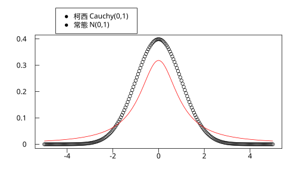
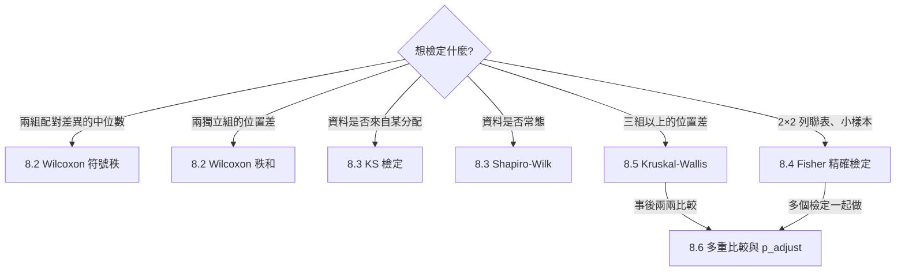

# 8.1 為什麼需要非參數方法

## 本節目標

- 說出參數方法（t 檢定、ANOVA 等）背後的**兩大假設**，以及它們什麼時候會被違反
- 用模擬體會**離群值與重尾**如何摧毀以平均數為基礎的推論
- 理解非參數方法的核心想法：**把數值換成名次（rank）**
- 看懂本章六節的工具箱地圖

---

## 參數方法的兩大假設

前幾章的檢定（第 6 章的 t 檢定、第 9 章將介紹的 ANOVA）都屬於**參數方法**：它們先假設資料來自某個由少數參數決定的分配（例如常態 $`N(\mu, \sigma^2)`$），再對參數做推論。這個套路威力大——但它至少押了兩個寶：

1. **形狀假設**：母體（近似）常態。t 統計量在小樣本下的「精確 t 分配」推導、ANOVA 的 F 分配推導，全都建立在各組資料來自常態母體之上。
2. **尺度假設**：平均數與標準差是「好」的摘要。這隱含著母體的變異是**輕尾**的——極端值會出現，但不會太誇張。

問題是：真實資料常常不配合。生態學的族群數量是偏態的、金融報酬是重尾的、問卷滿意度有天花板效應、儀器會偶爾記錄到壞點（離群值）。這時參數方法會發生什麼事？

---

## 問題場景：一個離群值就能翻盤

先看最小的實驗。抽 20 筆標準常態資料：

```python
import rstatistics as r

g = r.set_seed(42)
x = [g.rnorm(1)[0] for _ in range(20)]
print("原始資料   :", [round(v, 3) for v in x])
print("平均數     :", round(r.mean(x), 3))
print("中位數     :", round(r.median(x), 3))

y = x + [100.0]          # 儀器壞點：多了一筆 100
print("加入 100 後")
print("平均數     :", round(r.mean(y), 3))
print("中位數     :", round(r.median(y), 3))
```

```
原始資料   : [1.371, -0.565, 0.363, 0.633, 0.404, -0.106, 1.512, -0.095, 2.018, -0.063, 1.305, 2.287, -1.389, -0.279, -0.133, 0.636, -0.284, -2.656, -2.44, 1.32]
平均數     : 0.192
中位數     : 0.15
加入 100 後
平均數     : 4.945
中位數     : 0.363
```

21 筆資料裡只有 **1 筆**壞點，平均數就從 0.192 被拉到 4.945——膨脹了 25 倍；中位數幾乎不動。原因在第 1 章（1.2 節）就埋下伏筆：平均數讓每筆資料都有發言權，一筆 100 佔了整份 $`\sum x_i`$ 的 99%；中位數只在乎「誰在中間」，一筆極端值再大也只是「最大那筆」。

### 重尾母體：平均數理論上會「壞掉」

離群值還只是偶發事件。更根本的問題是**母體本身重尾**。回憶 4.4 節：常態分配的尾部以 $`e^{-x^2/2}`$ 的速度衰减；而**柯西分配**的尾部只以 $`1/x^2`$ 衰减，重到連期望值都不存在（4.4 節提過）。

```python
import rstatistics as r

# 三種母體下，「平均數估計」的穩定性：各抽 500 次、n=30
g = r.set_seed(7)
for name, gen in [("常態 N(0,1)", g.rnorm),
                  ("柯西（重尾）", g.rcauchy),
                  ("常態 + 10% 汙染 N(0,1)/N(0,25)", None)]:
    means, meds = [], []
    for _ in range(500):
        if gen is not None:
            x = gen(30)
        else:
            x = g.rnorm(30)
            for i in range(30):
                if g.runif(1)[0] < 0.1:
                    x[i] = x[i] * 5
        means.append(r.mean(x))
        meds.append(r.median(x))
    print(f"{name}")
    print(f"  平均數估計的標準差: {r.sd(means):.3f}   中位數估計的標準差: {r.sd(meds):.3f}")
```

```
常態 N(0,1)
  平均數估計的標準差: 0.186   中位數估計的標準差: 0.227
柯西（重尾）
  平均數估計的標準差: 19.975   中位數估計的標準差: 0.292
常態 + 10% 汙染 N(0,1)/N(0,25)
  平均數估計的標準差: 0.328   中位數估計的標準差: 0.238
```

讀這張表要小心：

- **常態下**平均數贏（0.186 < 0.227）——這沒有意外，常態時平均數是效率最高的估計量，參數方法在它的主場上是王者。
- **柯西下**平均數估計的標準差是 19.975，根本不可用（理論上柯西的 $`\bar{X}`$ 分配還是柯西，標準差無限大；模擬裡這個數字只反映「被少數幾次超大值炸開」）。
- **汙染常態**是更現實的模型：「大多數時候正常、偶爾出怪手」。平均數變差約 1.8 倍，中位數幾乎不受影響。

畫成圖更直觀：兩條密度曲線中心差不多，但柯西的兩肩「太肥」，把極端值的機率吃掉了。

```python
import rstatistics as r

xs = [(-5 + 10 * i / 200) for i in range(201)]
yn = [r.dnorm(x) for x in xs]
yc = [r.dcauchy(x) for x in xs]
g = r.Graphics(width=7.0, height=4.5)
g.plot(xs, yn)
g.lines(xs, yc, "red")
g.legend(-4.5, 0.42, ["常態 N(0,1)", "柯西 Cauchy(0,1)"])
g.save("img/08.1-tails.svg")
```



小樣本時更糟：t 檢定的精確性靠 $`\bar{X} \sim N(\mu, \sigma^2/n)`$，這一步需要母體常態（或靠 CLT 的大樣本近似，見 5.2 節）。$`n = 8`$ 的柯西資料，t 統計量的實際分配和 t 分配完全對不上，p 值只是自欺。

---

## 核心想法：把數值換成名次

面對「我們不知道（或不相信）母體長什麼樣」這件事，統計學家想出一條聰明的出路：**不看數值本身，只看它們的相對大小**。

把 $`n`$ 筆資料從小到大排，數值被換成名次 $`1, 2, \ldots, n`$：

- 離群值 100 換成名次之後只是「第 21 名」，跟第 20 名的差距不再被放大；
- 重尾母體不管尾巴多肥，**名次的分配是固定的**——$`n`$ 個相異連續觀測的每種排名出現機率都是 $`1/n!`$，跟母體形狀無關；
- 於是「兩組有沒有差」的問題變成「名次混得勻不勻」，可以推出**與母體無關**的精確機率。

`rstatistics` 的 `r.rank` 就是這個轉換（遇到並列取平均，見 8.2）：

```python
import rstatistics as r

z = [2.5, 1.0, 4.0, 2.5, 8.0]
print(r.rank(z))
```

```
[2.5, 1.0, 4.0, 2.5, 5.0]
```

注意 8.0 最大得第 5 名；兩個 2.5 並列第 2、3 名，各得平均 $`(2+3)/2 = 2.5`$。**一旦資料換成名次，母體的任何奇怪形狀都對名次毫無影響**——這一招把「假設常態」整個丟掉了，所以這類方法叫**無母數方法**（nonparametric methods，也譯「非參數方法」）。

### 付出的代價：一點點檢定力

天下沒有白吃的午餐。常態資料時，把數值換成名次丟掉了「大 3 倍」和「大 3.001 倍」的差別，估計效率會略降。經驗法則（Pitman 效率）：**常態母體下，Wilcoxon 檢定相對 t 檢定的效率約 0.95**——丟掉 5% 的檢定力，換來對離群值與重尾的完全免疫。只要母體偏離常態，名次方法往往反超。這筆交易在 8.2 節用模擬實測。

> **何時仍用參數方法？** 資料量夠大（CLT 保駕）、或母體真的近似常態、或你估計的不是「位置」而是精確的均值結構（如迴歸係數）時，t 檢定 / ANOVA / 迴歸仍是首選。非參數方法是**備案**，不是替代品。

---

## 本章地圖



每一節都遵循同一個節奏：先看這個方法**解決了前一章的什麼痛點**，推導統計量，用 `rstatistics` 與 R 對照著跑，最後把工具放進上面的地圖。

---

## 與 R 對照

本節只用了描述統計與模擬，R 的對應寫法如下（`rank` 在 R 是內建函數）：

```r
set.seed(7)
x <- rnorm(30)
mean(x); median(x)
rank(c(2.5, 1.0, 4.0, 2.5, 8.0))

# 柯西 vs 常態：平均數估計的穩定性
sim <- function(gen) sd(replicate(500, mean(gen(30))))
sim(rnorm); sim(rcauchy)
```

```
[1] 0.1921852
[1] 0.1500082
[1] 2.5 1.0 4.0 2.5 5.0
[1] 0.1835515
[1] 28.73858
```

（模擬結果每次不同，重點一致：柯西下 `mean` 的標準差大到不可用，`median` 穩定。）

---

## 小結

- 參數方法押寶在**常態形狀**與**平均數/標準差是好摘要**；離群值、重尾、小樣本都會讓這兩個寶失效。
- 一個離群值就能把平均數拉走，中位數不為所動。
- **把數值換成名次**：名次的分配與母體形狀無關，因此可以推出不依賴母體的檢定。
- 交換條件是常態下約 5% 的檢定力；母體一旦偏離常態，名次方法往往反超。

## 練習

1. 抽 30 筆常態資料，分別加入 1、5、10 筆 $`+1000`$ 的離群值，畫出平均數與中位數隨離群值數量的變化。提示：用 `g.set_seed` 固定亂數，迴圈裡 `x + [1000.0] * k`。
2. 把 8.1 節的模擬改成 $`n = 8`$（小樣本），柯西下平均數估計的標準差變多少？和 $`n = 30`$ 比是改善還是更糟？
3. 用 `r.qcauchy` 算柯西分配的 0.975 分位數，和常態的 1.96 比較；再算 0.999 分位數。解釋為什麼「3 個標準差以外」的直覺在重尾母體很危險。
4. 汙染常態模型中把汙染比例從 10% 改成 2%、方差從 25 改成 100，重跑模擬。哪個設定對平均數傷害最大？
5. 一句話回答：你的資料 $`n = 12`$，直方圖明顯右偏、有 1 筆超大值。你會先跑 t 檢定還是 Wilcoxon？為什麼？（提示：回顧 1.4 節的五數摘要。）
