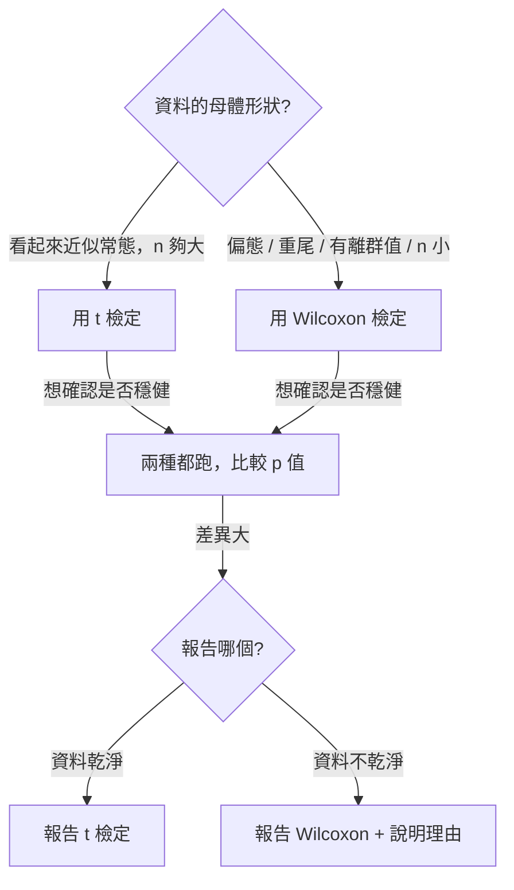

# 8.2 Wilcoxon 檢定

## 本節目標

- 知道 Wilcoxon 檢定在 1945 年問世時，為什麼要「把數值換成名次」
- 分清楚兩個不同的 Wilcoxon：**符號秩檢定**（配對）與**秩和檢定**（兩獨立樣本）
- 完整解讀 `r.wilcox_test` 的輸出：統計量 `V`、`W`、p 值、單雙邊選項
- 用模擬量化 t 檢定與 Wilcoxon 檢定的取捨：**常態下 t 略勝、離群值下 Wilcoxon 大勝**

---

## 1945 年：一個不需要常態假設的排名法

前一節我們看過參數方法的弱點：它們把「母體常態」和「平均數是好摘要」當成兩張必賭的彩票。1940 年代，統計學在實驗室、農業試驗與醫學研究裡累積了大量**小樣本**資料——每組可能只有 10 到 20 筆，這正是 t 檢定最脆弱的場合。

1945 年，美國統計學家 **Frank Wilcoxon** 發表〈Individual comparisons by ranking methods〉。他的做法現在看來理所当然：既然常態假設不可靠，那就**完全不要數值本身**，只保留誰比誰大。資料被換成 $`1, 2, \ldots, n`$ 的名次之後，母體是常態、重尾、還是別的什麼，都不再影響名次的分配。

Wilcoxon 原本處理的是**配對**資料（例如同一批受試者的前後測、同一塊田的兩種處理），方法叫**符號秩檢定**（signed rank test）。兩年後 **Mann 與 Whitney（1947）** 把同一套想法推廣到**兩個獨立樣本**，方法叫**秩和檢定**（rank sum test，統計量也叫 U 或 Mann-Whitney U）。今天在 R 裡，兩者共用 `wilcox.test()` 這一個函式，靠 `paired` 參數切換；`rstatistics` 的 `r.wilcox_test` 也一樣。

> 名字雖同，**假設不同**。符號秩檢定假設「配對差異的中位數為 0」；秩和檢定假設「兩組的位置（location）相同」。兩者都不假設資料本身常態。

---

## 符號秩檢定（配對）

### 演算法

給定配對資料 $`(x_i, y_i)`$ ， $`i = 1, \ldots, n`$ ：

1. 算差異 $`d_i = x_i - y_i`$ 。
2. 取絕對值 $`|d_i|`$ ，由小到大排名得 $`R_i`$ （並列取平均名次）。
3. 把差異的符號分成兩堆：正差的名次和記為 $`V^+`$ ，負差的名次和記為 $`V^- = \frac{n(n+1)}{2} - V^+`$ 。
4. 統計量取 $`V = \min(V^+, V^-)`$ （R 的 `wilcox.test` 印的是**未取 min 的** `V^+` 那一版）。

零假設是「差異的中位數為 0」。此時正負號應該各佔一半，而**名次是隨機分配的**——每一種 $`2^n`$ 種符號排列都等可能，因此 $`V^+`$ 的零分布可以**用組合數精確算出**，不必靠中央極限定理。

### 手算一次

用一組前後測資料，讓每一步都看得見：

```python
import rstatistics as r

before = [62.0, 71.0, 58.0, 80.0, 66.0, 75.0, 69.0, 72.0, 64.0, 77.0]
after = [71.0, 78.0, 65.0, 84.0, 72.0, 81.0, 74.0, 79.0, 70.0, 83.0]

d = [after[i] - before[i] for i in range(len(before))]
ab = [abs(v) for v in d]
rk = r.rank(ab)
for i in range(len(d)):
    print(f"  d[{i+1}] = {d[i]:5.1f}   |d| = {ab[i]:4.1f}   名次 = {rk[i]:4.1f}   符號 = {'+' if d[i] > 0 else '-'}")
V = sum(rk[i] for i in range(len(d)) if d[i] > 0)
print("V+ =", V, "   零假設下的期望 E[V+] = n(n+1)/4 =", len(d) * (len(d) + 1) / 4)
```

```
  d[1] =   9.0   |d| =  9.0   名次 = 10.0   符號 = +
  d[2] =   7.0   |d| =  7.0   名次 =  8.0   符號 = +
  d[3] =   7.0   |d| =  7.0   名次 =  8.0   符號 = +
  d[4] =   4.0   |d| =  4.0   名次 =  1.0   符號 = +
  d[5] =   6.0   |d| =  6.0   名次 =  4.5   符號 = +
  d[6] =   6.0   |d| =  6.0   名次 =  4.5   符號 = +
  d[7] =   5.0   |d| =  5.0   名次 =  2.0   符號 = +
  d[8] =   7.0   |d| =  7.0   名次 =  8.0   符號 = +
  d[9] =   6.0   |d| =  6.0   名次 =  4.5   符號 = +
  d[10] =   6.0   |d| =  6.0   名次 =  4.5   符號 = +
V+ = 55.0    零假設下的期望 E[V+] = n(n+1)/4 = 27.5
```

讀法： $`d`$ 的絕對值由小到大排開是 $`4, 5, 6, 6, 6, 6, 7, 7, 7, 9`$ 。**並列取平均名次**，所以：

- $`4.0`$ → 第 1 名
- $`5.0`$ → 第 2 名
- $`6.0`$ ×4 → 佔第 3, 4, 5, 6 名 → 平均 $`(3+4+5+6)/4 = 4.5`$
- $`7.0`$ ×3 → 佔第 7, 8, 9 名 → 平均 $`(7+8+9)/3 = 8`$
- $`9.0`$ → 第 10 名

這與表上完全一致。**並列取平均名次**是名次方法的標準規則，Wilcoxon 統計量的零分布必須用它推導——這也是為什麼並列值一多，精確 p 值要改用帶校正的演算法。

零假設下 $`V^+`$ 的期望是 $`n(n+1)/4 = 27.5`$ ，實測 $`V^+ = 55`$ ，遠高於期望：差異**系統性地偏向正方**，所以 p 值會很小。

### 跑 `r.wilcox_test`

```python
import rstatistics as r

before = [62.0, 71.0, 58.0, 80.0, 66.0, 75.0, 69.0, 72.0, 64.0, 77.0]
after = [71.0, 78.0, 65.0, 84.0, 72.0, 81.0, 74.0, 79.0, 70.0, 83.0]

h = r.wilcox_test(after, before, paired=True)
print(h)
print("  h.method         =", h.method)
print("  h.statistic_name =", h.statistic_name)
print("  h.statistic      =", h.statistic)
print("  h.p_value        =", h.p_value)
print("  h.alternative    =", h.alternative)
print("  h.null_name      =", h.null_name)
```

```

	Wilcoxon signed rank exact test

data:  x and y
V = 55, p-value = 0.001953
alternative hypothesis: true location shift is not equal to 0

  h.method         = Wilcoxon signed rank exact test
  h.statistic_name = V
  h.statistic      = 55.0
  h.p_value        = 0.001953125
  h.alternative    = two.sided
  h.null_name      = location shift
```

輸出**逐行解讀**：

| 輸出行 | 意義 |
| --- | --- |
| `Wilcoxon signed rank exact test` | `method`：用了哪一種方法。`exact` 表示 p 值由**列舉所有符號排列**算出，不是用正態近似 |
| `data:  x and y` | 資料名稱。`rstatistics` 沒有像 R 那樣從呼叫自動擷取變數名，所以預設是 `x and y` |
| `V = 55` | 統計量與其名稱。`V` 是**正差的名次和** $`V^+`$ （不是 `min` 後的值） |
| `p-value = 0.001953` | p 值。精確值是 $`2/2^{10} = 0.001953125`$ ：零假設下 10 個差異全為正（或全為負）的機率是 $`2/1024`$ |
| `alternative hypothesis: true location shift is not equal to 0` | 對立假設的內容。`null_name = "location shift"` 表示檢的是**位置平移**，不是平均數 |

$`p = 0.001953`$ 也可以手動驗證： $`n = 10`$ 全部同號的機率 $`2 \times (1/2)^{10} = 1/1024 = 0.0009766`$ ，雙尾就是 $`0.001953`$ 。

---

## 秩和檢定（兩獨立樣本）

### 演算法與統計量

兩組獨立資料 $`x_1,\ldots,x_{n_1}`$ 與 $`y_1,\ldots,y_{n_2}`$ ：

1. 把兩組**合併**成 $`n_1 + n_2`$ 筆，統一排名（並列取平均）。
2. 令 $`W = \sum_{i} R_i^{(x)}`$ 為 x 組的名次和。
3. 零假設「兩組位置相同」下， $`W`$ 的期望是 $`n_1(n_1+n_2+1)/2`$ 。

在 `rstatistics` 與 R 裡，印出的 `W` 是**平移後**的版本：

```math
W = \sum R_i^{(x)} - \frac{n_1(n_1+1)}{2}
```

這個版本在 $`n_1 = n_2`$ 時就是 **Mann-Whitney 的 U 統計量**（等價地 $`U = W_1 + W_2 - n_1 n_2`$ 這類寫法），並且在 $`n_1 = n_2`$ 時恰好等於兩組合併名次和的一半之差——非常直觀：**兩組名次混得越平均，W 越接近 0**。

### 跑一次

```python
import rstatistics as r

g1 = [23.0, 25.0, 28.0, 22.0, 26.0, 24.0, 27.0, 21.0]
g2 = [30.0, 32.0, 29.0, 33.0, 31.0, 35.0, 34.0, 28.0]
both = g1 + g2
rk2 = r.rank(both)
print("g1 =", g1)
print("g2 =", g2)
print("合併後的名次   :", rk2)
print("g1 的名次和 W =", sum(rk2[:len(g1)]))
print()

h2 = r.wilcox_test(g1, g2)
print(h2)
print("  h2.method =", h2.method, "  h2.statistic_name =", h2.statistic_name)
```

```
g1 = [23.0, 25.0, 28.0, 22.0, 26.0, 24.0, 27.0, 21.0]
g2 = [30.0, 32.0, 29.0, 33.0, 31.0, 35.0, 34.0, 28.0]
合併後的名次   : [3.0, 5.0, 8.5, 2.0, 6.0, 4.0, 7.0, 1.0, 11.0, 13.0, 10.0, 14.0, 12.0, 16.0, 15.0, 8.5]
g1 的名次和 W = 36.5


	Wilcoxon rank sum exact test

data:  x and y
W = 0.5, p-value = 0.0003108
alternative hypothesis: true location shift is not equal to 0

  h2.method = Wilcoxon rank sum exact test   h2.statistic_name = W
```

手算檢查： $`n_1 = n_2 = 8`$ ，合併總名次和 $`= \frac{16 \times 17}{2} = 136`$ 。g1 的名次和 $`= 36.5`$ ，所以平移後 $`W = 36.5 - \frac{8 \times 9}{2} = 36.5 - 36 = 0.5`$ ✓。g2 的名次和 $`= 136 - 36.5 = 99.5`$ ，平移後 $`= 99.5 - 36 = 63.5`$ ，而 $`W_1 + W_2 = 64 = n_1 n_2`$ ✓。

`W = 0.5` 幾乎是 0，代表 g1 的名次**完全被擠在前面**（第 1 到 8 名裡有 7 個），兩組分離得非常乾淨，p 值 $`0.0003108`$ 也就是自然的了。

### 參數一覽

```python
import rstatistics as r

g1 = [23.0, 25.0, 28.0, 22.0, 26.0, 24.0, 27.0, 21.0]
g2 = [30.0, 32.0, 29.0, 33.0, 31.0, 35.0, 34.0, 28.0]

print("alternative='less'      :", r.wilcox_test(g1, g2, alternative="less").p_value)
print("alternative='greater'    :", r.wilcox_test(g1, g2, alternative="greater").p_value)
print("exact=False（正態近似）   :", r.wilcox_test(g1, g2, exact=False).p_value)
print("correct=False（不校正）  :", r.wilcox_test(g1, g2, exact=False, correct=False).p_value)
```

```
alternative='less'      : 0.0001554001554001554
alternative='greater'    : 1.0
exact=False（正態近似）   : 0.001121815480650394
correct=False（不校正）  : 0.0009309722715750014
```

- `alternative`：`'two.sided'`（預設）、`'less'`（x 位置**小於** y）、`'greater'`。注意此例 g1 全部小於 g2，所以 `less` 的 p 值約是雙尾的一半，`greater` 恰好是 1。
- `exact`：`None`（預設）時自動決定——兩組皆小於 50 筆用精確法，否則用**正態近似**。手動設 `True`/`False` 可強制。
- `correct`：正態近似時是否做**連續性校正**（把 $`|z| = |W - \mu| - 0.5`$ ），預設 `True`。

> 為什麼要有連續性校正？ $`W`$ 是離散的階梯函數，而正態近似是連續曲線。在 $`W`$ 剛好等於期望值時，連續分布給出的尾端機率被高估了一點點；扣掉 $`0.5`$ 的「半格」就是標準的修正。

---

## 與 t 檢定的正面对決

現在做 8.1 節承諾過的實測：**t 檢定和 Wilcoxon 檢定，什麼時候誰贏？**

設計兩個情境，每個情境重複 2000 次，每次兩組各抽 20 筆：

- **情境 A（常態）**： $`x \sim N(0,1)`$ ， $`y \sim N(0.8, 1)`$ ——真實位移 0.8 個標準差。
- **情境 B（含離群值）**：同上，但額外在 y 組塞一個 $`\pm 12`$ 的壞點。

同時也算**型一誤差**情境（兩組其實沒有差異），確認兩種檢定的水準都還守得住。

```python
import rstatistics as r

N = 2000
alpha = 0.05
n = 20

def sim(gen, delta, add_outlier):
    gt = 0; gw = 0
    for _ in range(N):
        x = gen(n)
        y = [v + delta for v in gen(n)]
        if add_outlier:
            j = int(gen(1)[0] * n) % n
            y = list(y)
            y[j] = y[j] + 12.0 * (1 if gen(1)[0] > 0.5 else -1)
        gt += (r.t_test(x, y).p_value < alpha)
        gw += (r.wilcox_test(x, y, exact=False).p_value < alpha)
    return gt / N, gw / N

print(f"重複次數 N = {N}，每組 n = {n}，水準 alpha = {alpha}")
print("（模擬用大樣本近似 exact=False，與 R 的 wilcox.test(exact=FALSE) 相同）")
print()

g = r.set_seed(11)
a = sim(lambda k: g.rnorm(k), 0.8, False)
print(f"情境 A（常態 N(0,1)，y 比 x 多 0.8sd）  t 檢定力 = {a[0]:.3f}   Wilcoxon 檢定力 = {a[1]:.3f}   差 = {a[0]-a[1]:+.3f}")

g = r.set_seed(11)
b = sim(lambda k: g.rnorm(k), 0.8, True)
print(f"情境 B（常態 + 1 個離群值，同樣位移）     t 檢定力 = {b[0]:.3f}   Wilcoxon 檢定力 = {b[1]:.3f}   差 = {b[0]-b[1]:+.3f}")

g = r.set_seed(11)
c = sim(lambda k: g.rnorm(k), 0.0, False)
print(f"情境 C（兩組相同，常態）                t 型一誤差 = {c[0]:.3f}   Wilcoxon 型一誤差 = {c[1]:.3f}")

g = r.set_seed(11)
d = sim(lambda k: g.rnorm(k), 0.0, True)
print(f"情境 D（兩組相同，含離群值）            t 型一誤差 = {d[0]:.3f}   Wilcoxon 型一誤差 = {d[1]:.3f}")
```

```
重複次數 N = 2000，每組 n = 20，水準 alpha = 0.05
（模擬用大樣本近似 exact=False，與 R 的 wilcox.test(exact=FALSE) 相同）

情境 A（常態 N(0,1)，y 比 x 多 0.8sd）  t 檢定力 = 0.694   Wilcoxon 檢定力 = 0.660   差 = +0.033
情境 B（常態 + 1 個離群值，同樣位移）     t 檢定力 = 0.162   Wilcoxon 檢定力 = 0.557   差 = -0.396
情境 C（兩組相同，常態）                t 型一誤差 = 0.047   Wilcoxon 型一誤差 = 0.051
情境 D（兩組相同，含離群值）            t 型一誤差 = 0.006   Wilcoxon 型一誤差 = 0.045
```

### 怎麼讀這四行

1. **情境 A（常態）：t 略勝**。0.694 vs 0.660，t 多 3.4 個百分點的檢定力。這正好對應 8.1 節提的 **Pitman 效率約 0.95**： $`0.660/0.694 \approx 0.951`$ 。也就是說，名次化讓你損失了約 5% 的檢定力——這是**常態下**的固定成本。

2. **情境 B（一個離群值）：局勢逆轉，而且不是小幅逆轉**。t 檢定力從 0.694 掉到 **0.162**（損失超過七成！），Wilcoxon 幾乎不受影響（0.660 → 0.557）。原因在 8.1 節已經算過：一筆 $`\pm 12`$ 的壞點把 y 組的平均數與標準差都扭曲了，Welch t 檢定的分母 `stderr` 被**放大**（離群值使組內變異暴增），分子卻只偏移一點，於是 t 統計量被壓小；而 Wilcoxon 只看名次，壞點最多排第一或最後，不會「放大」差距。

3. **情境 C（常態下的水準）**：t 的型一誤差 0.047、Wilcoxon 0.051，都在 0.05 附近，兩種方法的水準都正常。

4. **情境 D（含離群值下的水準）**：這是最有趣的一行。t 檢定的型一誤差掉到 **0.006**——遠小於 0.05，也就是說 t 檢定**過度保守**，本來有差異的資料它常常不敢拒絕。Wilcoxon 仍是 0.045，水準正常。

### 結論：怎麼選



實務上最穩的做法是**兩種都跑**：如果 p 值接近就沒爭議；如果 p 值差很多，就說明結論對資料的形狀敏感，這本身是值得報告的訊息。

---

## 與 R 對照

R 的對應函式是 `wilcox.test()`，幾乎所有參數都一一對應：

```r
before <- c(62,71,58,80,66,75,69,72,64,77)
after  <- c(71,78,65,84,72,81,74,79,70,83)

d <- after - before
ab <- abs(d)
rk <- rank(ab)
for (i in seq_along(d)) {
  cat(sprintf("  d[%d] = %5.1f   |d| = %4.1f   名次 = %4.1f   符號 = %s\n",
              i, d[i], ab[i], rk[i], ifelse(d[i]>0,"+","-")))
}
cat("V+ =", sum(rk[d>0]), "   零假設下的期望 E[V+] = n(n+1)/4 =", length(d)*(length(d)+1)/4, "\n\n")

print(wilcox.test(after, before, paired=TRUE))
print(wilcox.test(d, conf.int=TRUE))

g1 <- c(23,25,28,22,26,24,27,21)
g2 <- c(30,32,29,33,31,35,34,28)
print(rank(c(g1,g2)))
cat("g1 名次和 W =", sum(rank(c(g1,g2))[1:8]), "\n")
print(wilcox.test(g1, g2))
print(wilcox.test(g1, g2, conf.int=TRUE))

print(t.test(after, before, paired=TRUE))
print(t.test(g1, g2))
```

```
  d[1] =   9.0   |d| =  9.0   名次 = 10.0   符號 = +
  d[2] =   7.0   |d| =  7.0   名次 =  8.0   符號 = +
  d[3] =   7.0   |d| =  7.0   名次 =  8.0   符號 = +
  d[4] =   4.0   |d| =  4.0   名次 =  1.0   符號 = +
  d[5] =   6.0   |d| =  6.0   名次 =  4.5   符號 = +
  d[6] =   6.0   |d| =  6.0   名次 =  4.5   符號 = +
  d[7] =   5.0   |d| =  5.0   名次 =  2.0   符號 = +
  d[8] =   7.0   |d| =  7.0   名次 =  8.0   符號 = +
  d[9] =   6.0   |d| =  6.0   名次 =  4.5   符號 = +
  d[10] =   6.0   |d| =  6.0   名次 =  4.5   符號 = +
V+ = 55    零假設下的期望 E[V+] = n(n+1)/4 = 27.5 


	Wilcoxon signed rank exact test

data:  after and before
V = 55, p-value = 0.001953
alternative hypothesis: true location shift is not equal to 0


	Wilcoxon signed rank exact test

data:  d
V = 55, p-value = 0.001953
alternative hypothesis: true location is not equal to 0
96.5 percent confidence interval:
 5.5 7.0
sample estimates:
(pseudo)median 
           6.5 

 [1]  3.0  5.0  8.5  2.0  6.0  4.0  7.0  1.0 11.0 13.0 10.0 14.0 12.0 16.0 15.0
[16]  8.5
g1 名次和 W = 36.5 

	Wilcoxon rank sum exact test

data:  g1 and g2
W = 0.5, p-value = 0.0003108
alternative hypothesis: true location shift is not equal to 0


	Wilcoxon rank sum exact test

data:  g1 and g2
W = 0.5, p-value = 0.0003108
alternative hypothesis: true location shift is not equal to 0
95.8 percent confidence interval:
 -10  -4
sample estimates:
difference in location 
                    -7 


	Paired t-test

data:  after and before
t = 14.895, df = 9, p-value = 1.199e-07
alternative hypothesis: true mean difference is not equal to 0
95 percent confidence interval:
 5.343215 7.256785
sample estimates:
mean difference 
            6.3 


	Welch Two Sample t-test

data:  g1 and g2
t = -5.7155, df = 14, p-value = 5.338e-05
alternative hypothesis: true difference in means is not equal to 0
95 percent confidence interval:
 -9.626816 -4.373184
sample estimates:
mean of x mean of y 
     24.5      31.5 
```

### 對照重點

| 項目 | R | rstatistics |
| --- | --- | --- |
| 配對符號秩 | `wilcox.test(x, y, paired=TRUE)` | `r.wilcox_test(x, y, paired=True)` |
| 兩樣本秩和 | `wilcox.test(x, y)` | `r.wilcox_test(x, y)` |
| 單樣本（對差異做） | `wilcox.test(d)` | `r.wilcox_test(d)` |
| 精確/近似 | `exact=TRUE/FALSE/NULL` | `exact=True/False/None` |
| 連續性校正 | `correct=TRUE/FALSE` | `correct=True/False` |
| 單雙邊 | `alternative=` | `alternative=` |
| 信賴區間 | `conf.int=TRUE`（**R 才有**） | 目前 `conf_int=True` 尚未實作，區間為空 |

`rstatistics` 目前的 `conf_int=True` 對 Wilcoxon 不會填入區間（回傳的 `conf_int` 是空的），R 則會給出「pseudo-median」或「location difference」的區間——這是 R 的進階功能，本書先留待日後補充。

模擬部分在 R 裡的寫法：

```r
N <- 2000; alpha <- 0.05; n <- 20
set.seed(11)
sim <- function(delta, add_outlier) {
  gt <- 0; gw <- 0
  for (i in 1:N) {
    x <- rnorm(n); y <- rnorm(n) + delta
    if (add_outlier) {
      j <- sample(1:n, 1)
      y[j] <- y[j] + 12 * ifelse(runif(1) > 0.5, 1, -1)
    }
    gt <- gt + (t.test(x, y)$p.value < alpha)
    gw <- gw + (wilcox.test(x, y, exact=FALSE)$p.value < alpha)
  }
  c(gt/N, gw/N)
}
a <- sim(0.8, FALSE)
cat(sprintf("情境 A  t = %.3f  Wilcoxon = %.3f\n", a[1], a[2]))
```

```
情境 A  t = 0.694  Wilcoxon = 0.660
```

（模擬每次略有差異，重點一致：常態下 t 略高、有離群值時 Wilcoxon 高得多。）

---

## 小結

- **Wilcoxon 1945** 開創了「只排名次」的檢定思路，把母體形狀假設整個拿掉。
- **符號秩檢定**（配對）：對差異 $`d_i = x_i - y_i`$ 的絕對值排名，統計量 `V` 是正差的名次和；零假設是「差異的中位數為 0」，p 值可由 $`2^n`$ 種符號排列精確算出。
- **秩和檢定**（兩獨立樣本，Mann-Whitney 1947）：合併排名，統計量 `W` 是平移後的名次和；零假設是「兩組位置相同」。
- `r.wilcox_test` 的輸出要讀三件事：`method`（精確還近似）、`statistic`（V 或 W）、`null_name`（檢的是位置而非平均數）。
- **取捨的量化結果**：常態下 t 檢定多約 3~5% 檢定力（Pitman 效率 0.95）；一個離群值就能讓 t 檢定力崩掉 70%，而 Wilcoxon 幾乎不受影響，同時 Wilcoxon 的型一誤差維持在正確水準，t 檢定則變得過度保守。
- 實務建議：**兩種都跑**。p 值接近就沒問題；差很多就說明結論對資料形狀敏感，值得在報告中說明。

## 練習

1. 自己造 10 對配對資料（先給差異 `d` 再反推 `before`、`after`），讓其中一對差異為 0。手算 `V+`，再用 `r.wilcox_test(d)` 驗證 p 值。提示：零差異在精確法裡必須被丟棄（`n` 會變小），這會怎樣影響 p 值？
2. 用 `r.wilcox_test` 的 `alternative` 參數重跑本節的 g1/g2 例子，畫一張圖：三條 p 值（less、greater、two.sided）隨兩組位移  $`\delta`$ 從 -2 變到 2 的曲線。提示：用 `r.set_seed` 固定亂數，迴圈裡改 `delta`。
3. 情境 B 中把離群值的偏移量從 $`\pm 12`$ 改成 $`\pm 4`$ 和 $`\pm 30`$ 重跑模擬。t 檢定力的曲線有什麼形狀？在哪個偏移量附近兩種檢定力交叉？
4. 修改模擬：把每組樣本數 `n` 從 10 掃到 100，畫 t 與 Wilcoxon 檢定力隨 n 的變化。哪個方法的曲線上升較快？為什麼？
5. 想檢定「配對資料的中位數差異是否為 0」，但差異分布明顯偏態。Wilcoxon 符號秩檢定適用嗎？如果不適用，你會改用什麼方法（提示：第 7 章的內容）？
