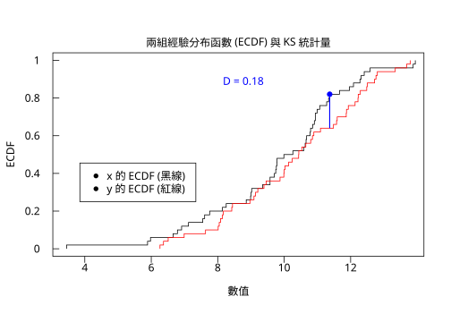
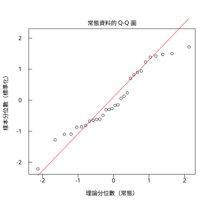
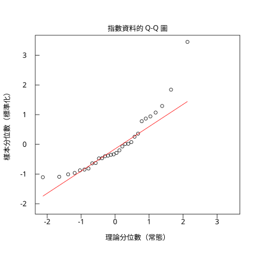

# 8.3 KS 檢定與 Shapiro-Wilk

## 本節目標

- 理解 Kolmogorov-Smirnov 檢定的**全部假設**：它比較的是兩個**分布**而不是兩個平均數
- 手算 KS 統計量 $`D`$ ，看懂 ECDF 圖上的「最大垂直距離」
- 用 `r.ks_test` 做兩樣本 KS 檢定，並理解 `exact` 與 `alternative` 的影響
- 用 Shapiro-Wilk 檢定**正態性**，看懂 $`W`$ 統計量與 p 值的意義
- 記住 n 大時的陷阱：**微小的偏離也會顯著**，所以要配合 Q-Q 圖一起看

---

## 1933 年：Kolmogorov 的「分布比較」問題

前兩節的方法都在問「**位置**有沒有差異」：Wilcoxon 問中位數、t 檢定問平均數。但統計學還有一類問題完全不同：

> 這兩個樣本，是不是來自**同一個分布**？

1933 年，**Andrei Kolmogorov** 發表了回答這個問題的工具。他的想法極為簡潔：把樣本變成**經驗分布函數**（empirical CDF, ECDF），然後量兩個 ECDF 最多差多少。

### ECDF 是什麼

對樣本 $`x_1, \ldots, x_n`$ ，定義

```math
\hat{F}_n(t) = \frac{1}{n}\sum_{i=1}^{n} \mathbb{1}\{x_i \le t\}
```

意思是「有多少比例的觀測值不超過 $`t`$ 」。它是一個**階梯函數**：每遇到一個觀測值就往上跳 $`1/n`$ 。

舉個例子，樣本 $`\{2, 5, 5, 9\}`$ 的 ECDF：

- $`t < 2`$ ： $`\hat{F} = 0`$
- $`2 \le t < 5`$ ： $`\hat{F} = 1/4`$
- $`5 \le t < 9`$ ： $`\hat{F} = 3/4`$ （5 出現兩次，跳兩格）
- $`t \ge 9`$ ： $`\hat{F} = 1`$

**關鍵直覺**：如果母體是 $`F`$ ，那麼抽很多筆時 $`\hat{F}_n(t)`$ 會**逼近** $`F(t)`$ （大數法則，見 5.3 節）。所以兩個樣本若來自同一分布，兩條 ECDF 應該貼得很近；反之，若來自不同分布，兩條 ECDF 會在某個地方分開。

### KS 統計量

Kolmogorov 定義的統計量就是**兩條 ECDF 之間的最大垂直距離**：

```math
D = \sup_t \left| \hat{F}_1(t) - \hat{F}_2(t) \right|
```

1936 年，**Nikolai Smirnov** 把它推廣並給出精確的抽樣分布，所以今天叫 **Kolmogorov–Smirnov 檢定**（KS 檢定）。

它比 t 檢定或 Wilcoxon 檢定**更嚴格也更通用**：

| | 檢定的假說 | 需要的母體假設 |
| --- | --- | --- |
| t 檢定 | 平均數相等 | 常態 |
| Wilcoxon | 位置（中位數）相等 | 對稱 |
| **KS 檢定** | **整個分布相同** | **無**（只要分布連續） |

代價是：KS 檢定**只比較分布形狀**，對「位置平移」其實不太敏感——兩組資料若只是整體平移了 0.5 個標準差，KS 的 D 不一定大。**KS 檢定不是 t 檢定的替代品，它是另一個問題的答案。**

---

## 手算 D 統計量

用兩組各 50 筆的常態資料（一組均值 10，一組均值 10.5）：

```python
import rstatistics as r

g = r.set_seed(2024)
x = [round(v, 4) for v in g.rnorm(50, 10.0, 2.0)]
y = [round(v, 4) for v in g.rnorm(50, 10.5, 2.0)]
print("x（前 10 筆）:", x[:10])
print("y（前 10 筆）:", y[:10])
print()

def F(v, data):
    return sum(1 for u in data if u <= v) / len(data)

pts = sorted(set(x) | set(y))
print("斷點處的 ECDF 差 |F_x - F_y|（只看前後各 10 個斷點）：")
best = 0.0
bpat = 0.0
for i, p in enumerate(pts):
    d = abs(F(p, x) - F(p, y))
    if d > best:
        best = d
        bpat = p
    if i < 10 or i >= len(pts) - 10:
        print(f"  t = {p:8.4f}   F_x = {F(p,x):.4f}   F_y = {F(p,y):.4f}   |diff| = {d:.4f}")
print("最大距離 D =", round(best, 6), " 出現在 t =", round(bpat, 4))
```

```
x（前 10 筆）: [11.9639, 10.9374, 9.7841, 9.5742, 12.3162, 12.5847, 11.0693, 9.7459, 7.5502, 7.7573]
y（前 10 筆）: [9.3909, 8.9686, 9.2066, 8.4449, 9.1382, 7.6328, 12.291, 10.0219, 12.5008, 10.4348]

斷點處的 ECDF 差 |F_x - F_y|（只看前後各 10 個斷點）：
  t =   3.4514   F_x = 0.0200   F_y = 0.0000   |diff| = 0.0200
  t =   5.8886   F_x = 0.0400   F_y = 0.0000   |diff| = 0.0400
  t =   5.9771   F_x = 0.0600   F_y = 0.0000   |diff| = 0.0600
  t =   6.2624   F_x = 0.0600   F_y = 0.0200   |diff| = 0.0400
  t =   6.3683   F_x = 0.0600   F_y = 0.0400   |diff| = 0.0200
  t =   6.5090   F_x = 0.0600   F_y = 0.0600   |diff| = 0.0000
  t =   6.6561   F_x = 0.0800   F_y = 0.0600   |diff| = 0.0200
  t =   6.7878   F_x = 0.1000   F_y = 0.0600   |diff| = 0.0400
  t =   6.9127   F_x = 0.1200   F_y = 0.0600   |diff| = 0.0600
  t =   6.9899   F_x = 0.1200   F_y = 0.0800   |diff| = 0.0400
  t =  12.5008   F_x = 0.9400   F_y = 0.8800   |diff| = 0.0600
  t =  12.5847   F_x = 0.9600   F_y = 0.8800   |diff| = 0.0800
  t =  12.7201   F_x = 0.9600   F_y = 0.9000   |diff| = 0.0600
  t =  12.7626   F_x = 0.9600   F_y = 0.9200   |diff| = 0.0400
  t =  12.8030   F_x = 0.9600   F_y = 0.9400   |diff| = 0.0200
  t =  13.3426   F_x = 0.9600   F_y = 0.9600   |diff| = 0.0000
  t =  13.6859   F_x = 0.9600   F_y = 0.9800   |diff| = 0.0200
  t =  13.7918   F_x = 0.9600   F_y = 1.0000   |diff| = 0.0400
  t =  13.8809   F_x = 0.9800   F_y = 1.0000   |diff| = 0.0200
  t =  13.9456   F_x = 1.0000   F_y = 1.0000   |diff| = 0.0000
最大距離 D = 0.18  出現在 t = 11.3694
```

最大差距 $`D = 0.18`$ 出現在 $`t = 11.3694`$ ：那裡 $`\hat{F}_x = 0.82`$ 而 $`\hat{F}_y = 0.64`$ 。ECDF 圖上就是這兩條階梯曲線之間最寬的那道縫。

### 把 D 畫出來

用 `rstatistics` 的 Graphics 裝置畫出兩條 ECDF，並把那條最寬的縫標成藍色：

```python
import rstatistics as r

g = r.set_seed(2024)
x = [round(v, 4) for v in g.rnorm(50, 10.0, 2.0)]
y = [round(v, 4) for v in g.rnorm(50, 10.5, 2.0)]

# ECDF 階梯函數的折線座標
def ecdf_poly(v):
    xs = sorted(v)
    n = len(v)
    px = [xs[0]]
    py = [0.0]
    for i in range(n):
        px.append(xs[i]); py.append((i + 1) / n)
        if i + 1 < n:
            px.append(xs[i + 1]); py.append((i + 1) / n)
    return px, py

def F(v, data):
    return sum(1 for u in data if u <= v) / len(data)

pts = sorted(set(x) | set(y))
best = 0.0; bpat = pts[0]
for p in pts:
    d = abs(F(p, x) - F(p, y))
    if d > best:
        best = d; bpat = p
fy1 = F(bpat, x); fy2 = F(bpat, y)

px1, py1 = ecdf_poly(x)
px2, py2 = ecdf_poly(y)

gr = r.Graphics(width=7.0, height=5.0)
gr.plot_window([min(x), max(y)], [0.0, 1.0])
gr.title("兩組經驗分布函數 (ECDF) 與 KS 統計量", "數值", "ECDF")
xt = [v for v in r.pretty([min(x), max(y)], 5) if min(x) <= v <= max(y)]
gr.axis(1, xt, [f"{v:g}" for v in xt])
yt = [0.0, 0.2, 0.4, 0.6, 0.8, 1.0]
gr.axis(2, yt, [f"{v:g}" for v in yt])
gr.box()
gr.lines(px1, py1, "black")
gr.lines(px2, py2, "red")
gr.segments([bpat], [min(fy1, fy2)], [bpat], [max(fy1, fy2)], "blue", 1.5)
gr.points([bpat], [max(fy1, fy2)], pch=19, col="blue")
gr.text(bpat - 2.6, max(fy1, fy2) + 0.05, f"D = {best:.2f}", col="blue")
gr.legend(min(x) + 0.4, 0.25, ["y 的 ECDF (紅線)", "x 的 ECDF (黑線)"])
gr.save("img/08.3-ecdf-ks.svg")
print("D =", round(best, 4), "在 t =", bpat, " F_x =", fy1, " F_y =", fy2)
```

```
D = 0.18 在 t = 11.3694  F_x = 0.82  F_y = 0.64
```



藍線就是 KS 統計量：兩條 ECDF 之間最寬處的垂直距離。

---

## `r.ks_test`：兩樣本 KS 檢定

```python
import rstatistics as r

g = r.set_seed(2024)
x = [round(v, 4) for v in g.rnorm(50, 10.0, 2.0)]
y = [round(v, 4) for v in g.rnorm(50, 10.5, 2.0)]

h = r.ks_test(x, y)
print(h)
print("  h.method         =", h.method)
print("  h.statistic_name =", h.statistic_name)
print("  h.statistic      =", h.statistic)
print("  h.p_value        =", h.p_value)
print("  h.alternative    =", h.alternative)
print()

print("alternative='less'    :", r.ks_test(x, y, alternative="less").p_value)
print("alternative='greater' :", r.ks_test(x, y, alternative="greater").p_value)
print("exact=False（漸近近似）:", r.ks_test(x, y, exact=False).p_value)
print()
h_exact = r.ks_test(x, y)
h_asym = r.ks_test(x, y, exact=False)
print("精確 p =", h_exact.p_value)
print("漸近 p =", h_asym.p_value)
print("兩者相差 =", abs(h_exact.p_value - h_asym.p_value))
```

```

	Exact two-sample Kolmogorov-Smirnov test

data:  x and y
D = 0.18, p-value = 0.3959
alternative hypothesis: two-sided

  h.method         = Exact two-sample Kolmogorov-Smirnov test
  h.statistic_name = D
  h.statistic      = 0.18
  h.p_value        = 0.3959398631708505
  h.alternative    = two-sided

alternative='less'    : 0.9238310708898945
alternative='greater' : 0.19938717542102988
exact=False（漸近近似）: 0.39273380987443285

精確 p = 0.3959398631708505
漸近 p = 0.39273380987443285
兩者相差 = 0.0032060532964176547
```

逐行解讀：

- `Exact two-sample Kolmogorov-Smirnov test`：`method` 說明這是**兩樣本**檢定，且用了**精確**算法。當 $`n_1 \times n_2 < 10000`$ 時預設用精確法，否則用漸近近似（`Asymptotic`）。
- `D = 0.18`：就是上面手算的最大 ECDF 距離。
- `p-value = 0.3959`：**不顯著**。兩組資料的分布沒有可偵測的差異。
- `alternative hypothesis: two-sided`：雙邊檢定。
- `精確 p` / `漸近 p` / `兩者相差`：把兩種算法並排放在一起比較。差距只有 $`0.0032`$ ，代表在這個樣本量下，「列舉所有可能的表」與「用極限分布近似」幾乎給出同一個答案。

> 這裡 p 值很大，正是因為兩組都來自同一個常態母體（只是均值差了 0.5 而已）。**KS 檢定對位置平移不敏感**，這是它的設計，不是錯誤。

### `alternative` 的三種方向

| 選項 | 統計量 | 意義 | 本例 p 值 |
| --- | --- | --- | --- |
| `'two.sided'`（預設） | $`D = \sup_t \lvert \hat{F}_x - \hat{F}_y \rvert`$ | 分布是否相同 | 0.3959 |
| `'less'` | $`D^- = \sup_t ( \hat{F}_y - \hat{F}_x )`$ | x 的 CDF 是否**處處低於** y | 0.9238 |
| `'greater'` | $`D^+ = \sup_t ( \hat{F}_x - \hat{F}_y )`$ | x 的 CDF 是否**處處高於** y | 0.1994 |

單邊版本**更敏銳**：因為它只問「有沒有系統性的方向」，不用同時考慮反方向。本例 x 的 ECDF 在中間區段整體比較高（`D+ = 0.18`），所以 `greater` 的 p 值（0.1994）比雙邊（0.3959）小了一半。

### 單樣本 KS：與理論分布比較

R 的 `ks.test` 還能比較「樣本 vs 一個理論分布」，`rstatistics` 尚未內建這個模式，但可以手算：

```python
import rstatistics as r
import math

g = r.set_seed(2024)
x = [round(v, 4) for v in g.rnorm(50, 10.0, 2.0)]
xs = sorted(x)
n = len(xs)
dplus = 0.0
dminus = 0.0
for i in range(n):
    F = r.pnorm(xs[i], 10.0, 2.0)
    dplus = max(dplus, (i + 1) / n - F)
    dminus = max(dminus, F - i / n)
D = max(dplus, dminus)
print("單樣本 KS（x 對 N(10,2)）手算：D+ =", round(dplus, 6), " D- =", round(dminus, 6), " D =", round(D, 6))
print("漸近 p 值（手算）= 2*exp(-2*n*D^2) =", round(2 * math.exp(-2 * n * D * D), 6))
```

```
單樣本 KS（x 對 N(10,2)）手算：D+ = 0.068931  D- = 0.095239  D = 0.095239
漸近 p 值（手算）= 2*exp(-2*n*D^2) = 0.807431
```

單樣本版的 $`D^+ = \max_i \left( \frac{i}{n} - F(x_i) \right)`$ 、 $`D^- = \max_i \left( F(x_i) - \frac{i-1}{n} \right)`$ ， $`D = \max(D^+, D^-)`$ 。R 的 `ks.test(x, "pnorm", 10, 2)` 對同一組資料給 $`D = 0.095239`$ ，與手算完全一致。

---

## 1965 年：Shapiro-Wilk 檢定正態性

KS 檢定很通用，但實務上最常見的問題是：**我的資料是不是常態？** 這是迴歸、t 檢定、ANOVA 的前提檢查。

KS 檢定在這件事上不太好用，原因有二：

1. 它**對參數估計錯誤不友善**——單樣本 KS 通常要先估出 $`\mu, \sigma`$ ，估錯了會影響檢定結果；
2. 它的**敏感度集中在尾巴**，而實務上最常見的偏態是**中間偏斜**，KS 對那種偏態不太有感。

1965 年，**Samuel Shapiro** 與 **Myron Wilk** 提出了 **Shapiro-Wilk 檢定**：直接檢定「資料是否來自常態分布」，而且**對正態性的各種偏離都很敏感**。

### 統計量 W

Shapiro-Wilk 的想法是：常態母體的樣本分位數應該**近似成一條直線**。把樣本排成 $`x_1 \le x_2 \le \cdots \le x_n`$ （已標準化），找一個線性組合

```math
W = \frac{\left( \sum_{i=1}^{n} a_i x_i \right)^2}{\sum_{i=1}^{n} (x_i - \bar{x})^2}
```

其中係數 $`a_i`$ 由**期望正態分位數**與**樣本順序統計量**的相關係數決定（用極小平方迴歸拟合）。 $`W`$ 衡量的是：**資料被這條線解釋了多少比例的變異**。

- $`W \approx 1`$ ：資料非常像常態；
- $`W`$ 越小：偏離越明顯。

p 值則由 $`W`$ 的零分布（純常態母體下的抽樣分布）算出。

### 跑 `r.shapiro_test`

```python
import rstatistics as r

# 資料：某零件的量測值
g = r.set_seed(5)
x = [round(v, 4) for v in g.rnorm(30, 50.0, 3.0)]
print("常態母體的 30 筆資料：", x)
h = r.shapiro_test(x)
print(h)
print("  h.method         =", h.method)
print("  h.statistic_name =", h.statistic_name)
print("  h.statistic      =", h.statistic)
print("  h.p_value        =", h.p_value)
print()

# 明顯右偏的資料
y = [round(v, 4) for v in g.rexp(30, rate=0.1)]
print("指數分布（右偏）的 30 筆資料：", y)
print(r.shapiro_test(y))
```

```
常態母體的 30 筆資料： [47.4774, 54.1531, 46.2335, 50.2104, 55.1343, 48.1913, 48.5835, 48.0939, 49.1427, 50.4143, 53.6829, 47.5947, 46.7588, 49.5274, 46.7847, 49.583, 48.2081, 43.4481, 50.7225, 49.2219, 52.7015, 52.8256, 54.4039, 52.1203, 52.457, 49.1196, 54.2558, 54.4963, 48.0288, 47.4416]

	Shapiro-Wilk normality test

data:  x
W = 0.95084, p-value = 0.178

  h.method         = Shapiro-Wilk normality test
  h.statistic_name = W
  h.statistic      = 0.9508384487228758
  h.p_value        = 0.1780249094358044

指數分布（右偏）的 30 筆資料： [2.4793, 17.7626, 6.8388, 1.0906, 5.7318, 4.3468, 16.3717, 6.7092, 39.2011, 0.2705, 9.107, 6.4749, 20.7553, 25.4551, 7.2785, 5.6631, 9.8911, 2.2297, 4.2604, 10.3713, 18.8659, 12.8076, 9.8383, 6.3191, 17.1374, 11.9272, 1.4891, 2.7626, 8.0107, 0.3905]

	Shapiro-Wilk normality test

data:  x
W = 0.85717, p-value = 0.0008795
```

- 常態樣本： $`W = 0.95084`$ ， $`p = 0.178`$ → **不拒絕常態**（p > 0.05）。
- 指數樣本： $`W = 0.85717`$ ， $`p = 0.0008795`$ → **強烈拒絕常態**。

注意 `r.shapiro_test` 有一個實作限制：樣本數必須介於 **3 到 5000** 之間，超過會拋出錯誤。

---

## 陷阱：n 大時，微小的偏離也會顯著

Shapiro-Wilk 的 p 值隨著 n 增大而對**任何**偏離都越來越敏感。實驗：造一批常態資料，再加上一丁點偏斜（ $`x = z + 0.15(z^2 - 1)`$ ， $`z`$ 是標準常態），看 p 值怎麼變。

```python
import rstatistics as r

print("=== 偏斜程度固定，n 變大 ===")
for n in [20, 50, 100, 200, 500]:
    gg = r.set_seed(9)
    z = gg.rnorm(n)
    d2 = [v + 0.6 * (v * v - 1.0) for v in z]
    hq = r.shapiro_test(d2)
    print(f"  n = {n:5d}   W = {hq.statistic:.4f}, p = {hq.p_value:.4g}")
```

```
=== 偏斜程度固定，n 變大 ===
  n =    20   W = 0.7231, p = 7.565e-05
  n =    50   W = 0.6514, p = 1.224e-09
  n =   100   W = 0.6981, p = 4.862e-13
  n =   200   W = 0.7554, p = 6.331e-17
  n =   500   W = 0.7479, p = 6.765e-27
```

偏斜程度完全一樣（ $`c = 0.6`$ ），但 n 從 20 增到 500，p 值從 $`7.6 \times 10^{-5}`$ 掉到 $`6.8 \times 10^{-27}`$ 。**樣本愈大，愈容易「證明」資料不是常態**——因為任何微小的真實偏離，在大樣本下都被放大成統計上顯著的差異。

再看更極端的版本：偏斜極小（ $`c = 0.15`$ ），n 從 30 到 1000：

```python
import rstatistics as r

print("=== n 大時：微小的偏離也會顯著 ===")
for n in [30, 100, 300, 1000]:
    gg = r.set_seed(9)
    z = gg.rnorm(n)
    d1 = z
    d2 = [v + 0.15 * (v * v - 1.0) for v in z]
    hp = r.shapiro_test(d1)
    hq = r.shapiro_test(d2)
    print(f"  n = {n:5d}   常態: W = {hp.statistic:.4f}, p = {hp.p_value:.4g}   "
          f"微偏斜: W = {hq.statistic:.4f}, p = {hq.p_value:.4g}")
```

```
=== n 大時：微小的偏離也會顯著 ===
  n =    30   常態: W = 0.9554, p = 0.2358   微偏斜: W = 0.8846, p = 0.003597
  n =   100   常態: W = 0.9847, p = 0.3008   微偏斜: W = 0.9194, p = 1.301e-05
  n =   300   常態: W = 0.9957, p = 0.5845   微偏斜: W = 0.9689, p = 4.482e-06
  n =  1000   常態: W = 0.9989, p = 0.8304   微偏斜: W = 0.9637, p = 4.454e-15
```

看這張表的另一個角度：**純常態樣本**的 p 值也隨 n 上升（0.2358 → 0.8304），因為 W 本身愈來愈接近 1。這說明 p 值在這裡**不是**「資料有多不像常態」的量度，而是「在這個 n 之下，樣本偏離到這個程度有多不尋常」。

> **實務規則**： $`n > 50`$ 時不要只看 Shapiro-Wilk 的 p 值。它幾乎一定會拒絕常態。要判斷偏離**是否實質**，要看**偏離的幅度**，而不是 p 值。

### 輔助：Q-Q 圖

Q-Q 圖（quantile-quantile plot）把樣本分位數對上理論分位數畫成散點：

- **常態**：點沿著直線排列；
- **右偏**：右端的點往上翹（長右尾）；
- **左偏**：左端的點往下掉；
- **雙峰 / 厚尾**：兩端都偏離。

用 `r.qqnorm_coords` 取得座標，再自己畫：

```python
import rstatistics as r

g = r.set_seed(5)
x = [round(v, 4) for v in g.rnorm(30, 50.0, 3.0)]
y = [round(v, 4) for v in g.rexp(30, rate=0.1)]

def qq_draw(v, title, path):
    # 標準化，讓 Q-Q 圖的兩個軸同尺度
    m = r.mean(v)
    s = r.sd(v)
    z = [(q - m) / s for q in v]
    t, sm = r.qqnorm_coords(z)
    lo = min(min(t), min(sm))
    hi = max(max(t), max(sm))
    gr = r.Graphics(width=6.0, height=6.0)
    gr.plot(t, sm, type="p", main=title, xlab="理論分位數（常態）", ylab="樣本分位數（標準化）",
            xlim=[lo, hi], ylim=[lo, hi])
    qx = r.quantile(t, [0.25, 0.75])
    qy = r.quantile(sm, [0.25, 0.75])
    slope = (qy[1] - qy[0]) / (qx[1] - qx[0])
    icept = qy[0] - slope * qx[0]
    gr.lines([t[0], t[len(t) - 1]], [icept + slope * t[0], icept + slope * t[len(t) - 1]], "red")
    gr.save(path)
    print("已存", path)

qq_draw(x, "常態資料的 Q-Q 圖", "08.3-qq-normal.svg")
qq_draw(y, "指數資料的 Q-Q 圖", "08.3-qq-exponential.svg")
```

```
已存 08.3-qq-normal.svg
已存 08.3-qq-exponential.svg
```

常態資料的 Q-Q 圖（點大致沿直線）：



指數資料的 Q-Q 圖（右端明顯往上翹）：



**Q-Q 圖和 Shapiro-Wilk 檢定是互補的**：檢定回答「偏離是否統計顯著」，Q-Q 圖回答「偏離長什麼樣、嚴不嚴重」。

---

## 與 R 對照

```r
set.seed(2024)
x <- round(rnorm(50,10,2),4)
y <- round(rnorm(50,10.5,2),4)

F <- function(v, d) sum(d <= v)/length(d)
pts <- sort(unique(c(x,y)))
diffs <- sapply(pts, function(p) abs(F(p,x)-F(p,y)))
cat("最大距離 D =", max(diffs), " 出現在 t =", pts[which.max(diffs)], "\n\n")

print(ks.test(x,y))
print(ks.test(x,y,exact=FALSE))
print(ks.test(x,y,alternative="less"))
print(ks.test(x,y,alternative="greater"))
print(ks.test(x,"pnorm",10,2))

set.seed(5)
a <- round(rnorm(30,50,3),4)
print(shapiro.test(a))
b <- round(rexp(30,rate=0.1),4)
print(shapiro.test(b))
```

```
最大距離 D = 0.18  出現在 t = 11.3694 


	Exact two-sample Kolmogorov-Smirnov test

data:  x and y
D = 0.18, p-value = 0.3959
alternative hypothesis: two-sided


	Asymptotic two-sample Kolmogorov-Smirnov test

data:  x and y
D = 0.18, p-value = 0.3927
alternative hypothesis: two-sided


	Exact two-sample Kolmogorov-Smirnov test

data:  x and y
D^- = 0.04, p-value = 0.9238
alternative hypothesis: the CDF of x lies below that of y


	Exact two-sample Kolmogorov-Smirnov test

data:  x and y
D^+ = 0.18, p-value = 0.1994
alternative hypothesis: the CDF of x lies above that of y


	Exact one-sample Kolmogorov-Smirnov test

data:  x
D = 0.095239, p-value = 0.719
alternative hypothesis: two-sided


	Shapiro-Wilk normality test

data:  a
W = 0.95084, p-value = 0.178


	Shapiro-Wilk normality test

data:  b
W = 0.85717, p-value = 0.0008795
```

### 對照重點

| 項目 | R | rstatistics |
| --- | --- | --- |
| 兩樣本 KS | `ks.test(x, y)` | `r.ks_test(x, y)` |
| 單樣本 KS（對理論分布） | `ks.test(x, "pnorm", 10, 2)` | 尚未內建，可手算 |
| 漸近近似 | `exact=FALSE` | `exact=False` |
| 單邊 | `alternative="less"/"greater"` | 同名參數 |
| 正態性 | `shapiro.test(x)` | `r.shapiro_test(x)` |
| Q-Q 圖 | `qqnorm(x)` + `qqline(x)` | `r.qqnorm_coords(x)` + 自繪 |

漸近近似與精確算法的 p 值幾乎相同：R 的 `ks.test(x, y, exact=FALSE)` 給 $`0.3927`$ ，`rstatistics` 給 $`0.392734`$ ；而**精確 p 值兩邊完全一致**（都是 0.3959）。兩者的差異只有 $`0.0032`$ ，正是「精確列舉所有表」與「用極限分布近似」之間的取捨——樣本量不小時，這個差距遠小於任何有意義的判讀界線。

> 順帶一提：如果 $`D`$ 很小、而樣本數也少，漸近近似的 p 值會偏大（因為此時極限分布的近似較粗糙）。這時請用 `exact=True`（預設在 $`n_1 \times n_2 < 10000`$ 時會自動選精確法）。

`n` 與 p 值的示範，R 的輸出：

```r
for (n in c(30,100,300,1000)) {
  set.seed(9)
  z <- rnorm(n)
  d2 <- z + 0.15*(z^2-1)
  cat(sprintf("  n = %5d   常態: W = %.4f, p = %g   微偏斜: W = %.4f, p = %g\n",
              n, shapiro.test(z)$statistic, shapiro.test(z)$p.value,
              shapiro.test(d2)$statistic, shapiro.test(d2)$p.value))
}
```

```
  n =    30   常態: W = 0.9554, p = 0.235812   微偏斜: W = 0.8846, p = 0.00359694
  n =   100   常態: W = 0.9847, p = 0.300752   微偏斜: W = 0.9194, p = 1.30148e-05
  n =   300   常態: W = 0.9957, p = 0.584545   微偏斜: W = 0.9689, p = 4.4815e-06
  n =  1000   常態: W = 0.9989, p = 0.830417   微偏斜: W = 0.9637, p = 4.45354e-15
```

與 `rstatistics` 的結果完全相同。

---

## 小結

- **KS 檢定（Kolmogorov 1933 / Smirnov 1936）**比較兩個**分布**是否相同，統計量 $`D`$ 是兩條 ECDF 之間的**最大垂直距離**。
- KS **不需要母體常態假設**，但**對位置平移不敏感**，所以它不能取代 t 檢定或 Wilcoxon 檢定。
- `r.ks_test(x, y)` 回傳 `D` 與 p 值；`exact=None` 時自動在精確與漸近之間選擇；`alternative` 可選 `'two.sided'`、`'less'`、`'greater'`，單邊版本更敏銳。
- **Shapiro-Wilk（1965）**檢定正態性， $`W \approx 1`$ 表示像常態；它比 KS 對偏斜更敏感，是正態性檢查的標準工具。
- **n 大時 p 值必然很小**： $`n > 50`$ 時不要只看 Shapiro-Wilk 的 p 值，要看偏離的**幅度**，並用 **Q-Q 圖**判斷偏離的型態。
- 三者定位：KS 問「分布一樣嗎」、Shapiro 問「是常態嗎」、t/Wilcoxon 問「位置有差嗎」。

## 練習

1. 用 `r.ks_test` 比較兩組 $`n = 30`$ 的指數分布資料（不同 rate），並畫出兩條 ECDF。比較它跟 Wilcoxon 檢定的 p 值，說明為什麼會差這麼多。提示：重點在**位置差異**對 KS 的影響。
2. 承上，改成比較兩組**形狀不同但位置相同**的資料（例如 $`N(0,1)`$ 對 $`N(0,1)`$ 但把一個值改成極端的雙峰組合）。這時 KS 與 Wilcoxon 誰會顯著？
3. 手算一個 2 筆對 2 筆的 KS 檢定： $`x = \{1, 2\}`$ ， $`y = \{3, 4\}`$ 。D 是多少？用 `r.ks_test` 驗證。
4. 造 5 組不同偏斜程度的資料（ $`c = 0, 0.1, 0.3, 0.6, 1.2`$ ），各自算 Shapiro-Wilk 的 W 與 p 值，並畫 Q-Q 圖。找出 W 大約掉到多少以下時 p 值開始小於 0.05。
5. 用 `r.shapiro_test` 檢定第 1 章某個真實資料集（例如 1.4 節的房價資料）。若 p 值很小，接下來你會怎麼處理？比較「改用對數變換」與「改用 Wilcoxon／非參數方法」兩條路的取捨。
