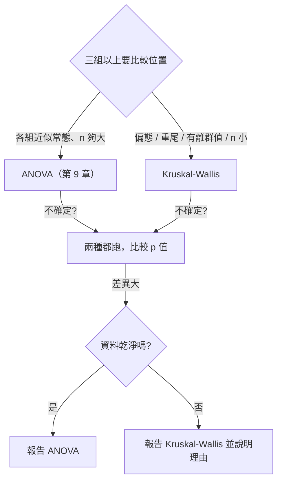

# 8.5 Kruskal-Wallis 檢定

## 本節目標

- 知道 **Kruskal 與 Wallis 1952** 為什麼要把 ANOVA「整個換成名次」
- 手算 Kruskal-Wallis 的 $`H`$ 統計量，並理解它與卡方分配的關係
- 用 `r.kruskal_test(x, g)` 做三組以上的位置比較
- 理解它與第 9 章 ANOVA 的**取捨**：常態 vs 離群值
- 學會**事後兩兩比較**，並理解為什麼需要 `p_adjust`（預告 8.6 節）

---

## 1952 年：把 ANOVA 換成名次

第 9 章將介紹的 ANOVA 是「三組以上平均數的比較」。它的做法是：

1. 算組間平方和（組平均數之間的變異）與組內平方和（組內的變異）；
2. 取比值得到 $`F`$ 統計量；
3. 對照 $`F`$ 分配求 p 值。

問題在第 1、2 步：ANOVA 的分母（組內變異）**用平方和計算，所以對離群值極度敏感**；分子（組平均數之差）也一樣。一個壞點可以同時扭曲兩者。

1952 年，**William Kruskal** 與 **Frank Wallis** 發表〈A rank test for the analysis of grouped data〉，提出一個「把 ANOVA 的每一步都換成名次」的版本。他們的核心觀察是：

> 如果把全部資料合併起來排名，那麼「某組的名次特別高或特別低」就代表該組的位置與其他組不同。

$`Kruskal–Wallis`$ 檢定（也寫作 Kruskal-Wallis H 檢定）就是 ANOVA 的**秩版本**：

| | ANOVA | Kruskal-Wallis |
| --- | --- | --- |
| 資料 | 原始數值 | 合併後的名次 |
| 組間統計 | 組平均數之差 | 組的**名次和** $`R_i`$ |
| 組內統計 | 平方和 | **隱含**在名次的分配裡 |
| 統計量 | $`F`$ | $`H`$ （近似卡方） |
| 自由度 | $`k-1`$ | $`k-1`$ |
| 母體假設 | 各組常態 | 各組分布**形狀相同**（位置可差） |

「形狀相同、位置可差」是關鍵：Kruskal-Wallis 假設三組的分布是**同一個形狀平移或平移後的樣子**，但**中位數可以不同**。這比常態假設弱得多，而且**完全不怕離群值**。

---

## 統計量 H 的推導

把所有 $`N = n_1 + \cdots + n_k`$ 筆資料合併排名（並列取平均名次），令第 $`i`$ 組的名次和為 $`R_i`$ 、人數為 $`n_i`$ 。

零假設是「所有組的位置相同」，也就是「每個名次落在哪一組是隨機的」。此時各組名次和的期望是 $`E[R_i] = n_i(N+1)/2`$ ，而且 $`R_i`$ 的**變異數只依賴 $`N`$ 與 $`n_i`$ **（與母體形狀無關）——這正是名次方法的威力所在。

把 $`R_i`$ 與期望的差距平方後加總、並除以一個恰好的常數，就得到統計量

```math
H = \frac{12}{N(N+1)} \sum_{i=1}^{k} \frac{R_i^2}{n_i} - 3(N+1)
```

**如果沒有並列值**， $`H`$ 恰好服從自由度 $`k-1`$ 的**卡方分配**——這是 Kruskal 與 Wallis 論文裡最漂亮的結果：名次方法產生了與 ANOVA 同型的統計量。

有並列值時要乘上一個修正因子：

```math
H = \frac{H_0}{1 - \frac{\sum (t_j^3 - t_j)}{N^3 - N}}
```

其中 $`t_j`$ 是第 $`j`$ 個並列組的大小。`rstatistics` 已經幫你做了這個修正。

### 手算一次

三組各 20 筆，B 組比 A 組高 1.5 個標準差，C 組比 A 組高 1 個標準差：

```python
import rstatistics as r

g = r.set_seed(2024)
a = g.rnorm(20, 5.0, 1.0)
b = g.rnorm(20, 6.5, 1.0)
c = g.rnorm(20, 6.0, 1.0)
x = a + b + c
grp = ["A"] * 20 + ["B"] * 20 + ["C"] * 20

print("各組摘要：")
for name, v in [("A", a), ("B", b), ("C", c)]:
    print(f"  {name}: n={len(v)}  mean={r.mean(v):.3f}  median={r.median(v):.3f}")
print()

# 手算 H
allv = a + b + c
rk = r.rank(allv)
groups = ["A", "B", "C"]
n = len(allv)
print("合併後的名次（依組）：")
sums = []
counts = []
for gname in groups:
    rs = [rk[i] for i in range(n) if grp[i] == gname]
    print(f"  {gname}: {rs}")
    sums.append(sum(rs))
    counts.append(len(rs))
print("各組名次和 R_i =", sums)
print("各組人數 n_i =", counts)
k = 3
H = 12.0 / (n * (n + 1)) * sum(sums[i] ** 2 / counts[i] for i in range(k)) - 3.0 * (n + 1)
print("H =", round(H, 6))
```

```
各組摘要：
  A: n=20  mean=4.702  median=4.882
  B: n=20  mean=6.404  median=6.386
  C: n=20  mean=6.031  median=5.981

合併後的名次（依組）：
  A: [32.0, 25.0, 14.0, 10.0, 38.0, 41.0, 27.0, 13.0, 5.0, 6.0, 3.0, 26.0, 29.0, 20.0, 1.0, 12.0, 7.0, 24.0, 4.0, 2.0]
  B: [57.0, 48.0, 56.0, 40.0, 52.0, 15.0, 43.0, 55.0, 8.0, 44.0, 17.0, 39.0, 33.0, 58.0, 35.0, 50.0, 49.0, 36.0, 30.0, 53.0]
  C: [18.0, 34.0, 45.0, 60.0, 11.0, 37.0, 42.0, 47.0, 46.0, 59.0, 23.0, 19.0, 22.0, 16.0, 21.0, 9.0, 51.0, 28.0, 54.0, 31.0]
各組名次和 R_i = [339.0, 818.0, 673.0]
各組人數 n_i = [20, 20, 20]
H = 19.782623
```

手算 $`H`$ ：

```math
H = \frac{12}{60 \times 61}\left(\frac{339^2}{20} + \frac{818^2}{20} + \frac{673^2}{20}\right) - 3 \times 61
```
```math
= \frac{12}{3660}\left(5745.05 + 33456.20 + 22646.45\right) - 183 = \frac{12}{3660}\times 61847.70 - 183 = 19.7826
```

**怎麼讀**：當 $`N = 60`$ 時，全部名次和是 $`60 \times 61/2 = 1830`$ ，三組平均分 $`610`$ 。實際上 A 組只拿到 339（遠低於 610）、B 組拿到 818（遠高於 610）、C 組拿到 673（略高）。分得越開，統計量 $`H`$ 就越大。

---

## 跑 `r.kruskal_test`

```python
import rstatistics as r

g = r.set_seed(2024)
a = g.rnorm(20, 5.0, 1.0)
b = g.rnorm(20, 6.5, 1.0)
c = g.rnorm(20, 6.0, 1.0)
x = a + b + c
grp = ["A"] * 20 + ["B"] * 20 + ["C"] * 20

h = r.kruskal_test(x, grp)
print(h)
print("  h.method         =", h.method)
print("  h.statistic_name =", h.statistic_name)
print("  h.statistic      =", h.statistic)
print("  h.parameter      =", h.parameter)
print("  h.p_value        =", h.p_value)
```

```

	Kruskal-Wallis rank sum test

data:  x and g
Kruskal-Wallis chi-squared = 19.783, df = 2, p-value = 5.061e-05

  h.method         = Kruskal-Wallis rank sum test
  h.statistic_name = Kruskal-Wallis chi-squared
  h.statistic      = 19.782622950819643
  h.parameter      = [2.0]
  h.p_value        = 5.0612525366797655e-05
```

輸出行行解讀：

- `Kruskal-Wallis chi-squared = 19.783`：統計量 $`H`$ 與卡方分布對照，所以統計量的名稱就寫成 "chi-squared"。
- `df = 2`：自由度 $`k-1 = 3-1 = 2`$ 。
- `p-value = 5.061e-05`：**顯著**，至少有一組的位置與其他組不同。
- `data:  x and g`：資料名稱（`rstatistics` 預設）。

注意 `r.kruskal_test` 的簽名是 `r.kruskal_test(x, g)`：`x` 是**所有資料攤平**的向量，`g` 是**等長的分組標籤**。這跟 `r.aov(y, group)` 的用法一致。

---

## 與第 9 章的 ANOVA 對照

第 9 章會詳細講 ANOVA，這裡先做對照，讓 8.5 節的位置清楚：

```python
import rstatistics as r

g = r.set_seed(2024)
x = g.rnorm(20, 5.0, 1.0) + g.rnorm(20, 6.5, 1.0) + g.rnorm(20, 6.0, 1.0)
grp = ["A"] * 20 + ["B"] * 20 + ["C"] * 20

m = r.aov(x, grp)
print(m)
print()
print(m.summary())
```

```
Call:
   aov(formula = y ~ g)

Terms:
                       g Residuals
Sum of Squares  31.98236  60.33364
Deg. of Freedom        2        57

Residual standard error: 1.028827
Estimated effects may be unbalanced

            Df Sum Sq Mean Sq F value   Pr(>F)
g            2  31.98   15.99   15.11 5.44e-06
Residuals   57  60.33    1.06                 
```

同一組資料，ANOVA 給 $`F = 15.11`$ 、p = 5.44e-06；Kruskal-Wallis 給 $`H = 19.783`$ 、p = 5.06e-05。**兩者都顯著，結論一致**——因為這是乾淨的常態資料。

### 差在哪裡？用模擬說話

設計兩個情境（各重複 2000 次，三組各 20 筆，B、C 組比 A 組高 0.8 個標準差）：

- **情境 A**：純常態資料
- **情境 B**：常態資料，但 B 組藏一個 $`\pm 12`$ 的離群值

```python
import rstatistics as r

N = 2000
alpha = 0.05
n = 20

def sim(gen, delta, add_outlier):
    ga = 0; gk = 0
    for _ in range(N):
        x = gen(n)
        y = [v + delta for v in gen(n)]
        z = [v + delta for v in gen(n)]
        if add_outlier:
            j = int(gen(1)[0] * n) % n
            y = list(y)
            y[j] = y[j] + 12.0 * (1 if gen(1)[0] > 0.5 else -1)
        a = r.aov(x + y + z, ["A"] * n + ["B"] * n + ["C"] * n)
        ga += (a.p < alpha)
        gk += (r.kruskal_test(x + y + z, ["A"] * n + ["B"] * n + ["C"] * n).p_value < alpha)
    return ga / N, gk / N

print(f"重複次數 N = {N}，每組 n = {n}，水準 alpha = {alpha}")
print()
g = r.set_seed(31)
a = sim(lambda k: g.rnorm(k), 0.8, False)
print(f"情境 A（常態，三組各差 0.8sd）  ANOVA 檢定力 = {a[0]:.3f}   Kruskal-Wallis 檢定力 = {a[1]:.3f}")
g = r.set_seed(31)
b = sim(lambda k: g.rnorm(k), 0.8, True)
print(f"情境 B（常態 + 1 個離群值）      ANOVA 檢定力 = {b[0]:.3f}   Kruskal-Wallis 檢定力 = {b[1]:.3f}")
```

```
重複次數 N = 2000，每組 n = 20，水準 alpha = 0.05

情境 A（常態，三組各差 0.8sd）  ANOVA 檢定力 = 0.731   Kruskal-Wallis 檢定力 = 0.706
情境 B（常態 + 1 個離群值）      ANOVA 檢定力 = 0.189   Kruskal-Wallis 檢定力 = 0.647
```

- **情境 A（常態）**：ANOVA 0.731 vs Kruskal-Wallis 0.706。ANOVA 略勝——又是那個約 5% 的名次化成本。
- **情境 B（一個離群值）**：ANOVA 崩到 **0.189**（從 0.731 掉了 74%！），Kruskal-Wallis 幾乎不受影響（0.706 → 0.647）。

原因和 8.2 節的 t 檢定完全一樣，只是這次受害的是**平方和**：ANOVA 的組內平方和被壞點灌大， $`F = MS_{between}/MS_{within}`$ 立刻縮小；而名次方法裡壞點最多就是「最大名次」，不會「放大」差距。

### 選哪個？



---

## 事後比較：兩兩 Wilcoxon

Kruskal-Wallis 只告訴你「**至少有一組不同**」，不告訴你「**哪一組**」。要回答後者，就得像 9 章 ANOVA 的事後比較那樣，做**兩兩比較**。

```python
import rstatistics as r

g = r.set_seed(2024)
a = g.rnorm(20, 5.0, 1.0)
b = g.rnorm(20, 6.5, 1.0)
c = g.rnorm(20, 6.0, 1.0)
x = a + b + c
grp = ["A"] * 20 + ["B"] * 20 + ["C"] * 20

pairs = [("A", "B"), ("A", "C"), ("B", "C")]
ps = []
print("=== 事後兩兩 Wilcoxon ===")
for g1, g2 in pairs:
    x1 = [x[i] for i in range(len(x)) if grp[i] == g1]
    x2 = [x[i] for i in range(len(x)) if grp[i] == g2]
    h = r.wilcox_test(x1, x2, exact=False)
    ps.append(h.p_value)
    print(f"  {g1} vs {g2}: W = {h.statistic:.1f}, p = {h.p_value:.5f}")
print("  原始 p 值:", ps)
print()
for m in ["bonferroni", "holm", "BH"]:
    print(f"  p_adjust(method='{m}'):", [round(v, 8) for v in r.p_adjust(ps, method=m)])
```

```
=== 事後兩兩 Wilcoxon ===
  A vs B: W = 42.0, p = 0.00002
  A vs C: W = 87.0, p = 0.00234
  B vs C: W = 250.0, p = 0.18058
  原始 p 值: [2.0407139096244576e-05, 0.0023412726074935344, 0.18057737680846508]

  p_adjust(method='bonferroni'): [6.122e-05, 0.00702382, 0.54173213]
  p_adjust(method='holm'): [6.122e-05, 0.00468255, 0.18057738]
  p_adjust(method='BH'): [6.122e-05, 0.00351191, 0.18057738]
```

原始 p 值看起來 A vs B、A vs C 都顯著，B vs C 不顯著——**結論和 ANOVA 的事後比較一致**。

但這裡有個**嚴重的問題**：我們做了 **3 個**檢定，每個都在 5% 水準下做。也就是說，即使所有組**完全相同**，也會有約 $`1 - 0.95^3 = 14.3\%`$ 的機率至少「發現」一組顯著不同。這就是**多重比較問題**，8.6 節會專門處理；`p_adjust` 就是解方——上表已經把校正後的 p 值算出來了。

（順帶一提：`r.wilcox_test` 在兩組各 20 筆時會自動用精確法，但精確法比近似法慢很多；上面用 `exact=False` 是為了讓模擬與示範跑得快，兩種方法在這個樣本量下結論相同。）

### 群組大小不同也沒問題

Kruskal-Wallis 對**不平衡設計**（各組人數不同）一樣適用：

```python
import rstatistics as r

gg = r.set_seed(7)
d1 = gg.rnorm(10, 5.0, 1.0)
d2 = gg.rnorm(30, 6.0, 1.0)
y = d1 + d2
gy = ["小組"] * 10 + ["大組"] * 30
print(r.kruskal_test(y, gy))
print()
print(r.wilcox_test(d1, d2, exact=False))
```

```

	Kruskal-Wallis rank sum test

data:  x and g
Kruskal-Wallis chi-squared = 6.8839, df = 1, p-value = 0.008698


	Wilcoxon rank sum test with continuity correction

data:  x and y
W = 66, p-value = 0.009105
alternative hypothesis: true location shift is not equal to 0
```

小組 10 筆、大組 30 筆，Kruskal-Wallis 與兩樣本 Wilcoxon 的結論一致（都顯著）。

---

## 與 R 對照

```r
set.seed(2024)
a <- rnorm(20,5,1); b <- rnorm(20,6.5,1); c <- rnorm(20,6,1)
x <- c(a,b,c); g <- rep(c("A","B","C"), each=20)

rk <- rank(x)
for (gn in c("A","B","C")) cat(sprintf("  %s: %s\n", gn, paste(rk[g==gn], collapse=", ")))
R <- sapply(c("A","B","C"), function(gn) sum(rk[g==gn]))
cnt <- sapply(c("A","B","C"), function(gn) sum(g==gn))
cat("各組名次和 R_i =", R, "\n")
cat("各組人數 n_i =", cnt, "\n")
n <- length(x); k <- 3
H <- 12/(n*(n+1))*sum(R^2/cnt) - 3*(n+1)
cat("H =", H, "\n\n")

print(kruskal.test(x, g))
print(aov(x ~ g))
print(summary(aov(x ~ g)))

cat("\n--- 事後兩兩 Wilcoxon ---\n")
ps <- c()
for (p in list(c("A","B"),c("A","C"),c("B","C"))) {
  w <- wilcox.test(x[g==p[1]], x[g==p[2]], exact=FALSE)
  ps <- c(ps, w$p.value)
  cat(sprintf("  %s vs %s: W = %.1f, p = %.5f\n", p[1], p[2], w$statistic, w$p.value))
}
cat("  原始 p 值:", ps, "\n")
for (m in c("bonferroni","holm","BH")) {
  cat(sprintf("  p.adjust(method='%s'): %s\n", m, paste(round(p.adjust(ps, method=m), 8), collapse=", ")))
}
```

```
  A: 32, 25, 14, 10, 38, 41, 27, 13, 5, 6, 3, 26, 29, 20, 1, 12, 7, 24, 4, 2
  B: 57, 48, 56, 40, 52, 15, 43, 55, 8, 44, 17, 39, 33, 58, 35, 50, 49, 36, 30, 53
  C: 18, 34, 45, 60, 11, 37, 42, 47, 46, 59, 23, 19, 22, 16, 21, 9, 51, 28, 54, 31
各組名次和 R_i = 339 818 673 
各組人數 n_i = 20 20 20 
H = 19.78262 


	Kruskal-Wallis rank sum test

data:  x and g
Kruskal-Wallis chi-squared = 19.783, df = 2, p-value = 5.061e-05

Call:
   aov(formula = x ~ g)

Terms:
                       g Residuals
Sum of Squares  31.98236  60.33364
Deg. of Freedom        2        57

Residual standard error: 1.028827
Estimated effects may be unbalanced
            Df Sum Sq Mean Sq F value   Pr(>F)    
g            2  31.98  15.991   15.11 5.44e-06 ***
Residuals   57  60.33   1.058                     
---
Signif. codes:  0 ‘***’ 0.001 ‘**’ 0.01 ‘*’ 0.05 ‘.’ 0.1 ‘ ’ 1

--- 事後兩兩 Wilcoxon ---
  A vs B: W = 42.0, p = 0.00002
  A vs C: W = 87.0, p = 0.00234
  B vs C: W = 250.0, p = 0.18058
  原始 p 值: 2.040714e-05 0.002341273 0.1805774 
  p.adjust(method='bonferroni'): 6.122e-05, 0.00702382, 0.54173213
  p.adjust(method='holm'): 6.122e-05, 0.00468255, 0.18057738
  p.adjust(method='BH'): 6.122e-05, 0.00351191, 0.18057738
```

`rstatistics` 與 R 的輸出**完全一致**（連 ANOVA 表的數字都一樣）。

### 對照重點

| 項目 | R | rstatistics |
| --- | --- | --- |
| Kruskal-Wallis | `kruskal.test(x, g)` | `r.kruskal_test(x, g)` |
| ANOVA | `aov(x ~ g)` / `summary(aov(...))` | `r.aov(x, grp)` / `m.summary()` |
| 事後比較 | `wilcox.test(x[g==a], x[g==b])` | `r.wilcox_test(x1, x2)` |
| p 值校正 | `p.adjust(ps, method="holm")` | `r.p_adjust(ps, method="holm")` |

R 的 `summary.aov()` 回傳的是 `listof` 類別的物件，直接對它取 `Pr(>F)` 欄位會得到 `NULL`（必須先用 `[[1]]` 取出 ANOVA 表）；`rstatistics` 的 `m.summary()` 直接給出 ANOVA 表，是更友善的設計。

---

## 小結

- **Kruskal & Wallis 1952** 把 ANOVA 換成名次版本，是「非參數 ANOVA」。
- 統計量 $`H = \frac{12}{N(N+1)}\sum \frac{R_i^2}{n_i} - 3(N+1)`$ ，近似服從 $`\chi^2_{k-1}`$ ；有並列值時要修正。
- 零假設是「各組的**位置**相同」，且各組分布**形狀相同**；不需要常態。
- **取捨的量化結果**：常態下 ANOVA 多約 3~5% 檢定力；一個離群值就讓 ANOVA 檢定力掉 74%，Kruskal-Wallis 幾乎不動。
- Kruskal-Wallis 只回答「至少有一組不同」；要問「哪一組」就得做**兩兩 Wilcoxon**。
- 事後比較必然帶來**多重比較問題**，需要 `p_adjust` 校正——這正是下一節的主題。

## 練習

1. 用 `r.rank` 手算本節例子的 $`H`$ （不重複資料，直接用手算的名次和），並用 `r.kruskal_test` 驗證。接著故意把某一筆資料改成極大值，看 $`H`$ 怎麼變（提示：改動只會影響兩個名次）。
2. 造三組**形狀不同但位置相同**的資料（例如 $`N(0,1)`$ 、 $`N(0,1)`$ 、 $`N(0,1)`$ 但把一組的一半換成對稱的雙峰），比較 Kruskal-Wallis 與 ANOVA 的 p 值。哪個會對形狀差異有反應？
3. 把模擬的組數從 3 增加到 5，每組 20 筆。ANOVA 與 Kruskal-Wallis 的檢定力差距會變大還是變小？為什麼？
4. 對本節的三組資料，除了兩兩 Wilcoxon 之外，改用「**先做 Kruskal-Wallis，再用 Duncan 或 Dunn 的方法**」的做法（R 沒有內建，但你可以用 `p_adjust` 模擬 Bonferroni 與 Holm）。比較兩種做法在 8.6 節會說的「型一誤差」上有什麼差別。
5. 群組大小嚴重不平衡（例如 5、5、40）時，用 `r.aov` 與 `r.kruskal_test` 比較 p 值。哪一個比較可靠？提示：ANOVA 在不平衡時的效率損失與組內變異的估計有關。
