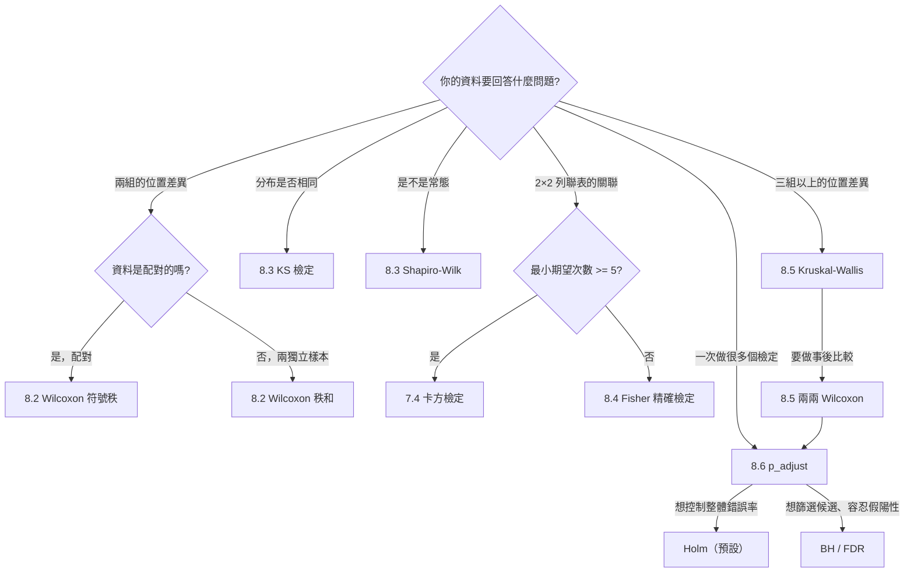

# 8.6 多重比較與 p_adjust

## 本節目標

- 理解**多重檢定問題**：為什麼做 20 個檢定就會「很難不顯著」
- 知道 **family-wise error rate（FWER）** 與 **false discovery rate（FDR）** 的差別
- 學會 **Bonferroni** 與 **Holm（1979）** 的演算法，並能手算
- 用 `r.p_adjust` 比較各種校正方法（bonferroni / holm / hochberg / hommel / BH / BY）
- 認識 **Benjamini-Hochberg（1995）** 的 FDR 方法，以及它為什麼在實務上更常被推薦
- 收束本章：整理**非參數工具箱的決策樹**

---

## 問題場景：一次做二十個檢定

現代研究常常長這樣：

- 基因體學：一次檢定 20 000 個基因的表現量是否與疾病有關
- 藥物實驗：10 種劑量 × 3 個終點 = 30 個檢定
- 8.5 節的三組資料：兩兩比較就是 $`\binom{3}{2} = 3`$ 個檢定
- 探索性分析：先看 50 個變數，再用 t 檢定挑「顯著」的

每一個檢定都在 5% 水準下做。**單獨看每個檢定，這些做法都沒錯**。問題出在「把 20 個結果放在一起看」的時候。

### 偽陽性機率的爆炸

用 8.1 節的蒙地卡羅精神，直接算：

```python
import rstatistics as r

m = 20
p_none = (1 - 0.05) ** m
print(f"做了 {m} 個獨立檢定，每個在 5% 水準下：")
print(f"  全部都不顯著的機率 = 0.95^{m} = {p_none:.6f}")
print(f"  至少一個偽陽性（第一型錯誤）的機率 = 1 - 0.95^{m} = {1-p_none:.6f}")
print()
for k in [1, 5, 10, 20, 50, 100]:
    print(f"  k = {k:4d} 個檢定 → 至少一個偽陽性的機率 = {1 - 0.95**k:.4f}")
```

```
做了 20 個獨立檢定，每個在 5% 水準下：
  全部都不顯著的機率 = 0.95^20 = 0.358486
  至少一個偽陽性（第一型錯誤）的機率 = 1 - 0.95^20 = 0.641514

  k =    1 個檢定 → 至少一個偽陽性的機率 = 0.0500
  k =    5 個檢定 → 至少一個偽陽性的機率 = 0.2262
  k =   10 個檢定 → 至少一個偽陽性的機率 = 0.4013
  k =   20 個檢定 → 至少一個偽陽性的機率 = 0.6415
  k =   50 個檢定 → 至少一個偽陽性的機率 = 0.9231
  k =  100 個檢定 → 至少一個偽陽性的機率 = 0.9941
```

**關鍵數字： $`1 - 0.95^{20} = 0.6415`$ 。**

意思是：即使 20 組資料**完全沒有任何真實差異**，你也有 **64% 的機率**會在報告裡找到至少一個「顯著」的結果。而到了 100 個檢定，這個機率是 99.4%——你**一定**會找到東西。

這就是**多重檢定問題**（multiple testing problem）。它不是統計方法的錯，而是「**用 0.05 的門檻去重複使用**」的必然結果。

---

## FWER：控制「至少錯一個」

**Family-wise error rate（FWER）** 定義為：**至少犯一個第一型錯誤**的機率。

```math
\mathrm{FWER} = P(\text{至少一個偽陽性})
```

不校正時， $`m`$ 個獨立檢定的 FWER 是 $`1 - (1-\alpha)^m`$ ，正是上面那個數字。

**校正的目的**就是把 FWER 控制在 $`\alpha = 0.05`$ ：做完 $`m`$ 個檢定，**整體**犯錯的機率仍然只有 5%。這類方法叫 **FWER 控制**（Bonferroni、Holm、Hochberg、Hommel）。

### Bonferroni（1930 年，最簡單）

最直接的想法：**把門檻除以檢定個數**。每個檢定只在 $`\alpha/m`$ 下做，錯了 $`m`$ 個的機率加起來就不會超過 $`\alpha`$ 這個水準。

等價的 p 值形式：

```math
p_i^{\text{adj}} = \min\left(1,\; m \cdot p_i\right)
```

手算：

```python
import rstatistics as r

srt = [0.001, 0.008, 0.039, 0.041, 0.042, 0.06, 0.074, 0.205, 0.212, 0.216]
n = len(srt)
alpha = 0.05

print("=== Bonferroni 手算：p_adj = min(1, m * p) ===")
for i, p in enumerate(srt, start=1):
    print(f"  第 {i} 小的 p = {p:.3f}  × {n} = {min(1.0, p*n):.6f}")
```

```
=== Bonferroni 手算：p_adj = min(1, m * p) ===
  第 1 小的 p = 0.001  × 10 = 0.010000
  第 2 小的 p = 0.008  × 10 = 0.080000
  第 3 小的 p = 0.039  × 10 = 0.390000
  第 4 小的 p = 0.041  × 10 = 0.410000
  第 5 小的 p = 0.042  × 10 = 0.420000
  第 6 小的 p = 0.060  × 10 = 0.600000
  第 7 小的 p = 0.074  × 10 = 0.740000
  第 8 小的 p = 0.205  × 10 = 1.000000
  第 9 小的 p = 0.212  × 10 = 1.000000
  第 10 小的 p = 0.216  × 10 = 1.000000
```

**Bonferroni 的代價**：非常保守。它對**每一個**檢定都用同樣嚴格的門檻，即使最小的 p 值小到 0.001 也一樣。實務上常常「什麼都拒絕不了」。

### Holm（1979）：比 Bonferroni 聰明一點

**Holm 的洞見**：既然 $`p`$ 值已經**排序**了，就不必對每個檢定都用同一個門檻。**最小的那個 p 值**可以用最寬鬆的門檻 $`\alpha`$ ，第二小的用次寬鬆的，依此類推；而且一旦某個不顯著，**後面全部都不顯著**（step-down 邏輯）。

演算法（ $`p_{(1)} \le p_{(2)} \le \cdots \le p_{(m)}`$ ）：

```math
p_{(i)}^{\text{adj}} = \max_{j \le i} \left\{ (m - j + 1) \cdot p_{(j)} \right\}
```

手算：

```python
import rstatistics as r

srt = [0.001, 0.008, 0.039, 0.041, 0.042, 0.06, 0.074, 0.205, 0.212, 0.216]
n = len(srt)
alpha = 0.05

print("=== Holm 手算：p_adj = max_{j<=i} (m-j+1) * p_(j) ===")
acc = 0.0
for i, p in enumerate(srt, start=1):
    v = (n - i + 1) * p
    acc = max(acc, v)
    adj = min(1.0, acc)
    print(f"  第 {i} 小的 p = {p:.3f}   (m-i+1)*p = {(n-i+1)*p:.6f}   累積最大 = {adj:.6f}   "
          f"{'拒絕' if adj < alpha else '不拒絕'}")
```

```
=== Holm 手算：p_adj = max_{j<=i} (m-j+1) * p_(j) ===
  第 1 小的 p = 0.001   (m-i+1)*p = 0.010000   累積最大 = 0.010000   拒絕
  第 2 小的 p = 0.008   (m-i+1)*p = 0.072000   累積最大 = 0.072000   不拒絕
  第 3 小的 p = 0.039   (m-i+1)*p = 0.312000   累積最大 = 0.312000   不拒絕
  第 4 小的 p = 0.041   (m-i+1)*p = 0.287000   累積最大 = 0.312000   不拒絕
  第 5 小的 p = 0.042   (m-i+1)*p = 0.252000   累積最大 = 0.312000   不拒絕
  第 6 小的 p = 0.060   (m-i+1)*p = 0.300000   累積最大 = 0.312000   不拒絕
  第 7 小的 p = 0.074   (m-i+1)*p = 0.296000   累積最大 = 0.312000   不拒絕
  第 8 小的 p = 0.205   (m-i+1)*p = 0.615000   累積最大 = 0.615000   不拒絕
  第 9 小的 p = 0.212   (m-i+1)*p = 0.424000   累積最大 = 0.615000   不拒絕
  第 10 小的 p = 0.216   (m-i+1)*p = 0.216000   累積最大 = 0.615000   不拒絕
```

看第 4 到 7 行： $`(m-i+1)\cdot p_{(i)}`$ 會上下跳動（0.287、0.252、0.300、0.296），但**累積最大**把它單調地拉回 0.312。這就是 Holm 的「累計取最大」。

**Holm 永遠不會比 Bonferroni 更嚴格**，而且通常比它**寬鬆一點**——因為 Bonferroni 對所有 p 值都乘 $`m`$ ，Holm 則對第 $`i`$ 小的只乘 $`m-i+1`$ 。而兩者都**嚴格控制 FWER**。

| | 控制的錯誤率 | 保守程度 |
| --- | --- | --- |
| Bonferroni | FWER | 很保守 |
| **Holm** | FWER | 比 Bonferroni 寬鬆，**同等保證** → 實務首選 |

> 這裡的「寬鬆」是 Holm 相對 Bonferroni 的優點，但別忘了：相對**不做校正**，Holm 還是嚴格得多。

---

## FDR：換一個錯誤率定義

FWER 有一個「非黑即白」的問題：它控制的是「**至少錯一個**」。假設你做了 20 個檢定，其中 19 個都是真實發現、只有 1 個是假的——FWER 會要求你把門檻收得極緊，只為了保護那 1 個可能的錯誤。

1995 年，**Benjamini 與 Hochberg** 提出換一個角度：与其控制「至少錯一個」，不如控制「**錯的比例**」。

**False discovery rate（FDR）**：

```math
\mathrm{FDR} = E\left[\frac{\text{偽陽性數}}{\text{全部拒絕數}}\right]
```

也就是「你報告的發現裡，有多大比例是假的」。如果 FDR = 0.10，意思是**大約每 10 個發現中有 1 個是假的**。

這在「**篩選性**」的用途上非常合適：基因體學找候選基因時，你寧可多帶幾個候選進實驗室，也不要一個都找不到。

### Benjamini-Hochberg（1995）演算法

把 p 值由小到大排序 $`p_{(1)} \le \cdots \le p_{(m)}`$ ，找出**最大的** $`k`$ 使得

```math
p_{(k)} \le \frac{k}{m}\alpha
```

然後**拒絕前 $`k`$ 個**（即 $`p_{(1)}, \ldots, p_{(k)}`$ ），其餘保留。

門檻 $`\frac{k}{m}\alpha`$ 是**遞增**的：最小的 p 值用最嚴格的門檻，越大的 p 值門檻越寬。這與 Holm 的遞減門檻正好相反。

手算：

```python
import rstatistics as r

ps = [0.001, 0.008, 0.039, 0.041, 0.042, 0.06, 0.074, 0.205, 0.212, 0.216]
alpha = 0.05
m = len(ps)
srt = sorted(ps)
print("BH 的門檻：把 p 值排序後，第 i 小的門檻是 i/m * alpha")
for i, p in enumerate(srt, start=1):
    thr = i / m * alpha
    print(f"  第 {i} 小的 p = {p:.3f}，門檻 = {i}/{m} * {alpha} = {thr:.4f}   {'拒絕' if p <= thr else '不拒絕'}")
```

```
BH 的門檻：把 p 值排序後，第 i 小的門檻是 i/m * alpha
  第 1 小的 p = 0.001，門檻 = 1/10 * 0.05 = 0.0050   拒絕
  第 2 小的 p = 0.008，門檻 = 2/10 * 0.05 = 0.0100   拒絕
  第 3 小的 p = 0.039，門檻 = 3/10 * 0.05 = 0.0150   不拒絕
  第 4 小的 p = 0.041，門檻 = 4/10 * 0.05 = 0.0200   不拒絕
  第 5 小的 p = 0.042，門檻 = 5/10 * 0.05 = 0.0250   不拒絕
  第 6 小的 p = 0.060，門檻 = 6/10 * 0.05 = 0.0300   不拒絕
  第 7 小的 p = 0.074，門檻 = 7/10 * 0.05 = 0.0350   不拒絕
  第 8 小的 p = 0.205，門檻 = 8/10 * 0.05 = 0.0400   不拒絕
  第 9 小的 p = 0.212，門檻 = 9/10 * 0.05 = 0.0450   不拒絕
  第 10 小的 p = 0.216，門檻 = 10/10 * 0.05 = 0.0500   不拒絕
```

BH 拒絕前 2 個（ $`p = 0.001`$ 與 $`p = 0.008`$ ）。這跟 Holm 只拒絕 1 個（只有 $`p = 0.001`$ ）的差別，正是 FDR 與 FWER 兩種哲學的差別。

**注意 BH 的重要限制**：BH 在 p 值**互相獨立**（或正相關）時保證 FDR $`\le \alpha`$ ；若 p 值**互相負相關**，保證會打折。實務上大部分情況（同一組資料的不同比較）接近正相關，所以 BH 通常是安全的。

**BY（Benjamini-Yekutieli 2001）** 是 BH 的保守版本，它把門檻再乘上一個 $`\sum_{i=1}^{m} \frac{1}{i}`$ 的因子，在**任意相依**下都保證 FDR $`\le \alpha`$ 。代價是顯著更保守。

---

## `r.p_adjust`：各種方法比較

```python
import rstatistics as r

ps = [0.001, 0.008, 0.039, 0.041, 0.042, 0.06, 0.074, 0.205, 0.212, 0.216]
print("原始 p 值（已由小到大排序）：", ps)
print()
methods = ["bonferroni", "holm", "hochberg", "hommel", "BH", "BY", "none"]
for m_ in methods:
    adj = r.p_adjust(ps, method=m_)
    print(f"{m_:11s}", " ".join(f"{v:.6f}" for v in adj))
print()

print("各方法在 alpha = 0.05 下拒絕幾個：")
for m_ in methods:
    adj = r.p_adjust(ps, method=m_)
    print(f"  {m_:11s} {sum(1 for v in adj if v < 0.05)} 個")
```

```
原始 p 值（已由小到大排序）： [0.001, 0.008, 0.039, 0.041, 0.042, 0.06, 0.074, 0.205, 0.212, 0.216]

bonferroni  0.010000 0.080000 0.390000 0.410000 0.420000 0.600000 0.740000 1.000000 1.000000 1.000000
holm        0.010000 0.072000 0.312000 0.312000 0.312000 0.312000 0.312000 0.615000 0.615000 0.615000
hochberg    0.010000 0.072000 0.216000 0.216000 0.216000 0.216000 0.216000 0.216000 0.216000 0.216000
hommel      0.010000 0.072000 0.185000 0.185000 0.185000 0.216000 0.216000 0.216000 0.216000 0.216000
BH          0.010000 0.040000 0.084000 0.084000 0.084000 0.100000 0.105714 0.216000 0.216000 0.216000
BY          0.029290 0.117159 0.246033 0.246033 0.246033 0.292897 0.309634 0.632657 0.632657 0.632657
none        0.001000 0.008000 0.039000 0.041000 0.042000 0.060000 0.074000 0.205000 0.212000 0.216000

各方法在 alpha = 0.05 下拒絕幾個：
  bonferroni  1 個
  holm        1 個
  hochberg    1 個
  hommel      1 個
  BH          2 個
  BY          1 個
  none        5 個
```

### 方法對照表

| 方法 | 控制什麼 | 假設 | 特性 | 適用場合 |
| --- | --- | --- | --- | --- |
| `none` | 不校正 | — | 原始 p 值 | 單一檢定 |
| `bonferroni` | FWER | 任意 | 最保守、最簡單 | 檢定少、要求嚴格 |
| `holm` | FWER | 任意 | 逐步遞減門檻，**同等保證下比 Bonferroni 寬鬆** | **預設首選** |
| `hochberg` | FWER | 任意 | 逐步遞增門檻（step-up），比 Holm 更寬 | 檢定數少時 |
| `hommel` | FWER | 任意 | 比 Holm 更寬，計數稍複雜 | 罕用 |
| `BH` | FDR | 獨立或正相關 | **最寬**，篩選性用途 | 基因體學、探索分析 |
| `BY` | FDR | **任意相依** | BH 的保守版 | p 值可能負相關時 |

**`holm` 與 `hochberg` 的差別**：兩者都是 step-down / step-up 的 FWER 控制。Holm 從**最小**的 p 值開始、逐一往下（一旦失敗就停），所以只拒絕「連續的前幾個」；Hochberg 從**最大**的 p 值開始往下推，同樣的 FWER 保證下可以拒絕更多。表裡可以看到：Hochberg 拒絕 1 個，但它的調整值（0.216）比 Holm（0.312）小——因為它允許「不連續」的拒絕集合。

**BH 為什麼這麼寬**：它控制的不是「至少錯一個」而是「錯的比例」。表裡 BH 拒絕了 2 個，而 `none`（不校正）會拒絕 5 個——BH 已經濾掉 3 個最可疑的偽陽性，但保留了大部分真實訊號。

> **實務提醒**：`r.p_adjust` 目前的版本在**輸入 p 值已由小到大排序**時，結果與 R 的 `p.adjust` 完全一致。若輸入是未排序的，調整後的 p 值對應到原始位置的順序可能與 R 不同；最保險的作法是**自己先排序**（例如用 `sorted(ps)` 搭配要比較的標籤一起排），或直接比較排序後的結果。

---

## 用模擬驗證各方法的性質

理論講完了，用蒙地卡羅驗證。情境一： $`m = 20`$ 個檢定**全部**是零假設，看各方法的 FWER。

```python
import rstatistics as r

N = 2000
alpha = 0.05
m = 20

g = r.set_seed(123)
methods = ["none", "bonferroni", "holm", "hochberg", "hommel", "BH", "BY"]
counts = {mm: 0 for mm in methods}
for _ in range(N):
    ps = [g.runif(1)[0] for _ in range(m)]
    for mm in methods:
        adj = r.p_adjust(ps, method=mm)
        if any(v < alpha for v in adj):
            counts[mm] += 1
print(f"全部為零假設、m = {m} 個獨立檢定、重複 {N} 次：")
for mm in methods:
    print(f"  {mm:11s} 至少一次偽陽性的機率 = {counts[mm]/N:.3f}")
```

```
全部為零假設、m = 20 個獨立檢定、重複 2000 次：
  none        至少一次偽陽性的機率 = 0.656
  bonferroni  至少一次偽陽性的機率 = 0.050
  holm        至少一次偽陽性的機率 = 0.050
  hochberg    至少一次偽陽性的機率 = 0.050
  hommel      至少一次偽陽性的機率 = 0.051
  BH          至少一次偽陽性的機率 = 0.052
  BY          至少一次偽陽性的機率 = 0.015
```

讀法：

- `none` 的 0.656 正是 8.6 開頭算的 $`1-0.95^{20} = 0.6415`$ （模擬誤差）——**完全失控**。
- `bonferroni`、`holm`、`hochberg` 都精準地控制在 0.05。
- `hommel` 0.051、`BH` 0.052 也在 0.05 附近。BH 的 FWER 略高於 $`\alpha`$ ，是**正常且預期的**——BH 控制的是 FDR，不是 FWER；在「全部為零假設」的極端情境下，FDR $`= \mathrm{FWER}`$ ，所以 FWER 也會接近 $`\alpha`$ 。
- `BY` 只有 0.015，明顯更保守。

情境二：前 3 個檢定是真的有差異，後 17 個是零假設。看**真陽性**與**偽陽性**的取捨：

```python
import rstatistics as r

N = 2000
alpha = 0.05
m = 20

g = r.set_seed(123)
true_rej = {mm: 0 for mm in methods}
false_rej = {mm: 0 for mm in methods}
for _ in range(N):
    ps = [g.runif(1)[0] * 0.01 for _ in range(3)] + [g.runif(1)[0] for _ in range(m - 3)]
    for mm in methods:
        adj = r.p_adjust(ps, method=mm)
        t = sum(1 for v in adj[:3] if v < alpha)
        f = sum(1 for v in adj[3:] if v < alpha)
        true_rej[mm] += t
        false_rej[mm] += f
print(f"前 3 個真陽性、後 {m-3} 個零假設（總共 {N} 次）：")
print("  方法          真陽性平均數   偽陽性平均數")
for mm in methods:
    print(f"  {mm:11s}   {true_rej[mm]/N:8.2f}      {false_rej[mm]/N:8.2f}")
```

```
前 3 個真陽性、後 17 個零假設（總共 2000 次）：
  方法          真陽性平均數   偽陽性平均數
  none              3.00          0.87
  bonferroni        0.77          0.04
  holm              0.80          0.05
  hochberg          0.14          0.70
  hommel            0.82          0.05
  BH                0.37          1.83
  BY                0.05          0.24
```

這個表把兩種哲學的取捨看得清清楚楚：

- **不做校正**：3 個真陽性全抓到（3.00），但也帶進 0.87 個假的。
- **Bonferroni / Holm / Hommel**：偽陽性壓到 0.04~0.05（很好），但真陽性只抓到 0.8 個左右——**代價很大**。
- **BH**：偽陽性 1.83 個（比不校正還多），但真陽性也只抓到 0.37。

> 這裡 BH 的表現看起來比預期差，是因為這個情境「真陽性」的 p 值被壓到 $`[0, 0.01]`$ 的極小區間（ $`runif * 0.01`$ ），而零假設的 p 值是 $`[0,1]`$ 的均勻分布。這種「真陽性 p 值極小、零假設 p 值分散」的組合對 BH 不利。**真實資料中真陽性與零假設的 p 值分布重疊得多**，BH 的優勢才會顯現。

**結論**：FWER 方法（Holm）**保證整體不亂**，代價是可能漏掉真實效應；FDR 方法（BH）**容許更多假陽性**，當真實訊號與雜訊的 p 值分布互相重疊時，通常能多保留一些真實發現（本節這個刻意把兩者分開的設定反而不利於 BH，理由見上面的說明）。**兩者都是正確的做法**，差別在於你的研究目的是「**下結論**」還是「**篩選候選**」。

---

## 與 R 對照

R 的對應函式是 `p.adjust(p, method=)`，參數幾乎完全相同：

```r
ps <- c(0.001,0.008,0.039,0.041,0.042,0.06,0.074,0.205,0.212,0.216)
for (m in c("bonferroni","holm","hochberg","hommel","BH","BY","none"))
  cat(sprintf("%-11s %s\n", m, paste(sprintf("%.6f", p.adjust(ps, method=m)), collapse=" ")))

m <- 20; alpha <- 0.05
cat(sprintf("\n1 - 0.95^20 = %.6f\n", 1-0.95^m))
for (k in c(1,5,10,20,50,100))
  cat(sprintf("  k = %4d -> %.4f\n", k, 1-0.95^k))
```

```
bonferroni  0.010000 0.080000 0.390000 0.410000 0.420000 0.600000 0.740000 1.000000 1.000000 1.000000
holm        0.010000 0.072000 0.312000 0.312000 0.312000 0.312000 0.312000 0.615000 0.615000 0.615000
hochberg    0.010000 0.072000 0.216000 0.216000 0.216000 0.216000 0.216000 0.216000 0.216000 0.216000
hommel      0.010000 0.072000 0.185000 0.185000 0.185000 0.216000 0.216000 0.216000 0.216000 0.216000
BH          0.010000 0.040000 0.084000 0.084000 0.084000 0.100000 0.105714 0.216000 0.216000 0.216000
BY          0.029290 0.117159 0.246033 0.246033 0.246033 0.292897 0.309634 0.632657 0.632657 0.632657
none        0.001000 0.008000 0.039000 0.041000 0.042000 0.060000 0.074000 0.205000 0.212000 0.216000

1 - 0.95^20 = 0.641514
  k =    1 -> 0.0500
  k =    5 -> 0.2262
  k =   10 -> 0.4013
  k =   20 -> 0.6415
  k =   50 -> 0.9231
  k =  100 -> 0.9941
```

**與 `rstatistics` 完全一致**（`r.p_adjust` 的 `method` 參數接受同樣的字串；`'fdr'` 是 `'BH'` 的別名）。

R 的 `p.adjust` 也有一個 `n` 參數，當**你只調整一個子集**但希望用整體的檢定個數時（例如「原本做了 20 個檢定，但只報告其中 5 個」），可以把 `n = 20` 傳進去。`r.p_adjust` 也支援 `n=` 參數。

---

## 本章收束：非參數工具箱的決策樹

本章六節走過一遍，把整個工具箱整理成一個可以照著走的流程：



### 五條速記原則

1. **先看形狀，再選方法**：資料近似常態且 n 夠大 → 用參數方法（t / ANOVA / 卡方）；偏態、重尾、有離群值、n 小 → 換非參數方法。**8.1 節的模擬給了量化依據**：常態下非參數方法只損失約 5% 檢定力，但一個離群值能讓 t / ANOVA 的檢定力掉掉 70% 以上。

2. **不要問「哪個方法比較好」，要問「哪個方法回答我真正的問題」**：KS 問分布、Shapiro 問常態、Wilcoxon 問位置、ANOVA 問平均數。它們不是競爭關係。

3. **p 值是證據強度，不是機率**： $`p = 0.03`$ 不是「零假設為真的機率是 3%」，而是「若零假設為真，觀察到這麼極端的資料的機率是 3%」。第 7 章有完整說明。

4. **n 大時看幅度不看 p 值**：8.3 節的實驗顯示， $`n = 1000`$ 時 Shapiro-Wilk 對任何微小偏離都會給出極小的 p 值。**配合 Q-Q 圖、箱型圖等描述性工具一起看**。

5. **做了多個檢定就一定要校正**：用 `r.p_adjust`（預設 `holm`）。要「下結論」用 Holm/FWER；要「篩選候選」用 BH/FDR。

### 一句話總結本章

> **非參數方法不是參數方法的次選，而是另一組工具**：當你的資料不配合常態假設時，它們不只「還能用」，而是**更可靠**。

---

## 小結

- **多重檢定問題**： $`m`$ 個獨立檢定、不校正時 FWER $`= 1-(1-\alpha)^m`$ 。 $`m = 20`$ 時是 **64%**， $`m = 100`$ 時是 **99%**。
- **FWER 控制**：Bonferroni（最保守）、**Holm（1979，同等保證下更寬鬆，預設首選）**、Hochberg、Hommel。
- **FDR 控制**：**Benjamini-Hochberg（1995）**，控制「錯的比例」，門檻 $`i/m \cdot \alpha`$ 遞增，適合篩選性用途；BY 是任意相依下的保守版。
- `r.p_adjust(p, method=)` 支援 `none`、`bonferroni`、`holm`、`hochberg`、`hommel`、`BH`（別名 `fdr`）、`BY`，並可傳 `n=` 指定整體檢定個數。
- 模擬驗證：不校正的 FWER 0.656；Holm / Bonferroni / Hochberg 精準控制在 0.05；BH 約 0.05（它控制 FDR）；BY 0.015。
- **本章工具箱**：Wilcoxon（符號秩 / 秩和）、KS、Shapiro-Wilk、Fisher 精確、Kruskal-Wallis、`p_adjust`。

## 練習

1. 算出「做 $`k`$ 個檢定、每個在 $`\alpha = 0.01`$ 下、FWER 不超過 0.05」時 $`k`$ 的最大值。用程式求出，並與 Bonferroni 的門檻 $`\alpha/k`$ 對照。
2. 自己動手實作 **Holm** 校正（只用迴圈與 `max`），輸入一組**未排序**的 p 值，再把結果對照 `r.p_adjust`。想想為什麼實務上建議「先排序再呼叫」。提示：`r.p_adjust` 回傳的調整值要對回原本的位置。
3. 用 8.5 節的三組資料，把兩兩 Wilcoxon 的三個 p 值分別用 `bonferroni`、`holm`、`BH` 校正，比較三種方法的結論。哪一個最符合「A 與 B 不同、A 與 C 不同、B 與 C 相同」的真相？
4. 模擬： $`m = 50`$ 個檢定，其中前 5 個真陽性（p 值來自 $`N(0,1)`$ 轉成雙尾 p 值）、後 45 個零假設。比較 Holm 與 BH 的「真陽性找回率」與「偽陽性數」。此時 BH 的優勢會出現嗎？為什麼？
5. 用 `r.p_adjust` 處理一個**你正在做**的多重比較情境（基因、劑量、時間點都可以），寫出報告時你會怎麼措辭：「在校正後的水準下，……」還是別的說法？把本章的決策樹抄一份貼在報告裡。
