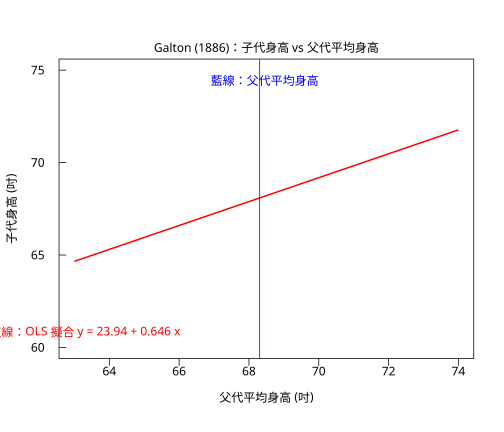

# 9.1 最小平方法

## 本節目標

- 知道 1886 年 Galton 到底觀察到了什麼，以及為什麼「向平均回歸」逼出了迴歸分析
- 理解最小平方法（OLS）的目標函數，並能從一階偏導推導出正規方程
- 會用最原始的公式手算簡單迴歸的斜率與截距，並用 `r.lm` 對照
- 能畫出散布圖並疊上擬合線，看懂一條直線在圖上代表什麼

---

## 1886：Galton 的身高資料與「向平均回歸」

在 19 世紀中葉，**法國統計學家 Adolphe Quetelet** 開始測量大量的士兵身高，並發現一個奇怪的現象：**身高服從一條鐘形的曲線**，而不是集中在某個平均值附近。他把這條曲線稱為「人類的常態分布」，並且驚人地發現，這條曲線的形狀與年齡、性別、城市、職業幾乎無關——只要營養與健康條件差不多，分布的中心（平均身高）就會隨族群而變，**但形狀不變**。

到了 1870 年代，人類學家 **Francis Galton** 問了一個更尖銳的問題：**父親的身高，能不能預測兒子的身高？**

他收集了英國的家庭資料，做了一件關鍵的事：他不是只記錄「父親的身高」與「兒子的身高」，而是把**父、母的身高取平均**作為「中親代身高（mid-parent height）」，再用**兒子們身高的中位數**作為反應值（他當時刻意不用平均數，因為身高分布偏態，平均數會被拉走）。理由很純粹：**用中位數可以抵抗極端值**，這正是第 1、8 章講過的「位置統計量」的用途。

Galton 在 1886 年發表〈Regression towards Mediocrity in Hereditary Height〉，報告了一個讓他困惑的結果：

- 父代很高的家庭，子代平均**沒有那麼高**；
- 父代很矮的家庭，子代平均**沒有那麼矮**；
- 整體的子代身高分布會**向平均值收斂**。

他把它叫做 **regression towards mediocrity（向平均回歸）**，並且用了「regression」這個詞——原本的意思是「回歸到（更早的）狀態」，後來統計學家把它借去指稱「一整類方法」。

這裡的因果鏈值得寫下來：**因為「預測子代」需要一條線**。Galton 當時用的預測值是「父代平均身高的平均值」，也就是一條**水平線**；但資料顯示不同父代的預測值不同，水平線明顯不夠。於是問題變成：

> 給定一組 $`(x_i, y_i)`$ ，怎麼找一條**直線**，使得它能最好地代表這組資料？

Galton 自己用「中位數的移動」估計斜率，得到約 **2/3**——也就是說，父代每比平均高一吋，子代平均只比自己的平均高約 2/3 吋。今天我們知道，這個 2/3 就是這份資料的**最小平方斜率**。

> 順帶一提：Gauss 在 1809 年處理天文觀測值時就已經用過同樣的「找一條線使誤差平方和最小」的方法；真正把它推廣成統計方法的是 Karl Pearson（1890 年代以後），把它變成「最小二乘迴歸（least squares regression）」並發展相關與迴歸的推論基礎。Galton 的貢獻是**第一個把迴歸用在一個真實的生物學問題上，並且因此發現了「回歸到平均」這個現象**。

---

## 最小平方法的目標函數

現在我們要自己推導。設資料為 $`(x_1, y_1), \dots, (x_n, y_n)`$ ，我們想找直線

$`\hat{y} = b_0 + b_1 x`$

讓每個點 $`(x_i, y_i)`$ 的**直線高度**與資料的差距（殘差） $`e_i = y_i - (b_0 + b_1 x_i)`$ 盡可能小。

「差距小」要怎麼變成一個可以最佳化的目標？有三種自然想法：

| 想法 | 目標函數 | 問題 |
| --- | --- | --- |
| 讓殘差總和最小 | $`\sum e_i`$ | 殘差正負抵銷，斜率怎麼改都不變 |
| 讓最大的殘差最小 | $`\max |e_i|`$ | 好用，但沒有漂亮的微分解 |
| 讓**殘差平方**總和最小 | $`\sum e_i^2`$ | 可微分、有唯一解、代數簡潔 |

第三種就是**最小平方法（ordinary least squares, OLS）**。它的目標函數（loss function）是

$`Q(b_0, b_1) = \sum_{i=1}^{n} \left( y_i - b_0 - b_1 x_i \right)^2`$

「平方」有兩個好處：一是負的偏差不會抵銷正的偏差；二是平滑可微分，所以可以用微積分求最小值。

### 從目標函數推導正規方程

$`Q`$ 是 $`b_0`$ 與 $`b_1`$ 的函數，最小值點必須滿足偏導數為 0：

$`\frac{\partial Q}{\partial b_0} = -2 \sum_{i=1}^{n} \left( y_i - b_0 - b_1 x_i \right) = 0`$

$`\frac{\partial Q}{\partial b_1} = -2 \sum_{i=1}^{n} x_i \left( y_i - b_0 - b_1 x_i \right) = 0`$

第一式說明：**所有殘差的和為 0**（OLS 直線一定通過 $`(\bar{x}, \bar{y})`$ 這一點）。第二式再除以 $`\sum x_i`$ 後減去第一式，就得到

$`\sum_{i=1}^{n} x_i y_i - b_0 \sum x_i - b_1 \sum x_i^2 = 0`$ 與 $`\sum y_i - n b_0 - b_1 \sum x_i = 0`$

聯立解出來，把 $`b_0 = \bar{y} - b_1 \bar{x}`$ 代回，就得到教科書上的兩個公式：

$`b_1 = \frac{\sum (x_i - \bar{x})(y_i - \bar{y})}{\sum (x_i - \bar{x})^2} = \frac{S_{xy}}{S_{xx}}`$

$`b_0 = \bar{y} - b_1 \bar{x}`$

這兩條叫做**正規方程（normal equations）**。

### 從幾何再看一次：投影

把資料寫成矩陣形式， $`\mathbf{y} = \mathbf{X}\boldsymbol{\beta} + \boldsymbol{\varepsilon}`$ ，其中設計矩陣 $`\mathbf{X}`$ 的每一列是 $`(1, x_i)`$ 。OLS 找的是讓 $`\|\mathbf{y} - \mathbf{X}\boldsymbol{\beta}\|^2`$ 最小的 $`\boldsymbol{\beta}`$ ，也就是**把 $`\mathbf{y}`$ 投影到 $`\mathbf{X}`$ 的行空間上**。正交投影的條件（殘差垂直於每一列）正是上面的第二條偏導方程。

這個幾何 viewpoint 有一個實用的副產品：直接解正規方程的矩陣形式 $`\boldsymbol{\beta} = (\mathbf{X}'\mathbf{X})^{-1}\mathbf{X}'\mathbf{y}`$ 在 $`\mathbf{X}`$ 的欄位高度相關時**數值不穩定**（ $`\mathbf{X}'\mathbf{X}`$ 接近奇異），所以實際的軟體都改用 **QR 分解**（把 $`\mathbf{X}`$ 分解成正交矩陣與上三角矩陣）或 **SVD** 來解。`rstatistics` 的 `r.lm` 走的正是 R 使用的 Householder QR（`dqrdc2` + `dqrsl`），所以數值結果與 R 一致到小數點後 15 位。

---

## 動手：Galton 的資料與手算

資料取自 Galton 1886 年的表格（父代平均身高、子代身高、子女人數），共 928 個孩子；身高單位是吋。為了方便貼程式碼，先把表格展開成 102 個「(父代身高, 子代身高, 人數)」的三元組。

```python
import rstatistics as r

# Galton (1886) 的父子身高表：(父代平均身高, 子代身高, 子女數)
CELLS = [
    (64.0, 61.7, 1), (64.0, 63.2, 2), (64.0, 64.2, 4), (64.0, 65.2, 1),
    (64.0, 66.2, 2), (64.0, 67.2, 2), (64.0, 68.2, 1), (64.0, 69.2, 1),
    (64.5, 61.7, 1), (64.5, 62.2, 1), (64.5, 63.2, 4), (64.5, 64.2, 4),
    (64.5, 65.2, 1), (64.5, 66.2, 5), (64.5, 67.2, 5), (64.5, 69.2, 2),
    (65.5, 61.7, 1), (65.5, 63.2, 9), (65.5, 64.2, 5), (65.5, 65.2, 7),
    (65.5, 66.2, 11), (65.5, 67.2, 11), (65.5, 68.2, 7), (65.5, 69.2, 7),
    (65.5, 70.2, 5), (65.5, 71.2, 2), (65.5, 72.2, 1), (66.5, 62.2, 3),
    (66.5, 63.2, 3), (66.5, 64.2, 5), (66.5, 65.2, 2), (66.5, 66.2, 17),
    (66.5, 67.2, 17), (66.5, 68.2, 14), (66.5, 69.2, 13), (66.5, 70.2, 4),
    (67.5, 62.2, 3), (67.5, 63.2, 5), (67.5, 64.2, 14), (67.5, 65.2, 15),
    (67.5, 66.2, 36), (67.5, 67.2, 38), (67.5, 68.2, 28), (67.5, 69.2, 38),
    (67.5, 70.2, 19), (67.5, 71.2, 11), (67.5, 72.2, 4), (68.5, 61.7, 1),
    (68.5, 63.2, 7), (68.5, 64.2, 11), (68.5, 65.2, 16), (68.5, 66.2, 25),
    (68.5, 67.2, 31), (68.5, 68.2, 34), (68.5, 69.2, 48), (68.5, 70.2, 21),
    (68.5, 71.2, 18), (68.5, 72.2, 4), (68.5, 73.2, 3), (69.5, 63.2, 1),
    (69.5, 64.2, 16), (69.5, 65.2, 4), (69.5, 66.2, 17), (69.5, 67.2, 27),
    (69.5, 68.2, 20), (69.5, 69.2, 33), (69.5, 70.2, 25), (69.5, 71.2, 20),
    (69.5, 72.2, 11), (69.5, 73.2, 4), (69.5, 73.7, 5), (70.5, 61.7, 1),
    (70.5, 63.2, 1), (70.5, 65.2, 1), (70.5, 66.2, 1), (70.5, 67.2, 3),
    (70.5, 68.2, 12), (70.5, 69.2, 18), (70.5, 70.2, 14), (70.5, 71.2, 7),
    (70.5, 72.2, 4), (70.5, 73.2, 3), (70.5, 73.7, 3), (71.5, 65.2, 1),
    (71.5, 66.2, 3), (71.5, 67.2, 4), (71.5, 68.2, 3), (71.5, 69.2, 5),
    (71.5, 70.2, 10), (71.5, 71.2, 4), (71.5, 72.2, 9), (71.5, 73.2, 2),
    (71.5, 73.7, 2), (72.5, 68.2, 1), (72.5, 69.2, 2), (72.5, 70.2, 1),
    (72.5, 71.2, 2), (72.5, 72.2, 7), (72.5, 73.2, 2), (72.5, 73.7, 4),
    (73.0, 72.2, 1), (73.0, 73.2, 3),
]

parent = []
child = []
for p, c, k in CELLS:
    parent += [p] * k
    child += [c] * k

print("樣本數 n =", len(parent))
print("父代平均身高 x: 平均 %.4f, 最小 %.1f, 最大 %.1f" % (r.mean(parent), min(parent), max(parent)))
print("子代身高     y: 平均 %.4f, 最小 %.1f, 最大 %.1f" % (r.mean(child), min(child), max(child)))

# ---- 手算最小平方法 --------------------------------------------------
xb = r.mean(parent)
yb = r.mean(child)
sxy = 0.0
sxx = 0.0
for xi, yi in zip(parent, child):
    sxy += (xi - xb) * (yi - yb)
    sxx += (xi - xb) ** 2
b_hand = sxy / sxx
a_hand = yb - b_hand * xb
print()
print("Sxy = %.6f, Sxx = %.6f" % (sxy, sxx))
print("斜率 b = Sxy/Sxx = %.6f" % b_hand)
print("截距 a = ybar - b*xbar = %.6f" % a_hand)

# ---- 與 r.lm 對照 ----------------------------------------------------
m = r.lm(child, [parent], names=["parent"])
print()
print("r.lm 的係數：")
print("  (Intercept) = %.6f" % m.coefficients[0])
print("  parent      = %.6f" % m.coefficients[1])
print("手算與 r.lm 的最大差異 = %.3e" % max(abs(a_hand - m.coefficients[0]), abs(b_hand - m.coefficients[1])))

# ---- 散布圖 + 擬合線 -------------------------------------------------
g = r.Graphics(width=7.0, height=6.0)
g.plot(parent, child, main="Galton (1886)：子代身高 vs 父代平均身高",
       xlab="父代平均身高 (吋)", ylab="子代身高 (吋)",
       xlim=[63.0, 74.0], ylim=[60.0, 75.0], col="gray40")
xs = [63.0 + i * (74.0 - 63.0) / 100.0 for i in range(101)]
ys = [a_hand + b_hand * xv for xv in xs]
g.lines(xs, ys, col="red", lwd=2.0)
g.abline(v=xb, col="blue", lwd=1.0)
g.text(63.3, 60.6, "紅線：OLS 擬合  y = 23.94 + 0.646 x", col="red")
g.text(68.45, 74.2, "藍線：父代平均身高", col="blue")
g.save("img/09.1-galton.svg")
print()
print("已存 09.1-galton.svg")
```

輸出：

```
樣本數 n = 928
父代平均身高 x: 平均 68.3082, 最小 64.0, 最大 73.0
子代身高     y: 平均 68.0885, 最小 61.7, 最大 73.7

Sxy = 1913.897629, Sxx = 2961.357759
斜率 b = Sxy/Sxx = 0.646291
截距 a = ybar - b*xbar = 23.941530

r.lm 的係數：
  (Intercept) = 23.941530
  parent      = 0.646291
手算與 r.lm 的最大差異 = 1.084e-12

已存 09.1-galton.svg
```

圖：高爾頓 1886 年的父子身高資料與擬合線。


幾個值得停下來看清楚的地方：

1. **斜率 0.646 ≈ 2/3**：Galton 當年用中位數估計得到的「2/3」，用今天的 OLS 算出來是 0.646——**同一個現象，不同的估計方法**。這也說明「回歸到平均」的量化本質：子代身高的離散只有父代的 65%。
2. **截距 23.94 沒有物理意義**： $`x = 0`$ 吋的身高不存在。截距只是讓直線通過 $`(\bar{x}, \bar{y})`$ 的「支點」，在資料範圍內沒有意義（這點會在 9.5 的外插討論中再出現）。
3. **手算與 `r.lm` 差到 $`10^{-12}`$ ：這是浮點數運算的誤差，不是公式錯了。

圖形（`img/09.1-galton.svg`）是本章的第一個視覺：橫軸是父代平均身高，縱軸是子代身高，紅線是 OLS 擬合線，藍線是父代平均身高的位置。你會看到**點雲有明顯的散布**（身高還受很多其他因素影響：性別、兄弟姊妹數、營養、疾病），但整體趨勢是正的。**斜率小於 1，正是「向平均回歸」在圖上的樣子**：右上角的點往下拉，左下角的點往上拉。

> 小提醒：`rstatistics` 的 `Graphics.abline()` 目前只支援水平線（`h=`）與垂直線（`v=`），不像 R 的 `abline()` 可以直接畫斜線；所以擬合線是用 `lines()` 画出來的。

---

## 與 R 對照

R 的 `lm()` 用公式（formula）介面：`lm(child ~ parent)`。資料用同一張表展開。

```r
# Galton (1886) 父子身高：R 對照
v <- scan(text = "
  64.0 61.7 1 64.0 63.2 2 64.0 64.2 4 64.0 65.2 1
  64.0 66.2 2 64.0 67.2 2 64.0 68.2 1 64.0 69.2 1
  64.5 61.7 1 64.5 62.2 1 64.5 63.2 4 64.5 64.2 4
  64.5 65.2 1 64.5 66.2 5 64.5 67.2 5 64.5 69.2 2
  65.5 61.7 1 65.5 63.2 9 65.5 64.2 5 65.5 65.2 7
  65.5 66.2 11 65.5 67.2 11 65.5 68.2 7 65.5 69.2 7
  65.5 70.2 5 65.5 71.2 2 65.5 72.2 1 66.5 62.2 3
  66.5 63.2 3 66.5 64.2 5 66.5 65.2 2 66.5 66.2 17
  66.5 67.2 17 66.5 68.2 14 66.5 69.2 13 66.5 70.2 4
  67.5 62.2 3 67.5 63.2 5 67.5 64.2 14 67.5 65.2 15
  67.5 66.2 36 67.5 67.2 38 67.5 68.2 28 67.5 69.2 38
  67.5 70.2 19 67.5 71.2 11 67.5 72.2 4 68.5 61.7 1
  68.5 63.2 7 68.5 64.2 11 68.5 65.2 16 68.5 66.2 25
  68.5 67.2 31 68.5 68.2 34 68.5 69.2 48 68.5 70.2 21
  68.5 71.2 18 68.5 72.2 4 68.5 73.2 3 69.5 63.2 1
  69.5 64.2 16 69.5 65.2 4 69.5 66.2 17 69.5 67.2 27
  69.5 68.2 20 69.5 69.2 33 69.5 70.2 25 69.5 71.2 20
  69.5 72.2 11 69.5 73.2 4 69.5 73.7 5 70.5 61.7 1
  70.5 63.2 1 70.5 65.2 1 70.5 66.2 1 70.5 67.2 3
  70.5 68.2 12 70.5 69.2 18 70.5 70.2 14 70.5 71.2 7
  70.5 72.2 4 70.5 73.2 3 70.5 73.7 3 71.5 65.2 1
  71.5 66.2 3 71.5 67.2 4 71.5 68.2 3 71.5 69.2 5
  71.5 70.2 10 71.5 71.2 4 71.5 72.2 9 71.5 73.2 2
  71.5 73.7 2 72.5 68.2 1 72.5 69.2 2 72.5 70.2 1
  72.5 71.2 2 72.5 72.2 7 72.5 73.2 2 72.5 73.7 4
  73.0 72.2 1 73.0 73.2 3
", quiet = TRUE)
tbl <- as.data.frame(matrix(v, ncol = 3, byrow = TRUE))
names(tbl) <- c("parent", "child", "n")
d <- tbl[rep(seq_len(nrow(tbl)), tbl$n), c("parent", "child")]
cat("樣本數 n =", nrow(d), "\n")

fit <- lm(child ~ parent, data = d)
cat("\n--- lm() 的係數 ---\n")
print(coef(fit))
cat("\n--- summary(lm) ---\n")
print(summary(fit))
cat("\n--- 手算對照 ---\n")
xb <- mean(d$parent); yb <- mean(d$child)
b <- sum((d$parent - xb) * (d$child - yb)) / sum((d$parent - xb)^2)
a <- yb - b * xb
cat(sprintf("斜率 b = %.6f, 截距 a = %.6f\n", b, a))
cat(sprintf("cor = %.6f, cor^2 = %.6f, R-squared = %.6f\n",
            cor(d$parent, d$child), cor(d$parent, d$child)^2,
            summary(fit)$r.squared))
```

輸出：

```
樣本數 n = 928

--- lm() 的係數 ---
(Intercept)      parent 
 23.9415302   0.6462906 

--- summary(lm) ---

Call:
lm(formula = child ~ parent, data = d)

Residuals:
    Min      1Q  Median      3Q     Max 
-7.8050 -1.3661  0.0487  1.6339  5.9264 

Coefficients:
            Estimate Std. Error t value Pr(>|t|)    
(Intercept) 23.94153    2.81088   8.517   <2e-16 ***
parent       0.64629    0.04114  15.711   <2e-16 ***
---
Signif. codes:  0 ‘***’ 0.001 ‘**’ 0.01 ‘*’ 0.05 ‘.’ 0.1 ‘ ’ 1

Residual standard error: 2.239 on 926 degrees of freedom
Multiple R-squared:  0.2105,	Adjusted R-squared:  0.2096 
F-statistic: 246.8 on 1 and 926 DF,  p-value: < 2.2e-16


--- 手算對照 ---
斜率 b = 0.646291, 截距 a = 23.941530
cor = 0.458762, cor^2 = 0.210463, R-squared = 0.210463
```

R 與 Python 的係數完全一致（23.9415302 與 0.6462906），這是因為 `r.lm` 就是照 R 的演算法寫的。

順帶注意 `Multiple R-squared: 0.2105`：**父代身高只能解釋子代身高 21% 的變異**。這正是 Galton 資料最現代的意義——遺傳不是全部，剩下的 79% 是環境與機率。這也是第 9 章接下來幾節的主題：係數只是故事的一半，**標準誤、殘差、預測區間**才是完整的推論。

---

## 小結

- **1886 年 Galton** 用父代平均身高與子代身高的中位數，發現「向平均回歸」；為了描述這個現象，他需要一條線，於是「用一條線代表資料」成為統計學的核心工作。
- OLS 的目標函數是 $`Q(b_0,b_1) = \sum (y_i - b_0 - b_1 x_i)^2`$ ；令偏導為 0 得**正規方程**，解出 $`b_1 = S_{xy}/S_{xx}`$ 與 $`b_0 = \bar{y} - b_1 \bar{x}`$ 。
- 幾何上，OLS 是把 $`\mathbf{y}`$ 投影到 $`\mathbf{X}`$ 的行空間；實作上用 QR/SVD 而非直接解 $`(\mathbf{X}'\mathbf{X})^{-1}`$ 以求數值穩定。
- 在 Galton 的資料上，OLS 斜率是 **0.646**，與 Galton 當年用中位數估到的「2/3」呼應； $`R^2 \approx 0.21`$ 。
- `r.lm(y, [x], names=[...])` 與 R 的 `lm()` 給出相同的係數。

---

## 練習

1. 把 `parent` 換成 `child`、`child` 換成 `parent` 重跑一次（也就是「反過來預測」）。斜率會變成原來的倒數嗎？為什麼截距不會剛好是倒數？提示：把 $`b_1 = S_{xy}/S_{xx}`$ 的分子分母對調看。
2. 用 `r.lm` 把 `child` 對 `parent` 做**不含截距**的擬合（`intercept=False`），斜率會變成多少？為什麼與含截距時不同？提示：OLS 的第一條正規方程（殘差和為 0）在沒有截距時不存在。
3. 試著只用 11 個父代身高各取 1 筆資料（每組取一個孩子）重做擬合，比較斜率與 928 筆時的差距。這說明「資料量」與「資料結構」哪一個影響更大？
4. 把 `g.plot(...)` 的 `xlim` 改成 `[63.0, 120.0]`，看看散佈圖被壓扁成什麼樣子。請問：一張圖的**比例尺（aspect ratio）**會如何影響你對「斜率」的視覺判讀？
5. 把 Galton 的資料依「父代身高高低」二分（父代平均身高 < 68.5 與 >= 68.5），分別算子代的平均身高與中位數。用哪一個比較能看出「向平均回歸」？為什麼？

<!-- 參考：Anscombe's quartet 與四種殘差病態請見 9.3；ANOVA 請見 9.4；預測與預測區間請見 9.5。 -->
