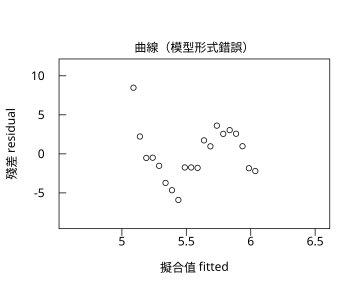
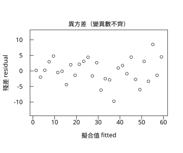
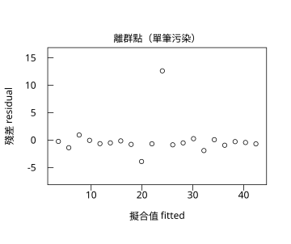
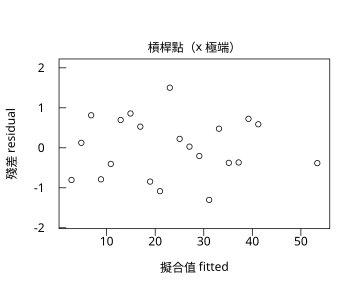
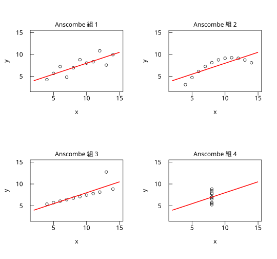

# 9.3 模型診斷

## 本節目標

- 知道「殘差圖」在看什麼，以及為什麼要畫它
- 辨認殘差圖上的四種典型病徵：曲率、異方差、離群點、槓桿點
- 用程式產生四種有問題的資料，並各畫一張殘差圖
- 理解 Anscombe 四重奏的教訓：**數字一樣不等於資料一樣**
- 知道模型診斷是「看圖」，不是「看 p 值」

---

## 問題場景：R² 很高，模型卻是錯的

上一節用 `women` 資料得到 $`R^2 = 0.991`$ ，漂亮得不像話。可是第 1 章提過：**有時候資料的關係根本不是直線**。這時 OLS 會怎麼做？

它會很努力地找一條「平均起來最不錯」的直線，然後把系統性的誤差全部塞進殘差裡。**係數看起來還是很顯著， $`R^2`$ 也不會太差，但模型其實在描述一個錯誤的世界觀。**

更麻煩的是：迴歸的標準誤、t 檢定、p 值、信賴區間，全都建立在「殘差是隨機的、常態的」這個假設上。假設一破，後面的推論就沒有意義。

所以在報告任何迴歸結果之前，標準流程是：

1. 擬合模型；
2. **畫殘差圖**（殘差 vs 擬合值）；
3. 檢查有沒有病徵；
4. 有的話，回到第 1 步（改模型形式、轉換變數、處理離群值…），或改用別的方法。

### 歷史：從「Anscombe 的惡作劇」到回歸診斷

- **1973 年**，統計學家 **Francis Anscombe**（與 Graham Anscombe 一家）發表了一篇短短的論文，裡面放了三組精心設計的資料（加上第四組更惡劣的）。三組資料的**均值、標準差、相關係數、迴歸係數、 $`R^2`$ 幾乎完全相同**，但畫出來一個是**直線加雜訊**、一個是**曲線**、一個是**有個點垂直掛在那裡**、一個是**一點水平線加一個槓桿點**。

  Anscombe 的目的不是嘲弄統計學家，而是示範一個真實的危險：**摘要數字會系統性地隱藏資料的形狀**。他甚至特別指出，這些資料用「線性回歸 + 常態誤差的假設」做分析，會得到完全相同的結論，而其中至少兩組的結論是錯的。

- 1970 到 1980 年代，**Cook's distance**（R. D. Cook, 1979）、**leverage（槓桿值）**、**影響圖（influence plot）** 等工具被發展出來，把「哪一筆資料在左右這個模型」變成可以計算的東西。**1983 年，Anscombe 與 statistical graphics 的推廣者（例如 Cleveland 的「迴歸診斷」工作）讓「先畫圖再相信數字」成為統計實務的標準流程。**

今天我們用的殘差圖，就是這段歷史的產物。

---

## 殘差圖在看什麼

殘差 $`e_i = y_i - \hat{y}_i`$ 是「模型沒能解釋的部分」。把它畫成「殘差 vs 擬合值」（或 vs 預測變數），就是在問：

> 模型的錯誤有沒有結構？

一個好的模型，殘差應該是**隨機地**散布在 0 的上下（理想上還要大致常態、等變異）。任何**可辨識的形狀**都代表模型漏掉了東西。

### 四種典型病徵

| 病徵 | 殘差圖上看什麼 | 真正的問題 | 常見的處理 |
| --- | --- | --- | --- |
| **曲率** | 殘差呈 U 形或倒 U 形 | 模型形式錯了（真實關係是非線性的） | 改用二次式、對數式、或加入其他變數 |
| **異方差** | 殘差呈喇叭狀（某段放大、某段縮小） | 誤差不齊次 → 標準誤與 p 值不可信 | 對變數取對數、加權最小平方法、或用異方差的稳健標準誤 |
| **離群點** | 有一兩個點孤零零地遠離 0 | 資料可能量測錯誤，或模型不適用於該點 | 查證資料；必要時刪除並說明 |
| **槓桿點** | 點在 $`x`$ 的極端處，殘差可能不大 | 少數資料點決定了整條直線 | 報告含與不含該點的結果、說明其影響 |

**槓桿（leverage）** 這個概念值得說清楚：一筆資料對擬合線的影響力，大致由「它的 $`x`$ 離平均有多遠」決定。 $`h_{ii} = \frac{1}{n} + \frac{(x_i - \bar{x})^2}{S_{xx}}`$ 是第 $`i`$ 筆資料的**槓桿值**： $`h_{ii}`$ 越大，這筆資料對係數的影響越大。 $`h_{ii}`$ 的平均值是 $`p/n`$ （ $`p`$ 是參數個數），所以當 $`h_{ii} > 2p/n`$ 時通常就要特別留意。

---

## 動手：四種問題資料

我們用 `r.set_seed(42)` 產生可重現的資料（`rstatistics` 的亂數與 R 的 `set.seed` 位元等價），四種情況各做一次擬合、各畫一張殘差圖。

```python
import math
import rstatistics as r

g = r.set_seed(42)

# ---------- 四種有問題的資料 ----------
# (1) 曲線：真實關係是二次的，卻用直線去 fit
x1 = [float(i) for i in range(1, 21)]
y1 = [0.5 * xi + 6.0 * math.sin(xi / 3.0) + g.rnorm(1)[0] for xi in x1]

# (2) 異方差：變異數隨 x 增大
x2 = [float(i) for i in range(1, 31)]
y2 = [2.0 * xi + g.rnorm(1)[0] * math.sqrt(xi) for xi in x2]

# (3) 離群點：只有一筆資料被污染
x3 = [float(i) for i in range(1, 21)]
y3 = [1.0 + 2.0 * xi + g.rnorm(1)[0] for xi in x3]
y3[10] = y3[10] + 14.0

# (4) 槓桿點：x 遠離其他資料，y 卻剛好落在直線上
x4 = [float(i) for i in range(1, 21)]
y4 = [1.0 + 2.0 * xi + g.rnorm(1)[0] for xi in x4]
x4.append(26.0)
y4.append(1.0 + 2.0 * 26.0)

cases = [
    ("曲線（模型形式錯誤）", x1, y1, "09.3-a-curvature.svg"),
    ("異方差（變異數不齊）", x2, y2, "09.3-b-heteroscedastic.svg"),
    ("離群點（單筆污染）", x3, y3, "09.3-c-outlier.svg"),
    ("槓桿點（x 極端）", x4, y4, "09.3-d-leverage.svg"),
]

for name, xx, yy, fn in cases:
    m = r.lm(yy, [xx], names=["x"])
    res = [a - b for a, b in zip(yy, m.fitted_values)]
    fitted = m.fitted_values
    lo = min(res + [0.0])
    hi = max(res + [0.0])
    pad = 0.2 * (hi - lo)
    gr = r.Graphics(width=5.0, height=4.2)
    gr.plot(fitted, res, main=name, xlab="擬合值 fitted", ylab="殘差 residual",
            xlim=[min(fitted) - 0.5, max(fitted) + 0.5], ylim=[lo - pad, hi + pad],
            col="black")
    gr.abline(h=0.0, col="red", lwd=1.5)
    gr.save(fn)
    print("%-22s 殘差和 = %+.4f, 殘差平方和 = %.4f, s = %.4f" %
          (name, sum(res), sum(e * e for e in res), (sum(e * e for e in res) / (len(xx) - 2)) ** 0.5))
```

輸出：

```
曲線（模型形式錯誤）             殘差和 = +0.0000, 殘差平方和 = 207.9470, s = 3.3989
異方差（變異數不齊）             殘差和 = +0.0000, 殘差平方和 = 435.8373, s = 3.9453
離群點（單筆污染）              殘差和 = -0.0000, 殘差平方和 = 185.7007, s = 3.2120
槓桿點（x 極端）              殘差和 = +0.0000, 殘差平方和 = 11.0720, s = 0.7634
```

圖：殘差圖（一）：曲率——模型形式錯誤、殘差圖（二）：異方差、殘差圖（三）：離群點、殘差圖（四）：槓桿點、Anscombe 1973 四重奏：四組幾乎相同的係數。






**注意第一個數字：殘差和永遠是 0**（誤差在小數點後 4 位以內）。這是 9.1 推導過的正規方程第一條的必然結果——**OLS 直線一定穿過資料的平均**。所以「殘差和為 0」不是模型對的證據，而是模型「至少在平均上」對齊的證據。

接著看四張圖（`img/09.3-a-curvature.svg` ~ `img/09.3-d-leverage.svg`）：

- **曲線**：殘差呈明顯的 **U 形**——左邊殘差為正（模型低估）、中間為負、右邊又為正。這是「真實關係不是直線」的標準指紋。
- **異方差**：殘差的**振幅隨擬合值增加而放大**（左邊擠在 0 附近，右邊散開）。這代表不同 $`x`$ 的資料點有不同的噪音大小。
- **離群點**：殘差圖上有一個點孤零零地跳到很遠的地方（是第 11 筆、 $`x = 11`$ 的那個觀測，殘差高達 12.63），其餘都很規矩。
- **槓桿點**：殘差圖看起來**幾乎沒問題**（殘差都很小），但請注意橫軸——**最右邊那個點的擬合值遠離其他點**。它自己只留下 -0.38 的小殘差，卻因為 $`x = 26`$ 而把 $`S_{xx}`$ 撐大，讓斜率的標準誤從 0.0301 降到 0.0255——**反而讓我們對這條線更過度自信**。這就是槓桿點最危險的地方：**光看殘差圖會漏掉它**，必須同時看 $`x`$ 的分布（或直接算槓桿值）。

> 這個例子裡，第 (4) 種情況的殘差平方和只有 11.07、 $`s = 0.76`$ 、 $`R^2 = 0.997`$ ，看起來是「四種情況中最好的模型」。但把它和第 (3) 種一起比較會更清楚：
>
> - **離群點的影響**：刪掉那個 $`x = 11`$ 的觀測後，斜率幾乎不變（2.0445 → 2.0345），但**標準誤從 0.1246 掉到 0.0395**、 $`R^2`$ 從 0.9374 升到 0.9936。也就是說離群值主要是透過「把標準誤與 $`R^2`$ 弄壞」來傷害模型，而不是透過斜率。
> - **槓桿點的影響**：刪掉那個 $`x = 26`$ 的觀測後，斜率從 2.0249 變成 2.0338（幾乎不變），但標準誤從 0.0255 回到 0.0301。**那一點讓我們「以為」估得更準**，而且讓擬合線看起來能延伸到資料根本沒有支持的範圍。

---

## Anscombe 四重奏：數字一樣，資料完全不同

Anscombe 的四組資料（1973）如下，每組 11 筆：

```python
AX = [
    [10.00, 8.00, 13.00, 9.00, 11.00, 14.00, 6.00, 4.00, 12.00, 7.00, 5.00],
    [10.00, 8.00, 13.00, 9.00, 11.00, 14.00, 6.00, 4.00, 12.00, 7.00, 5.00],
    [10.00, 8.00, 13.00, 9.00, 11.00, 14.00, 6.00, 4.00, 12.00, 7.00, 5.00],
    [8.00, 8.00, 8.00, 8.00, 8.00, 8.00, 8.00, 19.00, 8.00, 8.00, 8.00],
]
AY = [
    [8.04, 6.95, 7.58, 8.81, 8.33, 9.96, 7.24, 4.26, 10.84, 4.82, 5.68],
    [9.14, 8.14, 8.74, 8.77, 9.26, 8.10, 6.13, 3.10, 9.13, 7.26, 4.74],
    [7.46, 6.77, 12.74, 7.11, 7.81, 8.84, 6.08, 5.39, 8.15, 6.42, 5.73],
    [6.58, 5.76, 7.71, 8.84, 8.47, 7.04, 5.25, 12.50, 5.56, 7.91, 6.89],
]

print("Anscombe 四重奏：四組資料的 OLS 摘要")
print("組別   截距      斜率       R^2       調整 R^2   s")
for i in range(4):
    m = r.lm(AY[i], [AX[i]], names=["x"])
    sm = m.summary()
    print("  %d   %7.3f  %7.3f   %7.4f   %7.4f   %6.3f" %
          (i + 1, sm.estimates[0], sm.estimates[1], sm.r_squared, sm.adj_r_squared, sm.sigma))

gr = r.Graphics(width=7.5, height=7.0, mfrow=[2, 2])
for i in range(4):
    m = r.lm(AY[i], [AX[i]], names=["x"])
    b0 = m.coefficients[0]
    b1 = m.coefficients[1]
    gr.plot(AX[i], AY[i], main="Anscombe 組 %d" % (i + 1), xlab="x", ylab="y",
            col="black", xlim=[2.0, 15.0], ylim=[2.0, 15.0])
    xs = [2.0 + k * 13.0 / 40.0 for k in range(41)]
    gr.lines(xs, [b0 + b1 * xv for xv in xs], col="red", lwd=2.0)
    if i < 3:
        gr.next_panel()
gr.save("img/09.3-anscombe.svg")
```

輸出：

```
Anscombe 四重奏：四組資料的 OLS 摘要
組別   截距      斜率       R^2       調整 R^2   s
  1     3.000    0.500    0.6665    0.6295    1.237
  2     3.001    0.500    0.6662    0.6292    1.237
  3     3.002    0.500    0.6663    0.6292    1.236
  4     3.002    0.500    0.6667    0.6297    1.236
```

四組的截距都是 3.00、斜率都是 0.50、 $`R^2`$ 都是 0.666、 $`s`$ 都是 1.24。**如果只看這張表，四組資料完全無法區分。**

但圖（`img/09.3-anscombe.svg`）一看就明白：

- **組 1**：真正的直線加雜訊，模型正確。
- **組 2**：明顯的曲線（拋物線），直線模型是錯的。
- **組 3**：大致是直線，但**有一個點垂直掛在 (8, 12.74)**，那個點的殘差高達 3.24（遠超過其他點的 1.9）。
- **組 4**：除了 (19, 12.50) 之外**所有的 $`x`$ 都是 8**，是一條水平線加一個槓桿點；那個點的 $`x - \bar{x} = 8.36`$ 遠比別的點大，所以**斜率 0.5 幾乎完全由這一個點決定**。

Anscombe 的重點不是「統計學家很笨」，而是：**摘要統計量（係數、 $`R^2`$ 、相關係數）只壓縮了資料的一個面向**。要真正了解資料，**必須看圖**。

---

## 與 R 對照

```r
# Anscombe 四重奏（1973）：R 對照
data(anscombe)

cat("=== 四組資料的 OLS 摘要 ===\n")
for (i in 1:4) {
  x <- anscombe[[paste0("x", i)]]
  y <- anscombe[[paste0("y", i)]]
  fit <- lm(y ~ x)
  sm <- summary(fit)
  cat(sprintf("組 %d: 截距 = %.3f, 斜率 = %.3f, R^2 = %.4f, 調整 R^2 = %.4f, s = %.3f\n",
              i, coef(fit)[1], coef(fit)[2], sm$r.squared, sm$adj.r.squared, sm$sigma))
}

cat("\n=== 組 1 的 summary(lm) 完整輸出 ===\n")
print(summary(lm(y1 ~ x1, data = anscombe)))

cat("\n=== 組 2 的 summary(lm) 完整輸出 ===\n")
print(summary(lm(y2 ~ x2, data = anscombe)))

cat("\n=== 組 3：線性相關 r 幾乎相同 ===\n")
for (i in 1:4) {
  cat(sprintf("組 %d: cor = %.4f\n", i, cor(anscombe[[paste0("x", i)]], anscombe[[paste0("y", i)]])))
}

cat("\n=== 殘差平方和與最大 |殘差| ===\n")
for (i in 1:4) {
  fit <- lm(anscombe[[paste0("y", i)]] ~ anscombe[[paste0("x", i)]])
  r <- residuals(fit)
  cat(sprintf("組 %d: RSS = %.4f, max|resid| = %.4f\n", i, sum(r^2), max(abs(r))))
}
```

輸出：

```
=== 四組資料的 OLS 摘要 ===
組 1: 截距 = 3.000, 斜率 = 0.500, R^2 = 0.6665, 調整 R^2 = 0.6295, s = 1.237
組 2: 截距 = 3.001, 斜率 = 0.500, R^2 = 0.6662, 調整 R^2 = 0.6292, s = 1.237
組 3: 截距 = 3.002, 斜率 = 0.500, R^2 = 0.6663, 調整 R^2 = 0.6292, s = 1.236
組 4: 截距 = 3.002, 斜率 = 0.500, R^2 = 0.6667, 調整 R^2 = 0.6297, s = 1.236

=== 組 1 的 summary(lm) 完整輸出 ===

Call:
lm(formula = y1 ~ x1, data = anscombe)

Residuals:
     Min       1Q   Median       3Q      Max 
-1.92127 -0.45577 -0.04136  0.70941  1.83882 

Coefficients:
            Estimate Std. Error t value Pr(>|t|)   
(Intercept)   3.0001     1.1247   2.667  0.02573 * 
x1            0.5001     0.1179   4.241  0.00217 **
---
Signif. codes:  0 ‘***’ 0.001 ‘**’ 0.01 ‘*’ 0.05 ‘.’ 0.1 ‘ ’ 1

Residual standard error: 1.237 on 9 degrees of freedom
Multiple R-squared:  0.6665,	Adjusted R-squared:  0.6295 
F-statistic: 17.99 on 1 and 9 DF,  p-value: 0.00217


=== 組 2 的 summary(lm) 完整輸出 ===

Call:
lm(formula = y2 ~ x2, data = anscombe)

Residuals:
    Min      1Q  Median      3Q     Max 
-1.9009 -0.7609  0.1291  0.9491  1.2691 

Coefficients:
            Estimate Std. Error t value Pr(>|t|)   
(Intercept)    3.001      1.125   2.667  0.02576 * 
x2             0.500      0.118   4.239  0.00218 **
---
Signif. codes:  0 ‘***’ 0.001 ‘**’ 0.01 ‘*’ 0.05 ‘.’ 0.1 ‘ ’ 1

Residual standard error: 1.237 on 9 degrees of freedom
Multiple R-squared:  0.6662,	Adjusted R-squared:  0.6292 
F-statistic: 17.97 on 1 and 9 DF,  p-value: 0.002179


=== 組 3：線性相關 r 幾乎相同 ===
組 1: cor = 0.8164
組 2: cor = 0.8162
組 3: cor = 0.8163
組 4: cor = 0.8165

=== 殘差平方和與最大 |殘差| ===
組 1: RSS = 13.7627, max|resid| = 1.9213
組 2: RSS = 13.7763, max|resid| = 1.9009
組 3: RSS = 13.7562, max|resid| = 3.2411
組 4: RSS = 13.7425, max|resid| = 1.8390
```

最後兩段是關鍵證據：**四組的相關係數都一樣（0.816）**、**四組的 RSS 都一樣（13.75 左右）**，但組 3 的最大殘差是 3.24（遠大於其他組的 1.9）。也就是說，**在「誤差平方和」這個尺度上，組 3 與組 1 看起來同樣好；但組 3 的問題藏在「只有一個點很離譜」這個形狀裡**，只有把殘差畫出來才看得到。

---

## 小結

- **殘差圖是迴歸的必要步驟**，不是裝飾。它檢查的是「誤差有沒有結構」。
- 四種典型病徵：**曲率**（模型形式錯）、**異方差**（標準誤不可信）、**離群點**（資料或模型的問題）、**槓桿點**（少數點決定模型，且殘差圖可能看不出來）。
- 殘差和恆為 0 是 OLS 的必然結果，不能當成模型正確的證據。
- **Anscombe 四重奏**：四組資料的係數、 $`R^2`$ 、相關係數幾乎相同，但資料的形狀天差地別。**數字摘要會隱藏形狀，所以一定要看圖。**
- 診斷之後的處置才是重點：改模型形式、對數轉換、加權、處理離群值、或改用非參數方法（第 8 章）。

---

## 練習

1. 對 Anscombe 的第 2 組（曲線那組）加上二次項：用 `r.lm` 擬合 $`y`$ 對 $`[x, x^2]`$ （`x^2` 記得用 Python 的 `**`），比較 $`R^2`$ 與 $`s`$ 有沒有改善。再畫殘差圖。
2. 把第 (4) 種情況（槓桿點）的 `x4`/`y4` 中那個 $`x = 26`$ 的點刪掉重跑，比較斜率變化多少。這個變化量就是「那個點的影響力」。
3. 對第 (3) 種情況（離群點），分別算「有離群點」與「刪掉離群點」的 $`R^2`$ 與斜率。為什麼離群點對斜率的影響遠小於對 $`R^2`$ 的影響？
4. 自己設計一組「異方差」資料（例如 $`y`$ 的變異數隨 $`x`$ 平方增大），並分別用原始的 $`y`$ 與對數轉換後的 $`\log(y)`$ 擬合，比較殘差圖。提示：先取 $`math.log`$ 再擬合。
5. 想一想：如果殘差圖完全看不出問題，是不是就可以放心相信 p 值了？請列出迴歸假設中**殘差圖看不出來**的那幾條（例如樣本之間的獨立性）。
