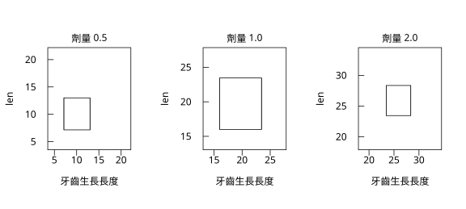

# 9.4 變異數分析

## 本節目標

- 理解 ANOVA 的核心想法：**把總變異拆成「組間」與「組內」兩塊**
- 會算平方和、自由度、平均平方與 F 統計量
- 逐行讀懂 `r.aov()` 與 ANOVA 表
- 說清楚 ANOVA（常態、變異數齊次）與 Kruskal-Wallis（秩）兩條路線的差別
- 知道 ANOVA 顯著之後還要做**事後比較**（Tukey）

---

## 問題場景：兩組比較還不夠

第 7 章的 t 檢定可以回答「兩組的平均數有沒有差別」。但實務上常常是**三組以上**：三種肥料、兩個班級、三台機器。

最直接的想法是「每一對都做一次 t 檢定」。三組就有 3 對，10 組就有 45 對。若每次都用 $`\alpha = 0.05`$ ，**整體的第一類錯誤率會膨脹到遠超過 5%**——這就是統計學家常說的「multiple comparisons problem」。而且每個 t 檢定只用到兩組的資料，**浪費了其他組別提供的資訊**。

ANOVA（analysis of variance，變異數分析）提供了一個更好的做法：

> **不要問「哪兩組不同」，先問「這幾組的整體平均數，有沒有可能都一樣」。**

如果整體檢定不顯著，就不必再做兩兩比較；如果顯著，再做事後比較（post-hoc comparison）去找出到底哪幾組不同。

### 歷史：Fisher 與方差分析的誕生

- **1920 年代**，R. A. Fisher 在 Rothamsted 實驗站（英國洛桑斯特德實驗站）處理了一大批農業實驗資料：同一種小麥、不同的氮肥處理、不同的土壤……他面對的正是「好幾個處理組，要比較它們」的問題。
- Fisher 的洞見是：**與其直接比較平均數，不如比較變異**。他把總變異拆成「處理造成的」與「處理之間的隨機誤差」，得到 **F 統計量**。因為「只用平均數」的資訊量太少，「用變異的分解」才讓小樣本也能有足夠的檢定力。
- 1930 到 1940 年代，ANOVA 成為實驗設計（design of experiments）與生物統計的標準工具，George Box 與 Edwin Bisley 更把它推廣成工業實驗的骨幹。
- 1945 年，**S. S. Wilks** 提出多元變異數分析（MANOVA），處理多個反應變數；1950 年代，混合效果模型（mixed models）則把「組內重複量測」也納進來。

**為什麼 ANOVA 叫「變異數分析」卻在比較平均數？** 因為它的機制是分析變異的分解，最後仍然是以「平均數是否相同」為結論。

---

## 理論：把總變異拆成兩塊

### 平方和的分解

對 $`k`$ 組資料（各組 $`n_j`$ 筆，總筆數 $`n`$ ），全體平均數記為 $`\bar{y}_{\cdot}`$ ：

**總平方和**（所有資料的離散程度）：

$`\mathrm{SS}_{\text{total}} = \sum_{i=1}^{n} (y_i - \bar{y}_{\cdot})^2`$

**組間平方和**（各組平均數之間的差異）：

$`\mathrm{SS}_{\text{between}} = \sum_{j=1}^{k} n_j \left( \bar{y}_j - \bar{y}_{\cdot} \right)^2`$

**組內平方和**（各組內部的隨機變異）：

$`\mathrm{SS}_{\text{within}} = \sum_{j=1}^{k} \sum_{i \in j} (y_{ij} - \bar{y}_j)^2`$

關鍵的恆等式是

$`\mathrm{SS}_{\text{total}} = \mathrm{SS}_{\text{between}} + \mathrm{SS}_{\text{within}}`$

這個恆等式不是巧合：任何資料點的偏離都可以拆成「離開自己組的平均數」加上「自己組平均數離開總平均數」兩段，平方後加總起來就得到上式（交叉項因為總和為 0 而消失）。

### F 統計量

把兩個平方和各自除以自由度，就得到「平均平方（mean square）」：

$`\mathrm{MS}_{\text{between}} = \frac{\mathrm{SS}_{\text{between}}}{k-1}`$ ， $`\mathrm{MS}_{\text{within}} = \frac{\mathrm{SS}_{\text{within}}}{n-k}`$

F 統計量就是兩個平均平方的比值：

$`F = \frac{\mathrm{MS}_{\text{between}}}{\mathrm{MS}_{\text{within}}}`$

**直覺**：如果各組平均數真的都一樣（虛無假設成立），組間的差異只是隨機誤差產生的，那麼 $`\mathrm{MS}_{\text{between}}`$ 與 $`\mathrm{MS}_{\text{within}}`$ 都是同一個東西的估計，比值應該在 1 附近。如果組平均數真的有差異，組間平方和會系統性地偏大，F 就會遠大於 1。

在虛無假設下， $`F`$ 服從 **F 分配** $`F_{k-1, n-k}`$ ，p 值就是

$`p = P\left(F_{k-1, n-k} \ge F_{\text{obs}}\right)`$

（回想 5.4 節：F 分配是兩個卡方分配的比值，而卡方分配是常態的平方——這就是「變異的比較」能變成 F 分配的來源。）

### 兩個關鍵假設

1. **各組資料來自常態母體**（組內的殘差要常態）。
2. **各組變異數相同**（組內的離散程度要一樣）。

第 2 條常被忽略：**ANOVA 的 F 檢定對變異數不齊其實相當敏感**（樣本數越少越敏感），所以做 ANOVA 前通常要先看箱型圖或做 Levene 檢定。

---

## 動手：`r.aov()` 與 ANOVA 表

資料用 R 內建的 `ToothGrowth`（60 隻豚鼠的牙齒生長長度），依**劑量**（0.5、1、2）分成三組。

```python
import math
import rstatistics as r

D05 = [4.20, 11.50, 7.30, 5.80, 6.40, 10.00, 11.20, 11.20, 5.20, 7.00,
       15.20, 21.50, 17.60, 9.70, 14.50, 10.00, 8.20, 9.40, 16.50, 9.70]
D10 = [16.50, 16.50, 15.20, 17.30, 22.50, 17.30, 13.60, 14.50, 18.80, 15.50,
       19.70, 23.30, 23.60, 26.40, 20.00, 25.20, 25.80, 21.20, 14.50, 27.30]
D20 = [23.60, 18.50, 33.90, 25.50, 26.40, 32.50, 26.70, 21.50, 23.30, 29.50,
       25.50, 26.40, 22.40, 24.50, 24.80, 30.90, 26.40, 27.30, 29.40, 23.00]

y = D05 + D10 + D20
group = ["0.5"] * 20 + ["1.0"] * 20 + ["2.0"] * 20

# ---------- 手算單因子 ANOVA ----------
groups = {"0.5": D05, "1.0": D10, "2.0": D20}
grand = r.mean(y)
n = len(y)
k = 3
ssb = 0.0
ssw = 0.0
print("組別    n   平均數")
for name in ["0.5", "1.0", "2.0"]:
    xs = groups[name]
    mj = r.mean(xs)
    ssb += len(xs) * (mj - grand) ** 2
    ssw += sum((v - mj) ** 2 for v in xs)
    print("%-5s %3d   %7.3f" % (name, len(xs), mj))
print("總平均 = %.4f" % grand)
dfb = k - 1
dfw = n - k
msb = ssb / dfb
msw = ssw / dfw
F = msb / msw
p = r.pf(F, dfb, dfw, lower_tail=False)
print()
print("SS_between = %.4f (df = %d), MS_between = %.4f" % (ssb, dfb, msb))
print("SS_within  = %.4f (df = %d), MS_within  = %.4f" % (ssw, dfw, msw))
print("F = %.4f, p = %.6g" % (F, p))

# ---------- r.aov ----------
a = r.aov(y, group, formula="len ~ dose")
print()
print(a)
print()
print(a.summary())

# ---------- 與 Kruskal-Wallis 對照 ----------
print()
print(r.kruskal_test(y, group))

# ---------- 圖：三組的箱型圖 ----------
gr = r.Graphics(width=8.0, height=3.6, mfrow=[1, 3])
for name in ["0.5", "1.0", "2.0"]:
    gr.boxplot(groups[name], main="劑量 %s" % name, xlab="牙齒生長長度", ylab="len")
    if name != "2.0":
        gr.next_panel()
gr.save("img/09.4-groups.svg")
print()
print("已存 09.4-groups.svg")
```

輸出：

```
組別    n   平均數
0.5    20    10.605
1.0    20    19.735
2.0    20    26.100
總平均 = 18.8133

SS_between = 2426.4343 (df = 2), MS_between = 1213.2172
SS_within  = 1025.7750 (df = 57), MS_within  = 17.9961
F = 67.4157, p = 9.53273e-16

Call:
   aov(formula = len ~ dose)

Terms:
                    dose Residuals
Sum of Squares  2426.434  1025.775
Deg. of Freedom        2        57

Residual standard error: 4.242175
Estimated effects may be unbalanced

            Df Sum Sq Mean Sq F value   Pr(>F)
dose         2   2426    1213   67.42 9.53e-16
Residuals   57   1026      18                 


	Kruskal-Wallis rank sum test

data:  x and g
Kruskal-Wallis chi-squared = 40.669, df = 2, p-value = 1.475e-09


已存 09.4-groups.svg
```

圖：三組的資料分布。



### 逐行解讀

- `SS_between = 2426.43`（自由度 2）、`SS_within = 1025.78`（自由度 57）：**組間的變異是組內變異的 2.4 倍**，所以 F 值很大。
- `F = 67.42`、`p = 9.53e-16`：三組的平均數**極不可能**相同。
- `Residual standard error: 4.242175`：這是 $`\sqrt{\mathrm{MS}_{\text{within}}}`$ ，也就是「扣掉劑量的影響之後，牙齒生長長度還剩下約 4.2 單位的典型誤差」。
- `Estimated effects may be unbalanced`：這是 R 的例行提示，意思是「各組的樣本數不一定相等」（本例其實相等）。
- 箱型圖（`img/09.4-groups.svg`）顯示三組的位置明顯分開，而且組內的散布相當整齊——這是 ANOVA 假設大致成立的視覺證據。

**整體檢定顯著之後呢？** ANOVA 只告訴你「有差別」，**沒告訴你哪幾組之間有差別**。

---

## 事後比較：Tukey 的想法

如果要找出「哪幾組不同」，最常見的方法是 **Tukey 的 honestly significant difference（Tukey HSD）**：

1. 先用所有成對差異的最大值與平均差異比較，得到一個「檢定臨界值」；
2. 兩組平均數的差若超過這個臨界值，就判定為有差別；
3. 關鍵在於**同時控制整體的第一類錯誤率（family-wise error rate）**，而不是每一對各自控制。

Tukey HSD 與「先做 ANOVA 再做多個 t 檢定」的差別：後者會讓整體錯誤率膨脹，前者不會。Tukey 方法（更精確地說是 Tukey 的 studentized range 分配）保證在**所有成對比較中至少有一次錯判的機率不超過 $`\alpha`$ **。

> `rstatistics` 0.4.0 尚未提供 Tukey 的實作，所以下面這段是用 R 跑出來當參考；概念與 R 完全一致。

---

## 與 Kruskal-Wallis 對照：正態 vs 秩

第 8 章我們學過 **Kruskal-Wallis 檢定**：把資料換成名次再比較。它是 ANOVA 的**非參數對應物**，兩者的取捨是：

| | ANOVA（F 檢定） | Kruskal-Wallis |
| --- | --- | --- |
| 假設 | 組內常態、變異數齊次 | 只需要各組分布**形狀相同**（位置可以不同） |
| 使用的資訊 | 平均數 | 名次（中位數的推論） |
| 對離群值 | **敏感**（平均數會被拉走） | **不敏感**（名次不會） |
| 對偏態 | 樣本數少時可能失效 | 比較穩健 |
| 對變異數不同 | 敏感（可能 inflate F） | 也有影響 |

來看一個具體例子：三組都是 $`N(10, 1)`$ 的資料（真的沒有差別），但其中一組有一個值被改成 70。

```python
import rstatistics as r

g2 = r.set_seed(2024)
y2 = []
grp2 = []
for name in ["A", "B", "C"]:
    for _ in range(20):
        y2.append(g2.rnorm(1)[0] + 10.0)
        grp2.append(name)
y2[40] = 70.0        # C 組的一個離群值
print()
print("離群值的影響：")
print("  各組平均數: %.3f %.3f %.3f" % (r.mean(y2[0:20]), r.mean(y2[20:40]), r.mean(y2[40:60])))
print("  各組中位數: %.3f %.3f %.3f" % (r.median(y2[0:20]), r.median(y2[20:40]), r.median(y2[40:60])))
a2 = r.aov(y2, grp2, formula="y ~ g")
print()
print(a2.summary())
print()
print(r.kruskal_test(y2, grp2))
```

輸出：

```
離群值的影響：
各組平均數: 9.702 9.904 13.074
各組中位數: 9.882 9.886 10.063

            Df Sum Sq Mean Sq F value Pr(>F)
g            2    143   71.55   1.175  0.316
Residuals   57   3471   60.89               


	Kruskal-Wallis rank sum test

data:  x and g
Kruskal-Wallis chi-squared = 0.76426, df = 2, p-value = 0.6824
```

這段輸出把兩種思維的差異講得很清楚：

- **平均數被污染了**：C 組的平均數是 13.07，比另外兩組的 9.70、9.90 高出三成多——但那**完全是一個離群值造成的假象**。中位數則分別是 9.882、9.886、10.063，幾乎一模一樣。
- **ANOVA 的 F = 1.175、p = 0.316**：ANOVA 沒有被騙到宣稱「顯著」。原因是那個離群值同時把組內平方和也撐大了（`Residuals` 的 Sum Sq 從 1026 暴增到 3471），F 值反而被壓低。
- **Kruskal-Wallis 的 p = 0.6824**：完全不受離群值影響（名次只會挪動一位）。

**實務建議**：如果資料偏態、組內變異明顯不同、或有離群值，**用 Kruskal-Wallis**（第 8 章）通常比硬用 ANOVA 誠實。

---

## 與 R 對照

```r
# 一因子 ANOVA：R 對照（資料：ToothGrowth，依劑量 dose 分三組）
data(ToothGrowth)
tg <- ToothGrowth
tg$doseF <- factor(tg$dose)

cat("=== 各組摘要 ===\n")
print(aggregate(len ~ doseF, data = tg, function(v) c(n = length(v), mean = mean(v))))

cat("\n=== summary(aov(len ~ dose)) ===\n")
print(summary(aov(len ~ doseF, data = tg)))

cat("\n=== kruskal.test(len ~ dose) ===\n")
print(kruskal.test(len ~ doseF, data = tg))

cat("\n=== 事後比較 TukeyHSD ===\n")
print(TukeyHSD(aov(len ~ doseF, data = tg)))

cat("\n=== 離群值的影響：離群值會污染平均數，但名次不動 ===\n")
set.seed(2024)
y <- c(rnorm(20, 10), rnorm(20, 10), rnorm(20, 10))
grp <- rep(c("A", "B", "C"), each = 20)
y[41] <- 70
cat(sprintf("各組平均數: %.3f %.3f %.3f\n", mean(y[1:20]), mean(y[21:40]), mean(y[41:60])))
cat(sprintf("各組中位數: %.3f %.3f %.3f\n", median(y[1:20]), median(y[21:40]), median(y[41:60])))
cat("\n-- ANOVA --\n")
print(summary(aov(y ~ grp)))
cat("\n-- Kruskal-Wallis --\n")
print(kruskal.test(y ~ grp))
```

輸出：

```
=== 各組摘要 ===
  doseF  len.n len.mean
1   0.5 20.000   10.605
2     1 20.000   19.735
3     2 20.000   26.100

=== summary(aov(len ~ dose)) ===
            Df Sum Sq Mean Sq F value   Pr(>F)
doseF        2   2426    1213   67.42 9.53e-16 ***
Residuals   57   1026      18                 
---
Signif. codes:  0 ‘***’ 0.001 ‘**’ 0.01 ‘*’ 0.05 ‘.’ 0.1 ‘ ’ 1

=== kruskal.test(len ~ dose) ===

	Kruskal-Wallis rank sum test

data:  len by doseF
Kruskal-Wallis chi-squared = 40.669, df = 2, p-value = 1.475e-09


=== 事後比較 TukeyHSD ===
  Tukey multiple comparisons of means
    95% family-wise confidence level

Fit: aov(formula = len ~ doseF, data = tg)

$doseF
        diff       lwr       upr    p adj
1-0.5  9.130  5.901805 12.358195 0.00e+00
2-0.5 15.495 12.266805 18.723195 0.00e+00
2-1    6.365  3.136805  9.593195 4.25e-05


=== 離群值的影響：離群值會污染平均數，但名次不動 ===
各組平均數: 9.702 9.904 13.074
各組中位數: 9.882 9.886 10.063

-- ANOVA --
            Df Sum Sq Mean Sq F value Pr(>F)
grp          2    143   71.55   1.175  0.316
Residuals   57   3471   60.89               

-- Kruskal-Wallis --

	Kruskal-Wallis rank sum test

data:  y by grp
Kruskal-Wallis chi-squared = 0.76426, df = 2, p-value = 0.6824
```

**Tukey 的輸出怎麼讀？** 每一列是一對組的比較：`diff` 是平均數差、`lwr`/`upr` 是差值的 95% 區間、`p adj` 是**經過多重比較校正**的 p 值。

- `1-0.5` 的差是 9.13，區間 $[5.90, 12.36]$ 不含 0 → 劑量 1 與 0.5 有顯著差別。
- `2-1` 的差是 6.37，區間 $[3.14, 9.59]$ 不含 0 → 劑量 2 與 1 也有差別（p adj = 4.25e-05）。

三對都顯著，符合整體 ANOVA 的結論。

> 有個 R 的小陷阱值得記：**`ToothGrowth` 的 `dose` 欄位是數值**。直接寫 `aov(len ~ dose)`，R 會把它當成**連續變數**做迴歸（自由度變成 1），得到的 F 統計量跟一因子 ANOVA 完全不同（`F = 105.1` 而非 `67.42`）。要做一因子 ANOVA，必須先 `factor(dose)`。

---

## 小結

- ANOVA 的核心是**變異的分解**： $`\mathrm{SS}_{\text{total}} = \mathrm{SS}_{\text{between}} + \mathrm{SS}_{\text{within}}`$ 。
- F 統計量是兩個平均平方的比值；虛無假設下服從 $`F_{k-1, n-k}`$ 分配。
- 假設：組內常態、組間變異數齊次。資料偏態或變異數不同時，改用 Kruskal-Wallis。
- `r.aov(y, group)` 給出平方和與自由度；`a.summary()` 給出 ANOVA 表（F 值與 p 值）。
- ANOVA 顯著只代表「有差別」，**要找出哪幾組不同，還需要 Tukey 這種事後比較**。
- 離群值會污染平均數但不影響名次——這是 ANOVA 與 Kruskal-Wallis 表現差異最清楚的例子。

---

## 練習

1. 把 `ToothGrowth` 依 `supp`（OJ / VC）分成兩組，用 `r.aov` 做 ANOVA，再用 `r.t_test` 做兩組 t 檢定。兩者的 p 值應該很接近（ ANOVA 在兩組時等價於 t 檢定的平方），試著驗證 $`F = t^2`$ 。
2. 故意把某組的一個值改成 1000，重做 ANOVA，觀察 `Residuals` 的 Sum Sq 與 F 值怎麼變；再改用 Kruskal-Wallis，觀察 p 值怎麼變。
3. 三組的樣本數刻意設成 10、20、30（用 `r.sample` 隨機取），比較「平衡」與「不平衡」設計對 F 與 p 值的影響。
4. 用 9.3 的方式產生一組「組內變異數不同」的資料（例如第 2 組的變異數是第 1 組的 10 倍），做 ANOVA 並畫殘差圖，觀察 F 值會不會被高估。
5. 想一想：ANOVA 整體顯著之後，如果只對「看起來最不一樣」的兩組補做一次 t 檢定，這個做法有什麼問題？正確的作法應該是什麼？
