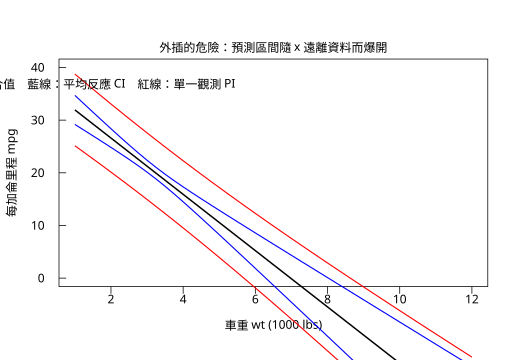

# 9.5 預測與預測區間

## 本節目標

- 分清楚**平均反應的信賴區間**與**單一觀測的預測區間**：公式、寬度、用途
- 會用 `r.predict()` 取得 `fit`、`lwr`、`upr` 三個欄位並解讀它們
- 親眼看到**外插**時區間如何爆開，學會不要隨便外推
- 會做多元迴歸（兩個以上預測變數），並對新資料做預測

---

## 問題場景：「這條線能不能拿來猜？」

第 9 章到這裡，我們已經有一條擬合線 $`\hat{y} = b_0 + b_1 x`$ 、一組係數與標準誤。現在實務問題來了：

> 有一台車重 3000 磅、馬力 150 的車，**它的每加侖里程大約是多少？** 我要的不只是「一個數字」，還有「我有多確定」。

這裡藏著一個很容易搞混的差別：

- **平均反應（mean response）**：在 $`x = x_0`$ 處，**那條線上的平均高度**是多少？這是一個「平均」，不確定性來自**係數本身的不確定性**。
- **單一觀測（a new observation）**：在 $`x = x_0`$ 處，**某一部具體的車**的里程是多少？除了係數的不確定性，還要加上**這部車本身的隨機誤差**。

前者用**信賴區間（confidence interval, CI）**，後者用**預測區間（prediction interval, PI）**。**預測區間一定比信賴區間寬**，而且通常寬得多——因為它多了一層「個體變異」。

這個區別不是學究式的：如果你要回答「平均而言 3000 磅的車有多少里程」，用 PI 是過度悲觀；如果你要回答「我手上這一部車可能是多少」，用 CI 是過度樂觀。**用錯區間會直接導致錯誤的決策。**

---

## 理論：兩個公式

以簡單迴歸 $`\hat{y} = b_0 + b_1 x`$ 為例，令

$`h(x_0) = \frac{1}{n} + \frac{(x_0 - \bar{x})^2}{S_{xx}}`$

這個 $`h`$ 稱為**槓桿值（leverage）**，它衡量「在 $`x_0`$ 處預測的不確定性，有多少來自『直線的位置不確定』」。注意：

- $`h`$ 在 $`x_0 = \bar{x}`$ 處最小（ $`1/n`$ ）；
- $`x_0`$ 離 $`\bar{x}`$ 越遠， $`h`$ 越大——**外插的不確定性會爆炸式增加**；
- $`n`$ 越大， $`h`$ 越小。

### 平均反應的信賴區間（CI）

$`\hat{y}(x_0) \pm t_{0.975,\,n-2} \cdot s \sqrt{h(x_0)}`$

### 單一觀測的預測區間（PI）

$`\hat{y}(x_0) \pm t_{0.975,\,n-2} \cdot s \sqrt{1 + h(x_0)}`$

**兩者只差一個 $`1`$ **，而那個 $`1`$ 就是「這個新觀測本身的隨機誤差 $`s`$ 」。這說明了一件事：

> **PI 的寬度有一個下限 $`\approx 2 t_{0.975} s`$ **，不管模型多準、樣本多大，單一觀測的不確定性都不會小於「個體本身的變異」。

多元迴歸時， $`h`$ 變成一個**二次型**： $`h(x_0) = \mathbf{x}_0' (\mathbf{X}'\mathbf{X})^{-1} \mathbf{x}_0`$ ，其中 $`\mathbf{x}_0 = (1, x_{01}, x_{02}, \dots)'`$ 。形式一樣，意義一樣：**離資料的「中心」越遠，區間越寬**。

---

## 動手：`r.predict()`

`r.predict(model, new_x, interval=..., level=...)` 的 `new_x` 與 `r.lm` 的 `x` 一樣，是**「一欄一預測變數」的 list**。回傳的物件印出來有三欄：`fit`（點預測）、`lwr`（下界）、`upr`（上界）。

資料用 R 內建的 `mtcars`（32 部車的 mpg、wt、hp）。

```python
import math
import rstatistics as r

WT = [2.620, 2.875, 2.320, 3.215, 3.440, 3.460, 3.570, 3.190, 3.150, 3.440,
      3.440, 4.070, 3.730, 3.780, 5.250, 5.424, 5.345, 2.200, 1.615, 1.835,
      2.465, 3.520, 3.435, 3.840, 3.845, 1.935, 2.140, 1.513, 3.170, 2.770,
      3.570, 2.780]
HP = [110.0, 110.0, 93.0, 110.0, 175.0, 105.0, 245.0, 62.0, 95.0, 123.0,
      123.0, 180.0, 180.0, 180.0, 205.0, 215.0, 230.0, 66.0, 52.0, 65.0,
      97.0, 150.0, 150.0, 245.0, 175.0, 66.0, 91.0, 113.0, 264.0, 175.0,
      335.0, 109.0]
MPG = [21.0, 21.0, 22.8, 21.4, 18.7, 18.1, 14.3, 24.4, 22.8, 19.2,
       17.8, 16.4, 17.3, 15.2, 10.4, 10.4, 14.7, 32.4, 30.4, 33.9,
       21.5, 15.5, 15.2, 13.3, 19.2, 27.3, 26.0, 30.4, 15.8, 19.7,
       15.0, 21.4]

# =============== 單元迴歸：CI vs PI ===============
m = r.lm(MPG, [WT], names=["wt"])
n = len(WT)
xb = r.mean(WT)
sxx = sum((xi - xb) ** 2 for xi in WT)
sd_res = (sum(e * e for e in m.residuals) / (n - 2)) ** 0.5
tcrit = r.qt(0.975, n - 2)

print("=== 資料範圍：wt 由 %.2f 到 %.2f，wt 平均 = %.4f ===" % (min(WT), max(WT), xb))
print("=== x0 = 3.0（資料範圍之內）===")
for x0 in [3.0]:
    h = 1.0 / n + (x0 - xb) ** 2 / sxx
    fit = m.coefficients[0] + m.coefficients[1] * x0
    hw_ci = tcrit * sd_res * math.sqrt(h)
    hw_pi = tcrit * sd_res * math.sqrt(1.0 + h)
    print("  h = %.6f, 擬合值 = %.4f" % (h, fit))
    print("  平均反應的 95%% CI : [%.4f, %.4f]  (半寬 %.4f)" % (fit - hw_ci, fit + hw_ci, hw_ci))
    print("  單一觀測的 95%% PI : [%.4f, %.4f]  (半寬 %.4f)" % (fit - hw_pi, fit + hw_pi, hw_pi))
print()
print("r.predict(..., interval='confidence')：")
print(r.predict(m, [[3.0]], interval="confidence"))
print("r.predict(..., interval='prediction')：")
print(r.predict(m, [[3.0]], interval="prediction"))

print()
print("=== 外插：x0 = 6.0, 8.0, 12.0（遠在資料範圍之外）===")
for x0 in [6.0, 8.0, 12.0]:
    h = 1.0 / n + (x0 - xb) ** 2 / sxx
    fit = m.coefficients[0] + m.coefficients[1] * x0
    hw_ci = tcrit * sd_res * math.sqrt(h)
    hw_pi = tcrit * sd_res * math.sqrt(1.0 + h)
    print("  x0 = %5.1f : 擬合值 %8.3f, CI 半寬 %8.3f, PI 半寬 %8.3f" % (x0, fit, hw_ci, hw_pi))
print()
print("r.predict(..., interval='confidence')：")
print(r.predict(m, [[6.0, 8.0, 12.0]], interval="confidence"))
print("r.predict(..., interval='prediction')：")
print(r.predict(m, [[6.0, 8.0, 12.0]], interval="prediction"))
```

輸出：

```
=== 資料範圍：wt 由 1.51 到 5.42，wt 平均 = 3.2172 ===
=== x0 = 3.0（資料範圍之內）===
  h = 0.032840, 擬合值 = 21.2517
  平均反應的 95% CI : [20.1244, 22.3790]  (半寬 1.1273)
  單一觀測的 95% PI : [14.9299, 27.5735]  (半寬 6.3218)

r.predict(..., interval='confidence')：
       fit      lwr      upr
1 21.25171 20.12444 22.37899

r.predict(..., interval='prediction')：
       fit      lwr      upr
1 21.25171 14.92987 27.57355
```

**怎麼讀這張表？**

- `fit = 21.25171`：車重 3000 磅的車，擬合的 mpg 是 21.25。
- CI 的 `lwr = 20.12`、`upr = 22.38`：**「平均而言」** 3000 磅的車，mpg 在 20.1 ~ 22.4 之間（95% 信心）。
- PI 的 `lwr = 14.93`、`upr = 27.57`：**「某一部具體的車」** 的 mpg 落在 14.9 ~ 27.6 之間。

PI 是 CI 的 **5.6 倍**寬（6.32 vs 1.13）。這就是「個體變異」的力量：車重一模一樣的兩部車，引擎狀況、變速箱、駕駛習慣都不同，mpg 當然差很多。

> 這裡的 $`h = 0.0328`$ 很小，因為 $`x_0 = 3.0`$ 幾乎就是 $`\bar{x} = 3.2172`$ 。所以 CI 之所以窄，主要不是因為模型好，而是因為**我們問的位置剛好在資料的正中央**。

### 外插：區間爆開

現在把 $`x_0`$ 推到資料範圍之外：

```
=== 外插：x0 = 6.0, 8.0, 12.0（遠在資料範圍之外）===
  x0 =   6.0 : 擬合值    5.218, CI 半寬    3.362, PI 半寬    7.071
  x0 =   8.0 : 擬合值   -5.471, CI 半寬    5.571, PI 半寬    8.350
  x0 =  12.0 : 擬合值  -26.849, CI 半寬   10.089, PI 半寬   11.852

r.predict(..., interval='confidence')：
         fit       lwr         upr
1   5.218297   1.85595   8.5806438
2  -5.470646 -11.04138   0.1000842
3 -26.848533 -36.93711 -16.7599577
r.predict(..., interval='prediction')：
         fit       lwr        upr
1   5.218297  -1.85279  12.289383
2  -5.470646 -13.82097   2.879678
3 -26.848533 -38.70072 -14.996350
```

這幾行數字值得慢慢看：

1. **CI 的半寬隨外插距離快速膨脹**：1.13 → 3.36 → 5.57 → 10.09。這正是 $`h(x_0) = 1/n + (x_0-\bar{x})^2/S_{xx}`$ 中那個平方項在作用。
2. **PI 的半寬膨脹得比較慢**（6.32 → 7.07 → 8.35 → 11.85）：因為 PI 裡面那個「1」（個體變異）已經占了一大部分，外插新增的不確定性只占小部分。
3. **最關鍵的是點預測本身**： $`x_0 = 12`$ 時擬合值是 **-26.85 mpg**！這在物理上不可能（一台車不可能每加侖跑 -27 英里）。**模型在資料範圍之外已經完全失效，但統計上它仍「很有自信」地給你一個數字**——這正是外插最危險的地方。

> **規則**：只在資料的範圍（更精確地說，在資料的**凸包**與密集區域）內做預測。若新資料超出範圍，先蒐集新資料重新擬合，不要靠外插。

圖（`img/09.5-extrapolation.svg`）把這件事畫出來：黑線是擬合值，藍線是 CI 的上下界，紅線是 PI 的上下界。可以看到**在資料密集的左半邊，藍線幾乎貼著黑線；越往右，藍線張開得越快，而紅線則一直是寬鬆的帶狀**。

把這張圖畫出來：

```python
# ---------- 外插的視覺化：區間隨 x 遠離資料而爆開 ----------
grid = [1.0 + i * 0.25 for i in range(45)]      # 1.0 ~ 12.0
ci = r.predict(m, [grid], interval="confidence")
pi = r.predict(m, [grid], interval="prediction")
g = r.Graphics(width=7.2, height=5.0)
g.plot(WT, MPG, main="外插的危險：預測區間隨 x 遠離資料而爆開",
       xlab="車重 wt (1000 lbs)", ylab="每加侖里程 mpg",
       xlim=[1.0, 12.0], ylim=[0.0, 40.0], col="gray70")
g.lines(grid, ci.fit, col="black", lwd=2.0)
g.lines(grid, ci.lwr, col="blue", lwd=1.5)
g.lines(grid, ci.upr, col="blue", lwd=1.5)
g.lines(grid, pi.lwr, col="red", lwd=1.5)
g.lines(grid, pi.upr, col="red", lwd=1.5)
g.text(1.4, 36.0, "黑線：擬合值　藍線：平均反應 CI　紅線：單一觀測 PI", col="black")
g.save("img/09.5-extrapolation.svg")
print()
print("已存 09.5-extrapolation.svg")
```

輸出：

```
已存 09.5-extrapolation.svg
```

圖：外插的危險：預測區間爆開。


---

## 多元迴歸：兩個預測變數

`r.lm` 的 `x` 參數是「一欄一個預測變數」，所以多元迴歸就是把 `x` 給成二維的 list。

```python
# =============== 多元迴歸 ===============
print()
print("=== 多元迴歸：mpg ~ wt + hp（mtcars, n = 32）===")
mm = r.lm(MPG, [WT, HP], names=["wt", "hp"])
print(mm.summary())

print("r.predict 新資料（wt = 3.0, hp = 150）：")
print(r.predict(mm, [[3.0], [150.0]], interval="confidence"))
print(r.predict(mm, [[3.0], [150.0]], interval="prediction"))

print("整批 32 台車的預測（只看前 5 筆）：")
pr = r.predict(mm, [WT, HP], interval="prediction")
for i in range(5):
    print("  第 %d 筆: fit = %7.3f, PI = [%7.3f, %7.3f]" % (i + 1, pr.fit[i], pr.lwr[i], pr.upr[i]))
```

輸出：

```
=== 多元迴歸：mpg ~ wt + hp（mtcars, n = 32）===

Call:
lm(formula = y ~ wt + hp)

Residuals:
   Min     1Q Median     3Q    Max 
-3.941 -1.600 -0.182  1.050  5.854 

Coefficients:
            Estimate Std. Error t value Pr(>|t|)    
(Intercept) 37.22727    1.59879  23.285 2.57e-20 ***
wt          -3.87783    0.63273  -6.129 1.12e-06 ***
hp          -0.03177    0.00903  -3.519 1.45e-03 ** 
---
Signif. codes:  0 ‘***’ 0.001 ‘**’ 0.01 ‘*’ 0.05 ‘.’ 0.1 ‘ ’ 1

Residual standard error: 2.593 on 29 degrees of freedom
Multiple R-squared:  0.8268,	Adjusted R-squared:  0.8148 
F-statistic: 69.21 on 2 and 29 DF,  p-value: 9.109e-12

r.predict 新資料（wt = 3.0, hp = 150）：
       fit      lwr      upr
1 20.82784 19.83556 21.82012
       fit      lwr      upr
1 20.82784 15.43169 26.22398

整批 32 台車的預測（只看前 5 筆）：
  第 1 筆: fit =  23.572, PI = [ 18.152,  28.993]
  第 2 筆: fit =  22.583, PI = [ 17.173,  27.994]
  第 3 筆: fit =  25.276, PI = [ 19.814,  30.737]
  第 4 筆: fit =  21.265, PI = [ 15.836,  26.694]
  第 5 筆: fit =  18.327, PI = [ 12.926,  23.728]
```

幾個重點：

1. ** $`x`$ 的結構**：`r.lm(MPG, [WT, HP], names=["wt", "hp"])` 中，`[WT, HP]` 是「兩欄」，`names` 給每欄一個名字；`r.predict(mm, [[3.0], [150.0]], ...)` 也是一樣的結構——**第一個 list 元素對應第一個預測變數**。
2. **解釋力提升**：單元迴歸的 $`R^2 = 0.7528`$ （見下面 R 對照），加入 `hp` 後變成 $`R^2 = 0.8268`$ 。殘差標準差也從 3.046 降到 2.593。
3. **係數的解讀要小心**： $`wt`$ 的係數是 -3.878， $`hp`$ 的係數是 -0.0318。**它們是「控制另一個變數之後」的邊際效果**——在 `hp` 固定的情況下，車重每多 1000 磅，mpg 少 3.88。注意這個解讀依賴於「模型形式正確」（例如沒有交互作用），這正是 9.3 診斷的用處。
4. **PI 依然比 CI 寬**：新資料（wt=3, hp=150）的 CI 是 [19.84, 21.82]，PI 是 [15.43, 26.22]。
5. **一次預測整批資料**：`r.predict(mm, [WT, HP], interval="prediction")` 會對 32 台車逐一預測，這在做殘差分析或產生預測表時很方便。

---

## 與 R 對照

```r
# 預測與預測區間：R 對照（資料：mtcars）
data(mtcars)

fit <- lm(mpg ~ wt, data = mtcars)
cat("=== 單元迴歸 mpg ~ wt ===\n")
print(summary(fit))

cat("\n=== x0 = 3：平均反應的 CI 與單一觀測的 PI ===\n")
print(predict(fit, newdata = data.frame(wt = 3), interval = "confidence"))
print(predict(fit, newdata = data.frame(wt = 3), interval = "prediction"))

cat("\n=== 外插：wt = 6, 8, 12 ===\n")
print(predict(fit, newdata = data.frame(wt = c(6, 8, 12)), interval = "confidence"))
print(predict(fit, newdata = data.frame(wt = c(6, 8, 12)), interval = "prediction"))

cat("\n=== 多元迴歸 mpg ~ wt + hp ===\n")
fit2 <- lm(mpg ~ wt + hp, data = mtcars)
print(summary(fit2))
cat("\n--- 新資料 wt = 3, hp = 150 ---\n")
print(predict(fit2, newdata = data.frame(wt = 3, hp = 150), interval = "confidence"))
print(predict(fit2, newdata = data.frame(wt = 3, hp = 150), interval = "prediction"))
```

輸出：

```
=== 單元迴歸 mpg ~ wt ===

Call:
lm(formula = mpg ~ wt, data = mtcars)

Residuals:
    Min      1Q  Median      3Q     Max 
-4.5432 -2.3647 -0.1252  1.4096  6.8727 

Coefficients:
            Estimate Std. Error t value Pr(>|t|)    
(Intercept)  37.2851     1.8776  19.858  < 2e-16 ***
wt           -5.3445     0.5591  -9.559 1.29e-10 ***
---
Signif. codes:  0 ‘***’ 0.001 ‘**’ 0.01 ‘*’ 0.05 ‘.’ 0.1 ‘ ’ 1

Residual standard error: 3.046 on 30 degrees of freedom
Multiple R-squared:  0.7528,	Adjusted R-squared:  0.7446 
F-statistic: 91.38 on 1 and 30 DF,  p-value: 1.294e-10


=== x0 = 3：平均反應的 CI 與單一觀測的 PI ===
       fit      lwr      upr
1 21.25171 20.12444 22.37899
       fit      lwr      upr
1 21.25171 14.92987 27.57355

=== 外插：wt = 6, 8, 12 ===
         fit       lwr         upr
1   5.218297   1.85595   8.5806438
2  -5.470646 -11.04138   0.1000842
3 -26.848533 -36.93711 -16.7599577
         fit       lwr        upr
1   5.218297  -1.85279  12.289383
2  -5.470646 -13.82097   2.879678
3 -26.848533 -38.70072 -14.996350

=== 多元迴歸 mpg ~ wt + hp ===

Call:
lm(formula = mpg ~ wt + hp, data = mtcars)

Residuals:
   Min     1Q Median     3Q    Max 
-3.941 -1.600 -0.182  1.050  5.854 

Coefficients:
            Estimate Std. Error t value Pr(>|t|)    
(Intercept) 37.22727    1.59879  23.285  < 2e-16 ***
wt          -3.87783    0.63273  -6.129 1.12e-06 ***
hp          -0.03177    0.00903  -3.519  0.00145 ** 
---
Signif. codes:  0 ‘***’ 0.001 ‘**’ 0.01 ‘*’ 0.05 ‘.’ 0.1 ‘ ’ 1

Residual standard error: 2.593 on 29 degrees of freedom
Multiple R-squared:  0.8268,	Adjusted R-squared:  0.8148 
F-statistic: 69.21 on 2 and 29 DF,  p-value: 9.109e-12


--- 新資料 wt = 3, hp = 150 ---
       fit      lwr      upr
1 20.82784 19.83556 21.82012
       fit      lwr      upr
1 20.82784 15.43169 26.22398
```

R 的 `predict()` 用的是 `newdata`（資料框），欄名要對應模型裡的變數名；`rstatistics` 則用「一欄一變數」的 list。**兩種介面風格不同，但計算完全一致**：所有數字都一模一樣。

順帶看單元迴歸與多元迴歸的差別：

| 模型 | 係數 | $`R^2`$ | 殘差標準差 |
| --- | --- | --- | --- |
| `mpg ~ wt` | -5.3445 | 0.7528 | 3.046 |
| `mpg ~ wt + hp` | wt: -3.8778, hp: -0.0318 | 0.8268 | 2.593 |

加入 `hp` 之後，`wt` 的係數從 -5.34 變成 -3.88——**這不是矛盾，而是「控制馬力之後的效果」**。這也提醒我們：多元迴歸的係數取決於**模型裡放了哪些變數**。

---

## 小結

- **CI 回答「平均反應在哪裡」，PI 回答「單一新觀測可能在哪裡」**；兩者只差一個「個體變異」項，所以 PI 一定比較寬。
- $`h(x_0) = 1/n + (x_0-\bar{x})^2/S_{xx}`$ 是關鍵： $`x_0`$ 越遠離資料中心，區間越寬。
- **外插的點預測會變成荒謬的數值（mpg = -26.8），但統計上不會警告你**——所以要自己設下「不外插」的規則。
- `r.predict(model, new_x, interval=...)` 的 `new_x` 結構與 `r.lm` 的 `x` 一致：**一欄一個預測變數**。
- 多元迴歸的係數是**條件（控制其他變數後）的效果**，解讀時要說明條件是什麼。
- 一份完整的迴歸報告至少要有：係數與標準誤、 $`R^2`$ 與殘差標準差、殘差圖（9.3）、以及預測與其不確定性。

---

## 練習

1. 用 `r.predict` 對 `wt` 從 1.5 到 5.5 取 41 個點算出 CI 與 PI，把三條線畫在同一張圖上（用 `g.lines`）。觀察區間在資料範圍內與範圍外的寬度變化，並說明哪一段的預測最可靠。
2. 把 `mpg ~ wt` 換成 `mpg ~ wt + hp`，用 `r.predict` 預測新資料 `(wt = 3, hp = 150)` 與 `(wt = 5, hp = 300)`。比較兩者的 PI 寬度，解釋為什麼第二個的區間大得多。
3. 找出 `mtcars` 中 `wt` 最大的那一部車（`Mazda RX4` 系列），用 `r.predict` 預測它的 mpg，並與資料中的真實值比較。
4. 用 9.2 的 `women` 資料算 `weight ~ height` 的 PI：身高 160 公分、180 公分各一組。哪一個的 PI 較寬？為什麼？（提示：看資料的平均身高。）
5. 想一想：如果我們想要「預測區間窄一點」，有哪些方法？（提示：更多資料、降低個體變異、縮小外推距離、把決定個體變異的因素放進模型成為預測變數。）
